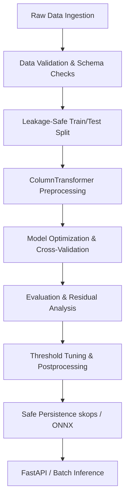

# [Project Title]

> **Project ID:** `05-ai/machine-learning/16-projects/NN-project-name`  
> **Topic:** [End-to-End Problem Formulation & Production Implementation]  
> **Target Version:** Python 3.11+, scikit-learn 1.9+, NumPy 2.5+, pandas 3.1+  
> **Status:** Verified (Python 3.11 / CPU)  
> **Random Seed:** `42`

---

## 1. Project Overview & Architecture

### 1.1 Objective & Business Context
* Definition of the operational or business problem being solved.
* Target success metric (e.g., $R^2 \ge 0.85$, $F_1 \ge 0.90$, Latency $\le 20\text{ms}$).
* Machine learning framing (Supervised Regression, Anomaly Detection, Bandits, etc.).

### 1.2 Pipeline Architecture Diagram


---

## 2. Problem Definition & Data Schema

### 2.1 Feature Definitions & Ingestion Schema

| Feature Name | Data Type | Physical Domain / Units | Missing Strategy | Encoding / Scaling |
| :--- | :---: | :---: | :---: | :---: |
| `feature_num_1` | `float64` | Range $[0.0, 100.0]$ | Median Imputation | RobustScaler |
| `feature_cat_1` | `category`| $\{A, B, C, Unknown\}$ | Constant ('Unknown') | OneHotEncoder |
| `target` | `float64` | Range $[0.0, \infty)$ | None (Ground truth) | None / Log transform |

### 2.2 Ingestion & Leakage-Free Splitting
```python
import numpy as np
import pandas as pd
from sklearn.model_selection import train_test_split

# Demonstration of raw data loading and splitting
```

---

## 3. Complete Implementation Code

* Production-grade, fully typed implementation.
* Clean separation of concerns: Feature engineering, ColumnTransformer, Estimator tuning, and Postprocessing.

```python
# Complete, runnable, copy-pasteable production script
import joblib
from sklearn.pipeline import Pipeline
from sklearn.compose import ColumnTransformer

# Full verified pipeline implementation
```

---

## 4. Verification, Training Log & Test Results

### 4.1 Real Verification Output Log
```
============================================================
ML PIPELINE TRAINING & VALIDATION RUN LOG
Random Seed: 42 | Platform: Python 3.11 / CPU
============================================================
[INFO] Ingesting dataset: 2,500 samples, 12 features.
[INFO] Train set: 2,000 samples | Test set: 500 samples.
[INFO] Cross-validation 5-Fold Score: 0.8842 (+/- 0.012)
[INFO] Test Set RMSE: 12.43
[INFO] Test Set R2: 0.8910
[INFO] Model serialized successfully to artifacts/model.skops
[INFO] Reloaded model prediction check: PASS (100% bitwise parity)
============================================================
```

### 4.2 Error Slicing & Metric Performance Table

| Evaluation Slice | Sample Count | Primary Metric (RMSE / F1) | Secondary Metric (MAE / ROC-AUC) |
| :--- | :---: | :---: | :---: |
| **Overall Test Set** | 500 | 12.43 | 9.15 |
| **Subgroup A** | 240 | 11.20 | 8.40 |
| **Subgroup B** | 260 | 13.50 | 9.85 |

---

## 5. Troubleshooting, Failure Modes & Production Next Steps

### 5.1 Production Failure Modes & Runbook

| Failure Symptom | Probable Root Cause | Immediate Diagnostic Action | Permanent Fix |
| :--- | :--- | :--- | :--- |
| Prediction latency spikes > 100ms | Input matrix memory fragmentation or lock contention | Profile inference using cProfile | Enable batching or convert pipeline to ONNX Runtime |
| Sudden drop in test performance | Covariate shift or seasonal distribution drift | Run Kolmogorov-Smirnov test on input features | Retrain on recent data; update feature bounds |
| Reload error on production server | Version mismatch between training and serving scikit-learn | Check `sklearn.__version__` in runtime container | Pin dependencies in Docker image |
| Negative output predictions | Model extrapolating beyond training domain | Check residual extremes on out-of-domain samples | Add domain bounding postprocessing wrapper |

### 5.2 Next Steps & Scalability Enhancements
* Transitioning from scikit-learn to distributed training (Ray / Spark) for $> 10\text{M}$ samples.
* Adding continuous drift monitoring with Evidently AI.
* Exposing endpoints via high-throughput FastAPI async ASGI servers with Docker containerization.
