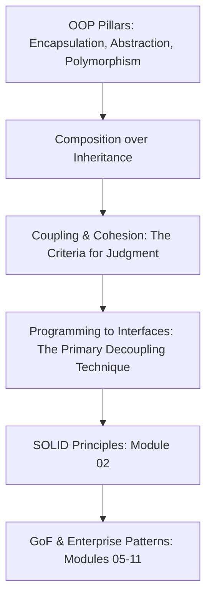

# Foundations: Overview

> **One-line summary:** SOLID principles and design patterns are not academic decorations added on top of OOP—they are systematic engineering solutions to the universal problems of tight coupling, fragile base classes, and escalating cost of change.

| Attribute | Specification |
|---|---|
| **Level** | Foundations / Core |
| **Prerequisites** | Familiarity with basic Object-Oriented programming (classes, methods, variables) |
| **Estimated Reading Time** | 20 minutes |
| **Status** | Complete |
| **Category** | Foundations |
| **Also Known As** | Object-Oriented Design Fundamentals, Core Principles of OOD |
| **Languages Tested** | Java 25 (LTS) / TypeScript 5.8 (Node 24 native) / Python 3.14 |

---

## Table of Contents
- [1 The Problem: The Cost of Change Curve](#1-the-problem-the-cost-of-change-curve)
- [2 Why Foundations Matter](#2-why-foundations-matter)
- [3 The Fundamental Relationship Matrix](#3-the-fundamental-relationship-matrix)
- [4 The Four Core Tensions in Software Design](#4-the-four-core-tensions-in-software-design)
- [5 How the Foundations Map to SOLID and Patterns](#5-how-the-foundations-map-to-solid-and-patterns)
- [6 Common Misconceptions](#6-common-misconceptions)
- [7 Summary / Cheat Sheet](#7-summary--cheat-sheet)
- [8 Further Reading](#8-further-reading)

---

## 1 The Problem: The Cost of Change Curve

In software engineering, software rarely breaks because the computer failed to execute an instruction. Software breaks because **business requirements change**, and the existing design requires modifications in dozens of unrelated files to support that change.

```text
Cost of Change
  ^
  |        /  Naive, tightly-coupled system (Exponential friction)
  |       /
  |      /
  |     /
  |    /
  |   /__________ Modular, decoupled system (Linear, bounded friction)
  |  /
  +--------------------------------------------------------> Time / Features
```

When a system lacks solid design foundations:
1. **Shotgun Surgery**: A minor change to a billing rate forces changes in 14 different files across the codebase.
2. **Fragility**: Fixing a bug in user authentication inexplicably breaks order PDF generation.
3. **Rigidity**: Developers refuse to refactor or add features because the blast radius is unpredictable.

---

## 2 Why Foundations Matter

If you study the SOLID principles or GoF patterns in isolation, they read like a list of abstract rules to memorize for an interview. But when you understand the foundational pressures:
- **Coupling** (how many other things this thing depends on),
- **Cohesion** (whether this thing does one clear job),
- **Encapsulation** (whether an object protects its business invariants), and
- **Composition** (how systems are assembled from swappable units),

SOLID principles stop being arbitrary rules and become obvious consequences of wanting low coupling and high cohesion.

---

## 3 The Fundamental Relationship Matrix



---

## 4 The Four Core Tensions in Software Design

Every software design decision balances four competing forces:
1. **Reusability vs Simplicity**: Highly generic code with 5 layers of abstraction is reusable, but costs more cognitive overhead to read and debug.
2. **Extensibility vs YAGNI**: Making a system open for unknown future extensions risks building speculative machinery that is never needed.
3. **Information Hiding vs Performance**: Passing complete value objects through clean interfaces creates minor memory allocation overhead compared to raw primitive pointer manipulation.
4. **Decoupling vs Understandability**: Decoupling via event emitters or dependency injection makes modules independent, but makes tracing sequential execution flow harder in an IDE.

---

## 5 How the Foundations Map to SOLID and Patterns

| Foundational Concept | How it Materializes in SOLID | How it Materializes in Design Patterns |
|---|---|---|
| **Encapsulation** | **Single Responsibility Principle (SRP)**: Encapsulate reasons to change together. | **State**, **Memento**: Encapsulate mutable transitions and snapshots away from clients. |
| **Polymorphism** | **Open/Closed Principle (OCP)**: Extend behavior via polymorphic subclasses without modifying caller. | **Strategy**, **Command**: Swap execution behavior dynamically via interfaces. |
| **Abstraction** | **Dependency Inversion Principle (DIP)**: Depend on high-level contracts, not concrete classes. | **Factory Method**, **Abstract Factory**: Decouple client code from concrete instantiation. |
| **Interfaces** | **Interface Segregation Principle (ISP)**: Split monolithic interfaces into client-specific contracts. | **Adapter**, **Facade**: Provide targeted, unified interfaces to subsystems. |
| **Composition** | **Liskov Substitution Principle (LSP)**: Replace brittle subclassing with composable delegates. | **Decorator**, **Composite**, **Bridge**: Build complex trees and behaviors by composing components. |

---

## 6 Common Misconceptions

- **Misconception 1: "OOP means creating deep class hierarchies."**  
  *Correction:* Inheritance is the strongest form of coupling in object-oriented programming. Real-world mastery of OOP is about avoiding inheritance and preferring composition and interfaces.
- **Misconception 2: "Encapsulation means generating private fields with public getters and setters."**  
  *Correction:* Exposing public getters and setters for every field provides zero encapsulation. True encapsulation guards **business invariants** and hides **decisions**, exposing behavior (`account.withdraw(50)`) rather than raw mutable state (`account.setBalance(account.getBalance() - 50)`).
- **Misconception 3: "Coupling should always be zero."**  
  *Correction:* A system with zero coupling does nothing because components cannot interact. The engineering objective is to eliminate **coupling to volatile concrete implementations** and replace it with **coupling to stable abstractions**.

---

## 7 Summary / Cheat Sheet

```
+-------------------------------------------------------------------------------+
| THE FOUNDATIONAL IMPERATIVE                                                   |
| 1. Encapsulate what varies: separate volatile logic from stable policy.      |
| 2. Program to interfaces, not implementations: make dependencies swappable.  |
| 3. Favor object composition over class inheritance: avoid fragile base trees. |
| 4. Maintain high cohesion and low coupling: minimize change blast radius.     |
+-------------------------------------------------------------------------------+
```

---

## 8 Further Reading

- Parnas, David L. (1972). *"On the Criteria To Be Used in Decomposing Systems into Modules"*, Communications of the ACM.
- Gamma, Helm, Johnson, Vlissides (1994). *"Design Patterns: Elements of Reusable Object-Oriented Software"*, Chapter 1.
- Martin, Robert C. (2002). *"Agile Software Development, Principles, Patterns, and Practices"*, Prentice Hall.

### In Your Language
| Language Track | Deep Dive Reference |
|---|---|
| Java | [Java OOP & Patterns Track](file:///e:/Learning/engineering-notes/01-languages/java/24-design-patterns/README.md) |
| TypeScript | [TypeScript OOP & Patterns Track](file:///e:/Learning/engineering-notes/01-languages/typescript/17-design-patterns/README.md) |
| Python | [Python OOP & Patterns Track](file:///e:/Learning/engineering-notes/01-languages/python/23-design-patterns/README.md) |

---
[← Module 01 Index](file:///e:/Learning/engineering-notes/08-solid-design-patterns/01-foundations/README.md) | [Next: 01 - OOP Pillars →](file:///e:/Learning/engineering-notes/08-solid-design-patterns/01-foundations/01-oop-pillars.md)
