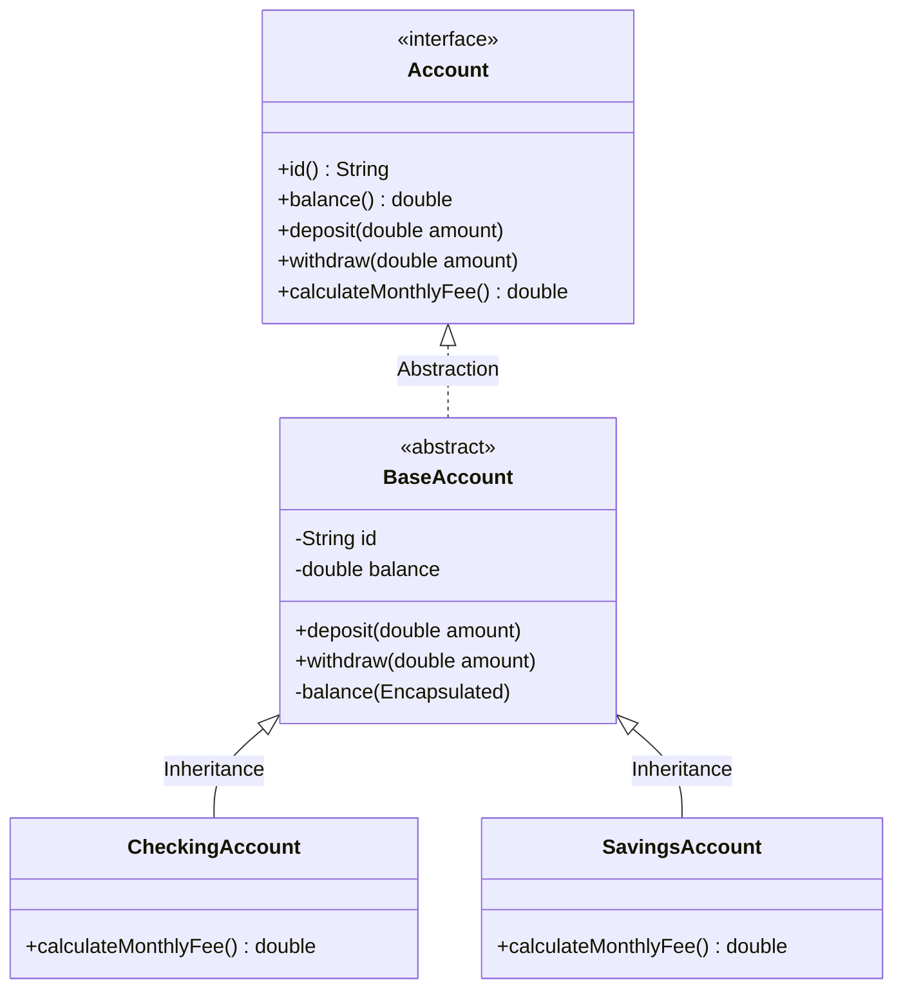
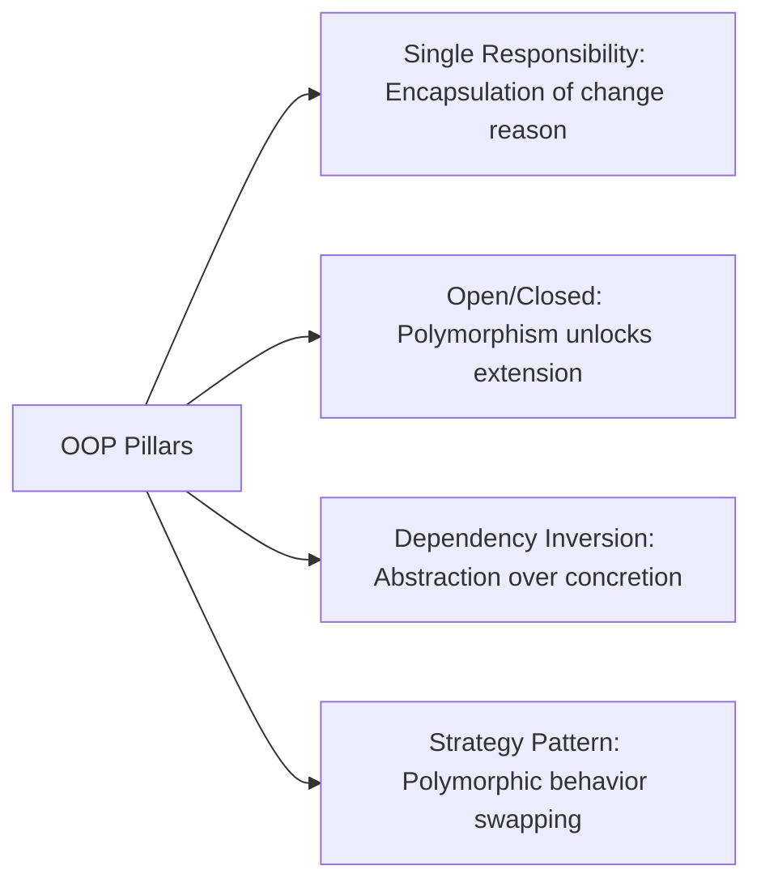

# Object-Oriented Programming (OOP) Pillars

> **One-line summary:** Encapsulation, Abstraction, Inheritance, and Polymorphism are not academic definitions to memorize—they are mechanical tools designed to prevent invalid state, decouple callers from internal mechanisms, and eliminate brittle conditional logic.

| Attribute | Specification |
|---|---|
| **Level** | Foundations / Core |
| **Prerequisites** | [00-overview.md](00-overview.md) |
| **Estimated Reading Time** | 30 minutes |
| **Status** | Complete |
| **Category** | Foundations |
| **Also Known As** | The Four Pillars of OOP |
| **Languages Tested** | Java 25 (LTS) / TypeScript 5.8 (Node 24 native) / Python 3.14 |

---

## Table of Contents
- [1 The Problem](#1-the-problem)
- [2 Why It Exists](#2-why-it-exists)
- [3 What It Is](#3-what-it-is)
- [4 The Problem Without It](#4-the-problem-without-it)
- [5 How It Solves It](#5-how-it-solves-it)
- [6 How It Works](#6-how-it-works)
- [7 Real-World Examples](#7-real-world-examples)
- [8 When to Use and When NOT to Use](#8-when-to-use-and-when-not-to-use)
- [9 Variations and Language Idioms](#9-variations-and-language-idioms)
- [10 Relationship to Other Principles and Patterns](#10-relationship-to-other-principles-and-patterns)
- [11 Common Mistakes and Anti-Patterns](#11-common-mistakes-and-anti-patterns)
- [12 Testing and Design Verification](#12-testing-and-design-verification)
- [13 Performance, Concurrency and Security Notes](#13-performance-concurrency-and-security-notes)
- [14 Interview Questions](#14-interview-questions)
- [15 Practice Exercises](#15-practice-exercises)
- [16 Summary / Cheat Sheet](#16-summary--cheat-sheet)
- [17 Further Reading](#17-further-reading)

---

## 1 The Problem

Imagine an engineering team building a core banking engine. Initially, developers model bank accounts using procedural data structures: a record with public fields `id`, `balance`, and `accountType`. 

Within four months, thirty different services (payment gateways, ATM dispensers, fee calculators, statement generators) read and mutate `balance` directly. Then, three catastrophic events occur:
1. An ATM service decrements `balance` by \$100 on an account holding only \$50 without verifying sufficiency, plunging the balance into negative territory and corrupting ledger audit logs.
2. The product team introduces a new account tier (`INVESTMENT_ACCOUNT`) with distinct daily withdrawal limits and compound interest rules. Adding this requires hunting down 42 separate `if/else` and `switch(accountType)` statements scattered across 18 microservices. Three switches are missed, leading to incorrect overdraft fees on launch day.
3. Every client service is directly coupled to whether balances are stored as primitive `double` or `BigDecimal`, making internal precision refactoring impossible without breaking every caller.

The team has hit the limits of unstructured data manipulation: state is unshielded, behaviors are fragmented across external callers, and adding a new variant requires modifying hundreds of lines of client code.

---

## 2 Why It Exists

In early procedural programming languages (such as C or Pascal), data structures (`struct`) and procedures (`functions`) were strictly separated. While simple, as software scaled beyond tens of thousands of lines, global state mutation and type-checking switches became the primary driver of regressions.

The four pillars emerged throughout the 1960s to 1980s (pioneered in Simula-67 and Smalltalk-80):
- **Encapsulation**: Resolves the force of **uncontrolled state mutation** by bundling state with the methods that operate on it and hiding internal representation.
- **Abstraction**: Resolves the force of **cognitive overload and tight coupling** by presenting a simple conceptual contract while concealing implementation complexity.
- **Inheritance**: Resolves the force of **redundant structural duplication** across related domains (though often misapplied).
- **Polymorphism**: Resolves the force of **brittle procedural branching** by allowing callers to issue a uniform command to differing types, which resolve their specific behavior at runtime.

---

## 3 What It Is

The Four Pillars form an integrated pipeline for managing software complexity:

```
[Encapsulation]  Protect invariants: "My state cannot be corrupted from the outside."
       ↓
 [Abstraction]   Expose intent: "Here is what I can do for you; don't worry about how."
       ↓
 [Inheritance]   Share structure: "This is common behavior among related concepts."
       ↓
 [Polymorphism]  Dynamic dispatch: "Ask me to act, and I will execute my own variant."
```



---

## 4 The Problem Without It

Here is the naive procedural implementation where callers mutate state directly and branching logic handles type differences:

```java
// File: NaiveAccountApp.java
class NaiveAccount {
    public String id;
    public double balance;
    public String type; // "CHECKING", "SAVINGS"
}

public class NaiveAccountApp {
    public static void main(String[] args) {
        NaiveAccount acc = new NaiveAccount();
        acc.id = "ACC-101";
        acc.balance = 50.0;
        acc.type = "CHECKING";

        // Bug 1: Violation of Encapsulation - caller corrupts internal state
        acc.balance -= 100.0; // Overdraft without balance verification
        System.out.println("Account balance corrupted: " + acc.balance);

        // Bug 2: Missing Polymorphism - brittle procedural switch
        double fee = 0;
        if (acc.type.equals("CHECKING")) {
            fee = 5.0;
        } else if (acc.type.equals("SAVINGS")) {
            fee = 0.0;
        }
        acc.balance -= fee;
        System.out.println("Balance after unverified fee: " + acc.balance);
    }
}
```

```text
Account balance corrupted: -50.0
Balance after unverified fee: -55.0
```

### The Change Request: Add `INVESTMENT_ACCOUNT`
When a product owner adds `INVESTMENT_ACCOUNT` with a \$15 fee and minimum balance of \$500:
1. Every developer must locate every `if (type.equals(...))` block in the entire codebase.
2. Nothing in the compiler warns developers that an `else if` was missed.
3. Callers can still bypass the \$500 minimum balance by writing `acc.balance = 10.0;`.

---

## 5 How It Solves It

Applying the four pillars transforms the banking system:
- **Encapsulation**: `balance` is private. Only `deposit()` and `withdraw()` can change it, enforcing non-negative and overdraft rules in one single location.
- **Abstraction**: Callers interact with the `Account` interface without caring whether balance is calculated in-memory, stored in Postgres, or cached in Redis.
- **Inheritance**: `BaseAccount` captures common identity and balance tracking, eliminating duplicate fields across account types.
- **Polymorphism**: `calculateMonthlyFee()` is dynamically dispatched. Callers invoke `acc.calculateMonthlyFee()` without knowing or checking whether it is Checking, Savings, or Investment.

### Java Implementation
```java
// File: AccountAppWith.java
interface Account {
    String id();
    double balance();
    void deposit(double amount);
    void withdraw(double amount);
    double calculateMonthlyFee();
}

abstract class BaseAccount implements Account {
    private final String id;
    private double balance;

    protected BaseAccount(String id, double initialBalance) {
        if (initialBalance < 0) throw new IllegalArgumentException("Initial balance cannot be negative");
        this.id = id;
        this.balance = initialBalance;
    }

    public String id() { return id; }
    public double balance() { return balance; }

    public void deposit(double amount) {
        if (amount <= 0) throw new IllegalArgumentException("Deposit amount must be positive");
        this.balance += amount;
    }

    public void withdraw(double amount) {
        if (amount <= 0) throw new IllegalArgumentException("Withdrawal amount must be positive");
        if (amount > this.balance) throw new IllegalStateException("Insufficient funds in account " + id);
        this.balance -= amount;
    }
}

class CheckingAccount extends BaseAccount {
    public CheckingAccount(String id, double initialBalance) {
        super(id, initialBalance);
    }
    public double calculateMonthlyFee() { return 5.0; }
}

class SavingsAccount extends BaseAccount {
    public SavingsAccount(String id, double initialBalance) {
        super(id, initialBalance);
    }
    public double calculateMonthlyFee() { return 0.0; }
}

public class AccountAppWith {
    public static void main(String[] args) {
        Account acc = new CheckingAccount("ACC-101", 50.0);
        acc.deposit(20.0);
        System.out.println("Deposit 20.0, current balance: " + acc.balance());
        
        try {
            acc.withdraw(100.0);
        } catch (IllegalStateException e) {
            System.out.println("Encapsulation preserved: " + e.getMessage());
        }

        // Polymorphic fee deduction
        double fee = acc.calculateMonthlyFee();
        acc.withdraw(fee);
        System.out.println("Polymorphic fee deducted (" + fee + "), final balance: " + acc.balance());
    }
}
```

### TypeScript Implementation
```typescript
// File: AccountAppWith.ts
interface Account {
    id: string;
    balance: number;
    deposit(amount: number): void;
    withdraw(amount: number): void;
    calculateMonthlyFee(): number;
}

abstract class BaseAccount implements Account {
    readonly id: string;
    private _balance: number;

    constructor(id: string, initialBalance: number) {
        if (initialBalance < 0) throw new Error("Initial balance cannot be negative");
        this.id = id;
        this._balance = initialBalance;
    }

    get balance(): number { return this._balance; }

    deposit(amount: number): void {
        if (amount <= 0) throw new Error("Deposit must be positive");
        this._balance += amount;
    }

    withdraw(amount: number): void {
        if (amount <= 0) throw new Error("Withdrawal must be positive");
        if (amount > this._balance) throw new Error(`Insufficient funds in account ${this.id}`);
        this._balance -= amount;
    }

    abstract calculateMonthlyFee(): number;
}

class CheckingAccount extends BaseAccount {
    calculateMonthlyFee(): number { return 5.0; }
}

class SavingsAccount extends BaseAccount {
    calculateMonthlyFee(): number { return 0.0; }
}

const acc: Account = new CheckingAccount("ACC-101", 50.0);
acc.deposit(20.0);
console.log(`Deposit 20.0, current balance: ${acc.balance}`);
try {
    acc.withdraw(100.0);
} catch (e: any) {
    console.log(`Encapsulation preserved: ${e.message}`);
}
const fee = acc.calculateMonthlyFee();
acc.withdraw(fee);
console.log(`Polymorphic fee deducted (${fee}), final balance: ${acc.balance}`);
```

### Python Implementation
```python
# File: account_app_with.py
from abc import ABC, abstractmethod

class Account(ABC):
    @property
    @abstractmethod
    def id(self) -> str:
        pass

    @property
    @abstractmethod
    def balance(self) -> float:
        pass

    @abstractmethod
    def deposit(self, amount: float) -> None:
        pass

    @abstractmethod
    def withdraw(self, amount: float) -> None:
        pass

    @abstractmethod
    def calculate_monthly_fee(self) -> float:
        pass

class BaseAccount(Account):
    def __init__(self, account_id: str, initial_balance: float):
        if initial_balance < 0:
            raise ValueError("Initial balance cannot be negative")
        self._id = account_id
        self._balance = initial_balance

    @property
    def id(self) -> str:
        return self._id

    @property
    def balance(self) -> float:
        return self._balance

    def deposit(self, amount: float) -> None:
        if amount <= 0:
            raise ValueError("Deposit must be positive")
        self._balance += amount

    def withdraw(self, amount: float) -> None:
        if amount <= 0:
            raise ValueError("Withdrawal must be positive")
        if amount > self._balance:
            raise RuntimeError(f"Insufficient funds in account {self._id}")
        self._balance -= amount

class CheckingAccount(BaseAccount):
    def calculate_monthly_fee(self) -> float:
        return 5.0

class SavingsAccount(BaseAccount):
    def calculate_monthly_fee(self) -> float:
        return 0.0

acc: Account = CheckingAccount("ACC-101", 50.0)
acc.deposit(20.0)
print(f"Deposit 20.0, current balance: {acc.balance}")
try:
    acc.withdraw(100.0)
except RuntimeError as e:
    print(f"Encapsulation preserved: {e}")

fee = acc.calculate_monthly_fee()
acc.withdraw(fee)
print(f"Polymorphic fee deducted ({fee}), final balance: {acc.balance}")
```

```text
Deposit 20.0, current balance: 70.0
Encapsulation preserved: Insufficient funds in account ACC-101
Polymorphic fee deducted (5.0), final balance: 65.0
```

---

## 6 How It Works

### Dynamic Dispatch Mechanics
When a caller executes `account.calculateMonthlyFee()`, the compiler does not bind this call directly to a fixed memory address. Instead, dynamic dispatch uses a virtual method table (**vtable**):

```
Variable: Account acc (Declared Type = Account)
           |
           v
Heap Object: CheckingAccount instance
   ├── [Header / vtable pointer] ──────> CheckingAccount vtable
   │                                       ├── deposit() -> BaseAccount.deposit
   │                                       ├── withdraw() -> BaseAccount.withdraw
   │                                       └── calculateMonthlyFee() -> CheckingAccount.calculateMonthlyFee
   ├── id: "ACC-101"
   └── balance: 65.0
```

1. **Static Resolution (Compile Time)**: The compiler checks that the declared type (`Account`) defines `calculateMonthlyFee()`.
2. **Dynamic Dispatch (Runtime)**: The runtime resolves the object's actual class (`CheckingAccount`) via its header pointer and dereferences the method pointer from its vtable.

---

## 7 Real-World Examples

### 1. Business Domain: Multi-Tenant Billing Engine
In an enterprise SaaS application, subscription accounts have varying billing models (Flat Rate, Per-Seat, Usage Metered).
- **Encapsulation**: Invariant rules like "seats cannot be negative" or "invoices cannot transition from PAID to DRAFT" live inside the `Subscription` aggregate.
- **Abstraction**: The billing pipeline invokes `Subscription.generateMonthlyInvoice()`.
- **Polymorphism**: `MeteredSubscription` aggregates log event counts, whereas `PerSeatSubscription` multiplies user counts by tier rates.

### 2. Standard Library: `java.io.InputStream`
The Java standard library's IO package is a textbook demonstration of the four pillars:
- **Abstraction**: `InputStream` defines an abstract contract: `int read() throws IOException`.
- **Inheritance**: `FileInputStream`, `ByteArrayInputStream`, and `FilterInputStream` inherit stream tracking and buffer allocation.
- **Polymorphism**: A consumer reading bytes from an `InputStream` does not know whether the source is a file on NVMe storage, a socket buffer, or memory bytes.

### 3. Modern Cloud / Infrastructure: Cloud Storage Provider Client
A microservice archiving documents to cloud blob stores:
- **Abstraction**: `BlobStorageClient` defines `upload(String key, byte[] data)`.
- **Implementations**: `S3StorageClient`, `GcsStorageClient`, `AzureBlobStorageClient`.
- **Encapsulation**: Authentication signatures, exponential retry backoff, and chunked multipart uploads are private details hidden within each cloud provider client.

---

## 8 When to Use and When NOT to Use

### Use When:
- Entities possess internal invariants that must never be violated (financial balances, order states, security tokens).
- Multiple distinct implementations share identical operational contracts.
- You need automated testing using test doubles (mocks/stubs).

### Avoid / Over-Engineering Signals:
- **Pure Data Transfer Objects (DTOs)**: Wrapping simple JSON payloads with private fields and pointless getters/setters provides no benefit. Use records (Java), interfaces (TS), or dataclasses (Python).
- **Shallow Inheritance Trees**: Creating a 6-level inheritance hierarchy (`Entity -> AuditableEntity -> VersionedEntity -> UserEntity -> MemberEntity`) causes the **Fragile Base Class problem**. Prefer composition.

---

## 9 Variations and Language Idioms

| Language | Encapsulation Mechanism | Polymorphism Mechanism | Abstraction Tool |
|---|---|---|---|
| **Java** | `private`, `protected`, package-private | Subtyping via `class` and `interface`, vtable dispatch | `interface`, `abstract class`, `sealed interface` |
| **TypeScript** | `private`, `protected`, `#privateFields` | Structural typing (duck-typing) | `interface`, `type`, `abstract class` |
| **Python** | Naming convention (`_private`, `__mangled`) | Dynamic duck-typing, `typing.Protocol` | `abc.ABC`, `typing.Protocol` |

---

## 10 Relationship to Other Principles and Patterns



---

## 11 Common Mistakes and Anti-Patterns

| Mistake | Why It Is Dangerous | Production Fix |
|---|---|---|
| **Getter/Setter Abuse** | Generating getters/setters for every private field turns private data into public variables with syntax noise. | Expose domain actions (`account.withdraw(50)`) instead of raw mutators (`account.setBalance(...)`). |
| **Overriding Concrete Methods with No-Ops** | Subclasses disabling parent methods breaks caller assumptions and violates LSP. | Refactor hierarchy: move shared logic into a composable delegate. |
| **Type-Checking Switches (`instanceof`)** | Adding a new type requires modifying all switches; easily forgotten. | Replace `instanceof` with a polymorphic method on the common interface. |
| **Inheriting for Code Reuse Alone** | Subclassing to grab 2 helper methods inherits 20 unwanted methods and locks architecture. | Use **Composition**: inject the helper as a collaborator. |
| **Deep Inheritance Trees (>3 levels)** | Modifying a base class unpredictably breaks deeply nested subclasses. | Flatten hierarchies; prefer interfaces and composition. |
| **Leaky Encapsulation via Mutable References** | Returning a mutable reference (`Date` or `List`) allows callers to mutate internal state directly. | Return unmodifiable views (`List.copyOf()`) or defensive copies. |

---

## 12 Testing and Design Verification

Polymorphism and Abstraction are the primary prerequisites for automated unit testing:

```java
// Testing without spinning up real banking infrastructure
class FakeAccount implements Account {
    private double balance = 100.0;
    public String id() { return "TEST-01"; }
    public double balance() { return balance; }
    public void deposit(double amount) { balance += amount; }
    public void withdraw(double amount) { balance -= amount; }
    public double calculateMonthlyFee() { return 0.0; }
}

// Client service can be tested deterministically in sub-millisecond runs
class BankServiceTest {
    void testFeeApplication() {
        Account testAcc = new FakeAccount();
        double fee = testAcc.calculateMonthlyFee();
        testAcc.withdraw(fee);
        assert testAcc.balance() == 100.0;
    }
}
```

---

## 13 Performance, Concurrency and Security Notes

- **Dynamic Dispatch Overhead**: Calling a method through a vtable requires one additional memory indirection (pointer dereference). Modern JIT compilers (HotSpot JVM, V8) eliminate this via **inline caching** and **monomorphic devirtualization**, making polymorphic calls as fast as direct calls in 99% of hot loops.
- **Concurrency & Encapsulation**: Encapsulating state inside an object creates a natural synchronization boundary. Synchronizing on `this` or a private `final Object lock = new Object()` guarantees thread-safe invariant checking.
- **Security**: Leaking mutable private collections is the #1 cause of privilege escalation bugs. Always use defensive copying.

---

## 14 Interview Questions

<details>
<summary><strong>1. What is the fundamental difference between Abstraction and Encapsulation?</strong></summary>

**Answer:**  
- **Encapsulation** is an *internal protection boundary*: it hides internal data and implementation details so an object's invariants cannot be corrupted from the outside.
- **Abstraction** is an *external conceptual boundary*: it hides complexity by exposing a simplified, high-level interface to callers.  
In short: Encapsulation protects the *inside*; Abstraction simplifies the *outside*.
</details>

<details>
<summary><strong>2. How does dynamic method dispatch differ between method overriding and method overloading?</strong></summary>

**Answer:**  
- **Method Overriding** uses **dynamic (runtime) dispatch**: the method version invoked depends on the actual runtime type of the object receiving the call, determined via the vtable.
- **Method Overloading** uses **static (compile-time) dispatch**: the compiler selects the method signature at compile time based strictly on the declared argument types and the declared variable reference type.
</details>

<details>
<summary><strong>3. What is the Fragile Base Class problem?</strong></summary>

**Answer:**  
The Fragile Base Class problem occurs when a change to a superclass inadvertently breaks the behavior or invariants of subclasses, often because subclasses rely on undocumented self-invocation patterns in the superclass (e.g., `add()` calling `addAll()`).
</details>

<details>
<summary><strong>4. Why is getter and setter generation often called an anti-pattern?</strong></summary>

**Answer:**  
Generating getters and setters for all fields destroys encapsulation by exposing internal data structures to external manipulation. It encourages procedural programming where business logic is placed in service classes that manipulate anemic data structures, rather than keeping logic where the data lives (Tell, Don't Ask).
</details>

<details>
<summary><strong>5. How does Python achieve encapsulation without a <code>private</code> keyword?</strong></summary>

**Answer:**  
Python uses cultural conventions (`_single_leading_underscore` signals internal implementation) and name mangling (`__double_leading_underscore` prefixes the attribute with `_ClassName`). However, Python adheres to the philosophy "we are all consenting adults here"—true physical access restrictions do not exist at the runtime level.
</details>

<details>
<summary><strong>6. What is structural typing (duck-typing) in TypeScript versus nominal typing in Java?</strong></summary>

**Answer:**  
- **Nominal typing (Java)**: Type compatibility is based on explicit declarations (`class A implements InterfaceB`). If class A has all the methods of InterfaceB but does not declare `implements InterfaceB`, it cannot be used where InterfaceB is expected.
- **Structural typing (TypeScript)**: Type compatibility is based entirely on the shape of the object. If an object has the required properties and methods with matching signatures, it satisfies the interface regardless of how it was created.
</details>

<details>
<summary><strong>7. How does polymorphism enable the Open/Closed Principle?</strong></summary>

**Answer:**  
Polymorphism allows client code to depend on an abstract interface. New behavior is introduced by creating a new subclass that implements that interface (open for extension) without having to touch or recompile the existing client code (closed for modification).
</details>

<details>
<summary><strong>8. Why should you avoid returning direct references to mutable internal collections?</strong></summary>

**Answer:**  
Returning a direct reference allows external callers to mutate the collection directly (e.g. `account.getTransactions().clear()`), completely bypassing any validation, logging, or invariant checking the enclosing class was designed to enforce. Always return an unmodifiable collection view or a defensive copy.
</details>

---

## 15 Practice Exercises

### Exercise 1: Spot the Violation (Easy)
Identify which OOP pillar is violated in the following snippet:
```java
public class User {
    public String email;
    public void setEmail(String email) {
        if (!email.contains("@")) throw new IllegalArgumentException();
        this.email = email;
    }
}
// Caller code:
User u = new User();
u.email = "invalid-email-no-at-sign";
```
<details>
<summary><strong>Solution</strong></summary>

**Violation:** **Encapsulation**.  
Even though `setEmail()` includes validation, the field `public String email` is public, allowing callers to bypass the validation completely and corrupt the object's invariant.  
**Fix:** Declare `private String email;`.
</details>

### Exercise 2: Refactor Procedural Branching to Polymorphism (Medium)
Refactor the following report generator to use polymorphism:
```java
public class ReportService {
    public void generate(String format) {
        if (format.equals("PDF")) System.out.println("Rendering PDF binary stream");
        else if (format.equals("CSV")) System.out.println("Rendering CSV text lines");
        else if (format.equals("JSON")) System.out.println("Rendering JSON payload");
    }
}
```
<details>
<summary><strong>Solution</strong></summary>

```java
interface ReportFormatter {
    void render();
}
class PdfFormatter implements ReportFormatter {
    public void render() { System.out.println("Rendering PDF binary stream"); }
}
class CsvFormatter implements ReportFormatter {
    public void render() { System.out.println("Rendering CSV text lines"); }
}
class JsonFormatter implements ReportFormatter {
    public void render() { System.out.println("Rendering JSON payload"); }
}

public class ReportService {
    public void generate(ReportFormatter formatter) {
        formatter.render();
    }
}
```
</details>

### Exercise 3: Defensive Copying Invariant (Medium)
Fix the leaky encapsulation bug in `Order`:
```java
public class Order {
    private final List<String> itemIds;
    public Order(List<String> items) { this.itemIds = items; }
    public List<String> getItemIds() { return itemIds; }
}
```
<details>
<summary><strong>Solution</strong></summary>

```java
public class Order {
    private final List<String> itemIds;
    public Order(List<String> items) {
        // Defensive copy on ingestion
        this.itemIds = new ArrayList<>(items);
    }
    public List<String> getItemIds() {
        // Unmodifiable view on egress
        return Collections.unmodifiableList(itemIds);
    }
}
```
</details>

### Exercise 4: Dynamic vs Static Dispatch Trap (Hard)
Predict the exact console output of this Java program:
```java
class SuperClass {
    void print(Object o) { System.out.println("SuperClass: Object"); }
    void print(String s) { System.out.println("SuperClass: String"); }
}
class SubClass extends SuperClass {
    void print(Object o) { System.out.println("SubClass: Object"); }
    void print(String s) { System.out.println("SubClass: String"); }
}
public class DispatchTest {
    public static void main(String[] args) {
        SuperClass instance = new SubClass();
        Object text = "Hello";
        instance.print(text);
    }
}
```
<details>
<summary><strong>Solution</strong></summary>

**Output:** `SubClass: Object`  
**Explanation:**  
1. **Compile-time (Static Resolution)**: The compiler determines *which overloaded method signature* to call based on the declared type of the argument (`text` is declared as `Object`), selecting `print(Object)`.
2. **Runtime (Dynamic Dispatch)**: At runtime, the JVM uses the vtable of the actual instance (`SubClass`) to execute the overridden version of `print(Object)`.
</details>

### Exercise 5: Abstract Base Class Invariant Enforcement (Hard)
Design a `Vehicle` hierarchy where every vehicle *must* validate that its speed never exceeds its `maxSpeed()`, but subclasses only specify `maxSpeed()` without re-implementing the speed validation logic.
<details>
<summary><strong>Solution</strong></summary>

Use the **Template Method** pattern with `final` encapsulation:
```java
public abstract class Vehicle {
    private int currentSpeed = 0;
    public abstract int maxSpeed();

    public final void accelerate(int delta) {
        if (delta <= 0) throw new IllegalArgumentException("Delta must be positive");
        if (currentSpeed + delta > maxSpeed()) {
            throw new IllegalStateException("Speed exceeds max of " + maxSpeed());
        }
        currentSpeed += delta;
    }
    public int currentSpeed() { return currentSpeed; }
}
```
</details>

### Exercise 6: Interface Composition (Easy)
Split a fat `Worker` interface (`work()`, `eat()`, `sleep()`, `chargeBattery()`) into cohesive interfaces so `RobotWorker` does not have to implement `eat()`.
<details>
<summary><strong>Solution</strong></summary>

```java
interface Workable { void work(); }
interface OrganicLife { void eat(); void sleep(); }
interface Rechargeable { void chargeBattery(); }

class HumanWorker implements Workable, OrganicLife {
    public void work() {}
    public void eat() {}
    public void sleep() {}
}

class RobotWorker implements Workable, Rechargeable {
    public void work() {}
    public void chargeBattery() {}
}
```
</details>

---

## 16 Summary / Cheat Sheet

```
+-----------------------------------------------------------------------------------------+
| THE FOUR OOP PILLARS SUMMARY                                                            |
| 1. Encapsulation: Keep state and mutations together. Protect invariants with private.   |
| 2. Abstraction:   Expose 'what', hide 'how'. Let clients depend on stable contracts.    |
| 3. Inheritance:   Share structure and subtyping. (Caution: Prefer composition).         |
| 4. Polymorphism:  One interface, many behaviors. Eliminate type switches with vtables.  |
+-----------------------------------------------------------------------------------------+
```

---

## 17 Further Reading

- Gamma, Helm, Johnson, Vlissides (1994). *"Design Patterns: Elements of Reusable Object-Oriented Software"*. Addison-Wesley.
- Bloch, Joshua (2018). *"Effective Java"*, 3rd Edition (Item 15: Minimize the accessibility of classes and members; Item 16: In public classes, use accessor methods, not public fields).
- Martin, Robert C. (2008). *"Clean Code: A Handbook of Agile Software Craftsmanship"*, Prentice Hall.

### In Your Language
| Language Track | Deep Dive Reference |
|---|---|
| Java | [Java OOP Pillars & Classes](file:///e:/Learning/engineering-notes/01-languages/java/24-design-patterns/README.md) |
| TypeScript | [TypeScript OOP & Interfaces](file:///e:/Learning/engineering-notes/01-languages/typescript/17-design-patterns/README.md) |
| Python | [Python Classes & Protocols](file:///e:/Learning/engineering-notes/01-languages/python/23-design-patterns/README.md) |

---
[← Previous: 00 - Foundations Overview](00-overview.md) | [Section Index](README.md) | [Next: 02 - Composition vs Inheritance →](02-composition-vs-inheritance.md)
