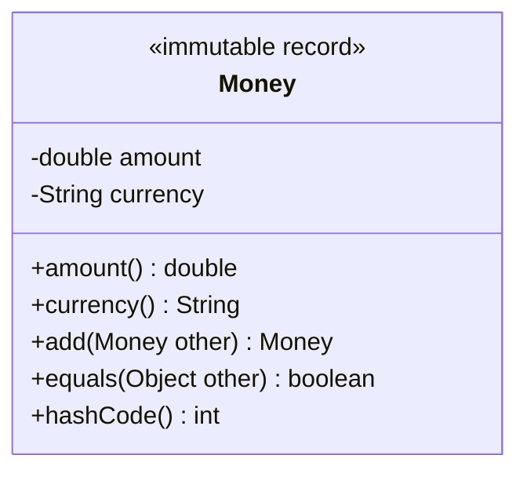

# Immutability and Value Objects

> **One-line summary:** Value Objects represent domain concepts defined entirely by their attributes rather than a persistent identity; making them strictly immutable completely eliminates aliasing bugs, guarantees thread safety, and makes domain logic side-effect free.

| Attribute | Specification |
|---|---|
| **Level** | Foundations / Core |
| **Prerequisites** | [01-oop-pillars.md](01-oop-pillars.md) |
| **Estimated Reading Time** | 30 minutes |
| **Status** | Complete |
| **Category** | Foundations |
| **Also Known As** | Domain Value Objects, Immutable Data Modeling, Aliasing Defense |
| **Languages Tested** | Java 25 (LTS) / TypeScript 5.8 (Node 24 native) / Python 3.14 |

---

## Table of Contents
- [1 The Problem](#1-the-problem)
- [2 Why It Exists](#2-why-it-exists)
- [3 What It Is](#3-what-it-is)
- [4 The Problem Without It](#4-the-problem-without-it)
- [5 How It Solves It](#5-how-it-solves-it)
- [6 How It Works](#6-how-it-works)
- [7 Real-World Examples](#7-real-world-examples)
- [8 When to Use and When NOT to Use](#8-when-to-use-and-when-not-to-use)
- [9 Variations and Language Idioms](#9-variations-and-language-idioms)
- [10 Relationship to Other Principles and Patterns](#10-relationship-to-other-principles-and-patterns)
- [11 Common Mistakes and Anti-Patterns](#11-common-mistakes-and-anti-patterns)
- [12 Testing and Design Verification](#12-testing-and-design-verification)
- [13 Performance, Concurrency and Security Notes](#13-performance-concurrency-and-security-notes)
- [14 Interview Questions](#14-interview-questions)
- [15 Practice Exercises](#15-practice-exercises)
- [16 Summary / Cheat Sheet](#16-summary--cheat-sheet)
- [17 Further Reading](#17-further-reading)

---

## 1 The Problem

A high-volume trading and payment gateway models financial monetary amounts using a mutable class:
```java
public class Money {
    public double amount;
    public String currency;
}
```

In the checkout flow, a customer applies a 20% discount coupon:
```java
Money orderTotal = cart.calculateTotal(); // returns $100.0 USD
Money discountedTotal = orderTotal;
discountedTotal.amount = 80.0;
```

Because both variables hold a reference to the **exact same memory address on the heap**, mutating `discountedTotal.amount` silently mutates `orderTotal.amount`.
When the audit service checks whether `discountedTotal < orderTotal` to log promotional expenses, the check returns `false` because both fields evaluate to \$80.0!

Later, in a multi-threaded web environment, two concurrent requests process transactions for the same shared account. Thread A updates `money.amount` while Thread B reads `money.amount`, resulting in race conditions, corrupted financial ledgers, and impossible-to-reproduce Heisenbugs.

This is the classic **Aliasing Bug**: when multiple parts of a system share a reference to mutable state, an edit in one place causes unintended side-effects in completely unrelated modules.

---

## 2 Why It Exists

In 2003, Eric Evans published *"Domain-Driven Design: Tackling Complexity in the Heart of Software"*, distinguishing between two core building blocks:
- **Entities**: Objects defined by a continuous thread of identity that persists over time (e.g. `User`, `Order`, `BankAccount`). Even if all attributes change, it remains the same entity.
- **Value Objects**: Objects defined strictly by the **values of their attributes**, having no conceptual identity (e.g. `Money`, `Address`, `Color`, `DateRange`).

If you have two \$20 bills, you do not care about their unique serial numbers when buying groceries—they are completely interchangeable because their value is identical. Mutable Value Objects are an architectural contradiction: if an attribute changes, it is no longer the same value; it is a completely different value.

---

## 3 What It Is

A **Value Object** has three mandatory properties:
1. **Immutability**: Once constructed, its state can never be modified. Operations (like `add()`, `subtract()`, `withCurrency()`) always return a **new instance**.
2. **Structural Equality**: Two instances with identical attributes are considered equal (`equals()` and `hashCode()` are based on data fields, not memory pointers).
3. **Self-Validation**: Invariants are validated in the constructor; an invalid Value Object can never exist in memory.



---

## 4 The Problem Without It

Here is the naive mutable implementation demonstrating reference aliasing:

```java
// File: AliasingBugApp.java
class MutableMoney {
    public double amount;
    public String currency;
    public MutableMoney(double amount, String currency) {
        this.amount = amount;
        this.currency = currency;
    }
}

public class AliasingBugApp {
    public static void main(String[] args) {
        MutableMoney originalPrice = new MutableMoney(100.0, "USD");
        // Aliasing: sharing reference
        MutableMoney discountedPrice = originalPrice;

        // Mutation on discounted price
        discountedPrice.amount = 80.0;

        // Bug: original price was silently corrupted!
        System.out.println("Aliasing bug: originalPrice.amount = " + originalPrice.amount);
    }
}
```

```text
Aliasing bug: originalPrice.amount = 80.0
```

### The Change Request: Audit Ledger Tracking
When finance mandates recording `(OriginalPrice, DiscountedPrice, Variance)`:
- Because both variables point to the same object, `originalPrice.amount` is already \$80.0.
- The recorded variance is \$0.0, failing regulatory compliance audits.

---

## 5 How It Solves It

By modeling `Money` as an immutable Value Object (Java `record`, TS `readonly`, Python `dataclass(frozen=True)`), any operation produces a new instance, leaving the original pristine.

### Java Implementation
```java
// File: ImmutabilityWithApp.java
record Money(double amount, String currency) {
    public Money {
        if (amount < 0) throw new IllegalArgumentException("Amount cannot be negative");
        if (currency == null || currency.isBlank()) throw new IllegalArgumentException("Currency required");
    }

    public Money add(Money other) {
        if (!this.currency.equals(other.currency)) {
            throw new IllegalArgumentException("Cannot add different currencies: " + currency + " vs " + other.currency);
        }
        return new Money(this.amount + other.amount, this.currency);
    }
}

public class ImmutabilityWithApp {
    public static void main(String[] args) {
        Money originalPrice = new Money(100.0, "USD");
        Money bonus = new Money(20.0, "USD");
        Money updatedPrice = originalPrice.add(bonus);

        System.out.println("Original price intact: " + originalPrice.amount() + " " + originalPrice.currency());
        System.out.println("Updated price: " + updatedPrice.amount() + " " + updatedPrice.currency());
        System.out.println("Value equality: " + new Money(100.0, "USD").equals(originalPrice));
    }
}
```

### TypeScript Implementation
```typescript
// File: ImmutabilityWithApp.ts
class Money {
    readonly amount: number;
    readonly currency: string;

    constructor(amount: number, currency: string) {
        if (amount < 0) throw new Error("Amount cannot be negative");
        if (!currency) throw new Error("Currency required");
        this.amount = amount;
        this.currency = currency;
    }

    add(other: Money): Money {
        if (this.currency !== other.currency) {
            throw new Error(`Currency mismatch: ${this.currency} vs ${other.currency}`);
        }
        return new Money(this.amount + other.amount, this.currency);
    }

    equals(other: Money): boolean {
        return this.amount === other.amount && this.currency === other.currency;
    }
}

const originalPrice = new Money(100, "USD");
const updated = originalPrice.add(new Money(20, "USD"));
console.log(`TS Original: ${originalPrice.amount} ${originalPrice.currency}`);
console.log(`TS Updated: ${updated.amount} ${updated.currency}`);
console.log(`TS Equality: ${originalPrice.equals(new Money(100, "USD"))}`);
```

### Python Implementation
```python
# File: immutability_with_app.py
from dataclasses import dataclass

@dataclass(frozen=True)
class Money:
    amount: float
    currency: str

    def __post_init__(self):
        if self.amount < 0:
            raise ValueError("Amount cannot be negative")
        if not self.currency:
            raise ValueError("Currency required")

    def add(self, other: 'Money') -> 'Money':
        if self.currency != other.currency:
            raise ValueError(f"Currency mismatch: {self.currency} vs {other.currency}")
        return Money(self.amount + other.amount, self.currency)

orig = Money(100.0, "USD")
upd = orig.add(Money(20.0, "USD"))
print(f"Python Original: {orig.amount} {orig.currency}")
print(f"Python Updated: {upd.amount} {upd.currency}")
print(f"Python Equality: {orig == Money(100.0, 'USD')}")
```

```text
Original price intact: 100.0 USD
Updated price: 120.0 USD
Value equality: true
TS Original: 100 USD
TS Updated: 120 USD
TS Equality: true
Python Original: 100.0 USD
Python Updated: 120.0 USD
Python Equality: True
```

---

## 6 How It Works

### Entity vs Value Object Comparison

| Dimension | Entity | Value Object |
|---|---|---|
| **Identity** | Unique ID (UUID, database primary key) | No identity; defined entirely by attributes |
| **Mutability** | State changes over time (mutable) | **Strictly immutable** |
| **Equality** | Reference or ID equality (`a.id == b.id`) | **Structural equality** (`a.amount == b.amount && a.currency == b.currency`) |
| **Lifecycle** | Tracked in database table | Transient; created, computed, replaced, and discarded |
| **Thread Safety** | Requires explicit locks/synchronization | **Inherently thread-safe** (zero locks required) |

---

## 7 Real-World Examples

### 1. Business Domain: Geographical Addresses
A user's shipping address (`street`, `city`, `zipCode`, `country`) is a Value Object. If a customer edits their address, you don't mutate the existing `Address` object—you construct a new `Address` and assign it to `customer.setShippingAddress(newAddress)`. This ensures that previous completed orders referencing the old address snapshot are not corrupted.

### 2. Standard Library: `java.time.LocalDate` (JSR-310)
In early Java, `java.util.Date` was mutable (`date.setYear(120)`), creating massive concurrency and security issues in multi-threaded web servers. Java 8 introduced `java.time.LocalDate` which is strictly immutable:
```java
LocalDate today = LocalDate.now();
LocalDate tomorrow = today.plusDays(1); // 'today' remains unchanged!
```

### 3. Modern Cloud / Infrastructure: Kubernetes Resource Limits
In Kubernetes YAML specs and SDKs, CPU and Memory allocations (`cpu: "500m"`, `memory: "128Mi"`) are parsed into immutable `Quantity` value objects with strict dimensional validation (preventing negative millicores).

---

## 8 When to Use and When NOT to Use

### Use Value Objects For:
- Measurements, quantities, currencies, and coordinate pairs (`Money`, `Weight`, `GeoCoordinate`).
- Text formats with validation rules (`EmailAddress`, `PhoneNumber`, `PostalCode`, `IpAddress`).
- Ranges and intervals (`DateRange`, `BoundingBox`).

### Use Entities For:
- Real-world actors with independent lifecycles (`User`, `Account`, `Product`, `Order`).
- Anything that requires tracking over time even if all properties change.

---

## 9 Variations and Language Idioms

- **Java**: Java 16+ `record` automatically generates private final fields, constructor validation, accessor methods, `equals()`, `hashCode()`, and `toString()`.
- **TypeScript**: `readonly` modifier on class fields or interface properties, or utility types like `Readonly<T>`.
- **Python**: `@dataclass(frozen=True)` prevents attribute assignments at runtime and implements structural `__eq__` and `__hash__`.

---

## 10 Relationship to Other Principles and Patterns

- **Domain-Driven Design (DDD)**: Value Objects are one of the primary building blocks alongside Entities and Aggregates.
- **Flyweight Pattern**: Immutable Value Objects can be cached and safely shared across millions of references without risk of mutation side-effects (e.g. `BigDecimal.ZERO`, `java.lang.Integer.valueOf`).
- **Memento Pattern**: Mementos are immutable Value Objects capturing state snapshots.

---

## 11 Common Mistakes and Anti-Patterns

| Mistake | Why It Breaks | Production Fix |
|---|---|---|
| **Primitive Obsession** | Using raw `double` for money or `String` for emails allows invalid data to permeate code. | Wrap primitives in self-validating Value Objects (`Money`, `EmailAddress`). |
| **Mutable Internal State** | Making fields `final` but holding a reference to a mutable `List` or `Date`. | Make defensive copies on construction and return unmodifiable views. |
| **Neglecting `hashCode()`** | Overriding `equals()` without `hashCode()` breaks hash maps and sets. | Always implement both based on the exact same attributes (or use `record`). |
| **Adding an ID Field** | Adding `long id` turns a Value Object into an Entity, confusing equality logic. | Remove ID; compare by attribute values. |
| **Mutating in Helper Methods** | Writing `money.applyDiscount(0.1)` that modifies an internal field. | Return a new instance: `public Money applyDiscount(...) { return new Money(...); }`. |
| **Excessive Allocation in Tight Loops** | Creating 100 million temporary Value Objects per second in high-frequency trading hot paths. | Use value types, primitives, or object pooling in performance-critical kernels. |

---

## 12 Testing and Design Verification

Value Objects make unit testing extraordinarily simple because they require zero mocking:

```java
class MoneyTest {
    void testEqualityAndAddition() {
        Money a = new Money(50.0, "USD");
        Money b = new Money(50.0, "USD");
        assert a.equals(b); // Structural equality

        Money sum = a.add(b);
        assert sum.amount() == 100.0;
        assert a.amount() == 50.0; // Invariance preserved
    }
}
```

---

## 13 Performance, Concurrency and Security Notes

- **Thread Safety**: Immutable Value Objects are **inherently thread-safe**. Multiple threads can read, cache, and share instances without synchronization locks, volatile memory barriers, or race condition hazards.
- **Garbage Collection**: Modern JVMs (ZGC, Shenandoah) and V8 optimize short-lived immutable objects through escape analysis and scalar replacement, allocating them directly on the CPU stack or CPU registers with zero GC pressure.
- **Security**: Defense against tampering: an untrusted caller cannot pass a security token Value Object and later modify its permission level in memory.

---

## 14 Interview Questions

<details>
<summary><strong>1. What is the fundamental difference between an Entity and a Value Object?</strong></summary>

**Answer:**  
- An **Entity** is defined by an identity that persists over time, even if all of its attributes change (e.g. a `User` whose email, name, and address change is still the same user).
- A **Value Object** is defined entirely by its attributes and has no conceptual identity (e.g. `Money(10, "USD")`). If an attribute changes, it is a completely different value object.
</details>

<details>
<summary><strong>2. Why must a Value Object be immutable?</strong></summary>

**Answer:**  
If a Value Object were mutable, reference aliasing would allow one part of the system to mutate an instance shared by another part, corrupting data integrity. Furthermore, mutating a Value Object stored as a key in a hash map would change its hash code, making it unretrievable.
</details>

<details>
<summary><strong>3. What is Primitive Obsession?</strong></summary>

**Answer:**  
Primitive Obsession is an anti-pattern where standard primitive types (`String`, `int`, `double`) are used to represent domain concepts (e.g. using `String` for an email address, `double` for a price, or `int` for a zip code). This scatters validation rules across callers and prevents type-safety checks.
</details>

<details>
<summary><strong>4. How do Java 16+ records facilitate Value Object modeling?</strong></summary>

**Answer:**  
Java records are transparent data carriers that are implicitly `final`, have `private final` fields, automatically generate canonical constructors with compact validation syntax, and automatically implement structural `equals()`, `hashCode()`, and `toString()`.
</details>

<details>
<summary><strong>5. What is the contract between <code>equals()</code> and <code>hashCode()</code> for Value Objects?</strong></summary>

**Answer:**  
If two Value Objects are equal according to `equals()`, they **must** return the same integer from `hashCode()`. If this contract is violated, the Value Object cannot be safely used in hash-based collections like `HashSet` or `HashMap`.
</details>

<details>
<summary><strong>6. How does immutability impact concurrent programming?</strong></summary>

**Answer:**  
Immutable objects eliminate shared mutable state, which is the root cause of concurrency bugs (race conditions, deadlocks, dirty reads). Because their state can never be modified after publication, they can be shared freely across threads without synchronization locks.
</details>

<details>
<summary><strong>7. When should an Address be an Entity vs a Value Object?</strong></summary>

**Answer:**  
- In most e-commerce systems, `Address` is a **Value Object** attached to an Order or User.
- In a municipal property tax or real estate registry, `Address` or `LandParcel` is an **Entity** with a persistent legal cadastral identity that exists independently of who lives there.
</details>

<details>
<summary><strong>8. What is Escape Analysis in modern JIT compilers?</strong></summary>

**Answer:**  
Escape analysis is an optimization where the JIT compiler analyzes the scope of a new object. If the object does not escape the allocating method (e.g. a transient Value Object created for a temporary calculation), the compiler can allocate it on the stack or decompose it into CPU registers (scalar replacement), eliminating heap allocation overhead.
</details>

---

## 15 Practice Exercises

### Exercise 1: Spot the Value Object Violation (Easy)
Identify why this class fails as a proper Value Object:
```java
public class Temperature {
    private double celsius;
    public Temperature(double c) { this.celsius = c; }
    public void setCelsius(double c) { this.celsius = c; }
    public double getCelsius() { return celsius; }
}
```
<details>
<summary><strong>Solution</strong></summary>

1. It provides a mutable setter `setCelsius()`, allowing in-place state mutation (violates immutability).
2. It fails to override `equals()` and `hashCode()` (defaults to memory pointer equality rather than structural equality).
</details>

### Exercise 2: Refactor to Java Record (Medium)
Convert this mutable class into an immutable Java 25 record with compact validation (latitude must be between -90 and 90; longitude between -180 and 180):
```java
public class GeoCoordinate {
    public double latitude;
    public double longitude;
}
```
<details>
<summary><strong>Solution</strong></summary>

```java
public record GeoCoordinate(double latitude, double longitude) {
    public GeoCoordinate {
        if (latitude < -90.0 || latitude > 90.0) {
            throw new IllegalArgumentException("Latitude out of range [-90, 90]");
        }
        if (longitude < -180.0 || longitude > 180.0) {
            throw new IllegalArgumentException("Longitude out of range [-180, 180]");
        }
    }
}
```
</details>

### Exercise 3: Defensive Copying in Value Object (Hard)
Ensure this `DateRange` Value Object is strictly immutable even if a caller passes or receives a mutable `Date` object:
```java
public class DateRange {
    private final Date start;
    private final Date end;
    public DateRange(Date start, Date end) {
        this.start = start;
        this.end = end;
    }
    public Date getStart() { return start; }
    public Date getEnd() { return end; }
}
```
<details>
<summary><strong>Solution</strong></summary>

```java
public final class DateRange {
    private final Date start;
    private final Date end;

    public DateRange(Date start, Date end) {
        if (start.after(end)) throw new IllegalArgumentException("Start after end");
        // Defensive copy on ingestion
        this.start = new Date(start.getTime());
        this.end = new Date(end.getTime());
    }

    public Date getStart() { return new Date(start.getTime()); } // Defensive copy on egress
    public Date getEnd() { return new Date(end.getTime()); }

    // implement equals() and hashCode() based on getTime()
}
// Note: Prefer java.time.Instant or LocalDate which are already immutable!
```
</details>

### Exercise 4: Value Object in Python with Dataclasses (Medium)
Implement an immutable `EmailAddress` Value Object in Python that validates the presence of an `@` symbol and converts the domain to lowercase.
<details>
<summary><strong>Solution</strong></summary>

```python
from dataclasses import dataclass

@dataclass(frozen=True)
class EmailAddress:
    value: str

    def __post_init__(self):
        if "@" not in self.value:
            raise ValueError(f"Invalid email address: {self.value}")
        local, domain = self.value.split("@", 1)
        # Using object.__setattr__ because frozen=True blocks standard assignment
        object.__setattr__(self, "value", f"{local}@{domain.lower()}")
```
</details>

### Exercise 5: Value Object Equality Test (Easy)
Write a TypeScript expression proving structural equality between two `Color` objects with RGB values `(255, 0, 0)`.
<details>
<summary><strong>Solution</strong></summary>

```typescript
class Color {
    constructor(readonly r: number, readonly g: number, readonly b: number) {}
    equals(other: Color): boolean {
        return this.r === other.r && this.g === other.g && this.b === other.b;
    }
}
const c1 = new Color(255, 0, 0);
const c2 = new Color(255, 0, 0);
console.log(c1.equals(c2)); // true (c1 === c2 would be false due to reference identity)
```
</details>

### Exercise 6: Value Object with Evolution Methods (Hard)
Implement a `Percentage` Value Object in Java with a `plus(Percentage other)` and `applyTo(double amount)` method, enforcing that percentage cannot be negative.
<details>
<summary><strong>Solution</strong></summary>

```java
public record Percentage(double value) {
    public Percentage {
        if (value < 0.0) throw new IllegalArgumentException("Percentage cannot be negative");
    }

    public Percentage plus(Percentage other) {
        return new Percentage(this.value + other.value);
    }

    public double applyTo(double amount) {
        return amount * (value / 100.0);
    }
}
```
</details>

---

## 16 Summary / Cheat Sheet

```
+-----------------------------------------------------------------------------------------+
| IMMUTABILITY & VALUE OBJECTS CHEAT SHEET                                                |
| Definition: An object defined entirely by its attributes with no conceptual identity.   |
|                                                                                         |
| 3 Rules of Value Objects:                                                               |
| 1. Strictly Immutable: State cannot change after creation. Operations return new copy.  |
| 2. Structural Equality: Two instances with identical attributes are equal.              |
| 3. Self-Validating: Constructor guarantees valid invariants. No illegal instances.    |
|                                                                                         |
| Benefits:                                                                               |
| - Zero reference aliasing bugs.                                                         |
| - Inherently thread-safe without synchronization locks.                                 |
| - Eliminates primitive obsession by encapsulating domain formatting and rules.          |
+-----------------------------------------------------------------------------------------+
```

---

## 17 Further Reading

- Evans, Eric (2003). *"Domain-Driven Design: Tackling Complexity in the Heart of Software"*, Chapter 5: Value Objects.
- Bloch, Joshua (2018). *"Effective Java"*, 3rd Edition (Item 17: Minimize mutability).
- Goetz, Brian et al. (2006). *"Java Concurrency in Practice"*, Chapter 3: Sharing Objects & Immutability.

### In Your Language
| Language Track | Deep Dive Reference |
|---|---|
| Java | [Java Records & Immutability](file:///e:/Learning/engineering-notes/01-languages/java/24-design-patterns/README.md) |
| TypeScript | [TypeScript Readonly & Utility Types](file:///e:/Learning/engineering-notes/01-languages/typescript/17-design-patterns/README.md) |
| Python | [Python Frozen Dataclasses](file:///e:/Learning/engineering-notes/01-languages/python/23-design-patterns/README.md) |

---
[← Previous: 06 - Encapsulate What Varies](06-encapsulate-what-varies.md) | [Section Index](README.md) | [Next: 08 - Command Query Separation →](08-command-query-separation.md)
