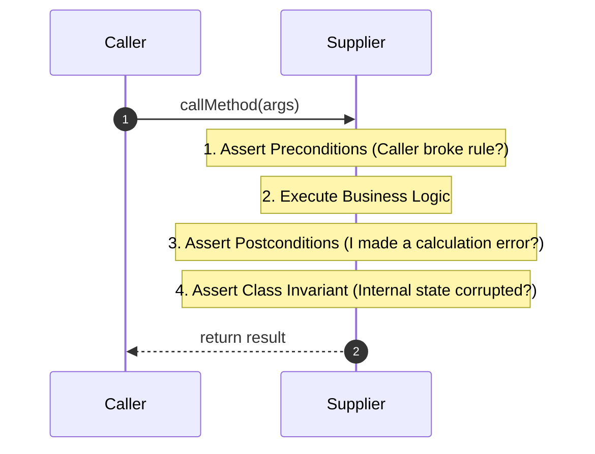

# Design by Contract and Defensive Programming

> **One-line summary:** Design by Contract formalizes the obligations and benefits between callers and callees via preconditions, postconditions, and class invariants, while defensive programming guards system boundaries against invalid external inputs without hiding bugs.

| Attribute | Specification |
|---|---|
| **Level** | Foundations / Core |
| **Prerequisites** | [01-oop-pillars.md](01-oop-pillars.md), [08-command-query-separation.md](08-command-query-separation.md) |
| **Estimated Reading Time** | 30 minutes |
| **Status** | Complete |
| **Category** | Foundations |
| **Also Known As** | DbC, Preconditions & Postconditions, Fail-Fast vs Tolerant |
| **Languages Tested** | Java 25 (LTS) / TypeScript 5.8 (Node 24 native) / Python 3.14 |

---

## Table of Contents
- [1 The Problem](#1-the-problem)
- [2 Why It Exists](#2-why-it-exists)
- [3 What It Is](#3-what-it-is)
- [4 The Problem Without It](#4-the-problem-without-it)
- [5 How It Solves It](#5-how-it-solves-it)
- [6 How It Works](#6-how-it-works)
- [7 Real-World Examples](#7-real-world-examples)
- [8 When to Use and When NOT to Use](#8-when-to-use-and-when-not-to-use)
- [9 Variations and Language Idioms](#9-variations-and-language-idioms)
- [10 Relationship to Other Principles and Patterns](#10-relationship-to-other-principles-and-patterns)
- [11 Common Mistakes and Anti-Patterns](#11-common-mistakes-and-anti-patterns)
- [12 Testing and Design Verification](#12-testing-and-design-verification)
- [13 Performance, Concurrency and Security Notes](#13-performance-concurrency-and-security-notes)
- [14 Interview Questions](#14-interview-questions)
- [15 Practice Exercises](#15-practice-exercises)
- [16 Summary / Cheat Sheet](#16-summary--cheat-sheet)
- [17 Further Reading](#17-further-reading)

---

## 1 The Problem

An engineering team building an automated logistics warehouse tries to protect against runtime exceptions by practicing "defensive programming":
```java
public void scheduleDelivery(Package pkg, Driver driver, Location dest) {
    if (pkg == null || driver == null || dest == null) {
        return; // Silently swallow null parameters to avoid NullPointerException
    }
    // process delivery...
}
```

A bug in the mobile order app causes `dest` to be passed as `null` for 5% of priority shipments. 
Instead of throwing an immediate exception that would alert engineers and trigger automated error monitoring (Sentry/Datadog), the method **silently exits with a no-op return**.
- The customer receives an order confirmation.
- The warehouse robot marks the package as "Dispatched".
- The physical package sits on a conveyor belt for 14 days because no delivery was ever scheduled.

When the customer complains, engineers spend four days trying to debug the problem. Because the code "defensively" swallowed the error, there was zero stack trace, zero log, and zero indication of where the invalid state originated.

Over-defensive programming turned a simple, immediate bug into a silent data-loss catastrophe.

---

## 2 Why It Exists

Bertrand Meyer introduced **Design by Contract (DbC)** in 1986 as part of the Eiffel language. Meyer observed that software components collaborate like business contractors:
- A client and supplier agree on a formal, binding contract.
- If the client fulfills the **Preconditions**, the supplier guarantees the **Postconditions**.
- Neither party should perform redundant checks or silently mask contract breaches.

When a contract is violated, the program should **Fail Fast**: crash immediately at the exact boundary of the fault rather than propagating corrupted state deeper into the system.

---

## 3 What It Is

Design by Contract defines three formal invariants:

```
[Preconditions]     Caller's Responsibility: "What must be true BEFORE calling me."
       ↓
[Method Execution]  Supplier's Work: Execute core algorithm under the agreed contract.
       ↓
[Postconditions]    Supplier's Guarantee: "What I promise is true UPON COMPLETION."
       ↓
[Class Invariant]   Permanent Guarantee: "What must ALWAYS be true before and after every public call."
```



---

## 4 The Problem Without It

Here is the naive over-defensive implementation that silently ignores invalid state:

```java
// File: ContractWithoutApp.java
class SilentFailureAccount {
    private double balance = 100.0;

    // Bad: Silently swallowing negative amounts or returning default values
    public void deposit(double amount) {
        if (amount <= 0) {
            // Silently ignoring invalid input hides caller bugs
            return;
        }
        balance += amount;
    }

    public double getBalance() { return balance; }
}

public class ContractWithoutApp {
    public static void main(String[] args) {
        SilentFailureAccount acc = new SilentFailureAccount();
        acc.deposit(-50.0); // Caller made a severe calculation mistake
        // Silent failure: caller has no idea the deposit was rejected!
        System.out.println("Silent failure hiding bug: balance is still " + acc.getBalance());
    }
}
```

```text
Silent failure hiding bug: balance is still 100.0
```

### The Change Request: Audit Discrepancies
When financial reconciliations detect that \$50 disappeared:
- There is no error log anywhere in production.
- Developers cannot tell whether the database failed or the deposit method rejected the transaction.

---

## 5 How It Solves It

By enforcing explicit contracts and failing fast, invalid state is caught instantly with descriptive context.

### Java Implementation
```java
// File: ContractWithApp.java
class ContractAccount {
    private double balance;

    public ContractAccount(double initialBalance) {
        // Precondition
        if (initialBalance < 0) throw new IllegalArgumentException("Precondition failed: initialBalance cannot be negative");
        this.balance = initialBalance;
        assertInvariant();
    }

    public void withdraw(double amount) {
        // Precondition: Caller responsibility
        if (amount <= 0) throw new IllegalArgumentException("Precondition failed: withdrawal must be positive");
        if (amount > balance) throw new IllegalStateException("Precondition failed: insufficient funds");

        double oldBalance = this.balance;
        this.balance -= amount;

        // Postcondition: Method guarantee
        if (this.balance != oldBalance - amount) throw new AssertionError("Postcondition failed: balance calculation error");
        assertInvariant();
    }

    public double balance() {
        assertInvariant();
        return this.balance;
    }

    // Class Invariant: Must always hold true before and after public operations
    private void assertInvariant() {
        if (this.balance < 0) throw new IllegalStateException("Class Invariant broken: balance < 0");
    }
}

public class ContractWithApp {
    public static void main(String[] args) {
        ContractAccount acc = new ContractAccount(100.0);
        acc.withdraw(40.0);
        System.out.println("Contract respected: balance = " + acc.balance());

        try {
            acc.withdraw(100.0);
        } catch (IllegalStateException e) {
            System.out.println("Fail-fast prevented invariant violation: " + e.getMessage());
        }
    }
}
```

### TypeScript Implementation
```typescript
// File: ContractWithApp.ts
class ContractAccount {
    private _balance: number;

    constructor(initialBalance: number) {
        if (initialBalance < 0) throw new Error("Precondition failed: initial balance < 0");
        this._balance = initialBalance;
        this.assertInvariant();
    }

    withdraw(amount: number): void {
        if (amount <= 0) throw new Error("Precondition failed: amount <= 0");
        if (amount > this._balance) throw new Error("Precondition failed: insufficient funds");

        const old = this._balance;
        this._balance -= amount;

        if (this._balance !== old - amount) throw new Error("Postcondition failed");
        this.assertInvariant();
    }

    get balance(): number {
        this.assertInvariant();
        return this._balance;
    }

    private assertInvariant(): void {
        if (this._balance < 0) throw new Error("Class Invariant broken: balance < 0");
    }
}

const acc = new ContractAccount(100);
acc.withdraw(40);
console.log(`TS Contract respected: balance = ${acc.balance}`);
try {
    acc.withdraw(100);
} catch (e: any) {
    console.log(`TS Fail-fast: ${e.message}`);
}
```

### Python Implementation
```python
# File: contract_with_app.py
class ContractAccount:
    def __init__(self, initial_balance: float):
        if initial_balance < 0:
            raise ValueError("Precondition failed: initial balance < 0")
        self._balance = initial_balance
        self._assert_invariant()

    def withdraw(self, amount: float) -> None:
        if amount <= 0:
            raise ValueError("Precondition failed: amount <= 0")
        if amount > self._balance:
            raise RuntimeError("Precondition failed: insufficient funds")

        old = self._balance
        self._balance -= amount

        if self._balance != old - amount:
            raise AssertionError("Postcondition failed")
        self._assert_invariant()

    @property
    def balance(self) -> float:
        self._assert_invariant()
        return self._balance

    def _assert_invariant(self) -> None:
        if self._balance < 0:
            raise RuntimeError("Class Invariant broken: balance < 0")

acc = ContractAccount(100.0)
acc.withdraw(40.0)
print(f"Python Contract respected: balance = {acc.balance}")
try:
    acc.withdraw(100.0)
except RuntimeError as e:
    print(f"Python Fail-fast: {e}")
```

```text
Contract respected: balance = 60.0
Fail-fast prevented invariant violation: Precondition failed: insufficient funds
TS Contract respected: balance = 60
TS Fail-fast: Precondition failed: insufficient funds
Python Contract respected: balance = 60.0
Python Fail-fast: Precondition failed: insufficient funds
```

---

## 6 How It Works

### The Golden Rule: Defensive at the Periphery, Contractual in the Core

```
[External World: Untrusted Network, User Input, Third-Party JSON]
                          │
                          ▼ Defensive Programming Barrier
[System Boundary: Validate, Sanitize, Parse into Typed Value Objects]
                          │
                          ▼ Design by Contract (Trusted Core)
[Domain Core: Pure Preconditions & Class Invariants. Fail-Fast Assertions]
```

1. **At System Boundaries (Defensive)**: When handling untrusted HTTP requests, CLI flags, or external database records, validate aggressively. Never crash the process; return HTTP 400 Bad Request with actionable field validation errors.
2. **Inside the Domain Core (Contractual)**: Once data is parsed into domain types, do not check for `null` or negative numbers inside every internal helper method. Assume the contract is valid; if a precondition is violated, throw an unhandled `IllegalStateException` immediately.

---

## 7 Real-World Examples

### 1. Business Domain: Airline Seat Allocation
In an airline ticketing engine:
- **Precondition**: `allocateSeat(Passenger p, Seat s)` requires `!s.isOccupied()` and `p.hasValidTicket()`.
- **Postcondition**: `s.getPassenger() == p` and `flight.availableSeats() == oldAvailableSeats - 1`.
- **Invariant**: `flight.allocatedSeats() + flight.availableSeats() == flight.totalCapacity()`.

### 2. Standard Library: `java.util.Objects.requireNonNull()`
The Java standard library uses fail-fast preconditions throughout:
```java
public Order(Customer customer) {
    this.customer = Objects.requireNonNull(customer, "Customer must not be null");
}
```
If a caller passes `null`, the constructor fails immediately on line 2, pinpointing the caller's stack frame rather than throwing a mysterious `NullPointerException` 500 lines later in production.

### 3. Modern Cloud / Infrastructure: Linux Kernel OOM Killer & Panics
When the Linux kernel detects kernel memory corruption (e.g. invalid spinlock state or page table inconsistency), it does not "defensively" try to continue running and hope for the best—it triggers an immediate **Kernel Panic**. Continuing to run with corrupted memory risks overwriting disk partitions and permanently destroying user data.

---

## 8 When to Use and When NOT to Use

### Use Design by Contract When:
- Writing core domain logic, algorithms, and financial calculation libraries.
- Establishing internal interfaces between team components.
- Enforcing critical business invariants that must never be violated.

### Use Defensive Programming When:
- Ingesting raw JSON payloads from untrusted web clients.
- Reading data from external network APIs or third-party webhooks.
- Handling hardware sensors or legacy file formats.

---

## 9 Variations and Language Idioms

- **Eiffel**: Native language keywords `require` (precondition), `ensure` (postcondition), and `invariant`.
- **Java**: `assert` keyword (disabled by default in production) or explicit exception checking (`Objects.requireNonNull()`, Guava `Preconditions.checkArgument()`).
- **Python**: `assert` statements or runtime contract libraries like `deal` or `icontract`.
- **Rust**: The type system (`Option<T>`, `Result<T, E>`) enforces contracts at compile time, eliminating null pointer exceptions entirely.

---

## 10 Relationship to Other Principles and Patterns

- **Liskov Substitution Principle (LSP)**: The direct inheritance rule for DbC: a subclass may **weaken preconditions** (demand less) and **strengthen postconditions** (guarantee more), but never the reverse.
- **Fail-Fast Principle**: The runtime execution strategy for contract breaches.
- **Null Object Pattern**: Eliminates defensive null checks by providing an active non-null default object.

---

## 11 Common Mistakes and Anti-Patterns

| Mistake | Why It Breaks | Production Fix |
|---|---|---|
| **Swallowing Exceptions (`catch (Exception e) {}`)** | Hides critical system failures; makes debugging impossible. | Log the exception and rethrow, or translate to a domain error. |
| **Defensive Null-Spam in Core Code** | Writing `if (x != null)` on every line clutters business logic. | Enforce non-null at the boundary; use `@NonNull` or type systems. |
| **Returning Magic Error Codes (`-1` or `null`)** | Callers forget to check return codes, causing corrupted calculations. | Throw an explicit domain exception or return `Optional<T>`. |
| **Validating Internal Invariants with Checked Exceptions** | Forcing callers to catch exceptions for programming bugs. | Use unchecked runtime exceptions (`IllegalArgumentException`) for contract breaches. |
| **Postcondition Mutation** | A postcondition check that accidentally mutates the state it was inspecting. | Keep contract assertion methods strictly side-effect free. |
| **Disabling Production Assertions** | Using Java `assert` for critical business rules that are turned off in production. | Use explicit `if (!valid) throw new IllegalStateException();`. |

---

## 12 Testing and Design Verification

Contracts turn unit tests into clear, unambiguous boundary verification tests:

```java
class ContractAccountTest {
    void testPreconditionRejection() {
        ContractAccount acc = new ContractAccount(100.0);
        
        // Assert that the contract explicitly rejects overdrafts
        try {
            acc.withdraw(150.0);
            assert false : "Should have thrown exception";
        } catch (IllegalStateException e) {
            assert e.getMessage().contains("insufficient funds");
        }
    }
}
```

---

## 13 Performance, Concurrency and Security Notes

- **Performance**: Precondition checks at method entry are simple branch instructions (`cmp` / `jmp`) easily predicted by modern CPU branch predictors. The performance cost is measured in single-digit nanoseconds, while preventing millions of dollars in data corruption.
- **Security**: Parameter validation at the system boundary is the primary defense against SQL injection, Buffer Overflows, and Cross-Site Scripting (XSS).

---

## 14 Interview Questions

<details>
<summary><strong>1. What are the three fundamental components of Design by Contract?</strong></summary>

**Answer:**  
1. **Preconditions**: Requirements that the caller must satisfy before calling the method.
2. **Postconditions**: Guarantees that the method promises to satisfy upon successful completion.
3. **Class Invariants**: Invariants that must be true for the object across its entire lifecycle (before and after every public method execution).
</details>

<details>
<summary><strong>2. How does Design by Contract relate to the Liskov Substitution Principle (LSP)?</strong></summary>

**Answer:**  
Under LSP, when a subclass overrides a superclass method:
- It **cannot strengthen preconditions** (it cannot demand more than the superclass demanded).
- It **cannot weaken postconditions** (it must guarantee at least as much as the superclass guaranteed).
- It **must preserve all class invariants** established by the superclass.
</details>

<details>
<summary><strong>3. What is the difference between Defensive Programming and Failing Fast?</strong></summary>

**Answer:**  
- **Defensive Programming** attempts to keep the program running even in the presence of invalid data, often by providing defaults or sanitizing inputs.
- **Failing Fast** immediately halts execution or throws an explicit exception the instant an illegal state or contract violation is detected, preventing corrupted data from propagating.
</details>

<details>
<summary><strong>4. Why is silently returning <code>null</code> or an empty value considered an anti-pattern?</strong></summary>

**Answer:**  
Silently returning null or empty masks bugs in the caller. The caller continues running under the false assumption that the operation succeeded, only to crash much later at a completely unrelated line of code, making root-cause diagnosis extremely difficult.
</details>

<details>
<summary><strong>5. Where should you be Defensive, and where should you rely on Contracts?</strong></summary>

**Answer:**  
Be **Defensive at the outer system boundaries** (HTTP controllers, message queue consumers, user inputs) where data is untrusted. Rely on **Contracts in the internal domain core**, where types are trusted and validated.
</details>

<details>
<summary><strong>6. Why shouldn't you use Java's <code>assert</code> keyword for user input validation?</strong></summary>

**Answer:**  
Java's `assert` statement is disabled by default at runtime unless explicitly enabled with the `-ea` flag. If used for input validation in production, the assertions are completely ignored by the JVM, leaving the system wide open to invalid inputs and security vulnerabilities.
</details>

<details>
<summary><strong>7. What is a Class Invariant?</strong></summary>

**Answer:**  
A Class Invariant is a condition describing the state of an object that must be true immediately after object construction, and must be true before and after the execution of every public method. Internal private helper methods may temporarily violate the invariant during intermediate computation.
</details>

<details>
<summary><strong>8. How does structural typing in TypeScript affect precondition enforcement?</strong></summary>

**Answer:**  
TypeScript's type system exists only at compile time and is completely erased at runtime. Therefore, TypeScript cannot rely on static types alone to enforce preconditions at runtime boundaries (such as receiving data from `fetch()` or `JSON.parse()`); runtime schema validators (like Zod) are necessary to enforce contracts.
</details>

---

## 15 Practice Exercises

### Exercise 1: Spot the Weak Precondition (Easy)
Identify why this method fails to enforce its contract:
```java
public void transferMoney(Account from, Account to, double amount) {
    from.debit(amount);
    to.credit(amount);
}
```
<details>
<summary><strong>Solution</strong></summary>

The method has zero precondition validation:
1. It does not check if `from` or `to` are `null`.
2. It does not verify that `amount > 0`.
3. It does not verify that `from != to` (transferring to self).  
**Fix:** Validate all three preconditions before executing transfers.
</details>

### Exercise 2: Implement Postcondition Check (Medium)
Add an explicit postcondition assertion to ensure this binary search implementation never returns an index where `arr[index] != target`:
```java
public int binarySearch(int[] arr, int target) {
    // algorithm...
}
```
<details>
<summary><strong>Solution</strong></summary>

```java
public int binarySearch(int[] arr, int target) {
    int low = 0, high = arr.length - 1;
    int resultIndex = -1;
    while (low <= high) {
        int mid = (low + high) >>> 1;
        if (arr[mid] == target) { resultIndex = mid; break; }
        else if (arr[mid] < target) low = mid + 1;
        else high = mid - 1;
    }
    // Postcondition check
    if (resultIndex != -1 && arr[resultIndex] != target) {
        throw new AssertionError("Postcondition failed: algorithm returned wrong index!");
    }
    return resultIndex;
}
```
</details>

### Exercise 3: Defensive Boundary Validation in TypeScript (Medium)
Write a boundary parser using TypeScript that defensively validates that an untrusted API payload contains a valid positive `id` and non-empty `name`, throwing a clear error if the contract is breached.
<details>
<summary><strong>Solution</strong></summary>

```typescript
interface ValidatedUser { id: number; name: string; }

function parseUserPayload(raw: any): ValidatedUser {
    if (!raw || typeof raw !== "object") throw new Error("Payload must be an object");
    if (typeof raw.id !== "number" || raw.id <= 0) throw new Error("Precondition failed: id must be positive number");
    if (typeof raw.name !== "string" || raw.name.trim() === "") throw new Error("Precondition failed: name required");

    return { id: raw.id, name: raw.name.trim() };
}
```
</details>

### Exercise 4: Spot the Class Invariant Bug (Hard)
Identify the invariant violation in this bounded stack:
```java
public class BoundedStack<T> {
    private final Object[] elements;
    private int size = 0;
    public BoundedStack(int capacity) { this.elements = new Object[capacity]; }
    public void push(T item) {
        elements[size++] = item; // What if size == elements.length?
    }
}
```
<details>
<summary><strong>Solution</strong></summary>

**Invariant:** `0 <= size <= elements.length`.  
If a caller calls `push()` when `size == capacity`, the method attempts to write out-of-bounds, throwing `ArrayIndexOutOfBoundsException` and potentially corrupting the internal state pointer.  
**Fix:** Enforce precondition: `if (size >= elements.length) throw new IllegalStateException("Stack is full");`.
</details>

### Exercise 5: Fail-Fast Null Check (Easy)
Refactor this constructor to use Java's `Objects.requireNonNull()`:
```java
public class OrderProcessor {
    private final PaymentClient client;
    public OrderProcessor(PaymentClient client) {
        this.client = client;
    }
}
```
<details>
<summary><strong>Solution</strong></summary>

```java
import java.util.Objects;

public class OrderProcessor {
    private final PaymentClient client;
    public OrderProcessor(PaymentClient client) {
        this.client = Objects.requireNonNull(client, "PaymentClient must not be null");
    }
}
```
</details>

### Exercise 6: Python Contract Enforcement (Hard)
Implement a Python class `BankAccount` with an internal invariant that `balance >= 0` and an overdraft limit, using a method decorator that asserts the invariant automatically after every mutating call.
<details>
<summary><strong>Solution</strong></summary>

```python
import functools

def check_invariant(method):
    @functools.wraps(method)
    def wrapper(self, *args, **kwargs):
        result = method(self, *args, **kwargs)
        if self._balance < -self._overdraft_limit:
            raise RuntimeError(f"Invariant breach: balance {self._balance} exceeds overdraft limit {self._overdraft_limit}")
        return result
    return wrapper

class BankAccount:
    def __init__(self, initial: float, overdraft_limit: float = 0.0):
        self._balance = initial
        self._overdraft_limit = overdraft_limit

    @check_invariant
    def withdraw(self, amount: float) -> None:
        if amount <= 0: raise ValueError("Amount must be positive")
        self._balance -= amount
```
</details>

---

## 16 Summary / Cheat Sheet

```
+-----------------------------------------------------------------------------------------+
| DESIGN BY CONTRACT & DEFENSIVE PROGRAMMING CHEAT SHEET                                  |
|                                                                                         |
| 1. Design by Contract (Internal Domain Core):                                           |
| - Preconditions:  Caller must satisfy before call. Fail-fast if violated.              |
| - Postconditions: Supplier guarantees upon return.                                      |
| - Invariants:     Conditions that must always hold true for the class.                  |
|                                                                                         |
| 2. Defensive Programming (System Boundaries):                                           |
| - Validate, sanitize, and parse raw untrusted data (HTTP, CLI, Files).                 |
| - Return actionable error feedback (HTTP 400 Bad Request).                              |
| - Never silently swallow exceptions or hide invalid parameters.                         |
+-----------------------------------------------------------------------------------------+
```

---

## 17 Further Reading

- Meyer, Bertrand (1997). *"Object-Oriented Software Construction"*, 2nd Edition, Prentice Hall (Chapter 11: Design by Contract: Building Reliable Software).
- Hunt, Andy; Thomas, Dave (1999). *"The Pragmatic Programmer"*, Chapter 4: Pragmatic Paranoia & Dead Programs Tell No Lies.
- Liskov, Barbara; Wing, Jeannette (1994). *"A Behavioral Notion of Subtyping"*, ACM TOPLAS.

### In Your Language
| Language Track | Deep Dive Reference |
|---|---|
| Java | [Java Assertions & Exception Architecture](file:///e:/Learning/engineering-notes/01-languages/java/24-design-patterns/README.md) |
| TypeScript | [TypeScript Type Guards & Runtime Validation](file:///e:/Learning/engineering-notes/01-languages/typescript/17-design-patterns/README.md) |
| Python | [Python Assertions & Invariant Checking](file:///e:/Learning/engineering-notes/01-languages/python/23-design-patterns/README.md) |

---
[← Previous: 08 - Command Query Separation](08-command-query-separation.md) | [Section Index](README.md) | [Next: 10 - What is Good Design? →](10-what-is-good-design.md)
