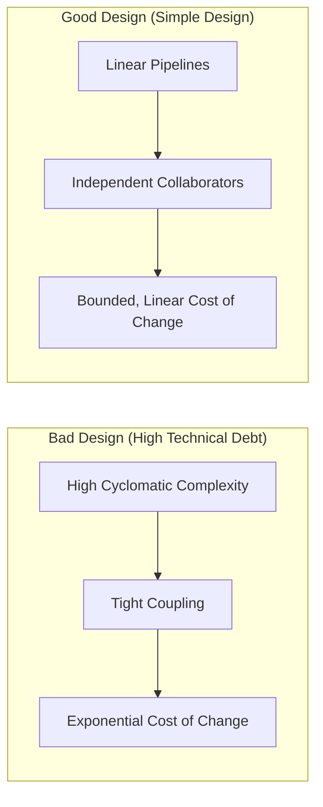
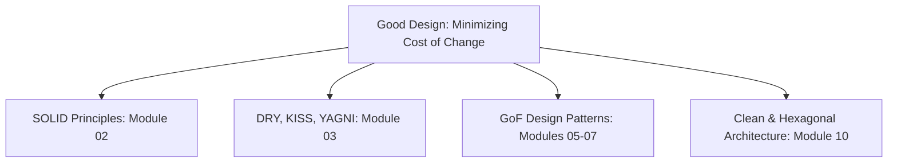

# What is Good Design?

> **One-line summary:** Good software design is not measured by clever algorithms or abstract pattern usage, but by the minimization of the total cost of change over the system's lifetime.

| Attribute | Specification |
|---|---|
| **Level** | Foundations / Core |
| **Prerequisites** | [00-overview.md](00-overview.md) to [09-design-by-contract-and-defensive-programming.md](09-design-by-contract-and-defensive-programming.md) |
| **Estimated Reading Time** | 30 minutes |
| **Status** | Complete |
| **Category** | Foundations |
| **Also Known As** | Cost of Change, Technical Debt Taxonomy, Simple Design Rules |
| **Languages Tested** | Java 25 (LTS) / TypeScript 5.8 (Node 24 native) / Python 3.14 |

---

## Table of Contents
- [1 The Problem](#1-the-problem)
- [2 Why It Exists](#2-why-it-exists)
- [3 What It Is](#3-what-it-is)
- [4 The Problem Without It](#4-the-problem-without-it)
- [5 How It Solves It](#5-how-it-solves-it)
- [6 How It Works](#6-how-it-works)
- [7 Real-World Examples](#7-real-world-examples)
- [8 When to Use and When NOT to Use](#8-when-to-use-and-when-not-to-use)
- [9 Variations and Language Idioms](#9-variations-and-language-idioms)
- [10 Relationship to Other Principles and Patterns](#10-relationship-to-other-principles-and-patterns)
- [11 Common Mistakes and Anti-Patterns](#11-common-mistakes-and-anti-patterns)
- [12 Testing and Design Verification](#12-testing-and-design-verification)
- [13 Performance, Concurrency and Security Notes](#13-performance-concurrency-and-security-notes)
- [14 Interview Questions](#14-interview-questions)
- [15 Practice Exercises](#15-practice-exercises)
- [16 Summary / Cheat Sheet](#16-summary--cheat-sheet)
- [17 Further Reading](#17-further-reading)

---

## 1 The Problem

A startup launches an e-commerce platform. In Year 1, development is blazing fast: features take 2 days from concept to production. The team bypasses architecture, writing monolithic classes with nested `if/else` ladders.

By Year 3, disaster strikes:
- The same 2-day feature now takes **4 weeks**.
- Every PR touching the checkout flow introduces 3 bugs in shipping and inventory.
- Developers are terrified of refactoring; new hires take 4 months just to understand how code flows.
- The company spends 80% of its engineering payroll fixing regressions rather than shipping new features.

Management asks: *"Why did our velocity drop by 90% when we hired twice as many engineers?"*

The answer is **Uncontrolled Technical Debt**: code was optimized for quick initial delivery without regard for the long-term cost of change.

---

## 2 Why It Exists

In 1992, Ward Cunningham coined the metaphor of **Technical Debt**:
> *"Shipping first-time code is like going into debt. A little debt speeds development so long as it is paid back promptly with a rewrite... Every minute spent on not-quite-right code counts as interest on that debt."*

In 2000, Kent Beck formulated the **Four Rules of Simple Design**, asserting that a good design is one that:
1. Passes all tests.
2. Reveals intent (clear, self-documenting code).
3. Contains no duplication (DRY).
4. Has the fewest possible classes and methods.

Good design is not an aesthetic luxury; it is an economic strategy to keep the cost of change linear over time.

---

## 3 What It Is

Good software design is characterized by five objective structural traits:

```
[Malleability]    Easy to change when business requirements evolve.
       ↓
[Understandability] Easily comprehended by new engineers without tribal knowledge.
       ↓
[Testability]     Sub-millisecond unit test coverage without heavy external mocking.
       ↓
[Observability]   Fails fast with actionable error context; no silent corruption.
       ↓
[Simplicity]      Solves today's known problem without speculative future machinery.
```



---

## 4 The Problem Without It

Here is the legacy pricing engine with high cyclomatic complexity, deeply nested branching, and tight coupling:

```java
// File: GoodDesignWithoutApp.java
class LegacyPricingEngine {
    // Cyclomatic complexity = 8
    public double calculate(double base, String customerType, boolean isHoliday, boolean isFirstOrder) {
        double result = base;
        if (customerType.equals("VIP")) {
            result *= 0.8;
            if (isHoliday) {
                result -= 10.0;
            }
        } else if (customerType.equals("REGULAR")) {
            if (isHoliday) {
                result *= 0.95;
            }
            if (isFirstOrder) {
                result -= 5.0;
            }
        }
        if (result < 0) result = 0;
        System.out.println("Legacy engine calculated: " + result);
        return result;
    }
}

public class GoodDesignWithoutApp {
    public static void main(String[] args) {
        LegacyPricingEngine engine = new LegacyPricingEngine();
        engine.calculate(100.0, "VIP", true, false);
    }
}
```

```text
Legacy engine calculated: 70.0
```

### The Change Request: Add Corporate Account Tier with 15% Discount
When adding a corporate tier:
1. Cyclomatic complexity increases to 12.
2. The number of path permutations doubles ($2^4 = 16$ test cases needed).
3. A developer modifying the holiday discount for regular customers accidentally alters VIP calculations.

---

## 5 How It Solves It

By decomposing the pricing logic into cohesive, composable `DiscountRule` steps, cyclomatic complexity drops to 1, and adding a corporate tier requires writing one new class without touching existing code.

### Java Implementation
```java
// File: GoodDesignWithApp.java
import java.util.*;

interface DiscountRule {
    double apply(double currentPrice);
}

class VipDiscountRule implements DiscountRule {
    public double apply(double price) { return price * 0.8; }
}

class HolidayCreditRule implements DiscountRule {
    public double apply(double price) { return Math.max(0, price - 10.0); }
}

class CleanPricingPipeline {
    private final List<DiscountRule> rules = new ArrayList<>();

    public CleanPricingPipeline addRule(DiscountRule rule) {
        rules.add(rule);
        return this;
    }

    // Cyclomatic complexity = 1 (linear pipeline)
    public double calculate(double basePrice) {
        double price = basePrice;
        for (DiscountRule rule : rules) {
            price = rule.apply(price);
        }
        System.out.println("Clean pipeline calculated: " + price);
        return price;
    }
}

public class GoodDesignWithApp {
    public static void main(String[] args) {
        CleanPricingPipeline pipeline = new CleanPricingPipeline()
            .addRule(new VipDiscountRule())
            .addRule(new HolidayCreditRule());

        pipeline.calculate(100.0);
    }
}
```

### TypeScript Implementation
```typescript
// File: GoodDesignWithApp.ts
interface DiscountRule {
    apply(currentPrice: number): number;
}

class VipDiscountRule implements DiscountRule {
    apply(price: number): number { return price * 0.8; }
}

class HolidayCreditRule implements DiscountRule {
    apply(price: number): number { return Math.max(0, price - 10.0); }
}

class CleanPricingPipeline {
    private readonly rules: DiscountRule[] = [];

    addRule(rule: DiscountRule): this {
        this.rules.push(rule);
        return this;
    }

    calculate(basePrice: number): number {
        let price = basePrice;
        for (const rule of this.rules) {
            price = rule.apply(price);
        }
        console.log(`TS Clean pipeline calculated: ${price}`);
        return price;
    }
}

const p = new CleanPricingPipeline()
    .addRule(new VipDiscountRule())
    .addRule(new HolidayCreditRule());
p.calculate(100.0);
```

### Python Implementation
```python
# File: good_design_with_app.py
from typing import Protocol, List

class DiscountRule(Protocol):
    def apply(self, current_price: float) -> float: ...

class VipDiscountRule:
    def apply(self, price: float) -> float:
        return price * 0.8

class HolidayCreditRule:
    def apply(self, price: float) -> float:
        return max(0.0, price - 10.0)

class CleanPricingPipeline:
    def __init__(self):
        self._rules: List[DiscountRule] = []

    def add_rule(self, rule: DiscountRule) -> 'CleanPricingPipeline':
        self._rules.append(rule)
        return self

    def calculate(self, base_price: float) -> float:
        price = base_price
        for rule in self._rules:
            price = rule.apply(price)
        print(f"Python Clean pipeline calculated: {price}")
        return price

pipeline = CleanPricingPipeline()
pipeline.add_rule(VipDiscountRule()).add_rule(HolidayCreditRule())
pipeline.calculate(100.0)
```

```text
Clean pipeline calculated: 70.0
TS Clean pipeline calculated: 70
Python Clean pipeline calculated: 70.0
```

---

## 6 How It Works

### The 4 Concrete Signals of Bad Design (Robert C. Martin)

1. **Rigidity**: The tendency for software to be difficult to change because every change forces a cascade of subsequent changes in other modules.
2. **Fragility**: The tendency of software to break in places that have no conceptual relationship to the area that was changed.
3. **Immobility**: The inability to reuse software from other projects or parts of the same project because it cannot be disentangled from its current context.
4. **Viscosity**: When it is easier to do the "hacky" thing (copy-pasting or modifying existing files) than to do the design-consistent thing (adding a clean extension).

---

## 7 Real-World Examples

### 1. Business Domain: Stripe API Architecture
Stripe's API and client SDKs are recognized as benchmarks of good software design:
- Core concepts (`Charge`, `Customer`, `Subscription`, `Refund`) are highly cohesive domain models.
- Idempotency keys prevent duplicate credit card charges on network retries.
- Every API endpoint is versioned, allowing backward compatibility for over a decade.

### 2. Standard Library: Java Stream API
The Java Stream API (`stream().filter().map().reduce()`) embodies the four rules of simple design:
- Reveals intent: Declarative operations replace nested procedural loops.
- Composable: Connects small, pure functions together into high-performance pipelines.
- Passes all tests: Built with rigorous mathematical foundations (monads/functors).

### 3. Modern Cloud / Infrastructure: Prometheus Metrics Exporters
Instead of monitoring agents embedding proprietary scrapers for every database, Prometheus exposes a simple, universal HTTP plain-text endpoint: `/metrics`. Any software that produces lines of `metric_name{label="val"} number` is instantly observable. Simplicity in design enables universal integration.

---

## 8 When to Use and When NOT to Use

### Invest in Design Refactoring When:
- A module's cyclomatic complexity exceeds 10–15.
- Code review velocity is stalled by confusion over architecture.
- A feature change requires touching more than 3 distinct files.

### Do NOT Over-Design When:
- **Spike / Prototype Phase**: Testing a market hypothesis where the code will be deleted in two weeks.
- **Speculative Future-Proofing**: Designing a plugin architecture for an application that only needs to print to the console.

---

## 9 Variations and Language Idioms

- **OOP Style**: Decoupling via interfaces, classes, and dependency injection.
- **Functional Style**: Decoupling via pure functions, immutability, and function composition (`compose(f, g)`).
- **Go / Rust Style**: Zero inheritance, small interfaces, explicit error handling via `Result`.

---

## 10 Relationship to Other Principles and Patterns



---

## 11 Common Mistakes and Anti-Patterns

| Mistake | Why It Breaks | Production Fix |
|---|---|---|
| **Architecture Astronautics** | Building 10 layers of abstract factories for a basic CRUD service. | Solve today's concrete problem; refactor when a 2nd variation arrives. |
| **Premature Optimization** | Sacrificing readability for microsecond gains before profiling. | Write clean, readable code first; profile before optimizing. |
| **The Cargo Cult** | Using Microservices or CQRS simply because Google or Netflix uses them. | Choose the simplest architecture that fits your team size and throughput. |
| **Testing Implementation Details** | Writing unit tests that assert private field state rather than public behavior. | Test observable public contracts; let internal implementation vary freely. |
| **Ignoring Technical Debt Interest** | Continuously pushing features while ignoring refactoring until velocity hits zero. | Dedicate 20% of every sprint to paying down technical debt. |
| **Big Bang Rewrites** | Attempting to rewrite a 10-year legacy monolith from scratch (almost always fails). | Use the **Strangler Fig pattern** to incrementally carve out features. |

---

## 12 Testing and Design Verification

Good design is intrinsically testable. If code cannot be tested easily with simple unit tests, the design is flawed:

```java
class CleanPricingPipelineTest {
    void testPipelineExecution() {
        CleanPricingPipeline pipeline = new CleanPricingPipeline()
            .addRule(price -> price * 0.5); // 50% discount mock rule

        assert pipeline.calculate(100.0) == 50.0;
    }
}
```

---

## 13 Performance, Concurrency and Security Notes

- **Performance**: Clean, cohesive architectures with low coupling are easier to profile, optimize, and parallelize. Complex, tightly-coupled spaghetti code makes identifying performance bottlenecks nearly impossible.
- **Security**: Good design minimizes the attack surface. High cohesion ensures that sensitive cryptographic or authentication secrets are isolated in dedicated, auditable security boundaries.

---

## 14 Interview Questions

<details>
<summary><strong>1. What is the definition of Technical Debt?</strong></summary>

**Answer:**  
Technical debt is a metaphor coined by Ward Cunningham. It represents the implied future cost of additional rework caused by choosing an easy or expedient solution now instead of using a better approach that would take longer. Like financial debt, technical debt incurs "interest" in the form of increased friction and slower velocity on future feature development.
</details>

<details>
<summary><strong>2. What are Kent Beck's Four Rules of Simple Design, in order of priority?</strong></summary>

**Answer:**  
1. **Passes all tests**: The software must work correctly and be verifiable.
2. **Reveals intent**: Code should be readable, self-documenting, and clear to humans.
3. **No duplication (DRY)**: Eliminates duplicate knowledge and logic.
4. **Fewest elements**: Eliminates unnecessary classes, methods, and speculative machinery.
</details>

<details>
<summary><strong>3. How does Cyclomatic Complexity measure design quality?</strong></summary>

**Answer:**  
Cyclomatic complexity measures the number of linearly independent paths through a program's source code (calculated based on decision points: `if`, `while`, `for`, `case`). High cyclomatic complexity indicates tangled branching logic, high defect density, and the need for dozens of test cases to achieve path coverage.
</details>

<details>
<summary><strong>4. What is the difference between Accidental Complexity and Essential Complexity?</strong></summary>

**Answer:**  
- **Essential Complexity**: Complexity inherent in the problem domain being solved (e.g. tax laws, aeronautical physics). It cannot be removed without simplifying the requirements.
- **Accidental Complexity**: Complexity introduced by the software engineers themselves through poor tooling, bad abstractions, tightly-coupled code, or over-engineering. Good design minimizes accidental complexity.
</details>

<details>
<summary><strong>5. What is the "Strangler Fig" pattern in legacy modernization?</strong></summary>

**Answer:**  
Instead of attempting a risky "big-bang" rewrite of a legacy monolith, the Strangler Fig pattern places an API gateway in front of the monolith and incrementally replaces specific endpoints or features with new, modular services. Over time, the old system is completely replaced ("strangled") without downtime.
</details>

<details>
<summary><strong>6. Why is high code coverage alone not a guarantee of good design?</strong></summary>

**Answer:**  
Tests can achieve 100% line coverage while asserting nothing meaningful, or while heavily mocking private implementation details. If the underlying code is tightly coupled and rigid, 100% test coverage can actually make refactoring *harder* because any structural change breaks hundreds of brittle tests.
</details>

<details>
<summary><strong>7. What does "Reveals Intent" mean in practice?</strong></summary>

**Answer:**  
It means that code should clearly communicate what it is trying to achieve through meaningful domain names, small cohesive methods, and minimal mental indirection. A reader should understand the business purpose of the code without reading comments or consulting the author.
</details>

<details>
<summary><strong>8. What is the relationship between the Cost of Change curve and Agile software development?</strong></summary>

**Answer:**  
In traditional waterfall development, the cost of change rises exponentially over time. Agile methodologies (TDD, refactoring, continuous integration, simple design) aim to flatten the cost of change curve, keeping it linear and manageable so that changes late in the project lifecycle remain economically feasible.
</details>

---

## 15 Practice Exercises

### Exercise 1: Calculate Cyclomatic Complexity (Easy)
Calculate the cyclomatic complexity of this method:
```java
public boolean isValid(int age, boolean hasConsent) {
    if (age >= 18) {
        return true;
    } else if (age >= 13 && hasConsent) {
        return true;
    }
    return false;
}
```
<details>
<summary><strong>Solution</strong></summary>

**Complexity = 3.**  
Decision points:
1. `if (age >= 18)` (+1)
2. `else if (age >= 13)` (+1)
3. `&& hasConsent` (+1)  
Base path (+1) - standard McCabe metric = 3 distinct execution paths.
</details>

### Exercise 2: Refactor to Reveal Intent (Medium)
Refactor this cryptic loop to reveal its business intent:
```java
public List<String> f(List<String[]> d) {
    List<String> r = new ArrayList<>();
    for (String[] x : d) {
        if (x[2].equals("PAID") && Double.parseDouble(x[3]) > 1000) {
            r.add(x[0]);
        }
    }
    return r;
}
```
<details>
<summary><strong>Solution</strong></summary>

```java
record Invoice(String invoiceId, String customerId, String status, double amount) {
    public boolean isHighValuePaid() {
        return "PAID".equals(status) && amount > 1000.0;
    }
}

public class InvoiceAuditor {
    public List<String> findHighValuePaidInvoiceIds(List<Invoice> invoices) {
        return invoices.stream()
            .filter(Invoice::isHighValuePaid)
            .map(Invoice::invoiceId)
            .toList();
    }
}
```
</details>

### Exercise 3: Spot the Accidental Complexity (Medium)
Explain why creating an `AbstractFactoryFactory` to instantiate a single database logger is accidental complexity.
<details>
<summary><strong>Solution</strong></summary>

The problem domain simply requires writing a log message to a database. Introducing multiple layers of abstract factories creates conceptual noise, class bloat, and indirection that does not solve any domain problem—it is accidental complexity introduced purely by over-engineering.
</details>

### Exercise 4: Identify Rigidity and Fragility (Hard)
Describe a concrete scenario where fixing a bug in user billing breaks user avatar uploads, and identify which design smell is responsible.
<details>
<summary><strong>Solution</strong></summary>

If `User` is a God Class with 80 fields containing both billing data and avatar URLs, and all updates are executed via `userDao.update(user)` which writes the full object graph back to the database. If a billing fix updates the SQL query for user without including the avatar binary blob, saving billing details will overwrite the avatar with null.  
**Smell:** **Low Cohesion (God Class)** and **Inappropriate Intimacy**.
</details>

### Exercise 5: The Boy Scout Rule in Practice (Easy)
State the Boy Scout Rule and describe how it prevents technical debt accumulation.
<details>
<summary><strong>Solution</strong></summary>

*"Always leave the campground cleaner than you found it."*  
Whenever you touch a file to add a feature or fix a bug, make one small design improvement (rename a confusing variable, extract a 50-line method, remove unused imports). Over time, the codebase continuously improves rather than degrades.
</details>

### Exercise 6: Complete Python Refactoring (Hard)
Refactor this monolithic notification dispatcher in Python into a modular pipeline following the 4 rules of simple design:
```python
def dispatch_alert(msg: str, channels: list[str]):
    for c in channels:
        if c == "SLACK":
            print(f"POST to webhook: {msg}")
        elif c == "EMAIL":
            print(f"SMTP send: {msg}")
```
<details>
<summary><strong>Solution</strong></summary>

```python
from typing import Protocol, List

class AlertChannel(Protocol):
    def send(self, message: str) -> None: ...

class SlackChannel:
    def send(self, message: str) -> None:
        print(f"POST to webhook: {message}")

class EmailChannel:
    def send(self, message: str) -> None:
        print(f"SMTP send: {message}")

class AlertDispatcher:
    def __init__(self, channels: List[AlertChannel]):
        self._channels = channels

    def dispatch(self, message: str) -> None:
        for channel in self._channels:
            channel.send(message)
```
</details>

---

## 16 Summary / Cheat Sheet

```
+-----------------------------------------------------------------------------------------+
| WHAT IS GOOD DESIGN? CHEAT SHEET                                                        |
|                                                                                         |
| Core Metric: Minimizing the Cost of Change over time.                                   |
|                                                                                         |
| The 4 Rules of Simple Design (Kent Beck):                                               |
| 1. Passes all tests (Verifiable).                                                       |
| 2. Reveals intent (Readable, expressive).                                               |
| 3. No duplication (DRY, single source of truth).                                        |
| 4. Fewest elements (No speculative generality or architecture astronautics).            |
|                                                                                         |
| The 4 Sins of Software Design (Robert C. Martin):                                       |
| - Rigidity: Hard to change; touches many files.                                         |
| - Fragility: Breaks in unexpected, unrelated places.                                    |
| - Immobility: Impossible to reuse or extract.                                           |
| - Viscosity: Doing the right thing is harder than doing the hack.                       |
+-----------------------------------------------------------------------------------------+
```

---

## 17 Further Reading

- Beck, Kent (2000). *"Extreme Programming Explained: Embrace Change"*, Addison-Wesley.
- Martin, Robert C. (2008). *"Clean Code: A Handbook of Agile Software Craftsmanship"*, Prentice Hall.
- Cunningham, Ward (1992). *"The WyCash Portfolio Management System"*, OOPSLA '92 Experience Report (Coined Technical Debt).

### In Your Language
| Language Track | Deep Dive Reference |
|---|---|
| Java | [Java Clean Code & Architecture](file:///e:/Learning/engineering-notes/01-languages/java/24-design-patterns/README.md) |
| TypeScript | [TypeScript Architecture & Testing](file:///e:/Learning/engineering-notes/01-languages/typescript/17-design-patterns/README.md) |
| Python | [Pythonic Clean Code](file:///e:/Learning/engineering-notes/01-languages/python/23-design-patterns/README.md) |

---
[← Previous: 09 - Design by Contract](09-design-by-contract-and-defensive-programming.md) | [Section Index](README.md) | [Next Module: 02 - SOLID Principles →](../02-solid-principles/README.md)
