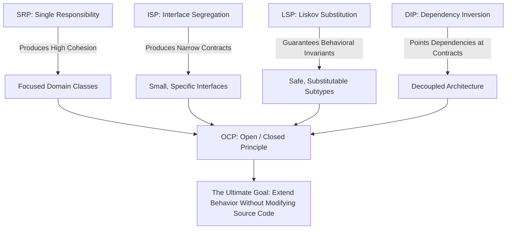

# SOLID Principles: Overview

> **One-line summary:** SOLID is an acronym for five foundational design principles formulated by Robert C. Martin that describe what makes software architectures easy to change, test, and extend over multi-year enterprise lifecycles.

| Attribute | Specification |
|---|---|
| **Level** | Foundations / Core |
| **Prerequisites** | [01-foundations/01-oop-pillars.md](../01-foundations/01-oop-pillars.md), [01-foundations/03-coupling-and-cohesion.md](../01-foundations/03-coupling-and-cohesion.md) |
| **Estimated Reading Time** | 20 minutes |
| **Status** | Complete |
| **Category** | SOLID Principles |
| **Also Known As** | Uncle Bob's SOLID Principles |
| **Languages Tested** | Java 25 (LTS) / TypeScript 5.8 (Node 24 native) / Python 3.14 |

---

## Table of Contents
- [1 The Problem: The Inherent Fragility of Growing Codebases](#1-the-problem-the-inherent-fragility-of-growing-codebases)
- [2 Why SOLID Exists: History and Acronym Synthesis](#2-why-solid-exists-history-and-acronym-synthesis)
- [3 The 5 Principles at a Glance](#3-the-5-principles-at-a-glance)
- [4 How the 5 Principles Interlock](#4-how-the-5-principles-interlock)
- [5 Symptom-to-Principle Diagnostic Guide](#5-symptom-to-principle-diagnostic-guide)
- [6 Common Misconceptions](#6-common-misconceptions)
- [7 Summary / Cheat Sheet](#7-summary--cheat-sheet)
- [8 Further Reading](#8-further-reading)

---

## 1 The Problem: The Inherent Fragility of Growing Codebases

Software does not wear out like physical machinery. Instead, software suffers from **Architectural Rot**:
- As new features are bolted on, code becomes increasingly rigid, fragile, and immobile.
- Developers add conditional `if/else` checks to avoid disturbing existing logic.
- Classes accumulate multiple responsibilities, becoming 2,000-line God Objects.
- Changes to database queries break UI rendering.

When code rots, every sprint slows down, defect density increases exponentially, and team morale plummets.

---

## 2 Why SOLID Exists: History and Acronym Synthesis

In the late 1990s and in his 2000 paper *"Design Principles and Design Patterns"*, Robert C. Martin ("Uncle Bob") compiled five design guidelines from computer science literature and industry practice:
1. **SRP**: Tom DeMarco and Meilir Page-Jones (Cohesion and reasons to change).
2. **OCP**: Bertrand Meyer (1988, *Object-Oriented Software Construction*).
3. **LSP**: Barbara Liskov and Jeannette Wing (1994, *A Behavioral Notion of Subtyping*).
4. **ISP**: Robert C. Martin (1996, developed during Xerox printer software consulting).
5. **DIP**: Robert C. Martin (1996, in *C++ Report*).

Around 2004, Michael Feathers observed that the initials of these five principles formed the memorable acronym **SOLID**.

---

## 3 The 5 Principles at a Glance

| Letter | Principle | Core Intent & Rule | Problem it Solves |
|:---:|---|---|---|
| **S** | [Single Responsibility](./01-single-responsibility.md) | A class should have one, and only one, reason to change (one actor). | Tangled business logic, presentation, and persistence causing shotgun surgery. |
| **O** | [Open/Closed](./02-open-closed.md) | Software entities should be open for extension, but closed for modification. | Giant `switch` and `if/else` statements that break existing working code when adding new types. |
| **L** | [Liskov Substitution](./03-liskov-substitution.md) | Subtypes must be substitutable for their base types without altering program correctness. | Subclasses that throw `UnsupportedOperationException` or break base class behavioral invariants. |
| **I** | [Interface Segregation](./04-interface-segregation.md) | Clients should not be forced to depend upon interfaces they do not use. | Fat interfaces that force consumers to implement useless empty dummy methods. |
| **D** | [Dependency Inversion](./05-dependency-inversion.md) | High-level modules should not depend on low-level modules; both should depend on abstractions. | Direct compile-time coupling to databases, external SDKs, or hardware, preventing automated testing. |

---

## 4 How the 5 Principles Interlock

The five SOLID principles are not disconnected suggestions—they form a unified architectural feedback loop:



Notice that **Open/Closed Principle (OCP) is the ultimate goal**. You achieve OCP:
- By keeping classes focused on one actor (**SRP**),
- Connecting them through small, role-specific contracts (**ISP**),
- Inverting compile-time dependencies so high-level policies depend on abstractions (**DIP**), and
- Guaranteeing that any new extension behaves safely without breaking callers (**LSP**).

---

## 5 Symptom-to-Principle Diagnostic Guide

When reviewing legacy code or debugging a production regression, use this diagnostic heuristic table:

| Observed Code Smell / Production Pain | Violates | Recommended Remediation Note |
|---|:---:|---|
| A PR touching user billing accidentally breaks user avatar image resizing. | **SRP** | [01-single-responsibility.md](./01-single-responsibility.md) |
| Adding a new shipping provider requires modifying 18 files with `if (provider == ...)` ladders. | **OCP** | [02-open-closed.md](./02-open-closed.md) |
| A subclass overrides a parent method with `{ /* do nothing */ }` or throws `NotImplementedException`. | **LSP** | [03-liskov-substitution.md](./03-liskov-substitution.md) |
| An interface has 30 methods, and implementing a lightweight mock requires stubbing 28 unused methods. | **ISP** | [04-interface-segregation.md](./04-interface-segregation.md) |
| You cannot write a unit test for a service without spinning up a live PostgreSQL container and AWS network credentials. | **DIP** | [05-dependency-inversion.md](./05-dependency-inversion.md) |

---

## 6 Common Misconceptions

- **Misconception 1: "A single responsibility means a class should do only one thing."**  
  *Correction:* Uncle Bob explicitly clarified that SRP is about **actors and stakeholders**, not function size. A class should have *one reason to change* (meaning it serves one specific stakeholder, such as the Accounting department, not both Accounting and Marketing).
- **Misconception 2: "SOLID requires creating an interface for every single class."**  
  *Correction:* Creating `IOrderService` for an `OrderService` with only one implementation does not magically satisfy SOLID; it just adds useless boilerplate. Use interfaces where volatility, polymorphism, or test seams exist.
- **Misconception 3: "SOLID is an absolute law."**  
  *Correction:* SOLID principles are heuristics to manage the cost of change. Over-applying them to tiny scripts or stable prototypes creates architecture astronautics.

---

## 7 Summary / Cheat Sheet

```
+-------------------------------------------------------------------------------+
| THE SOLID MENTAL MODEL                                                        |
| S - Single Responsibility: One actor, one reason to change.                   |
| O - Open/Closed:           Extend via new code, not by editing old code.     |
| L - Liskov Substitution:   Subtypes must behave correctly without surprises. |
| I - Interface Segregation: Keep contracts client-specific and small.          |
| D - Dependency Inversion:  Depend on abstractions, not concretions.           |
+-------------------------------------------------------------------------------+
```

---

## 8 Further Reading

- Martin, Robert C. (2002). *"Agile Software Development, Principles, Patterns, and Practices"*, Prentice Hall.
- Martin, Robert C. (2017). *"Clean Architecture: A Craftsman's Guide to Software Structure and Design"*, Prentice Hall.
- Feathers, Michael (2004). *"Working Effectively with Legacy Code"*, Prentice Hall.

### In Your Language
| Language Track | Deep Dive Reference |
|---|---|
| Java | [Java SOLID & Clean Code](file:///e:/Learning/engineering-notes/01-languages/java/24-design-patterns/README.md) |
| TypeScript | [TypeScript SOLID Principles](file:///e:/Learning/engineering-notes/01-languages/typescript/17-design-patterns/README.md) |
| Python | [Pythonic SOLID Principles](file:///e:/Learning/engineering-notes/01-languages/python/23-design-patterns/README.md) |

---
[← Module 02 Index](README.md) | [Next: 01 - Single Responsibility Principle →](01-single-responsibility.md)
