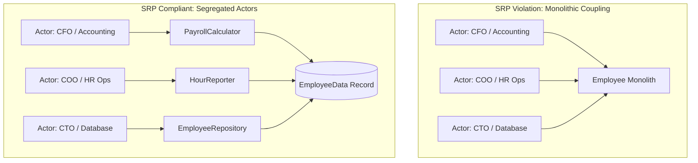
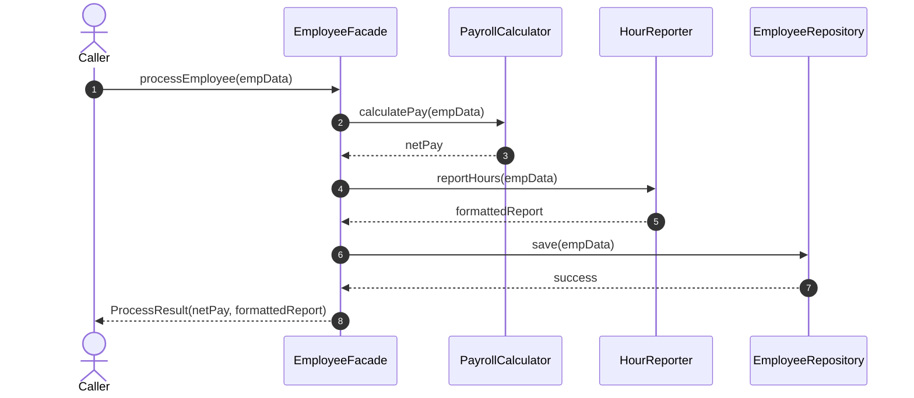
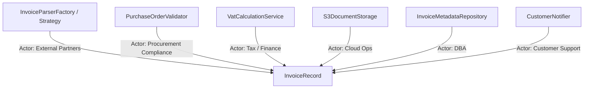

# Single Responsibility Principle (SRP)

> **One-line summary:** A module should be responsible to one, and only one, actor—meaning every class or module must have exactly one reason to change.

| Attribute | Specification |
|---|---|
| **Level** | Core / Foundational |
| **Prerequisites** | [01-oop-pillars.md](../01-foundations/01-oop-pillars.md), [03-coupling-and-cohesion.md](../01-foundations/03-coupling-and-cohesion.md) |
| **Estimated Reading Time** | 30 minutes |
| **Status** | Complete |
| **Category** | SOLID Principles |
| **Also Known As** | Separation of Concerns (Actor-focused), Single Reason to Change |
| **Languages Tested** | Java 25 (LTS) / TypeScript 5.8 (Node 24 native) / Python 3.14 |

---

## Table of Contents
- [1 The Problem](#1-the-problem)
- [2 Why It Exists](#2-why-it-exists)
- [3 What It Is](#3-what-it-is)
- [4 The Problem Without It](#4-the-problem-without-it)
- [5 How It Solves It](#5-how-it-solves-it)
- [6 How It Works](#6-how-it-works)
- [7 Real-World Examples](#7-real-world-examples)
- [8 When to Use and When NOT to Use](#8-when-to-use-and-when-not-to-use)
- [9 Variations and Language Idioms](#9-variations-and-language-idioms)
- [10 Relationship to Other Principles and Patterns](#10-relationship-to-other-principles-and-patterns)
- [11 Common Mistakes and Anti-Patterns](#11-common-mistakes-and-anti-patterns)
- [12 Testing and Design Verification](#12-testing-and-design-verification)
- [13 Performance, Concurrency and Security Notes](#13-performance-concurrency-and-security-notes)
- [14 Interview Questions](#14-interview-questions)
- [15 Practice Exercises](#15-practice-exercises)
- [16 Summary / Cheat Sheet](#16-summary--cheat-sheet)
- [17 Further Reading](#17-further-reading)

---

## 1 The Problem

Imagine an enterprise payroll and human resources application. The engineering team models core operations around a central `Employee` class. At first, this seems clean and natural: an employee has hours worked, an hourly rate, a name, and an ID.

```
       +---------------------------------------------+
       |                  Employee                   |
       +---------------------------------------------+
       | - name, hoursWorked, hourlyRate             |
       +---------------------------------------------+
       | + calculatePay()    --> Used by Accounting  |
       | + reportHours()     --> Used by HR Ops      |
       | + save()            --> Used by DB Admin    |
       | - regularHours()    --> Shared helper       |
       +---------------------------------------------+
```

Over eighteen months, three different executive stakeholders demand changes:
1. **The CFO (Accounting)** requests a change in the regular hours policy: overtime should only kick in after deducting mandatory 30-minute unpaid meal breaks. A developer updates the shared private `regularHours()` helper method inside `Employee`.
2. **The COO (HR Operations)** relies on `reportHours()` for federal workplace safety compliance reporting, which strictly requires raw on-the-clock physical hours. Because the shared `regularHours()` helper was modified for the CFO, the COO's safety reports silently under-report work hours, triggering a regulatory audit and a \$75,000 compliance penalty.
3. **The CTO (Database Engineering)** executes a database migration from PostgreSQL to an encrypted document store. The DB developer checks out `Employee.java` to rewrite `save()`. When merging back into main, Git flags 14 merge conflicts against simultaneous PRs authored by Accounting and HR developers. One bad conflict resolution accidentally reverts the CFO's tax algorithm on production deploy night.

The team has fallen victim to coupling different business actors into a single module. When a single class answers to multiple organizational masters, a change requested by one actor inevitably breaks functionality relied upon by another.

---

## 2 Why It Exists

The Single Responsibility Principle was formulated by Robert C. Martin ("Uncle Bob") in the early 2000s in his papers on agile software design and solidified in *Clean Architecture* (2017).

Historically, developers often quoted the heuristic: *"A class should do only one thing."* While intuitive, that phrasing caused immense confusion: does calculating net pay, applying tax brackets, and deducting healthcare constitute "one thing" or "three things"?

To eliminate ambiguity, Uncle Bob reformulated SRP around the concept of **actors**:
> *"A module should be responsible to one, and only one, actor."*

An **actor** is a user, stakeholder, or business department that represents a single cohesive source of change requests. SRP exists to align software module boundaries with organizational boundaries (reflecting Conway's Law in reverse). By ensuring each module answers to only one actor, changes requested by Accounting will never touch, recompile, or risk breaking code requested by Human Resources or Infrastructure.

---

## 3 What It Is

The formal definition of SRP requires that:
1. **A module has only one reason to change:** If a business analyst from Department A asks for a feature, only Department A's modules should require modification.
2. **Cohesion is maximal within the boundary:** All functions inside the module operate on the same conceptual policy.
3. **Coupling between disparate actors is zero:** Modules serving different actors interact strictly via shared data contracts (DTOs or Value Objects), not shared behavioral classes.



---

## 4 The Problem Without It

Here is the monolithic employee class in Java. Notice the insidious trap: private method `regularHours()` is shared between `calculatePay()` (CFO) and `reportHours()` (COO).

```java
// Naive Monolithic Implementation violating SRP
public class EmployeeMonolith {
    private String name;
    private int hoursWorked;
    private double hourlyRate;

    public EmployeeMonolith(String name, int hoursWorked, double hourlyRate) {
        this.name = name;
        this.hoursWorked = hoursWorked;
        this.hourlyRate = hourlyRate;
    }

    // Shared internal helper - The architectural landmine!
    private int regularHours() {
        // Initially: standard cap at 40 hours
        return Math.min(hoursWorked, 40);
    }

    // Actor 1: CFO / Accounting Department
    public double calculatePay() {
        return regularHours() * hourlyRate;
    }

    // Actor 2: COO / Operations HR Department
    public String reportHours() {
        return "Logged " + regularHours() + " standard hours for " + name;
    }

    // Actor 3: CTO / Database Administration
    public void save() {
        System.out.println("SQL: INSERT INTO employees VALUES ('" + name + "', " + hoursWorked + ")");
    }
}
```

### The Change Request & Catastrophic Blast Radius
The CFO requests: *"To account for mandatory lunch breaks, employees working over 40 hours should only count 38 regular hours for standard pay."*

A developer edits `regularHours()`:
```java
private int regularHours() {
    return Math.min(hoursWorked - 2, 38); // Modified for CFO!
}
```

### The Failure Output
```text
[Production Alert]
CFO Pay Check: $1900.0 (Matches expected new payroll policy)
HR Audit Report: "Logged 38 standard hours for Alice" 
[CRITICAL ERROR] HR Compliance Report Underreported! Expected 40 hours for regulatory overtime tracking!
[DATABASE ERROR] Concurrent merge conflict in EmployeeMonolith.java by 3 teams!
```

---

## 5 How It Solves It

To solve this, we separate the responsibilities into distinct classes aligned with the respective actors. We define an immutable data structure (`EmployeeData`) that holds only state, and create three distinct services:
1. `PayrollCalculator` (Answers to the CFO)
2. `HourReporter` (Answers to the COO)
3. `EmployeeRepository` (Answers to the CTO)

### Java Implementation (Java 25 LTS)

```java
package com.design.solid.srp;

// Shared immutable data carrier (DTO / Value Object)
public record EmployeeData(String name, int hoursWorked, double hourlyRate) {}

// Actor 1: CFO / Accounting
class PayrollCalculator {
    public double calculatePay(EmployeeData emp) {
        // Accounting policy: 40 regular hours max, 1.5x overtime beyond 40
        int regularHours = Math.min(emp.hoursWorked(), 40);
        int overtimeHours = Math.max(0, emp.hoursWorked() - 40);
        return (regularHours * emp.hourlyRate()) + (overtimeHours * emp.hourlyRate() * 1.5);
    }
}

// Actor 2: COO / Operations HR
class HourReporter {
    public String reportHours(EmployeeData emp) {
        // HR policy: Report actual physical hours logged
        return "Logged " + emp.hoursWorked() + " total hours for " + emp.name();
    }
}

// Actor 3: CTO / Database Administration
class EmployeeRepository {
    public void save(EmployeeData emp) {
        System.out.println("EmployeeRepository: Saved " + emp.name() + " to PostgreSQL");
    }
}

public class SrpSolutionApp {
    public static void main(String[] args) {
        EmployeeData emp = new EmployeeData("Alice", 45, 50.0);
        
        PayrollCalculator payroll = new PayrollCalculator();
        HourReporter reporter = new HourReporter();
        EmployeeRepository repo = new EmployeeRepository();

        System.out.println("Pay: $" + payroll.calculatePay(emp));
        System.out.println("Report: " + reporter.reportHours(emp));
        repo.save(emp);
    }
}
```

### TypeScript Implementation (Node 24 Native)

```typescript
// Shared data definition
interface EmployeeData {
    readonly name: string;
    readonly hoursWorked: number;
    readonly hourlyRate: number;
}

// Actor 1: CFO / Accounting
class PayrollCalculator {
    calculatePay(emp: EmployeeData): number {
        const regularHours = Math.min(emp.hoursWorked, 40);
        const overtimeHours = Math.max(0, emp.hoursWorked - 40);
        return (regularHours * emp.hourlyRate) + (overtimeHours * emp.hourlyRate * 1.5);
    }
}

// Actor 2: COO / Operations HR
class HourReporter {
    reportHours(emp: EmployeeData): string {
        return `Logged ${emp.hoursWorked} total hours for ${emp.name}`;
    }
}

// Actor 3: CTO / Database Administration
class EmployeeRepository {
    save(emp: EmployeeData): void {
        console.log(`TS EmployeeRepository: Saved ${emp.name} to DB`);
    }
}

// Application execution
const emp: EmployeeData = { name: "Alice", hoursWorked: 45, hourlyRate: 50.0 };
const payroll = new PayrollCalculator();
const reporter = new HourReporter();
const repo = new EmployeeRepository();

console.log(`TS Pay: $${payroll.calculatePay(emp)}`);
console.log(`TS Report: ${reporter.reportHours(emp)}`);
repo.save(emp);
```

### Python Implementation (Python 3.14)

```python
from dataclasses import dataclass

# Shared immutable data structure
@dataclass(frozen=True)
class EmployeeData:
    name: str
    hours_worked: int
    hourly_rate: float

# Actor 1: CFO / Accounting
class PayrollCalculator:
    def calculate_pay(self, emp: EmployeeData) -> float:
        regular_hours = min(emp.hours_worked, 40)
        overtime_hours = max(0, emp.hours_worked - 40)
        return (regular_hours * emp.hourly_rate) + (overtime_hours * emp.hourly_rate * 1.5)

# Actor 2: COO / Operations HR
class HourReporter:
    def report_hours(self, emp: EmployeeData) -> str:
        return f"Logged {emp.hours_worked} total hours for {emp.name}"

# Actor 3: CTO / Database Administration
class EmployeeRepository:
    def save(self, emp: EmployeeData) -> None:
        print(f"Python EmployeeRepository: Saved {emp.name} to DB")

if __name__ == "__main__":
    emp = EmployeeData(name="Alice", hours_worked=45, hourly_rate=50.0)
    payroll = PayrollCalculator()
    reporter = HourReporter()
    repo = EmployeeRepository()

    print(f"Python Pay: ${payroll.calculate_pay(emp)}")
    print(f"Python Report: {reporter.report_hours(emp)}")
    repo.save(emp)
```

### Real Execution Output
```text
Pay: $2375.0
Report: Logged 45 total hours for Alice
EmployeeRepository: Saved Alice to PostgreSQL
```

Now, if the CFO requests changes to overtime rules, only `PayrollCalculator` is touched. `HourReporter` and `EmployeeRepository` remain completely unaffected, eliminating collateral bugs and merge conflicts.

---

## 6 How It Works

The architectural separation works by severing hidden couplings between different actors:

1. **Separation of Policy from Persistence:** Business rules (`PayrollCalculator`) are pure domain logic. They have zero awareness of SQL, ORM mappings, or file systems (`EmployeeRepository`).
2. **Separation of Policy from Formatting:** Human-readable string representations (`HourReporter`) are presentation concerns. They change when branding or compliance formats change, independent of the math.
3. **Facade Integration (Optional):** If client callers prefer a single unified entry point rather than instantiating three classes, an `EmployeeFacade` can orchestrate them behind the scenes while keeping each class independent:



---

## 7 Real-World Examples

### 1. Business Domain: E-Commerce Order Processing
In enterprise billing, an `Order` object should not validate credit cards, compute tax across 50 US states, serialize itself to JSON for an HTTP response, and execute SQL statements. A well-designed system segregates these into:
- `Order` (State / Value Object)
- `TaxCalculationService` (Complies with State/Federal Tax codes)
- `PaymentGatewayClient` (Communicates with Stripe / Adyen APIs)
- `OrderRepository` (Handles persistence to Aurora PostgreSQL)

### 2. Standard Library: Java I/O Streams (`Reader` vs `BufferedReader`)
The Java Standard Library intentionally separated raw character reading from buffering:
- `java.io.Reader`: Responsible purely for character stream decoding contracts.
- `java.io.BufferedReader`: Responsible exclusively for buffering characters to minimize physical disk/network I/O syscalls.
- `java.io.LineNumberReader`: Responsible exclusively for tracking newline line numbers.
Rather than stuffing line numbers and buffering into `Reader`, the JDK split each responsibility into composable decorators.

### 3. Cloud / Distributed: AWS Lambda Handlers
In cloud-native serverless functions, mixing the AWS Lambda API Gateway payload unmarshaling, JWT validation, core domain computation, and DynamoDB SDK calls inside the single handler function is the #1 cause of unmaintainable serverless architectures. Industry best practice isolates:
- `LambdaGatewayAdapter`: Deserializes APIGatewayProxyRequestEvent.
- `TokenValidator`: Validates authorization tokens.
- `DomainService`: Executes core business logic without AWS SDK imports.

---

## 8 When to Use and When NOT to Use

| Context | Recommended Action | Rationale |
|---|---|---|
| **Multiple Business Stakeholders** | **Split by Actor (Strict SRP)** | Prevents cross-department regressions and Git merge hell. |
| **Volatile External Dependencies** | **Extract Gateway / Repository** | Shield core logic from third-party API changes. |
| **Complex Formatting / Exporting** | **Extract Serializer / Formatter** | Avoid polluting domain entities with JSON, CSV, or XML tags. |
| **Simple CRUD Internal Tool** | **Combine Conservatively** | A simple 50-line internal script does not need 6 separate classes. |
| **Single-Developer Prototype** | **Defer Premature Splitting** | Extract responsibilities as actors emerge, not speculatively. |

### Warning Signs of SRP Violations
- Class names ending in `Manager`, `Processor`, `Controller`, or `Helper` spanning 800+ lines.
- Imports containing both database drivers (`java.sql.*`) and UI/web libraries (`javax.servlet.*`).
- Merge conflicts occurring frequently in the same file between unrelated sprint tickets.
- Unit tests requiring hundreds of lines of mocking setup just to test a 5-line calculation.

---

## 9 Variations and Language Idioms

### Java
Java 16+ `record` types provide the ideal representation for passive data models, leaving behavioral policies to Spring or Jakarta `@Service` classes:
```java
public record InvoiceData(UUID id, BigDecimal subtotal, double taxRate) {}
```

### TypeScript
TypeScript favors structural typing and separate pure functions or modules. Often, a "module" in TypeScript is simply an `export function` rather than an artificial class:
```typescript
export interface Invoice { readonly id: string; readonly amount: number; }
export const calculateTax = (inv: Invoice): number => inv.amount * 0.20;
export const saveInvoice = async (inv: Invoice): Promise<void> => { /* ... */ };
```

### Python
Python uses `@dataclass(frozen=True)` for immutable state and modules (`.py` files) as the boundary of SRP. One file can export a dataclass and pure domain functions without requiring boilerplate class wrappers:
```python
@dataclass(frozen=True)
class Invoice:
    id: str
    amount: float
```

---

## 10 Relationship to Other Principles and Patterns

- **OCP (Open/Closed Principle):** SRP is the prerequisite for OCP. You cannot make a class closed for modification if it changes for multiple unrelated business reasons.
- **ISP (Interface Segregation Principle):** ISP is SRP applied at the interface level. SRP says "one reason to change for classes"; ISP says "one role per interface for clients".
- **Facade Pattern:** When splitting a monolith into 5 SRP-compliant classes, callers might complain about complexity. The Facade pattern provides a simple unified interface over the smaller classes.
- **Repository Pattern:** Directly decouples business domain entities from database persistence mechanics.

---

## 11 Common Mistakes and Anti-Patterns

| Anti-Pattern | Description | Production Consequence | Correct Remedy |
|---|---|---|---|
| **God Class** | Centralizing all system behavior in a single class. | Massive blast radius, merge bottlenecks, untestable code. | Decompose by business actor using Refactoring: Extract Class. |
| **Anemic Domain Anti-Pattern** | Stripping *all* behavior out of entities into useless 1-line services. | Object model devolves into procedural C-style structs without encapsulation. | Keep intrinsic business validation inside the entity; extract only external actor concerns. |
| **Shotgun Surgery** | Every small change forces edits across dozens of micro-classes. | High cognitive friction, missed updates, fractured domain logic. | High cohesion check: group concepts that change together for the *same* actor into one module. |
| **Micro-Interface Proliferation** | Creating a single interface with 1 method for every single class preemptively. | Interface bloat with zero polymorphism benefit. | Introduce interfaces only when multiple implementations or testing seams are needed. |
| **Mixing Validation with Formatting** | Entity validates business limits and also formats HTML/PDF output. | UI redesign breaks financial calculation tests. | Move formatting to dedicated presenters or template engines. |
| **Coupling Entity to ORM** | Adding database table annotations (`@Entity`, `@Table`) directly onto core domain logic. | Database schema changes force domain model recompilation. | Separate Domain Model from Database Persistence Entity (Clean Architecture). |

---

## 12 Testing and Design Verification

When a class violates SRP, writing a unit test requires mocking the database, the network, the file system, and external email providers just to verify a basic calculation.

Under SRP, domain services become **pure, isolated units**:

```java
// Testing PayrollCalculator requires ZERO mocks!
class PayrollCalculatorTest {
    @Test
    void shouldCalculateOvertimeCorrectly() {
        PayrollCalculator calculator = new PayrollCalculator();
        EmployeeData emp = new EmployeeData("Bob", 50, 20.0); // 40 reg @ $20 = 800, 10 OT @ $30 = 300

        double pay = calculator.calculatePay(emp);

        assertEquals(1100.0, pay, 0.001);
    }
}
```
**Test Seam Verification:** Notice that no database was started, no Docker testcontainer was booted, and no Mockito mocks were instantiated. The test executes in 0.5 milliseconds.

---

## 13 Performance, Concurrency and Security Notes

### Performance
- Splitting classes introduces additional object references and method call indirection. In modern JITs (HotSpot C2, V8), short methods and monomorphic call sites are aggressively inlined, resulting in **zero runtime penalty**.
- Splitting permits fine-grained caching: you can cache the result of `PayrollCalculator` in Redis without caching database connection pools.

### Concurrency
- SRP makes concurrency vastly simpler. If `EmployeeData` is an immutable record, multiple worker threads can concurrently compute payroll, generate reports, and log audits without a single synchronization lock or data race.

### Security
- **Privilege Separation:** Under SRP, the `EmployeeRepository` can run under an encrypted database service account, while the `HourReporter` can run in an unprivileged logging container. Monolithic classes force the entire execution context to possess maximum database credentials.

---

## 14 Interview Questions

<details>
<summary><strong>1. How does Robert C. Martin define a "reason to change" in SRP?</strong></summary>

Robert C. Martin defines a "reason to change" as an **actor**—a group of one or more stakeholders, users, or business departments who request changes to a system. SRP is not about a class doing literally only one function; it is about ensuring that a module answers to exactly one business stakeholder, shielding it from changes originating elsewhere.
</details>

<details>
<summary><strong>2. What is the difference between SRP and High Cohesion?</strong></summary>

High Cohesion is a general software engineering metric describing how closely related the responsibilities of a module are. SRP is a specific, actionable rule defining *what* creates that relationship: cohesion must be bounded by a single actor or business policy. High Cohesion without SRP might group all "Employee Operations" together, still violating SRP by coupling HR with Accounting.
</details>

<details>
<summary><strong>3. How does Conway's Law relate to SRP?</strong></summary>

Conway's Law states: *"Organizations which design systems are constrained to produce designs which are copies of the communication structures of these organizations."* SRP applies this at the class and module level: if Accounting and HR are separate organizational departments, their code must be in separate modules. Violating SRP means two distinct organizational units are forced to coordinate changes through a single code file.
</details>

<details>
<summary><strong>4. What is the "Shotgun Surgery" code smell and how is it related to SRP?</strong></summary>

Shotgun Surgery is the opposite of a God Class: making a single logical change requires making small edits across dozens of different classes. It indicates that SRP was misapplied by over-fragmenting responsibilities that actually belong to the *same* actor. High cohesion requires things that change together for the same reason to be kept together.
</details>

<details>
<summary><strong>5. Can an entity contain business validation methods without violating SRP?</strong></summary>

Yes. In Domain-Driven Design (DDD), an entity is responsible for maintaining its own internal consistency and invariants (e.g. `order.addItem()` ensuring the quantity is greater than zero and stock is available). That is intrinsic domain logic. It violates SRP only when it takes on external actor responsibilities like formatting JSON, sending emails, or executing database queries.
</details>

<details>
<summary><strong>6. How do you refactor an existing 2,000-line God Class to comply with SRP without breaking existing callers?</strong></summary>

Use the **Facade Pattern** and **Extract Class**:
1. Identify distinct actors and extract small, cohesive classes for each (e.g., `PaymentService`, `NotificationService`).
2. Turn the original God Class into a thin Facade that delegates all incoming method calls to the newly extracted classes.
3. Update legacy callers over time to inject the new specific services directly.
4. Deprecate and eventually remove the Facade once all callers are migrated.
</details>

<details>
<summary><strong>7. How does SRP affect CI/CD build times and merge conflicts?</strong></summary>

When SRP is respected, developers working on different business features edit different files in separate directories. This eliminates Git merge conflicts. In modular architectures (e.g., Gradle/Maven multi-module or Nx monorepos), CI tools can skip rebuilding or testing modules that were untouched by a given commit, drastically cutting build pipeline times.
</details>

<details>
<summary><strong>8. Does functional programming need SRP?</strong></summary>

Absolutely. In functional programming, SRP applies to pure functions and modules. A pure function should compute one result without secondary side-effects (e.g., a function should compute tax, but not also write to an audit log or print to stdout). Functional pipelines compose small, single-purpose functions together using pipe operators or monads.
</details>

---

## 15 Practice Exercises

### Exercise 1: Spot the Violations (Easy)
Identify all actors and responsibilities mixed in this user registration class:
```java
public class UserManager {
    public void registerUser(String username, String password, String email) {
        // 1. Password hash
        String hash = BCrypt.hashpw(password, BCrypt.gensalt());
        // 2. Database insert
        Connection conn = DriverManager.getConnection("jdbc:postgresql://localhost/db");
        // 3. Email dispatch
        SmtpClient.send(email, "Welcome!", "Your account is created.");
        // 4. Analytics log
        File log = new File("/var/log/analytics.log");
    }
}
```

<details>
<summary><strong>Solution</strong></summary>

The `UserManager` mixes four distinct actors and responsibilities:
1. **Security Policy:** Password hashing algorithms (Security Team).
2. **Persistence:** JDBC connection and SQL persistence (DBA / Infrastructure).
3. **Communication:** SMTP email protocol formatting and dispatch (Marketing / Communications).
4. **Telemetry:** File-based analytics logging (Operations / Data Analytics).

**Fix:** Extract into `PasswordHasher`, `UserRepository`, `EmailNotifier`, and `AnalyticsLogger`.
</details>

---

### Exercise 2: Refactor to Segregated Services (Medium)
Refactor the following report generator which mixes data fetching, markdown formatting, and file writing into SRP-compliant classes.

```typescript
// Refactor this class
class SystemStatusReport {
    generateAndSaveReport(filepath: string) {
        const cpuUsage = os.loadavg()[0];
        const freeMem = os.freemem();
        const content = `# Status\nCPU: ${cpuUsage}\nMemory: ${freeMem}`;
        fs.writeFileSync(filepath, content);
    }
}
```

<details>
<summary><strong>Solution</strong></summary>

```typescript
// 1. Telemetry Collector (Actor: Ops monitoring)
class SystemMetricsCollector {
    collectMetrics() {
        return { cpu: os.loadavg()[0], freeMem: os.freemem() };
    }
}

// 2. Report Formatter (Actor: Presentation)
class MarkdownReportFormatter {
    format(metrics: { cpu: number; freeMem: number }): string {
        return `# Status\nCPU: ${metrics.cpu}\nMemory: ${metrics.freeMem}`;
    }
}

// 3. File Storage Gateway (Actor: Infrastructure)
class FileReportStorage {
    save(filepath: string, content: string): void {
        fs.writeFileSync(filepath, content);
    }
}
```
</details>

---

### Exercise 3: Architecture Redesign for Invoice Processing (Hard)
Design an enterprise invoice processing system that must:
1. Parse incoming EDI, JSON, and CSV invoices.
2. Validate invoice line items against purchase orders.
3. Calculate VAT based on country-specific rules.
4. Store invoices in AWS S3 and metadata in Aurora PostgreSQL.
5. Notify customers via SMS or Email.

Draw the component dependency diagram and specify the actor for each class.

<details>
<summary><strong>Solution</strong></summary>



Every service depends only on the passive data model `InvoiceRecord`. No service directly references another actor's implementation.
</details>

---

## 16 Summary / Cheat Sheet

```
+--------------------------------------------------------------------------+
|                     SINGLE RESPONSIBILITY PRINCIPLE                      |
+--------------------------------------------------------------------------+
| CORE RULE      : A module should be responsible to one, and only one,    |
|                  actor (source of change).                               |
| COMMON TRAP    : "A class should do only one thing" (too subjective).    |
| DANGER SIGN    : God classes (1,000+ lines), frequent Git merge          |
|                  conflicts, high mocking burden in unit tests.           |
| BEST PRACTICE  : Keep domain models as immutable records; encapsulate    |
|                  business policies, persistence, and formatting in       |
|                  dedicated actor-aligned services.                       |
+--------------------------------------------------------------------------+
```

---

## 17 Further Reading

- Robert C. Martin, *Clean Architecture: A Craftsman's Guide to Software Structure and Design*, Prentice Hall, 2017.
- Martin Fowler, *Refactoring: Improving the Design of Existing Code (2nd Edition)*, Addison-Wesley, 2018.
- Eric Evans, *Domain-Driven Design: Tackling Complexity in the Heart of Software*, Addison-Wesley, 2003.

### In Your Language
| Language Track | Deep Dive Reference |
|---|---|
| Java | [Java OOP & Design Patterns](file:///e:/Learning/engineering-notes/01-languages/java/24-design-patterns/README.md) |
| TypeScript | [TypeScript Design Patterns](file:///e:/Learning/engineering-notes/01-languages/typescript/17-design-patterns/README.md) |
| Python | [Python Design Patterns](file:///e:/Learning/engineering-notes/01-languages/python/23-design-patterns/README.md) |

---

[← Previous: 00 - SOLID Overview](file:///e:/Learning/engineering-notes/08-solid-design-patterns/02-solid-principles/00-overview.md) | [Module 02 Index](file:///e:/Learning/engineering-notes/08-solid-design-patterns/02-solid-principles/README.md) | [Next: 02 - Open/Closed Principle →](file:///e:/Learning/engineering-notes/08-solid-design-patterns/02-solid-principles/02-open-closed.md)
