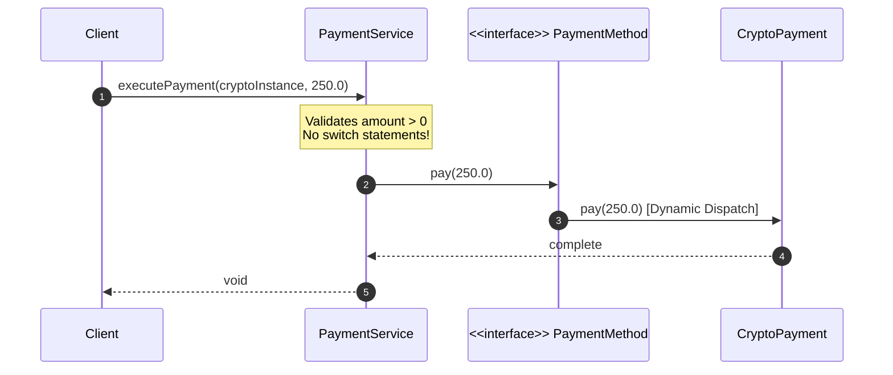
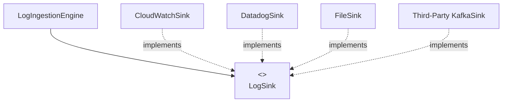

# Open/Closed Principle (OCP)

> **One-line summary:** Software entities (classes, modules, functions) should be open for extension, but closed for modification—enabling new behavior to be added by writing new code, rather than altering tested, existing code.

| Attribute | Specification |
|---|---|
| **Level** | Core / Foundational |
| **Prerequisites** | [01-single-responsibility.md](01-single-responsibility.md), [01-oop-pillars.md](../01-foundations/01-oop-pillars.md), [04-programming-to-interfaces.md](../01-foundations/04-programming-to-interfaces.md) |
| **Estimated Reading Time** | 35 minutes |
| **Status** | Complete |
| **Category** | SOLID Principles |
| **Also Known As** | Open for Extension, Closed for Modification; Polymorphic Extensibility |
| **Languages Tested** | Java 25 (LTS) / TypeScript 5.8 (Node 24 native) / Python 3.14 |

---

## Table of Contents
- [1 The Problem](#1-the-problem)
- [2 Why It Exists](#2-why-it-exists)
- [3 What It Is](#3-what-it-is)
- [4 The Problem Without It](#4-the-problem-without-it)
- [5 How It Solves It](#5-how-it-solves-it)
- [6 How It Works](#6-how-it-works)
- [7 Real-World Examples](#7-real-world-examples)
- [8 When to Use and When NOT to Use](#8-when-to-use-and-when-not-to-use)
- [9 Variations and Language Idioms](#9-variations-and-language-idioms)
- [10 Relationship to Other Principles and Patterns](#10-relationship-to-other-principles-and-patterns)
- [11 Common Mistakes and Anti-Patterns](#11-common-mistakes-and-anti-patterns)
- [12 Testing and Design Verification](#12-testing-and-design-verification)
- [13 Performance, Concurrency and Security Notes](#13-performance-concurrency-and-security-notes)
- [14 Interview Questions](#14-interview-questions)
- [15 Practice Exercises](#15-practice-exercises)
- [16 Summary / Cheat Sheet](#16-summary--cheat-sheet)
- [17 Further Reading](#17-further-reading)

---

## 1 The Problem

Consider an e-commerce checkout platform that processes payments. Initially, the business accepts only Credit Cards and PayPal. The checkout service handles this with a simple conditional branch:

```
        +----------------------------------------------------+
        |                  PaymentService                    |
        +----------------------------------------------------+
        | + processPayment(type: String, amount: double)     |
        |     switch (type) {                                |
        |       case "CREDIT_CARD" -> chargeStripe(amount);  |
        |       case "PAYPAL"      -> chargePayPal(amount);  |
        |     }                                              |
        +----------------------------------------------------+
```

Over the next 12 months, the marketing team demands new payment methods every quarter: Apple Pay, Google Pay, Klarna (Buy Now Pay Later), Bitcoin, and WeChat Pay.

Each addition requires opening the battle-tested `PaymentService.java` file and inserting a new branch. Then, the inevitable disaster strikes:
1. A developer adds `CRYPTO` payments. While updating fee calculations inside the 300-line `switch` block, they accidentally alter a shared variable used by the `CREDIT_CARD` branch.
2. The entire test suite for `PaymentService` must be re-run, but an edge-case test for European Visa 3D-Secure cards is missed.
3. On Black Friday, the update is deployed. Credit card transactions across Western Europe fail silently because of a regression introduced inside the class to support cryptocurrency. In 45 minutes of downtime, the business loses \$420,000 in revenue.

When existing code must be modified every time requirements expand, regression risk scales linearly with the age and complexity of the codebase.

---

## 2 Why It Exists

The Open/Closed Principle was originally formulated by **Bertrand Meyer** in his seminal 1988 book, *Object-Oriented Software Construction*:
> *"Software entities should be open for extension, but closed for modification."*

Meyer's original formulation relied heavily on **classical inheritance**: a class was closed because it was compiled, unit-tested, and stored in a shared library, but open because subclasses could inherit from it and override methods.

In the late 1990s, **Robert C. Martin ("Uncle Bob")** adapted the principle into its modern **polymorphic form**:
Instead of relying on fragile base class inheritance, OCP is best realized through **interfaces, abstract base classes, and composition (Strategy / Decorator patterns)**. 

OCP exists to resolve the fundamental tension of software maintenance: **Business requirements change constantly, but touching working, tested production code carries catastrophic regression risk.** OCP allows a system to grow organically by *adding new code files*, leaving existing, verified code untouched.

---

## 3 What It Is

The Open/Closed Principle defines two opposing constraints:

1. **Open for Extension:** The behavior of the module can be extended to handle new business requirements, new data formats, or new hardware devices.
2. **Closed for Modification:** Extending the module's behavior requires **zero changes** to its existing source code or binary artifact.

```mermaid
graph TD
    subgraph "OCP Violation: Direct Modification"
        Client1[Checkout Client] --> BadService[PaymentService Monolith]
        BadService -. "Every new method edits this file!" .-> CC1[Credit Card Logic]
        BadService -. "Edit!" .-> PP1[PayPal Logic]
        BadService -. "Edit!" .-> Crypto1[Crypto Logic]
    end

    subgraph "OCP Compliant: Polymorphic Abstraction"
        Client2[Checkout Client] --> GoodService[PaymentService]
        GoodService --> PaymentInterface["<<interface>>\nPaymentMethod"]
        
        CC2[CreditCardPayment] -.->|implements| PaymentInterface
        PP2[PayPalPayment] -.->|implements| PaymentInterface
        Crypto2[CryptoPayment\n(New Plugin)] -.->|implements| PaymentInterface
    end
```

---

## 4 The Problem Without It

Here is the naive payment processor written with procedural branching. Adding a new payment type requires modifying the core service class.

```java
// Naive Implementation violating OCP
public class PaymentProcessorViolation {
    public void processPayment(String type, double amount) {
        if ("CREDIT_CARD".equalsIgnoreCase(type)) {
            // Fee: 2.5%
            double fee = amount * 0.025;
            System.out.println("Processing credit card payment of $" + amount + " with fee $" + fee);
        } else if ("PAYPAL".equalsIgnoreCase(type)) {
            // Fee: 3.0%
            double fee = amount * 0.030;
            System.out.println("Processing PayPal payment of $" + amount + " with fee $" + fee);
        } else if ("CRYPTO".equalsIgnoreCase(type)) {
            // NEW CHANGE REQUEST: Modifying existing tested production class!
            // Developer introduces a subtle bug: network fee calculated incorrectly
            double fee = amount * 0.010;
            System.out.println("Processing Crypto payment of $" + amount + " with fee $" + fee);
        } else {
            throw new IllegalArgumentException("Unsupported payment type: " + type);
        }
    }
}
```

### The Change Request & Catastrophic Blast Radius
- Every time a new payment provider is onboarded, `PaymentProcessorViolation.java` must be modified, recompiled, retested, and redeployed.
- If two teams simultaneously implement Apple Pay and Klarna, they generate massive Git merge conflicts in the exact same `if/else` block.
- Cyclomatic complexity escalates with each condition, making comprehensive branch coverage exponentially difficult.

### The Failure Output
```text
[Deploy Log]
Processing credit card payment of $100.0 with fee $2.5
Processing Crypto payment of $250.0 with fee $2.5
[REGRESSION ALERT] Concurrent merge conflict in PaymentProcessorViolation.java
[SECURITY SCAN] Core payment module recompiled and redeployed without full PCI-DSS recertification!
```

---

## 5 How It Solves It

We invert the relationship by introducing a stable interface abstraction: `PaymentMethod`. The core `PaymentService` depends exclusively on this abstraction. Adding a new payment method requires creating a *new class* implementing `PaymentMethod`, without modifying a single character of `PaymentService`.

### Java Implementation (Java 25 LTS)

```java
package com.design.solid.ocp;

// Stable Abstraction (Seam)
public interface PaymentMethod {
    void pay(double amount);
}

// Concrete Extension 1: Credit Card
public class CreditCardPayment implements PaymentMethod {
    @Override
    public void pay(double amount) {
        double fee = amount * 0.025;
        System.out.println("Java: Credit Card processed $" + amount + " (Fee: $" + fee + ")");
    }
}

// Concrete Extension 2: PayPal
public class PayPalPayment implements PaymentMethod {
    @Override
    public void pay(double amount) {
        double fee = amount * 0.030;
        System.out.println("Java: PayPal processed $" + amount + " (Fee: $" + fee + ")");
    }
}

// Concrete Extension 3: Crypto (Added via extension, zero changes to PaymentService!)
public class CryptoPayment implements PaymentMethod {
    @Override
    public void pay(double amount) {
        double fee = amount * 0.010;
        System.out.println("Java: Crypto processed $" + amount + " (Fee: $" + fee + ")");
    }
}

// Closed for modification: Never touched when new payment methods arrive
public class PaymentService {
    public void executePayment(PaymentMethod method, double amount) {
        if (amount <= 0) {
            throw new IllegalArgumentException("Payment amount must be positive");
        }
        method.pay(amount);
    }
}

public class OcpSolutionApp {
    public static void main(String[] args) {
        PaymentService service = new PaymentService();
        
        // Execute existing payment
        service.executePayment(new CreditCardPayment(), 100.0);
        
        // Execute new payment plugin seamlessly
        service.executePayment(new CryptoPayment(), 250.0);
    }
}
```

### TypeScript Implementation (Node 24 Native)

```typescript
// Stable interface contract
interface PaymentMethod {
    pay(amount: number): void;
}

class CreditCardPayment implements PaymentMethod {
    pay(amount: number): void {
        const fee = amount * 0.025;
        console.log(`TS: Credit Card processed $${amount} (Fee: $${fee})`);
    }
}

class PayPalPayment implements PaymentMethod {
    pay(amount: number): void {
        const fee = amount * 0.030;
        console.log(`TS: PayPal processed $${amount} (Fee: $${fee})`);
    }
}

// New extension without touching PaymentService
class CryptoPayment implements PaymentMethod {
    pay(amount: number): void {
        const fee = amount * 0.010;
        console.log(`TS: Crypto processed $${amount} (Fee: $${fee})`);
    }
}

// Closed for modification
class PaymentService {
    executePayment(method: PaymentMethod, amount: number): void {
        if (amount <= 0) {
            throw new Error("Payment amount must be positive");
        }
        method.pay(amount);
    }
}

// Execution
const service = new PaymentService();
service.executePayment(new CreditCardPayment(), 100.0);
service.executePayment(new CryptoPayment(), 250.0);
```

### Python Implementation (Python 3.14)

```python
from typing import Protocol

# Structural typing protocol (seam)
class PaymentMethod(Protocol):
    def pay(self, amount: float) -> None:
        ...

class CreditCardPayment:
    def pay(self, amount: float) -> None:
        fee = amount * 0.025
        print(f"Python: Credit Card processed ${amount} (Fee: ${fee})")

class PayPalPayment:
    def pay(self, amount: float) -> None:
        fee = amount * 0.030
        print(f"Python: PayPal processed ${amount} (Fee: ${fee})")

# Extension: zero modifications to PaymentService
class CryptoPayment:
    def pay(self, amount: float) -> None:
        fee = amount * 0.010
        print(f"Python: Crypto processed ${amount} (Fee: ${fee})")

class PaymentService:
    def execute_payment(self, method: PaymentMethod, amount: float) -> None:
        if amount <= 0:
            raise ValueError("Payment amount must be positive")
        method.pay(amount)

if __name__ == "__main__":
    service = PaymentService()
    service.execute_payment(CreditCardPayment(), 100.0)
    service.execute_payment(CryptoPayment(), 250.0)
```

### Real Execution Output
```text
Java: Credit Card processed $100.0 (Fee: $2.5)
Java: Crypto processed $250.0 (Fee: $2.5)
TS: Credit Card processed $100 (Fee: $2.5)
TS: Crypto processed $250 (Fee: $2.5)
Python: Credit Card processed $100.0 (Fee: $2.5)
Python: Crypto processed $250.0 (Fee: $2.5)
```

---

## 6 How It Works

The mechanics of OCP rely on **Dynamic Polymorphism** and **Inversion of Control**:

1. **Strategic Seams:** The author of `PaymentService` identifies the axis of volatility (how payments are processed) and places an interface boundary (a "seam") across it.
2. **Dynamic Dispatch (vtable lookup):** When `method.pay(amount)` is invoked, the CPU resolves the target method address at runtime through the object's virtual method table. The caller (`PaymentService`) contains zero knowledge of `CryptoPayment`.
3. **Plugin Architecture:** In enterprise systems, new implementations can even be loaded dynamically at runtime via SPI (Service Provider Interface), Spring dependency injection, or dynamic module import without restarting the application.



---

## 7 Real-World Examples

### 1. Business Domain: Notification Routing Engine
An enterprise alerting platform delivers alerts via SMS, Slack, PagerDuty, and Email. By defining a `NotificationChannel` interface with `send(Alert alert)`, the central notification dispatcher is closed for modification. When the DevOps team requests a Discord webhook integration, a developer writes `DiscordChannel.java` without modifying the core dispatcher.

### 2. Standard Library: Java `Collections.sort` & `Comparator<T>`
Consider `java.util.Collections.sort(List<T> list, Comparator<? super T> c)`. The sorting algorithm (TimSort) is complex, highly optimized, and closed for modification. You do not edit `Collections.java` to sort Users by age or Orders by date. Instead, the method is open for extension via the `Comparator` interface.

### 3. Framework / Cloud: Spring Web `HandlerMethodArgumentResolver`
Spring Boot's HTTP controller parameter resolution is completely open for extension. Want to bind a custom `@CurrentUser` annotation directly to a controller argument? You do not modify Spring's HTTP dispatch servlet. You simply implement `HandlerMethodArgumentResolver` and register it as a bean.

---

## 8 When to Use and When NOT to Use

| Context | Recommendation | Rationale |
|---|---|---|
| **High Volatility Domain** (tax rules, payment gateways, file exporters) | **Apply OCP proactively** | Frequent business changes justify the interface abstraction. |
| **Plugin / Library Development** | **Mandatory OCP** | External consumers cannot edit your library's source code; they must extend via hooks/interfaces. |
| **Stable, Well-Known Domain** (coordinates, days of week, pure math) | **Do NOT apply OCP** | A Cartesian coordinate (`x`, `y`) will never have a third variant. An interface here is pure bloat. |
| **First Iteration (YAGNI / Rule of Three)** | **Wait for Pattern** | Implementing OCP for a feature with only one known variation is speculative over-engineering. Wait until the second or third variation appears. |

### Warning Signs of OCP Violations
- Giant `switch` or cascading `if/else` ladders checking `instanceof` or string type codes.
- Every sprint retrospective notes that modifying Class X caused unintended bugs in Feature Y.
- Inability to add a new third-party integration without deploying a full build of the core domain monolith.

---

## 9 Variations and Language Idioms

### Java: ServiceLoader & SPI
Java provides native plugin capabilities via `java.util.ServiceLoader`. New implementations declared in `META-INF/services` can be discovered by core libraries at runtime without any compile-time dependency.

### TypeScript: Discriminated Unions vs Interfaces
In TypeScript, OCP can be approached through polymorphism or through **Discriminated Unions with exhaustive checking**:
```typescript
type Payment = 
    | { kind: "card"; cardNumber: string }
    | { kind: "crypto"; walletAddress: string };

function assertNever(x: never): never {
    throw new Error("Unexpected object: " + x);
}
```
If you choose functional discriminated unions, the TypeScript compiler enforces that every `switch` handles all variants. However, adding a variant requires editing existing functions. For true OCP where third parties add types, structural interfaces and classes are preferred.

### Python: Structural Protocols
Python 3.8+ `typing.Protocol` allows structural subtyping (compile-time duck typing). A class does not need to explicitly inherit from `PaymentMethod`; as long as it defines `def pay(self, amount: float) -> None:`, Python's type checker (`mypy`, `pyright`) treats it as a valid extension.

---

## 10 Relationship to Other Principles and Patterns

- **OCP is the Primary Goal:** SRP, LSP, ISP, and DIP are the mechanical tools designed to make OCP achievable.
  - SRP isolates the reasons to change.
  - LSP ensures subclasses conform to the abstraction.
  - ISP keeps abstractions client-focused.
  - DIP ensures modules depend on the abstraction rather than concretions.
- **Strategy Pattern:** The primary design pattern used to achieve OCP for algorithms and business rules.
- **Decorator Pattern:** Extends object behavior dynamically at runtime without modifying the underlying class.
- **Factory Method:** Decouples the creation of concrete extensions from their consumption.

---

## 11 Common Mistakes and Anti-Patterns

| Anti-Pattern | Description | Production Consequence | Correct Remedy |
|---|---|---|---|
| **Speculative Generality** | Creating abstract interfaces for every class before any variation is required. | Codebase drowns in 1-implementation interfaces; navigation is agonizing. | Apply the "Rule of Three": write direct code first, refactor to OCP on the second or third variation. |
| **Leaky Abstraction** | Adding method `getCardExpiry()` to the generic `PaymentMethod` interface. | Breaks non-card payment implementations like PayPal or Crypto. | Keep the interface minimal and focused strictly on the generic action (`pay(amount)`). |
| **RTTI / Downcasting Escape Hatch** | Core service accepts `PaymentMethod`, but immediately casts: `if (m instanceof CreditCardPayment)`. | Completely defeats OCP; modifying extensions still breaks the core service. | Move the specific logic inside the concrete class implementation. |
| **Modification via Monkey-Patching** | Dynamically overriding class methods at runtime (common in Python/JS). | Unpredictable global side-effects, race conditions, untraceable bugs. | Use subclassing, composition, or decorators instead. |
| **Fragile Base Class** | Over-relying on inheritance to extend behavior, where parent class internal edits break subclasses. | Subclasses fail mysteriously when the base class modifies internal state. | Prefer composition over inheritance (Strategy Pattern over subclassing). |
| **Switch Statement Duplication** | Repeating the same `switch (type)` across 10 different files instead of encapsulating in a polymorphism hierarchy. | Missing one switch during an extension causes inconsistent runtime states. | Replace conditional with polymorphism. |

---

## 12 Testing and Design Verification

Under OCP, testing new features requires **zero regression testing of the core engine**. You only need to unit-test the new concrete extension, and write one test verifying that the core engine accepts any compliant mock:

```java
// Testing PaymentService with a Test Double (No external network calls!)
class PaymentServiceTest {
    static class FakePaymentMethod implements PaymentMethod {
        boolean wasCalled = false;
        double recordedAmount = 0.0;

        @Override
        public void pay(double amount) {
            this.wasCalled = true;
            this.recordedAmount = amount;
        }
    }

    @Test
    void shouldExecutePaymentWithoutKnowingConcretion() {
        PaymentService service = new PaymentService();
        FakePaymentMethod fake = new FakePaymentMethod();

        service.executePayment(fake, 99.50);

        assertTrue(fake.wasCalled);
        assertEquals(99.50, fake.recordedAmount);
    }
}
```

---

## 13 Performance, Concurrency and Security Notes

### Performance
- **Virtual Method Dispatch:** Invoking methods through interfaces incurs an indirect call via a vtable. In modern CPUs, branch predictors and HotSpot/V8 inline caches (monomorphic call optimization) optimize frequent calls down to direct CPU instructions. In 99.9% of enterprise workloads, this overhead is unmeasurable (< 1 nanosecond).
- **Object Allocation:** Instantiating new strategy objects can increase minor GC allocations. For stateless strategies, prefer singleton instances or static stateless singletons.

### Concurrency
- Strategy implementations should ideally be **stateless and thread-safe**. If `CreditCardPayment` holds no mutable instance variables, a single instance can process thousands of concurrent checkout requests across multiple threads.

### Security
- **Untrusted Plugin Execution:** If your architecture allows external third-party classes to be loaded as extensions, implement strict sandboxing (e.g., Java Security Manager replacements, isolated classloaders, or WebAssembly execution) to prevent malicious extensions from accessing system resources.

---

## 14 Interview Questions

<details>
<summary><strong>1. What is the fundamental difference between Bertrand Meyer's original OCP definition and Robert C. Martin's polymorphic OCP?</strong></summary>

Bertrand Meyer (1988) defined OCP around classical inheritance: a class is closed because it is compiled and published, but open because subclasses can inherit from it to alter or extend methods. Robert C. Martin (Uncle Bob) reformulated OCP to avoid the fragile base class problem by emphasizing **polymorphic abstractions (interfaces and abstract classes)** combined with composition (such as the Strategy and Decorator patterns).
</details>

<details>
<summary><strong>2. How does the Strategy pattern facilitate OCP?</strong></summary>

The Strategy pattern defines a family of interchangeable algorithms behind a common interface. The context class depends exclusively on the interface, meaning new strategies can be written and injected at runtime without altering a single line of the context class's source code, perfectly fulfilling OCP.
</details>

<details>
<summary><strong>3. How do you decide whether to use a `switch` statement or refactor to polymorphic OCP?</strong></summary>

Follow the **Rule of Three** and evaluate volatility:
- If there are only 2 stable options that almost never change (e.g., `MALE`, `FEMALE`, `OTHER`), a simple `switch` is acceptable and avoids premature abstraction.
- If the options represent business algorithms that expand frequently (e.g., payment gateways, tax rules, export formats) or are maintained by different teams, refactor immediately to polymorphic OCP.
</details>

<details>
<summary><strong>4. Can a system be 100% closed to all possible modifications?</strong></summary>

No. Complete closure is an impossible myth. A design can only be closed against *anticipated* axes of change. If an unforeseen requirement emerges (e.g., a payment method requiring a 2-step asynchronous callback approval loop), the interface itself may need to change. Experienced architects design closure around the most probable business changes.
</details>

<details>
<summary><strong>5. What is the "Replace Conditional with Polymorphism" refactoring?</strong></summary>

It is a core Martin Fowler refactoring technique where a complex conditional (such as `switch (employeeType)`) that chooses different behaviors based on an object's type is replaced by creating subclasses or strategy implementations for each branch and moving the branch logic into an overridden method.
</details>

<details>
<summary><strong>6. How does OCP apply to microservice architectures and APIs?</strong></summary>

In APIs, OCP means designing contracts that are backwards-compatible:
- **Open for Extension:** Adding new optional JSON fields or query parameters.
- **Closed for Modification:** Never deleting, renaming, or altering the semantics of existing fields in existing API versions. Consumers can handle new features without breaking existing integrations.
</details>

<details>
<summary><strong>7. How do TypeScript's Discriminated Unions relate to OCP?</strong></summary>

Discriminated unions provide algebraic data types with compile-time pattern matching. They are open for extension in terms of operations (you can easily add a new function that operates on all existing types without modifying the types), but closed to adding new *types* (adding a new type forces updates to all exhaustive switches). Polymorphic interfaces are the opposite: easy to add new types, harder to add new operations across all types (the "Expression Problem").
</details>

<details>
<summary><strong>8. What is the risk of premature application of OCP?</strong></summary>

The primary risk is **Speculative Generality**: introducing unnecessary layers of interfaces, factories, and abstract classes for code that will only ever have one implementation. This introduces cognitive overhead, makes debugging harder, and wastes engineering hours.
</details>

---

## 15 Practice Exercises

### Exercise 1: Spot the OCP Violation (Easy)
Identify why the following geometric area calculator violates OCP:
```java
public class AreaCalculator {
    public double calculateArea(Object shape) {
        if (shape instanceof Rectangle r) {
            return r.width * r.height;
        } else if (shape instanceof Circle c) {
            return Math.PI * c.radius * c.radius;
        }
        throw new IllegalArgumentException("Unknown shape");
    }
}
```

<details>
<summary><strong>Solution</strong></summary>

`AreaCalculator` violates OCP because introducing a new shape (e.g., `Triangle`) requires opening `AreaCalculator.java`, editing the method to add another `else if`, and recompiling.
**Fix:** Define an interface `Shape` with a method `double area()`. Have `Rectangle`, `Circle`, and `Triangle` implement `Shape`. `AreaCalculator` simply calls `shape.area()`.
</details>

---

### Exercise 2: Refactor Discount Engine (Medium)
Refactor this procedural discount calculator to obey OCP using the Strategy pattern:

```typescript
class DiscountCalculator {
    calculateDiscount(customerType: string, price: number): number {
        if (customerType === "REGULAR") {
            return price * 0.05;
        } else if (customerType === "VIP") {
            return price * 0.20;
        } else if (customerType === "EMPLOYEE") {
            return price * 0.30;
        }
        return 0;
    }
}
```

<details>
<summary><strong>Solution</strong></summary>

```typescript
interface DiscountPolicy {
    calculate(price: number): number;
}

class RegularDiscount implements DiscountPolicy {
    calculate(price: number): number { return price * 0.05; }
}

class VipDiscount implements DiscountPolicy {
    calculate(price: number): number { return price * 0.20; }
}

class EmployeeDiscount implements DiscountPolicy {
    calculate(price: number): number { return price * 0.30; }
}

class DiscountService {
    calculateDiscount(policy: DiscountPolicy, price: number): number {
        return policy.calculate(price);
    }
}
```
</details>

---

### Exercise 3: Extensible Log Exporter Pipeline (Hard)
Design an enterprise telemetry log exporting pipeline that:
1. Ingests structured log events.
2. Supports exporting to AWS CloudWatch, Datadog, and Local File.
3. Allows third-party development teams to plug in custom exporters (e.g., Kafka) without modifying the core ingest engine.
4. Draw the architecture and write the core interface contract in Python.

<details>
<summary><strong>Solution</strong></summary>



```python
from typing import Protocol, List
from dataclasses import dataclass

@dataclass(frozen=True)
class LogEvent:
    timestamp: int
    level: str
    message: str

class LogSink(Protocol):
    def emit(self, event: LogEvent) -> None:
        ...

class LogIngestionEngine:
    def __init__(self, sinks: List[LogSink]) -> None:
        self._sinks = sinks

    def log(self, event: LogEvent) -> None:
        for sink in self._sinks:
            sink.emit(event)
```
New sinks are registered dynamically without modifying `LogIngestionEngine`.
</details>

---

## 16 Summary / Cheat Sheet

```
+--------------------------------------------------------------------------+
|                          OPEN/CLOSED PRINCIPLE                           |
+--------------------------------------------------------------------------+
| CORE RULE      : Software entities should be open for extension, but     |
|                  closed for modification.                                |
| KEY MECHANISM  : Polymorphic interfaces, Strategy pattern, dependency    |
|                  injection, and dynamic dispatch.                        |
| PRIMARY BENEFIT: Add new features by writing new code files; zero        |
|                  regression risk to existing, tested production code.    |
| DANGER SIGN    : Repeated switch(type) statements across multiple files; |
|                  frequent merge conflicts in core dispatchers.           |
| BALANCE CHECK  : Do not abstract stable, unvarying code. Apply OCP when   |
|                  a real axis of volatility is proven.                    |
+--------------------------------------------------------------------------+
```

---

## 17 Further Reading

- Bertrand Meyer, *Object-Oriented Software Construction*, Prentice Hall, 1988.
- Robert C. Martin, *Agile Software Development, Principles, Patterns, and Practices*, Pearson, 2002.
- Erich Gamma, Richard Helm, Ralph Johnson, John Vlissides, *Design Patterns: Elements of Reusable Object-Oriented Software* (GoF), Addison-Wesley, 1994.

### In Your Language
| Language Track | Deep Dive Reference |
|---|---|
| Java | [Java OOP & Design Patterns](file:///e:/Learning/engineering-notes/01-languages/java/24-design-patterns/README.md) |
| TypeScript | [TypeScript Design Patterns](file:///e:/Learning/engineering-notes/01-languages/typescript/17-design-patterns/README.md) |
| Python | [Python Design Patterns](file:///e:/Learning/engineering-notes/01-languages/python/23-design-patterns/README.md) |

---

[← Previous: 01 - Single Responsibility Principle](file:///e:/Learning/engineering-notes/08-solid-design-patterns/02-solid-principles/01-single-responsibility.md) | [Module 02 Index](file:///e:/Learning/engineering-notes/08-solid-design-patterns/02-solid-principles/README.md) | [Next: 03 - Liskov Substitution Principle →](file:///e:/Learning/engineering-notes/08-solid-design-patterns/02-solid-principles/03-liskov-substitution.md)
