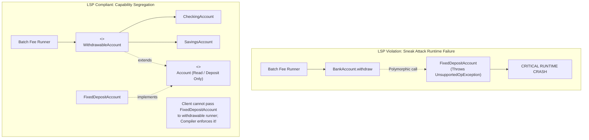
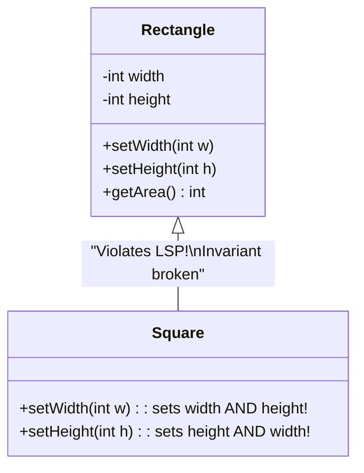

# Liskov Substitution Principle (LSP)

> **One-line summary:** Subtypes must be substitutable for their base types without altering the correctness of the program or violating any caller expectations.

| Attribute | Specification |
|---|---|
| **Level** | Core / Advanced Foundational |
| **Prerequisites** | [01-oop-pillars.md](../01-foundations/01-oop-pillars.md), [02-composition-vs-inheritance.md](../01-foundations/02-composition-vs-inheritance.md), [09-design-by-contract-and-defensive-programming.md](../01-foundations/09-design-by-contract-and-defensive-programming.md) |
| **Estimated Reading Time** | 35 minutes |
| **Status** | Complete |
| **Category** | SOLID Principles |
| **Also Known As** | Behavioral Subtyping, Design by Contract Subtyping |
| **Languages Tested** | Java 25 (LTS) / TypeScript 5.8 (Node 24 native) / Python 3.14 |

---

## Table of Contents
- [1 The Problem](#1-the-problem)
- [2 Why It Exists](#2-why-it-exists)
- [3 What It Is](#3-what-it-is)
- [4 The Problem Without It](#4-the-problem-without-it)
- [5 How It Solves It](#5-how-it-solves-it)
- [6 How It Works](#6-how-it-works)
- [7 Real-World Examples](#7-real-world-examples)
- [8 When to Use and When NOT to Use](#8-when-to-use-and-when-not-to-use)
- [9 Variations and Language Idioms](#9-variations-and-language-idioms)
- [10 Relationship to Other Principles and Patterns](#10-relationship-to-other-principles-and-patterns)
- [11 Common Mistakes and Anti-Patterns](#11-common-mistakes-and-anti-patterns)
- [12 Testing and Design Verification](#12-testing-and-design-verification)
- [13 Performance, Concurrency and Security Notes](#13-performance-concurrency-and-security-notes)
- [14 Interview Questions](#14-interview-questions)
- [15 Practice Exercises](#15-practice-exercises)
- [16 Summary / Cheat Sheet](#16-summary--cheat-sheet)
- [17 Further Reading](#17-further-reading)

---

## 1 The Problem

Imagine a commercial banking platform processing midnight batch interest and overdraft fees. The architecture features a base `BankAccount` class with a `withdraw(double amount)` method.

```
       +---------------------------------------------+
       |                 BankAccount                 |
       +---------------------------------------------+
       | + deposit(amount: double)                   |
       | + withdraw(amount: double)                  |
       | + getBalance(): double                      |
       +---------------------------------------------+
                              ^
                              | extends
       +---------------------------------------------+
       |             FixedDepositAccount             |
       +---------------------------------------------+
       | + withdraw(amount: double)                  |
       |     --> throws UnsupportedOpException       |
       +---------------------------------------------+
```

A junior developer creates `FixedDepositAccount` (certificates of deposit locked for a 12-month term) by subclassing `BankAccount`. Because funds are legally locked until maturity, the developer overrides `withdraw()` to throw `UnsupportedOperationException("Withdrawals are locked until maturity date!")`.

The compiler is completely satisfied: `FixedDepositAccount` is a valid Java/TypeScript/Python subclass. Type checks pass cleanly.

Then, the monthly automated maintenance fee runner executes:
```java
public void deductMonthlyFee(List<BankAccount> accounts, double fee) {
    for (BankAccount account : accounts) {
        account.withdraw(fee); // BOOM!
    }
}
```
At 02:00 AM, the loop processes account #4,112—a `FixedDepositAccount`. An unexpected runtime exception detonates, aborting the transaction midway. Half the customers are charged maintenance fees, the database transaction rolls back into a dirty state, and 20,000 customers wake up with unserviced accounts.

The team has committed the classic violation of **Behavioral Subtyping**: the subclass inherited the syntax of the superclass, but violated its behavioral contract.

---

## 2 Why It Exists

The Liskov Substitution Principle was introduced by computer scientist **Barbara Liskov** in her 1987 OOPSLA conference keynote, and later formally defined with **Jeannette Wing** in their 1994 paper *A Behavioral Notion of Subtyping*:

> *"Let $\Phi(x)$ be a property provable about objects $x$ of type $T$. Then $\Phi(y)$ should be true for objects $y$ of type $S$ where $S$ is a subtype of $T$."*

In plain English: **If code works correctly with a base type $T$, it must continue to work correctly and without surprises when supplied any subtype $S$.**

LSP exists because **compilers only check syntax, not behavior**. A compiler verifies that a subclass provides a method named `withdraw(double)` returning `void`. The compiler cannot know that `withdraw()` in the subclass throws an unexpected exception, deletes files, or violates an invariant. LSP provides the mathematical and contract-driven rules that prevent inheritance from becoming a liability.

---

## 3 What It Is

LSP is defined through **Design by Contract (DbC)** rules across four primary dimensions:

1. **Preconditions cannot be strengthened in a subtype:** A subclass cannot demand stricter validation or narrower inputs than the parent. (e.g., If the parent accepts any integer, the subclass cannot crash when given negative integers).
2. **Postconditions cannot be weakened in a subtype:** A subclass must deliver at least everything the parent promised. (e.g., If the parent guarantees a balance deduction, the subclass cannot silently do nothing).
3. **Invariants of the superclass must be preserved:** Any invariant that holds true for the parent (e.g., `balance >= 0` or `width * height == area`) must hold true for all subclasses.
4. **The History Constraint:** Subtypes must not allow state mutations that the superclass forbade. If the superclass is immutable, the subclass must not expose setters.



---

## 4 The Problem Without It

Here is the banking code violating LSP. The subclass compiles without warning, but creates a runtime minefield for any client treating it polymorphically:

```java
// Naive Base Class
public class BankAccount {
    protected double balance;

    public BankAccount(double initialBalance) {
        this.balance = initialBalance;
    }

    public void deposit(double amount) {
        this.balance += amount;
    }

    public void withdraw(double amount) {
        if (amount > balance) {
            throw new IllegalArgumentException("Insufficient funds");
        }
        this.balance -= amount;
    }

    public double getBalance() {
        return balance;
    }
}

// LSP Violation: Subtype refuses to fulfill the base class contract!
public class FixedDepositAccount extends BankAccount {
    public FixedDepositAccount(double initialBalance) {
        super(initialBalance);
    }

    @Override
    public void withdraw(double amount) {
        // Detonates the caller's expectations!
        throw new UnsupportedOperationException("Withdrawals are locked until maturity date!");
    }
}
```

### The Change Request & Catastrophic Blast Radius
A batch runner processes recurring withdrawals:
```java
public void processBatchWithdrawals(List<BankAccount> accounts, double amount) {
    for (BankAccount acc : accounts) {
        acc.withdraw(amount); // Caller has no idea one of these accounts refuses withdrawals!
    }
}
```

### The Failure Output
```text
[Batch Runner Started: 5,000 accounts]
Processed account #4110: Success
Processed account #4111: Success
[FATAL EXCEPTION] java.lang.UnsupportedOperationException: Withdrawals are locked until maturity date!
    at com.design.solid.lsp.FixedDepositAccount.withdraw(FixedDepositAccount.java:12)
    at com.design.solid.lsp.BatchRunner.processBatchWithdrawals(BatchRunner.java:18)
[PROCESS ABORTED] 889 accounts unprocessed. Database in inconsistent transaction state.
```

---

## 5 How It Solves It

To solve this, we must not force `FixedDepositAccount` into an inheritance relationship with behaviors it cannot fulfill. We segregate the hierarchy:
1. `Account`: Common capabilities (query balance, deposit funds).
2. `WithdrawableAccount`: Extends `Account`, explicitly adding the `withdraw` capability.

Now, clients that require withdrawal depend on `WithdrawableAccount`. The compiler makes it **physically impossible** to pass a `FixedDepositAccount` into a withdrawal loop.

### Java Implementation (Java 25 LTS)

```java
package com.design.solid.lsp;

// Base capability contract
public interface Account {
    double getBalance();
    void deposit(double amount);
}

// Segregated capability contract for withdrawable accounts
public interface WithdrawableAccount extends Account {
    void withdraw(double amount);
}

// Subtype 1: Checking Account (Fully withdrawable)
public class CheckingAccount implements WithdrawableAccount {
    private double balance;

    public CheckingAccount(double initialBalance) {
        this.balance = initialBalance;
    }

    @Override
    public void deposit(double amount) {
        this.balance += amount;
    }

    @Override
    public void withdraw(double amount) {
        if (amount > balance) {
            throw new IllegalArgumentException("Insufficient funds");
        }
        this.balance -= amount;
    }

    @Override
    public double getBalance() {
        return balance;
    }
}

// Subtype 2: Fixed Deposit Account (Only deposits & queries allowed)
public class FixedDepositAccount implements Account {
    private double balance;

    public FixedDepositAccount(double initialBalance) {
        this.balance = initialBalance;
    }

    @Override
    public void deposit(double amount) {
        this.balance += amount;
    }

    @Override
    public double getBalance() {
        return balance;
    }
}

public class LspSolutionApp {
    public static void main(String[] args) {
        WithdrawableAccount checking = new CheckingAccount(1000.0);
        checking.withdraw(200.0);
        System.out.println("Java: Checking balance after withdrawal: $" + checking.getBalance());

        Account fixed = new FixedDepositAccount(5000.0);
        fixed.deposit(500.0);
        System.out.println("Java: Fixed deposit balance: $" + fixed.getBalance());
    }
}
```

### TypeScript Implementation (Node 24 Native)

```typescript
interface Account {
    getBalance(): number;
    deposit(amount: number): void;
}

interface WithdrawableAccount extends Account {
    withdraw(amount: number): void;
}

class CheckingAccount implements WithdrawableAccount {
    private balance: number;

    constructor(initialBalance: number) {
        this.balance = initialBalance;
    }

    deposit(amount: number): void {
        this.balance += amount;
    }

    withdraw(amount: number): void {
        if (amount > this.balance) {
            throw new Error("Insufficient funds");
        }
        this.balance -= amount;
    }

    getBalance(): number {
        return this.balance;
    }
}

class FixedDepositAccount implements Account {
    private balance: number;

    constructor(initialBalance: number) {
        this.balance = initialBalance;
    }

    deposit(amount: number): void {
        this.balance += amount;
    }

    getBalance(): number {
        return this.balance;
    }
}

// Safe execution guaranteed at compile time
const checking: WithdrawableAccount = new CheckingAccount(1000.0);
checking.withdraw(200.0);
console.log(`TS: Checking balance: $${checking.getBalance()}`);

const fixed: Account = new FixedDepositAccount(5000.0);
fixed.deposit(500.0);
console.log(`TS: Fixed deposit balance: $${fixed.getBalance()}`);
```

### Python Implementation (Python 3.14)

```python
from typing import Protocol

class Account(Protocol):
    def get_balance(self) -> float: ...
    def deposit(self, amount: float) -> None: ...

class WithdrawableAccount(Account, Protocol):
    def withdraw(self, amount: float) -> None: ...

class CheckingAccount:
    def __init__(self, initial_balance: float) -> None:
        self._balance = initial_balance

    def deposit(self, amount: float) -> None:
        self._balance += amount

    def withdraw(self, amount: float) -> None:
        if amount > self._balance:
            raise ValueError("Insufficient funds")
        self._balance -= amount

    def get_balance(self) -> float:
        return self._balance

class FixedDepositAccount:
    def __init__(self, initial_balance: float) -> None:
        self._balance = initial_balance

    def deposit(self, amount: float) -> None:
        self._balance += amount

    def get_balance(self) -> float:
        return self._balance

if __name__ == "__main__":
    checking: WithdrawableAccount = CheckingAccount(1000.0)
    checking.withdraw(200.0)
    print(f"Python: Checking balance: ${checking.get_balance()}")

    fixed: Account = FixedDepositAccount(5000.0)
    fixed.deposit(500.0)
    print(f"Python: Fixed deposit balance: ${fixed.get_balance()}")
```

### Real Execution Output
```text
Java: Checking balance after withdrawal: $800.0
Java: Fixed deposit balance: $5500.0
TS: Checking balance: $800
TS: Fixed deposit balance: $5500
Python: Checking balance: $800.0
Python: Fixed deposit balance: $5500.0
```

---

## 6 How It Works

### The Classic Geometric Dilemma: Rectangle vs. Square
The most famous illustration of LSP is the **Circle-Ellipse** or **Rectangle-Square** problem.
In real-world mathematics: *"A Square is a Rectangle."*
In object-oriented programming: **A Square is NOT a Rectangle!**

Why? Because a `Rectangle` exposes independent mutations:
```java
rectangle.setWidth(5);
rectangle.setHeight(4);
assert(rectangle.getArea() == 20); // Caller invariant: setting width does NOT change height!
```
If `Square` inherits from `Rectangle`, setting `width` must automatically update `height` to keep sides equal. The moment a client passes a `Square` to a method expecting a `Rectangle`, the caller's fundamental invariant (`setWidth` only changes width) is shattered:



### Mathematical Invariants Summary
| Rule | Base Type $T$ Expectation | Subtype $S$ Requirement | Violation Example |
|---|---|---|---|
| **Preconditions** | Accepts range $[0, 100]$ | Must accept $[0, 100]$ or wider (e.g., $[-50, 100]$) | Subtype crashes if input $> 50$ (strengthened precondition). |
| **Postconditions** | Returns positive integer $\ge 1$ | Must return $\ge 1$ or narrower (e.g., $\ge 5$) | Subtype returns $0$ or `null` (weakened postcondition). |
| **Exceptions** | Throws `IOException` | Throws `IOException` or subclass (e.g. `FileNotFoundException`) | Subtype throws `RuntimeException` or checked `SQLException`. |
| **Return Type** | Covariant (can return a more specific subtype) | Covariant return | Base returns `Animal`, Subtype returns `Dog` (Valid!). |
| **Parameter Type**| Contravariant (can accept a more generic supertype) | Contravariant argument | Base accepts `Dog`, Subtype accepts `Animal` (Valid!). |

---

## 7 Real-World Examples

### 1. JDK Flaw: `java.util.Collections.unmodifiableList`
Java's standard `List<E>` interface exposes `add()`, `remove()`, and `clear()`. However, `Collections.unmodifiableList(list)` returns an instance that implements `List<E>` but throws `UnsupportedOperationException` whenever `add()` is called. This is a recognized historical violation of LSP in the JDK. The type system claims it is a `List`, but it does not support `List` mutation contracts. (Modern languages like Kotlin fixed this by separating `List` from `MutableList`).

### 2. Python Standard Library: `Sequence` vs `MutableSequence`
In Python's `collections.abc` module, Python correctly models LSP:
- `Sequence`: Defines `__getitem__`, `__len__`, `__contains__`, `index`, and `count` (Read-Only). `tuple`, `str`, and `range` implement `Sequence`.
- `MutableSequence`: Inherits from `Sequence` and adds `append`, `insert`, `pop`, `extend`. `list` implements `MutableSequence`.
A tuple is never a `MutableSequence`, preventing unexpected mutation crashes.

### 3. Web DOM: `Node` vs `Element`
In the W3C DOM specification, an HTML comment or text node is a `Node`, but only an `Element` has attributes and tag names (`getAttribute`, `tagName`). The DOM avoids making `TextNode` inherit from `Element`, correctly preserving LSP.

---

## 8 When to Use and When NOT to Use

| Context | Action | Rationale |
|---|---|---|
| **Modeling "Is-A" Inheritance** | **Verify behavioral substitutability first** | Real-world linguistic "is-a" does not equal architectural "is-a". |
| **Read-Only vs Writable Collections** | **Segregate into separate interfaces** | Avoid subtypes that throw `UnsupportedOperationException`. |
| **Subclass overriding a method to do nothing (`{}`)** | **STOP: Refactor to Composition** | An empty override is a dead giveaway of an LSP violation. |
| **Private Implementation Reuse** | **Use Composition (`has-a`), not Inheritance** | Don't inherit from `Stack` just to get `List` methods if popping isn't a list behavior. |

### Diagnostic Signs of LSP Violations
- Catching `UnsupportedOperationException` or `NotImplementedError` in client calling loops.
- `if (account instanceof FixedDepositAccount)` checks scattered in client code before calling methods.
- Overridden methods that return `null`, `-1`, or no-op when the base class promises a meaningful result.

---

## 9 Variations and Language Idioms

### Java: Covariant Return Types
Java natively supports covariant return types: an overriding method in a subclass can return a narrower subtype:
```java
public class AnimalFactory {
    public Animal create() { return new Animal(); }
}
public class DogFactory extends AnimalFactory {
    @Override
    public Dog create() { return new Dog(); } // Perfectly valid under LSP!
}
```

### TypeScript: Strict Function Types
TypeScript has the `--strictFunctionTypes` compiler flag. When enabled, method parameter types are checked **contravariantly** instead of bivariantly, catching LSP parameter violations at compile time:
```typescript
interface Animal { name: string; }
interface Dog extends Animal { bark(): void; }

type Handler = (d: Dog) => void;
// With strictFunctionTypes, assigning an incompatible handler throws a compiler error!
```

### Python: Mypy and Protocol Variance
Python's `typing.TypeVar` allows explicit specification of covariance (`covariant=True`) and contravariance (`contravariant=True`) to formally verify LSP adherence in generic containers:
```python
T_co = TypeVar('T_co', covariant=True)
class ReadOnlyRepository(Protocol[T_co]):
    def get_by_id(self, id: str) -> T_co: ...
```

---

## 10 Relationship to Other Principles and Patterns

- **ISP (Interface Segregation Principle):** ISP is the remedy for LSP violations. When a base class has too many methods (e.g. `withdraw` on all accounts), splitting it into smaller interfaces (`Account`, `WithdrawableAccount`) restores LSP.
- **Composition over Inheritance:** The most effective way to avoid LSP violations is to replace inheritance with composition. Instead of `FixedDepositAccount extends BankAccount`, use a `DepositPlan` injected into a single `Account`.
- **Template Method Pattern:** Relies heavily on LSP: base algorithms call abstract hooks that subclasses override without altering the overarching algorithm workflow.

---

## 11 Common Mistakes and Anti-Patterns

| Anti-Pattern | Description | Production Consequence | Correct Remedy |
|---|---|---|---|
| **The Refusal Override** | Overriding a base method to throw `UnsupportedOperationException`. | Unforeseen runtime crashes in polymorphic batch jobs. | Split interface into discrete role capabilities. |
| **Type Check Smear** | Using `if (obj instanceof SubClass)` to bypass calls that would fail on that subclass. | Breaks polymorphism; violates both LSP and OCP. | Refactor hierarchy so all instances safely accept the base call. |
| **Silent No-Op** | Overriding a mutating method with an empty `{}` body to suppress behavior. | Callers assume state changed, leading to corrupt audit logs. | Do not inherit from the mutable interface. |
| **Strengthened Preconditions** | Subclass rejects valid inputs that the superclass gladly processes. | Caller passes valid input and encounters unexpected `IllegalArgumentException`. | Ensure subclass accepts all parent inputs. |
| **Weakened Postconditions** | Subclass fails to fulfill return guarantees (e.g., returning unformatted dirty strings). | Downstream parsers crash on missing data contracts. | Ensure subclass fulfills all parent guarantees. |
| **Violating the History Constraint** | Subclass exposes mutation methods on an otherwise immutable parent class. | Thread-safety assumptions in concurrent caches are destroyed. | Preserve immutability across the entire subtype chain. |

---

## 12 Testing and Design Verification

### The Polymorphic Contract Test
The gold standard for verifying LSP is writing a **Contract Test Suite** that runs against *every* subtype in the hierarchy:

```java
public abstract class AccountContractTest {
    protected abstract Account createAccount(double initialBalance);

    @Test
    void shouldNeverHaveNegativeBalanceAfterDeposit() {
        Account account = createAccount(100.0);
        account.deposit(50.0);
        assertTrue(account.getBalance() >= 150.0);
    }
}

// Concrete test verifying CheckingAccount obeys the contract
class CheckingAccountTest extends AccountContractTest {
    @Override
    protected Account createAccount(double initialBalance) {
        return new CheckingAccount(initialBalance);
    }
}

// Concrete test verifying FixedDepositAccount obeys the contract
class FixedDepositAccountTest extends AccountContractTest {
    @Override
    protected Account createAccount(double initialBalance) {
        return new FixedDepositAccount(initialBalance);
    }
}
```
If a subclass fails any test in the base contract suite, it is an **LSP violation**.

---

## 13 Performance, Concurrency and Security Notes

### Performance
- Obeying LSP prevents defensive type checking. Code littered with `instanceof` checks incurs CPU branch-prediction penalties and prevents JIT compilers from optimizing call sites. True polymorphic code allows compilers to use monomorphic or bimorphic inline caching.

### Concurrency
- **Immutability Invariants:** If a base class is documented as immutable and thread-safe (e.g. Java's `String` or `BigDecimal`), a subclass must not introduce mutable state. Violating this invariant in a concurrent environment causes catastrophic data races and memory visibility bugs.

### Security
- **Confused Deputy Attacks:** If a base security service promises that `authorize(user)` thoroughly validates tokens against LDAP, a subclass must not weaken this check to allow anonymous bypasses. Weakening security postconditions compromises the entire application boundary.

---

## 14 Interview Questions

<details>
<summary><strong>1. What is the formal definition of the Liskov Substitution Principle?</strong></summary>

Formulated by Barbara Liskov and Jeannette Wing (1994): If $S$ is a subtype of $T$, then objects of type $T$ in a program may be replaced with objects of type $S$ without altering any of the desirable properties of that program (correctness, task performed, etc.).
</details>

<details>
<summary><strong>2. Why is a Square not a Rectangle in Object-Oriented Programming?</strong></summary>

Because in OOP, types are defined by their **behaviors and contracts**, not their mathematical attributes. A `Rectangle` has the behavioral contract that `setWidth` and `setHeight` operate independently. A `Square` cannot preserve this contract without breaking the caller's invariant that setting width does not mutate height.
</details>

<details>
<summary><strong>3. What are the rules regarding preconditions and postconditions under LSP?</strong></summary>

- **Preconditions cannot be strengthened:** A subclass cannot require more restrictive arguments than its superclass.
- **Postconditions cannot be weakened:** A subclass cannot guarantee less or return wider/looser outputs than its superclass.
</details>

<details>
<summary><strong>4. Is throwing an exception in an overridden method always an LSP violation?</strong></summary>

Not if the exception is part of the base method's documented contract. If the base method declares `throws IOException`, a subclass throwing `FileNotFoundException` is completely valid. It becomes an LSP violation when the subclass throws an *unexpected* exception (like `UnsupportedOperationException`) that the caller has no reason to expect.
</details>

<details>
<summary><strong>5. How does `java.util.Collections.unmodifiableList` violate LSP?</strong></summary>

It implements `java.util.List`, which promises mutating methods like `add()` and `set()`. Calling `add()` on an unmodifiable list throws `UnsupportedOperationException`. A client expecting a `List` cannot substitute an unmodifiable list into any code that performs write operations without crashing.
</details>

<details>
<summary><strong>6. What is the "History Constraint" in LSP?</strong></summary>

The history constraint requires that a subtype must not introduce state changes that would be impossible according to the supertype's state transition model. For example, if a base class represents a point with immutable coordinates, a subclass cannot provide a `setX()` method.
</details>

<details>
<summary><strong>7. How does the presence of `instanceof` in client code indicate an LSP violation?</strong></summary>

If a client needs to inspect `if (obj instanceof SubClass)` before invoking a method or taking a special path, it means `SubClass` cannot be treated uniformly as its base type. The client is working around an incompatibility in the hierarchy.
</details>

<details>
<summary><strong>8. What is the relationship between LSP and Interface Segregation (ISP)?</strong></summary>

ISP solves LSP violations. When an interface is too broad (forcing subclasses to reject or throw on methods they cannot support), segregating that interface into smaller, focused role interfaces allows classes to implement only the contracts they can genuinely fulfill.
</details>

---

## 15 Practice Exercises

### Exercise 1: Spot the LSP Violation (Easy)
Identify why `Ostrich` violates LSP when extending `Bird`:
```java
public class Bird {
    public void fly() {
        System.out.println("Flapping wings and soaring in the sky");
    }
}

public class Ostrich extends Bird {
    @Override
    public void fly() {
        throw new UnsupportedOperationException("Ostriches cannot fly!");
    }
}
```

<details>
<summary><strong>Solution</strong></summary>

`Bird` asserts the behavioral contract that all instances can `fly()`. `Ostrich` cannot fly and throws an exception, breaking any client running `bird.fly()`.
**Fix:** Segregate the hierarchy: `Bird` (base with feathers, eggs), and `FlyingBird extends Bird` with `fly()`. `Ostrich extends Bird`, while `Eagle extends FlyingBird`.
</details>

---

### Exercise 2: Refactor ReadOnly Storage (Medium)
Refactor the following file storage hierarchy so that `ReadOnlyStorage` does not violate LSP:

```typescript
class CloudStorage {
    readFile(path: string): Buffer { /* read */ }
    writeFile(path: string, data: Buffer): void { /* write */ }
}

class ReadOnlyStorage extends CloudStorage {
    writeFile(path: string, data: Buffer): void {
        throw new Error("Cannot write to read-only storage!");
    }
}
```

<details>
<summary><strong>Solution</strong></summary>

```typescript
interface ReadableStorage {
    readFile(path: string): Buffer;
}

interface WritableStorage extends ReadableStorage {
    writeFile(path: string, data: Buffer): void;
}

class ReadOnlyStorage implements ReadableStorage {
    readFile(path: string): Buffer { /* read */ }
}

class StandardCloudStorage implements WritableStorage {
    readFile(path: string): Buffer { /* read */ }
    writeFile(path: string, data: Buffer): void { /* write */ }
}
```
</details>

---

### Exercise 3: Contract Test Suite for Payment Gateways (Hard)
Write an abstract Python contract test suite to verify that any payment gateway subtype satisfies:
1. Precondition: Accepts any positive amount.
2. Postcondition: Returns a transaction ID of exactly 36 characters (UUID).
3. Exception Contract: Throws `PaymentDeclinedException` (and never raw database errors) on card failure.

<details>
<summary><strong>Solution</strong></summary>

```python
import unittest
from abc import ABC, abstractmethod

class PaymentGateway(ABC):
    @abstractmethod
    def charge(self, amount: float) -> str:
        """Charges amount. Must return 36-char UUID. Raises PaymentDeclinedException on failure."""
        ...

class BasePaymentGatewayContractTest(ABC):
    @abstractmethod
    def create_gateway(self) -> PaymentGateway:
        ...

    def test_charge_postcondition_returns_uuid(self):
        gw = self.create_gateway()
        tx_id = gw.charge(50.0)
        self.assertIsInstance(tx_id, str)
        self.assertEqual(len(tx_id), 36)

    def test_charge_precondition_negative_amount_raises_value_error(self):
        gw = self.create_gateway()
        with self.assertRaises(ValueError):
            gw.charge(-10.0)
```
Any concrete payment gateway must pass `BasePaymentGatewayContractTest`.
</details>

---

## 16 Summary / Cheat Sheet

```
+--------------------------------------------------------------------------+
|                       LISKOV SUBSTITUTION PRINCIPLE                      |
+--------------------------------------------------------------------------+
| CORE RULE      : Subtypes must be completely substitutable for their     |
|                  base types without breaking client correctness.         |
| DBC RULES      : 1. Preconditions cannot be strengthened in a subtype.   |
|                  2. Postconditions cannot be weakened in a subtype.     |
|                  3. Invariants of supertypes must be preserved.          |
| DANGER SIGN    : Overriding methods to throw UnsupportedOpException;    |
|                  empty no-op method overrides; instanceof type checks.   |
| GOLDEN HEURISTIC: In OOP, "Is-A" is about BEHAVIOR, not real-world       |
|                  linguistic taxonomy. (Square is NOT a Rectangle).       |
+--------------------------------------------------------------------------+
```

---

## 17 Further Reading

- Barbara Liskov, Jeannette Wing, *A Behavioral Notion of Subtyping*, ACM TOPLAS, 1994.
- Bertrand Meyer, *Object-Oriented Software Construction* (Design by Contract chapter), Prentice Hall, 1997.
- Joshua Bloch, *Effective Java (3rd Edition)* (Item 18: Favor composition over inheritance), Addison-Wesley, 2018.

### In Your Language
| Language Track | Deep Dive Reference |
|---|---|
| Java | [Java OOP & Design Patterns](file:///e:/Learning/engineering-notes/01-languages/java/24-design-patterns/README.md) |
| TypeScript | [TypeScript Design Patterns](file:///e:/Learning/engineering-notes/01-languages/typescript/17-design-patterns/README.md) |
| Python | [Python Design Patterns](file:///e:/Learning/engineering-notes/01-languages/python/23-design-patterns/README.md) |

---

[← Previous: 02 - Open/Closed Principle](file:///e:/Learning/engineering-notes/08-solid-design-patterns/02-solid-principles/02-open-closed.md) | [Module 02 Index](file:///e:/Learning/engineering-notes/08-solid-design-patterns/02-solid-principles/README.md) | [Next: 04 - Interface Segregation Principle →](file:///e:/Learning/engineering-notes/08-solid-design-patterns/02-solid-principles/04-interface-segregation.md)
