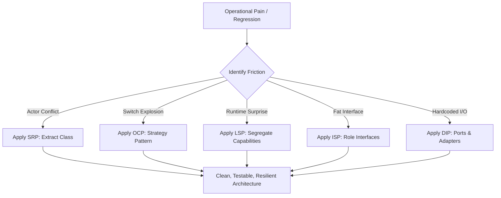
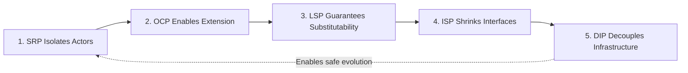

# SOLID in Practice: Pragmatic Application & Architectural Harmony

> **One-line summary:** SOLID principles are diagnostic tools designed to relieve real architectural friction—apply them when cost-of-change escalates, not as dogmatic dogma on day one.

| Attribute | Specification |
|---|---|
| **Level** | Core / Comprehensive Synthesis |
| **Prerequisites** | [01-single-responsibility.md](01-single-responsibility.md), [02-open-closed.md](02-open-closed.md), [03-liskov-substitution.md](03-liskov-substitution.md), [04-interface-segregation.md](04-interface-segregation.md), [05-dependency-inversion.md](05-dependency-inversion.md) |
| **Estimated Reading Time** | 35 minutes |
| **Status** | Complete |
| **Category** | SOLID Principles |
| **Also Known As** | Pragmatic SOLID, Pain-Driven Design, Refactoring to SOLID |
| **Languages Tested** | Java 25 (LTS) / TypeScript 5.8 (Node 24 native) / Python 3.14 |

---

## Table of Contents
- [1 The Problem](#1-the-problem)
- [2 Why It Exists](#2-why-it-exists)
- [3 What It Is](#3-what-it-is)
- [4 The Problem Without It](#4-the-problem-without-it)
- [5 How It Solves It](#5-how-it-solves-it)
- [6 How It Works](#6-how-it-works)
- [7 Real-World Examples](#7-real-world-examples)
- [8 When to Use and When NOT to Use](#8-when-to-use-and-when-not-to-use)
- [9 Variations and Language Idioms](#9-variations-and-language-idioms)
- [10 Relationship to Other Principles and Patterns](#10-relationship-to-other-principles-and-patterns)
- [11 Common Mistakes and Anti-Patterns](#11-common-mistakes-and-anti-patterns)
- [12 Testing and Design Verification](#12-testing-and-design-verification)
- [13 Performance, Concurrency and Security Notes](#13-performance-concurrency-and-security-notes)
- [14 Interview Questions](#14-interview-questions)
- [15 Practice Exercises](#15-practice-exercises)
- [16 Summary / Cheat Sheet](#16-summary--cheat-sheet)
- [17 Further Reading](#17-further-reading)

---

## 1 The Problem

Engineering teams adopting SOLID typically fall into one of two destructive extremes:

1. **The Big Ball of Mud (Zero Design):** The team writes monolithic, procedural classes where business calculations, database JDBC queries, HTTP parsing, and email dispatches are tangled into 3,000-line methods. Every feature addition causes regressions, merge conflicts bring sprint velocity to a standstill, and automated unit testing is impossible.
2. **Enterprise Over-Engineering (Dogmatic Over-Abstraction):** A developer reads about SOLID and decides that *every single class* must have an accompanying interface, factory, adapter, and strategy—even for a simple 3-field internal CRUD microservice. The codebase explodes into 80 shallow classes where finding the actual business calculation requires navigating 14 layers of indirection.

```
       [Under-Engineered]                                [Over-Engineered]
       "Big Ball of Mud"                                "Enterprise FizzBuzz"
       One 3,000-line God Class                         80 Micro-Classes for 1 Feature
       High coupling, regressions                       Indirection fatigue, navigation hell
                   \                                        /
                    \                                      /
                     +---> [ PRAGMATIC SOLID ] <----------+
                           "Deep Modules, Seams at Fault Lines"
```

The fundamental engineering challenge is **how to apply the five SOLID principles in harmony**, driving refactoring from actual friction rather than speculative anticipation.

---

## 2 Why It Exists

In *A Philosophy of Software Design* (2018), John Ousterhout introduced the concept of **Deep Modules vs. Shallow Modules**:
- A **Deep Module** provides powerful, complex functionality through a simple, cohesive interface.
- A **Shallow Module** provides tiny, trivial functionality while forcing callers to learn complex interface abstractions.

When applied dogmatically, SOLID can degenerate into shallow module proliferation. When applied pragmatically, SOLID transforms shallow, brittle procedural code into robust, deep architectural components.

Pragmatic SOLID exists to answer: **"How do the five principles cooperate to solve real operational pain?"**
- **SRP** separates the axes of change (actors).
- **OCP** protects verified code from regression when adding new features.
- **LSP** guarantees that polymorphism behaves correctly without runtime surprises.
- **ISP** ensures that clients only depend on what they actually use.
- **DIP** decouples high-level intellectual property from low-level infrastructure churn.

---

## 3 What It Is

Pragmatic SOLID is governed by **Pain-Driven Design**:
> *"Never introduce an abstraction without first feeling the friction that justifies its existence."*

### The Architectural Friction Diagnostic Matrix

| Pain You Feel | Underlying Violation | Principle to Reach For |
|---|---|---|
| Fixes in Accounting break HR reports | Class serves multiple actors | **Single Responsibility Principle (SRP)** |
| Every new product tier forces edits to a central `switch` | Logic closed to extension | **Open/Closed Principle (OCP)** |
| Subtype throws `UnsupportedOperationException` | Subclass breaks caller contract | **Liskov Substitution Principle (LSP)** |
| Implementers stub out empty methods (`{}`) | Interface has irrelevant methods | **Interface Segregation Principle (ISP)** |
| Unit tests require booting MySQL and SMTP servers | High-level code creates plumbing | **Dependency Inversion Principle (DIP)** |



---

## 4 The Problem Without It

Here is a naive, monolithic `OrderProcessor` that violates **all five SOLID principles simultaneously**.

```java
// Anti-Pattern: Violating all 5 SOLID principles simultaneously
public class MonolithicOrderProcessor {
    public void process(String orderId, String customerEmail, String customerTier, List<String> itemSkus, List<Double> itemPrices) {
        // 1. Validation (SRP violation)
        if (itemSkus.isEmpty()) throw new IllegalArgumentException("Empty order");

        // 2. Pricing & Discount Calculation (SRP & OCP violation: switch on tier)
        double subtotal = 0;
        for (double price : itemPrices) subtotal += price;
        
        double finalTotal = subtotal;
        if ("GOLD".equalsIgnoreCase(customerTier)) {
            finalTotal = subtotal * 0.90; // 10% off
        } else if ("SILVER".equalsIgnoreCase(customerTier)) {
            finalTotal = subtotal * 0.95; // 5% off
        }

        // 3. Database Persistence (SRP & DIP violation: hardcoded JDBC)
        try {
            Connection conn = DriverManager.getConnection("jdbc:postgresql://localhost:5432/orders");
            PreparedStatement ps = conn.prepareStatement("INSERT INTO orders VALUES (?, ?)");
            ps.setString(1, orderId);
            ps.setDouble(2, finalTotal);
            ps.executeUpdate();
        } catch (SQLException e) {
            throw new RuntimeException("DB Failure", e);
        }

        // 4. Notification Dispatch (SRP & DIP violation: hardcoded SMTP)
        SmtpClient smtp = new SmtpClient("smtp.company.internal", 25);
        smtp.sendMail(customerEmail, "Your total is: $" + finalTotal);
    }
}
```

### The Change Request & Friction Cascade
1. **Marketing** introduces a `PLATINUM` tier: developers must modify the `process()` method (violates OCP).
2. **Infrastructure** migrates database to DynamoDB: developers must rewrite the SQL query inside the core billing method (violates DIP & SRP).
3. **Automated Testing** runs in CI: tests hang indefinitely trying to connect to `smtp.company.internal` on port 25 (violates DIP).

### The Failure Output
```text
[CI BUILD RUNNER]
Running MonolithicOrderProcessorTest...
SQLException: Connection to localhost:5432 refused!
SocketException: Connection to smtp.company.internal:25 timed out!
BUILD FAILED (Duration: 3m 45s)
```

---

## 5 How It Solves It

We refactor the system step-by-step to demonstrate how all five principles work in concert:
1. **SRP:** Extract immutable `Order` data structure; separate pricing, persistence, and notifications into focused services.
2. **OCP:** Abstract pricing into a `PricingPolicy` strategy.
3. **LSP:** Ensure all pricing policies and repositories adhere strictly to their contracts without unexpected exceptions.
4. **ISP:** Create small, focused interfaces (`PricingPolicy`, `OrderRepository`, `Notifier`).
5. **DIP:** Inject abstractions into `OrderProcessor` via constructor injection.

### Java Implementation (Java 25 LTS)

```java
package com.design.solid.practice;

import java.util.List;

// Passive Data Entities (SRP)
public record OrderItem(String sku, double price, int qty) {}
public record Order(String id, String email, String customerType, List<OrderItem> items) {}

// Segregated Role Interfaces (ISP & DIP)
public interface PricingPolicy {
    double calculateTotal(Order order);
}

public interface OrderRepository {
    void save(Order order, double finalTotal);
}

public interface Notifier {
    void notifyCustomer(String email, String message);
}

// Extensible Implementation (OCP & LSP)
public class TieredPricingPolicy implements PricingPolicy {
    @Override
    public double calculateTotal(Order order) {
        double subtotal = order.items().stream()
                .mapToDouble(i -> i.price() * i.qty())
                .sum();
        return switch (order.customerType().toUpperCase()) {
            case "GOLD" -> subtotal * 0.90;
            case "SILVER" -> subtotal * 0.95;
            default -> subtotal;
        };
    }
}

// Low-Level Infrastructure Detail (DIP & LSP)
public class InMemoryOrderRepository implements OrderRepository {
    @Override
    public void save(Order order, double finalTotal) {
        System.out.println("Java: Saved order " + order.id() + " with total $" + finalTotal);
    }
}

public class ConsoleNotifier implements Notifier {
    @Override
    public void notifyCustomer(String email, String message) {
        System.out.println("Java: Notification sent to " + email + ": " + message);
    }
}

// High-Level Domain Policy (SRP, OCP, DIP)
public class OrderProcessor {
    private final PricingPolicy pricing;
    private final OrderRepository repository;
    private final Notifier notifier;

    public OrderProcessor(PricingPolicy pricing, OrderRepository repository, Notifier notifier) {
        this.pricing = pricing;
        this.repository = repository;
        this.notifier = notifier;
    }

    public void process(Order order) {
        if (order.items().isEmpty()) {
            throw new IllegalArgumentException("Cannot process empty order");
        }
        double total = pricing.calculateTotal(order);
        repository.save(order, total);
        notifier.notifyCustomer(order.email(), "Order " + order.id() + " processed. Total: $" + total);
    }
}

public class SolidPracticeApp {
    public static void main(String[] args) {
        Order order = new Order("ORD-777", "customer@example.com", "GOLD", List.of(
            new OrderItem("LAPTOP", 1000.0, 1),
            new OrderItem("MOUSE", 50.0, 2)
        )); // Subtotal: $1100. GOLD 10% discount = $990.0

        OrderProcessor processor = new OrderProcessor(
            new TieredPricingPolicy(),
            new InMemoryOrderRepository(),
            new ConsoleNotifier()
        );

        processor.process(order);
    }
}
```

### TypeScript Implementation (Node 24 Native)

```typescript
interface OrderItem {
    readonly sku: string;
    readonly price: number;
    readonly qty: number;
}

interface Order {
    readonly id: string;
    readonly email: string;
    readonly customerType: string;
    readonly items: readonly OrderItem[];
}

interface PricingPolicy {
    calculateTotal(order: Order): number;
}

interface OrderRepository {
    save(order: Order, finalTotal: number): void;
}

interface Notifier {
    notifyCustomer(email: string, message: string): void;
}

class TieredPricingPolicy implements PricingPolicy {
    calculateTotal(order: Order): number {
        const subtotal = order.items.reduce((sum, i) => sum + (i.price * i.qty), 0);
        switch (order.customerType.toUpperCase()) {
            case "GOLD": return subtotal * 0.90;
            case "SILVER": return subtotal * 0.95;
            default: return subtotal;
        }
    }
}

class InMemoryOrderRepository implements OrderRepository {
    save(order: Order, finalTotal: number): void {
        console.log(`TS: Saved order ${order.id} with total $${finalTotal}`);
    }
}

class ConsoleNotifier implements Notifier {
    notifyCustomer(email: string, message: string): void {
        console.log(`TS: Notification sent to ${email}: ${message}`);
    }
}

class OrderProcessor {
    private pricing: PricingPolicy;
    private repository: OrderRepository;
    private notifier: Notifier;

    constructor(pricing: PricingPolicy, repository: OrderRepository, notifier: Notifier) {
        this.pricing = pricing;
        this.repository = repository;
        this.notifier = notifier;
    }

    process(order: Order): void {
        if (order.items.length === 0) throw new Error("Cannot process empty order");
        const total = this.pricing.calculateTotal(order);
        this.repository.save(order, total);
        this.notifier.notifyCustomer(order.email, `Order ${order.id} processed. Total: $${total}`);
    }
}

const order: Order = {
    id: "ORD-777",
    email: "customer@example.com",
    customerType: "GOLD",
    items: [
        { sku: "LAPTOP", price: 1000.0, qty: 1 },
        { sku: "MOUSE", price: 50.0, qty: 2 }
    ]
};

const processor = new OrderProcessor(
    new TieredPricingPolicy(),
    new InMemoryOrderRepository(),
    new ConsoleNotifier()
);
processor.process(order);
```

### Python Implementation (Python 3.14)

```python
from dataclasses import dataclass
from typing import Protocol, List

@dataclass(frozen=True)
class OrderItem:
    sku: str
    price: float
    qty: int

@dataclass(frozen=True)
class Order:
    id: str
    email: str
    customer_type: str
    items: List[OrderItem]

class PricingPolicy(Protocol):
    def calculate_total(self, order: Order) -> float: ...

class OrderRepository(Protocol):
    def save(self, order: Order, final_total: float) -> None: ...

class Notifier(Protocol):
    def notify_customer(self, email: str, message: str) -> None: ...

class TieredPricingPolicy:
    def calculate_total(self, order: Order) -> float:
        subtotal = sum(i.price * i.qty for i in order.items)
        tier = order.customer_type.upper()
        if tier == "GOLD":
            return subtotal * 0.90
        elif tier == "SILVER":
            return subtotal * 0.95
        return subtotal

class InMemoryOrderRepository:
    def save(self, order: Order, final_total: float) -> None:
        print(f"Python: Saved order {order.id} with total ${final_total}")

class ConsoleNotifier:
    def notify_customer(self, email: str, message: str) -> None:
        print(f"Python: Notification sent to {email}: {message}")

class OrderProcessor:
    def __init__(self, pricing: PricingPolicy, repository: OrderRepository, notifier: Notifier) -> None:
        self._pricing = pricing
        self._repository = repository
        self._notifier = notifier

    def process(self, order: Order) -> None:
        if not order.items:
            raise ValueError("Cannot process empty order")
        total = self._pricing.calculate_total(order)
        self._repository.save(order, total)
        self._notifier.notify_customer(order.email, f"Order {order.id} processed. Total: ${total}")

if __name__ == "__main__":
    order = Order(
        id="ORD-777",
        email="customer@example.com",
        customer_type="GOLD",
        items=[OrderItem("LAPTOP", 1000.0, 1), OrderItem("MOUSE", 50.0, 2)]
    )

    processor = OrderProcessor(TieredPricingPolicy(), InMemoryOrderRepository(), ConsoleNotifier())
    processor.process(order)
```

### Real Execution Output
```text
Java: Saved order ORD-777 with total $990.0
Java: Notification sent to customer@example.com: Order ORD-777 processed. Total: $990.0
TS: Saved order ORD-777 with total $990
TS: Notification sent to customer@example.com: Order ORD-777 processed. Total: $990
Python: Saved order ORD-777 with total $990.0
Python: Notification sent to customer@example.com: Order ORD-777 processed. Total: $990.0
```

---

## 6 How It Works

The five principles work as an interlocking defense mechanism against architectural rot:



1. **SRP establishes the domain seams:** Without SRP, you cannot determine *where* to put an interface.
2. **OCP defines the strategy boundaries:** Allows new customer loyalty plans or payment methods to be added without regression.
3. **LSP protects the strategy execution:** Ensures any concrete pricing algorithm behaves predictably.
4. **ISP prevents interface pollution:** Keeps the `Notifier` interface minimal (e.g., `notifyCustomer`) rather than coupling it to raw SMS or SMTP session management.
5. **DIP inverts the dependency direction:** Ensures `OrderProcessor` remains the pure intellectual orchestrator, completely indifferent to whether storage is PostgreSQL, DynamoDB, or an in-memory map.

---

## 7 Real-World Examples

### 1. Enterprise E-Commerce Platform (Shopify / Amazon Style)
In modern modular e-commerce engines, checkout orchestration is strictly decoupled:
- Pricing engine queries promotions, coupons, and tax services via segregated interfaces.
- Payment captures depend on a payment gateway port (Stripe, Adyen, PayPal).
- Inventory reservations depend on an inventory ledger port.
No checkout orchestrator contains raw SQL or third-party HTTP calls.

### 2. Microservice Orchestration (BFF / Gateway Pattern)
In distributed cloud architectures, an API Gateway or Backend for Frontend (BFF) delegates down to gRPC and REST microservices:
- Downstream communication is hidden behind client interfaces.
- Failure of a downstream recommendation service triggers an LSP-compliant fallback (e.g., returning cached popular items) rather than throwing a 500 error.

### 3. Serverless Event Processing (AWS Lambda)
A lambda handler ingests events from AWS SQS or EventBridge. By applying DIP:
- The handler extracts the event payload and passes it to an agnostic domain processor.
- Business unit tests execute in milliseconds using in-memory mocks without AWS LocalStack or live AWS credentials.

---

## 8 When to Use and When NOT to Use

### The Decision Spectrum

```
[ Greenfield Prototype ]  --->  [ Established Core Feature ]  --->  [ Public SDK / Enterprise Core ]
Direct, concrete code           Refactor on Rule of Three            Strict SOLID, decoupled ports
Tolerate coupling               Extract interfaces on change         Formal contract tests
```

| Project Context | SOLID Prescription | Practical Strategy |
|---|---|---|
| **Early Hackathon / Prototype** | **Minimal / Deferred** | Write direct, concrete code. Avoid premature interfaces. Learn the problem domain first. |
| **Stable Internal CRUD Tool** | **Moderate (SRP + DIP)** | Separate UI from SQL. Use basic constructor injection. Avoid elaborate strategy patterns. |
| **High-Volatility Core Domain** | **Full Pragmatic SOLID** | Abstract pricing, payment, and external integrations. Enforce strict unit test coverage. |
| **Public Library / SDK** | **Strict SOLID** | External users cannot modify your binaries; you must provide clean extension hooks (OCP/ISP). |

---

## 9 Variations and Language Idioms

### Modern Java (Java 21 to 25)
- Use **Records** for immutable DTOs and events (`record OrderProcessed(...)`).
- Use **Pattern Matching for `switch`** with sealed interfaces to combine OCP with algebraic data safety.
- Favor constructor injection over framework magic.

### Modern TypeScript (TypeScript 5.x)
- Use **Structural Protocols** without explicit class boilerplate.
- Use **Intersection Types** (`Printer & Scanner`) instead of bloated inheritance hierarchies.
- Use **Readonly Collections** (`readonly OrderItem[]`) to eliminate accidental mutations.

### Modern Python (Python 3.12+)
- Use **`typing.Protocol`** for compile-time duck typing.
- Use **`@dataclass(frozen=True)`** for value objects.
- Use dependency injection through function closures or FastAPI's `Depends()`.

---

## 10 Relationship to Other Principles and Patterns

- **YAGNI (You Aren't Gonna Need It):** The primary counterbalance to SOLID. Do not create an interface for a class until you actually have multiple implementations or a real testing seam requirement.
- **Rule of Three:** Write simple concrete code the first time. Duplicate if necessary the second time. Refactor to an OCP/Strategy abstraction the third time.
- **Hexagonal Architecture:** The macro-architectural manifestation of SOLID. Domain entities sit in the center; ports (ISP) and adapters (DIP) surround it.

---

## 11 Common Mistakes and Anti-Patterns

| Anti-Pattern | Description | Production Consequence | Correct Remedy |
|---|---|---|---|
| **Interface-Per-Class Cargo Cult** | Creating `IUserService` and `UserServiceImpl` blindly for every single class. | 2x file count, zero polymorphism benefit, navigation fatigue. | Delete `IUserService`; inject `UserService` directly until a second implementation or seam is needed. |
| **Premature Generalization** | Designing a 6-layer strategy pattern for a business rule that has never changed in 5 years. | Wasted engineering time, high cognitive load. | Keep it as a simple private method until variance actually occurs. |
| **God-Interface Violation** | Defining an interface with 30 methods because "it's good to use interfaces". | Violates ISP; implementers stub out methods with dummy values. | Break down into small role interfaces. |
| **Ignoring Invariants (LSP Blindness)** | Creating a subclass that changes the behavior or exceptions of a parent. | Silent production crashes in polymorphic batch jobs. | Favor composition or verify contract tests across all subtypes. |
| **Framework Contamination** | Importing Spring or NestJS decorators directly inside domain entities. | High-level domain coupled to low-level framework. | Keep core domain pure vanilla code; keep decorators in the application/infrastructure layer. |
| **Big Bang Refactoring** | Attempting to rewrite a 10,000-line monolith to SOLID in a single giant PR. | Unmergeable merge conflicts, broke production, team morale disaster. | Incremental refactoring using Branch by Abstraction and Strangler Fig patterns. |

---

## 12 Testing and Design Verification

The ultimate proof of pragmatic SOLID is **the ease and speed of your test suite**.

Under pragmatic SOLID:
- Core business rules require **zero mocks** and **zero network infrastructure**.
- A full suite of 500 domain unit tests runs in **under 2 seconds**.

```java
// Testing OrderProcessor with zero Mockito, zero Spring, zero Docker!
class OrderProcessorTest {
    @Test
    void shouldProcessOrderAndApplyGoldDiscount() {
        // Arrange
        Order order = new Order("ORD-1", "user@test.com", "GOLD", List.of(
            new OrderItem("ITEM-1", 100.0, 1)
        ));
        
        PricingPolicy pricing = o -> 90.0; // Deterministic lambda stub
        List<Double> savedTotals = new ArrayList<>();
        OrderRepository repo = (o, total) -> savedTotals.add(total);
        List<String> notifications = new ArrayList<>();
        Notifier notifier = (email, msg) -> notifications.add(msg);

        OrderProcessor processor = new OrderProcessor(pricing, repo, notifier);

        // Act
        processor.process(order);

        // Assert
        assertEquals(1, savedTotals.size());
        assertEquals(90.0, savedTotals.get(0));
        assertEquals(1, notifications.size());
    }
}
```

---

## 13 Performance, Concurrency and Security Notes

### Performance
- Pragmatic SOLID encourages **Deep Modules** with well-defined boundaries. Modern JITs (HotSpot C2, V8) easily optimize monomorphic calls and inline small methods.
- The real performance win comes from architectural freedom: because storage is decoupled via DIP, you can insert a Redis caching layer or change from synchronous execution to an asynchronous message queue without touching domain logic.

### Concurrency
- Decoupling state into immutable records (`Order`, `OrderItem`) ensures that multiple worker threads can calculate pricing and generate reports concurrently without locking or shared mutable state.

### Security
- By segregating sensitive infrastructure (database credentials, payment secrets) into the Composition Root, domain services execute in an unprivileged, pure computation sandbox.

---

## 14 Interview Questions

<details>
<summary><strong>1. How do you respond if an interviewer asks: "Should every class in Java/TypeScript have an interface?"</strong></summary>

**No.** Blindly creating `IUserService` for `UserService` is the "Interface-Per-Class" anti-pattern. Interfaces should only be introduced when there are multiple concrete implementations, when building a public SDK/library, or when creating a necessary test seam for slow/volatile I/O (like a database or third-party HTTP API). For pure, stable internal domain services, injecting the concrete class directly is simpler and cleaner.
</details>

<details>
<summary><strong>2. How does Kent Beck's "Simple Design" compare with SOLID?</strong></summary>

Kent Beck's 4 Rules of Simple Design are:
1. Passes all tests.
2. Reveals intent (clear, readable).
3. No duplication (DRY).
4. Fewest elements (classes, methods).
SOLID aligns with rules 1-3, but dogmatic SOLID often violates rule 4 by introducing too many speculative elements. Pragmatic SOLID balances Uncle Bob's principles against Beck's rule of fewest elements.
</details>

<details>
<summary><strong>3. What is "Pain-Driven Design" and how does it prevent over-engineering?</strong></summary>

Pain-Driven Design mandates that developers write simple, direct code first, and only introduce design patterns or SOLID abstractions when they feel real friction (e.g. merge conflicts, regression bugs, slow tests, or repeated `switch` statements). It prevents speculative over-engineering by requiring real evidence of volatility before abstracting.
</details>

<details>
<summary><strong>4. How do you incrementally refactor a 5,000-line God class to SOLID without stopping feature delivery?</strong></summary>

Use the **Strangler Fig** and **Branch by Abstraction** patterns:
1. Introduce an interface around the legacy method being modified.
2. Extract the specific new behavior into a small, SOLID-compliant class.
3. Have the legacy God class delegate to the new class.
4. Over several sprints, incrementally migrate callers to the new service until the legacy class shrinks to nothing and can be deleted.
</details>

<details>
<summary><strong>5. What is the relationship between OCP and testing?</strong></summary>

OCP directly impacts regression testing. When code is closed for modification and open for extension, adding a new feature means writing a new class. You only need to write unit tests for the new class; existing, verified code is untouched, meaning zero risk of regressions in existing features.
</details>

<details>
<summary><strong>6. How does Dependency Inversion (DIP) affect Continuous Integration (CI) build pipelines?</strong></summary>

When domain logic depends on abstractions rather than low-level infrastructure, unit tests run entirely in-memory without starting Docker testcontainers, relational databases, or external network services. A build pipeline of 1,000 unit tests finishes in seconds rather than 15-20 minutes, giving developers immediate feedback.
</details>

<details>
<summary><strong>7. How does the "Rule of Three" guide the application of OCP?</strong></summary>

The Rule of Three states: *"The first time you do something, you just do it. The second time you do something similar, you wince at the duplication, but you do the duplicate thing anyway. The third time you do something similar, you refactor."* For OCP, don't build a dynamic Strategy pattern for the first or second variant; wait until the third variation proves the axis of change.
</details>

<details>
<summary><strong>8. Does functional programming eliminate the need for SOLID?</strong></summary>

No. Functional programming expresses SOLID differently:
- SRP: Pure functions that compute one transformation without side effects.
- OCP: Higher-order functions that accept function parameters to extend behavior.
- LSP: Type signatures and algebraic properties (e.g. Functor laws, Monad laws).
- ISP: Small function signatures and structural types rather than fat records.
- DIP: Passing dependency functions as parameters (currying / partial application).
</details>

---

## 15 Practice Exercises

### Exercise 1: Spot the Violations in an Order Refund Flow (Easy)
Identify which SOLID principles are violated in this refund handler:
```java
public class RefundHandler {
    public void refund(String orderId, double amount) {
        if (orderId == null) throw new IllegalArgumentException();
        // Direct MySQL query
        Connection conn = DriverManager.getConnection("jdbc:mysql://localhost/db");
        // Direct Stripe API call
        StripeClient stripe = new StripeClient("sk_live_123");
        stripe.refundCharge(orderId, amount);
        // Print receipt
        System.out.println("Receipt printed: " + amount);
    }
}
```

<details>
<summary><strong>Solution</strong></summary>

- **SRP:** Handles validation, SQL database updates, Stripe payment gateway calls, and printing receipts in a single class.
- **DIP:** Directly instantiates `StripeClient` and hardcodes JDBC connection strings with `new`.
- **OCP:** Adding PayPal refunds requires modifying this class.
**Fix:** Segregate into `RefundService` depending on `PaymentGateway` and `OrderRepository` interfaces.
</details>

---

### Exercise 2: Refactor Notification Manager (Medium)
Refactor this notification class so that new channels (SMS, Push, Email) can be added without modifying the core class:

```typescript
class NotificationManager {
    send(channel: string, user: string, text: string) {
        if (channel === "SMS") {
            console.log(`Sending SMS to ${user}: ${text}`);
        } else if (channel === "EMAIL") {
            console.log(`Sending Email to ${user}: ${text}`);
        } else {
            throw new Error("Unknown channel");
        }
    }
}
```

<details>
<summary><strong>Solution</strong></summary>

```typescript
interface ChannelSender {
    readonly channelName: string;
    send(user: string, text: string): void;
}

class SmsSender implements ChannelSender {
    readonly channelName = "SMS";
    send(user: string, text: string): void { console.log(`SMS to ${user}: ${text}`); }
}

class EmailSender implements ChannelSender {
    readonly channelName = "EMAIL";
    send(user: string, text: string): void { console.log(`Email to ${user}: ${text}`); }
}

class NotificationDispatcher {
    private senders: Map<string, ChannelSender> = new Map();

    register(sender: ChannelSender): void {
        this.senders.set(sender.channelName.toUpperCase(), sender);
    }

    send(channel: string, user: string, text: string): void {
        const sender = this.senders.get(channel.toUpperCase());
        if (!sender) throw new Error(`Unknown channel: ${channel}`);
        sender.send(user, text);
    }
}
```
</details>

---

### Exercise 3: Full Pragmatic Pipeline Architecture (Hard)
Design an automated invoice audit pipeline in Python:
1. It ingests an invoice stream.
2. It runs a configurable list of validation rules (e.g., duplicate check, tax calculation check, blacklisted vendor check).
3. It emits flagged invoices to an alert queue.
4. It must allow adding new audit rules without modifying the pipeline runner.
5. Write the protocols, the runner, and a unit test verifying with a fake rule.

<details>
<summary><strong>Solution</strong></summary>

```python
from typing import Protocol, List
from dataclasses import dataclass

@dataclass(frozen=True)
class Invoice:
    id: str
    vendor: str
    amount: float

class AuditRule(Protocol):
    def validate(self, invoice: Invoice) -> bool:
        """Returns True if valid, False if flagged."""
        ...

class AuditPipeline:
    def __init__(self, rules: List[AuditRule]) -> None:
        self._rules = rules

    def audit(self, invoice: Invoice) -> List[str]:
        violations = []
        for rule in self._rules:
            if not rule.validate(invoice):
                violations.append(f"Violated {rule.__class__.__name__}")
        return violations

# Test with a fake rule
class AmountUnder10000Rule:
    def validate(self, invoice: Invoice) -> bool:
        return invoice.amount < 10000.0

pipeline = AuditPipeline([AmountUnder10000Rule()])
flagged = pipeline.audit(Invoice("INV-1", "VendorX", 15000.0))
assert len(flagged) == 1
assert "AmountUnder10000Rule" in flagged[0]
```
</details>

---

## 16 Summary / Cheat Sheet

```
+--------------------------------------------------------------------------+
|                        PRAGMATIC SOLID CHEAT SHEET                       |
+--------------------------------------------------------------------------+
| PRINCIPLE | CORE QUESTION                         | HEURISTIC TO REMEMBER|
|-----------|---------------------------------------|----------------------|
| SRP       | Who is the actor requesting changes?  | One master per module|
| OCP       | Can I add features without edits?     | Strategy / Polymorph |
| LSP       | Can subtypes substitute seamlessly?   | Preserve all contracts|
| ISP       | Are clients forced to see unused APIs?| Small role interfaces|
| DIP       | Does business policy own its seams?   | Ports & Adapters     |
+--------------------------------------------------------------------------+
| GOLDEN HEURISTIC: Start simple. Abstract on friction. Let pain guide     |
|                   refactoring. Avoid the "Interface-Per-Class" trap.     |
+--------------------------------------------------------------------------+
```

---

## 17 Further Reading

- John Ousterhout, *A Philosophy of Software Design*, Yakny Press, 2018.
- Martin Fowler, *Refactoring: Improving the Design of Existing Code (2nd Edition)*, Addison-Wesley, 2018.
- Robert C. Martin, *Clean Architecture: A Craftsman's Guide to Software Structure and Design*, Prentice Hall, 2017.

### In Your Language
| Language Track | Deep Dive Reference |
|---|---|
| Java | [Java OOP & Design Patterns](file:///e:/Learning/engineering-notes/01-languages/java/24-design-patterns/README.md) |
| TypeScript | [TypeScript Design Patterns](file:///e:/Learning/engineering-notes/01-languages/typescript/17-design-patterns/README.md) |
| Python | [Python Design Patterns](file:///e:/Learning/engineering-notes/01-languages/python/23-design-patterns/README.md) |

---

[← Previous: 05 - Dependency Inversion Principle](file:///e:/Learning/engineering-notes/08-solid-design-patterns/02-solid-principles/05-dependency-inversion.md) | [Module 02 Index](file:///e:/Learning/engineering-notes/08-solid-design-patterns/02-solid-principles/README.md) | [Next: 07 - SOLID Violations Spotting Guide →](file:///e:/Learning/engineering-notes/08-solid-design-patterns/02-solid-principles/07-solid-violations-spotting-guide.md)
