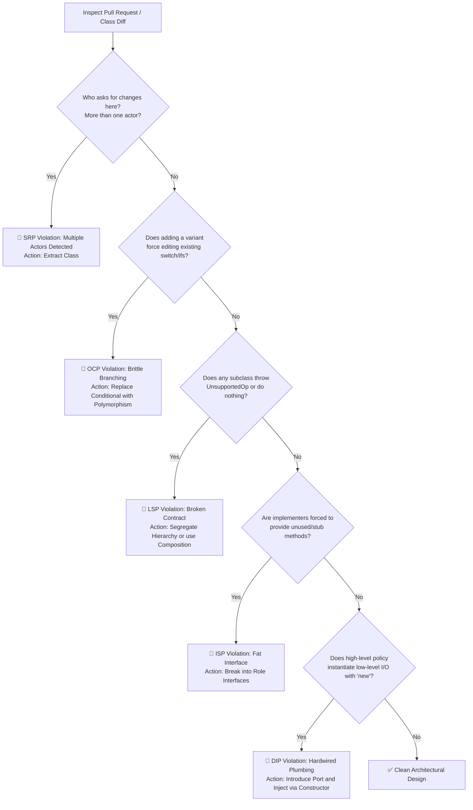

# SOLID Violations Spotting Guide: Code Review Heuristics & Diagnostics

> **One-line summary:** An operational code review field guide for detecting architectural rot, identifying subtle SOLID violations in pull requests, and automating structural boundaries.

| Attribute | Specification |
|---|---|
| **Level** | Core / Diagnostic & Operational |
| **Prerequisites** | [01-single-responsibility.md](01-single-responsibility.md), [02-open-closed.md](02-open-closed.md), [03-liskov-substitution.md](03-liskov-substitution.md), [04-interface-segregation.md](04-interface-segregation.md), [05-dependency-inversion.md](05-dependency-inversion.md) |
| **Estimated Reading Time** | 30 minutes |
| **Status** | Complete |
| **Category** | SOLID Principles |
| **Also Known As** | SOLID Code Review Checklist, Architectural Code Smells Guide |
| **Languages Tested** | Java 25 (LTS) / TypeScript 5.8 (Node 24 native) / Python 3.14 |

---

## Table of Contents
- [1 The Problem](#1-the-problem)
- [2 Why It Exists](#2-why-it-exists)
- [3 What It Is](#3-what-it-is)
- [4 The Problem Without It](#4-the-problem-without-it)
- [5 How It Solves It](#5-how-it-solves-it)
- [6 How It Works](#6-how-it-works)
- [7 Real-World Examples](#7-real-world-examples)
- [8 When to Use and When NOT to Use](#8-when-to-use-and-when-not-to-use)
- [9 Variations and Language Idioms](#9-variations-and-language-idioms)
- [10 Relationship to Other Principles and Patterns](#10-relationship-to-other-principles-and-patterns)
- [11 Common Mistakes and Anti-Patterns](#11-common-mistakes-and-anti-patterns)
- [12 Testing and Design Verification](#12-testing-and-design-verification)
- [13 Performance, Concurrency and Security Notes](#13-performance-concurrency-and-security-notes)
- [14 Interview Questions](#14-interview-questions)
- [15 Practice Exercises](#15-practice-exercises)
- [16 Summary / Cheat Sheet](#16-summary--cheat-sheet)
- [17 Further Reading](#17-further-reading)

---

## 1 The Problem

Most engineering teams conduct code reviews by focusing on surface-level trivia: variable naming, indentation, trailing commas, or stylistic preferences. Linters like ESLint, Checkstyle, and Flake8 catch syntax errors, but **they are completely blind to architectural rot**.

Consider what slips through typical code reviews every single day:
- A developer adds an `if (userType == "ENTERPRISE")` check inside a billing module. It compiles cleanly, has 100% test coverage, and looks harmless in a 15-line diff. Six months later, there are 45 identical conditional checks scattered across 12 files.
- A developer creates a subclass `ReadOnlyCustomer` that overrides `save()` to throw an exception. The PR is approved because "it prevents accidental writes." In production, a nightly maintenance cron job crashes midway because it assumed any `Customer` could be persisted.
- A developer injects a concrete `StripeHttpClient` directly into a domain entity's constructor. The test passes because the developer mocked the HTTP client using reflection. Now, writing any new unit test requires 40 lines of mock setup.

Without a systematic, diagnostic heuristic for spotting architectural violations, technical debt accumulates silently until velocity grinds to a halt.

---

## 2 Why It Exists

Architectural decay rarely happens in catastrophic rewrites; it occurs via the **"Broken Windows Theory" of software engineering**: one tiny shortcut or compromise approved in a pull request establishes a precedent, inviting further compromises.

This guide exists to transform abstract design principles into **concrete, objective code review heuristics**. Instead of subjective debates ("I feel this class is doing too much"), reviewers can point to verifiable, structural symptoms ("This class imports both `java.sql.*` and `javax.servlet.*`, violating SRP across persistence and presentation actors").

---

## 3 What It Is

The **SOLID Diagnostic Framework** equips developers and tech leads with a rapid triage flowchart to evaluate any class or pull request:



---

## 4 The Problem Without It

Here is an innocent-looking pull request submitted to an enterprise notification engine. Reviewers approved it because it passed CI tests:

```java
// Pull Request: "Add support for Slack alerts"
public class AlertRouter {
    // 🚨 DIP Smell: Direct concretion instantiation
    private SlackHttpClient slackClient = new SlackHttpClient("https://hooks.slack.com/services/...");
    private TwilioSmsClient smsClient = new TwilioSmsClient("AC12345", "auth_token");

    // 🚨 SRP Smell: Mixing routing, formatting, and network protocols
    public void dispatch(String channel, String message, String recipient) {
        // 🚨 OCP Smell: Adding Discord next sprint will modify this exact method!
        if ("SLACK".equalsIgnoreCase(channel)) {
            String jsonPayload = "{\"text\": \"" + message + "\"}";
            slackClient.postWebhook(jsonPayload);
        } else if ("SMS".equalsIgnoreCase(channel)) {
            // 🚨 LSP Smell: Formatting assumptions break if phone number has no country code
            if (!recipient.startsWith("+")) throw new IllegalArgumentException("Phone must start with +");
            smsClient.send(recipient, message);
        }
    }
}
```

### The Production Failure Cascade
1. An upstream user enters a US number without `+1`. The `AlertRouter` detonates with `IllegalArgumentException`, dropping all subsequent alerts queued in the batch.
2. The security team rotates the Slack webhook token: `AlertRouter.java` must be edited, recompiled, and redeployed, taking down the entire alerting cluster for 10 minutes.
3. Writing a unit test for `dispatch()` triggers actual network calls to Slack and Twilio, charging the company credit card for live SMS messages during local development.

---

## 5 How It Solves It

By applying our diagnostic checklist, we identify all four smells and refactor the code into clean, segregated, inverted components.

### The Diagnostic Triage Matrix
| Smell Detected | Underlying Principle | Diagnostic Symptom | Refactoring Action |
|---|---|---|---|
| `new SlackHttpClient()` | **DIP** | Instantiating I/O clients with `new` | Inject abstraction via constructor |
| `if ("SLACK" ...)` | **OCP** | String comparison switch in core routing | Strategy pattern / Map registry |
| JSON formatting inside router | **SRP** | Mixing transport with presentation | Move formatting into channel adapter |
| Throws on non-`+` prefix | **LSP** | Tightened precondition in branch | Validate at input boundary |

### Refactored Implementation (Multi-Language)

#### Java 25 LTS
```java
package com.design.solid.spotting;

import java.util.Map;

// 1. Role Abstraction (ISP & DIP)
public interface AlertChannel {
    void send(String recipient, String message);
}

// 2. Concrete Extensible Adapters (SRP & OCP)
public class SlackChannel implements AlertChannel {
    private final String webhookUrl;

    public SlackChannel(String webhookUrl) { this.webhookUrl = webhookUrl; }

    @Override
    public void send(String recipient, String message) {
        System.out.println("Java: Slack webhook posted to " + recipient + ": " + message);
    }
}

public class SmsChannel implements AlertChannel {
    @Override
    public void send(String recipient, String message) {
        System.out.println("Java: SMS dispatched to " + recipient + ": " + message);
    }
}

// 3. Router closed for modification (OCP & DIP)
public class AlertRouter {
    private final Map<String, AlertChannel> channels;

    public AlertRouter(Map<String, AlertChannel> channels) {
        this.channels = channels;
    }

    public void dispatch(String channelKey, String recipient, String message) {
        AlertChannel channel = channels.get(channelKey.toUpperCase());
        if (channel == null) {
            throw new IllegalArgumentException("Unsupported channel: " + channelKey);
        }
        channel.send(recipient, message);
    }
}
```

#### TypeScript 5.8 (Node 24 Native)
```typescript
interface AlertChannel {
    send(recipient: string, message: string): void;
}

class SlackChannel implements AlertChannel {
    constructor(private webhookUrl: string) {}
    send(recipient: string, message: string): void {
        console.log(`TS: Slack webhook posted to ${recipient}: ${message}`);
    }
}

class SmsChannel implements AlertChannel {
    send(recipient: string, message: string): void {
        console.log(`TS: SMS dispatched to ${recipient}: ${message}`);
    }
}

class AlertRouter {
    constructor(private channels: Map<string, AlertChannel>) {}

    dispatch(channelKey: string, recipient: string, message: string): void {
        const channel = this.channels.get(channelKey.toUpperCase());
        if (!channel) throw new Error(`Unsupported channel: ${channelKey}`);
        channel.send(recipient, message);
    }
}
```

#### Python 3.14
```python
from typing import Protocol, Dict

class AlertChannel(Protocol):
    def send(self, recipient: str, message: str) -> None: ...

class SlackChannel:
    def __init__(self, webhook_url: str) -> None:
        self.webhook_url = webhook_url

    def send(self, recipient: str, message: str) -> None:
        print(f"Python: Slack webhook posted to {recipient}: {message}")

class SmsChannel:
    def send(self, recipient: str, message: str) -> None:
        print(f"Python: SMS dispatched to {recipient}: {message}")

class AlertRouter:
    def __init__(self, channels: Dict[str, AlertChannel]) -> None:
        self.channels = channels

    def dispatch(self, channel_key: str, recipient: str, message: str) -> None:
        channel = self.channels.get(channel_key.upper())
        if not channel:
            raise ValueError(f"Unsupported channel: {channel_key}")
        channel.send(recipient, message)
```

---

## 6 How It Works: The Code Review Checklist

When reviewing any pull request, scan through these five concrete heuristic sections:

### 1. SRP Diagnostic Heuristics
- [ ] **Import Audit:** Does the class import disparate domains? (e.g. `java.sql` + `javax.servlet`, or `mongoose` + `nodemailer`).
- [ ] **Method Name Dissonance:** Does a class named `UserManager` have methods like `renderProfileHtml()`, `sendEmail()`, and `exportToCsv()`?
- [ ] **The "And" Test:** Can you describe what the class does in one sentence without using the word **"and"**? (e.g., "It calculates tax *and* formats invoices *and* sends emails" = 3 violations).

### 2. OCP Diagnostic Heuristics
- [ ] **The Switch/Type Smell:** Does the pull request add another `case "NEW_TYPE":` to an existing `switch` or `if/else` block?
- [ ] **Downcasting / `instanceof`:** Does the method accept a generic interface and immediately check `if (obj instanceof SpecificSubtype)`?
- [ ] **File Modification Ratio:** Did adding a new feature require modifying 10 existing files instead of creating 1 new file and registering it?

### 3. LSP Diagnostic Heuristics
- [ ] **The Refusal Smell:** Does any method override throw `UnsupportedOperationException`, `NotImplementedError`, or return `null`?
- [ ] **Strengthened Preconditions:** Does an overriding method add new input validation constraints that the base class does not have?
- [ ] **Weakened Postconditions:** Does an overriding method fail to fulfill promises made by the base class contract?

### 4. ISP Diagnostic Heuristics
- [ ] **The Empty Stub Smell:** Does a class implement an interface with empty bodies (`{}`) because it doesn't need those methods?
- [ ] **Mocking Burden in Tests:** Does a unit test require mocking 15 methods on an interface when the method under test only calls 1?
- [ ] **God Interfaces:** Does an interface have more than 7-10 methods spanning unrelated operations?

### 5. DIP Diagnostic Heuristics
- [ ] **The Direct `new` Smell:** Does high-level business logic call `new HttpClient()`, `new DatabaseConnection()`, or `new FileOutputStream()`?
- [ ] **Hardcoded Secrets/Endpoints:** Are URLs, ports, or API credentials instantiated directly inside domain services?
- [ ] **Static Method Calls:** Does domain logic call global static methods (`DatabaseHelper.execute()`, `SmtpClient.send()`) that cannot be mocked?

---

## 7 Real-World Examples

### Case Study 1: The "Harmless" Helper Class
A PR introduces `GeneralUtilityHelper.java` (950 lines). It contains methods for date parsing, string manipulation, credit card tokenization, and AWS S3 uploads.
- **Diagnosis:** Blatant **SRP** violation. It serves at least four different actors (UI, Security, Infrastructure, Core Domain).
- **Remedy:** Break into dedicated classes: `DateFormatter`, `CardTokenVaultClient`, `S3ObjectStore`.

### Case Study 2: The E-Commerce Discount Regression
A PR adds `if (customer.isBirthday()) discount *= 1.2;` inside `PricingCalculator.java`. Next week, another PR adds `if (isBlackFriday()) discount *= 1.5;`.
- **Diagnosis:** Blatant **OCP** violation.
- **Remedy:** Extract a `DiscountRule` interface: `BirthdayDiscountRule`, `BlackFridayDiscountRule`. The `PricingCalculator` iterates through an injected list of rules.

### Case Study 3: The Fake Repository
A developer writes `InMemoryUserRepository` for testing, implementing `UserRepository`. However, calling `findPaginated()` throws `NotImplementedError("Pagination not supported in memory")`.
- **Diagnosis:** Blatant **LSP** violation. The test fake does not fulfill the contract of the interface it claims to implement.
- **Remedy:** Implement basic in-memory pagination or segregate pagination into `PaginatedUserRepository`.

---

## 8 When to Use and When NOT to Use

| Situation | Action | Rationale |
|---|---|---|
| **Pull Requests Touching Core Domain Logic** | **Enforce Strict SOLID Checklist** | Regressions here have catastrophic financial and operational impact. |
| **Pull Requests Adding Third-Party APIs** | **Enforce DIP & ISP** | Prevent third-party vendor lock-in from infecting the codebase. |
| **Throwaway Prototypes / Spikes** | **Relax Rules Temporarily** | Speed of learning is higher priority than long-term maintainability. |
| **Simple Script / 1-Off Migration** | **Do NOT over-engineer** | A 30-line database migration script does not need 5 interfaces and a DI container. |

---

## 9 Variations and Language Idioms

### Java: Automated Architecture Testing with ArchUnit
In Java, you can enforce SOLID principles automatically in CI using **ArchUnit**:
```java
@AnalyzeClasses(packages = "com.company.app")
public class ArchitectureTest {
    @ArchTest
    public static final ArchRule domainMustNotDependOnInfrastructure =
        noClasses().that().resideInAPackage("..domain..")
            .should().dependOnClassesThat().resideInAPackage("..infrastructure..");
}
```

### TypeScript: Dependency Cruiser
In TypeScript/Node, tools like `dependency-cruiser` generate rules preventing domain modules from importing infrastructure:
```json
{
  "forbidden": [
    {
      "name": "domain-not-to-infra",
      "severity": "error",
      "from": { "path": "^src/domain" },
      "to": { "path": "^src/infrastructure" }
    }
  ]
}
```

### Python: Import Linter
In Python, `import-linter` enforces clean layers in `setup.cfg` or `pyproject.toml`:
```ini
[importlinter:contract:1]
name = Domain layer must not import infrastructure
type = layers
layers =
    infrastructure
    application
    domain
```

---

## 10 Relationship to Other Principles and Patterns

- **Code Smells (Fowler):** SOLID violations are the direct mechanical causes of Martin Fowler's classic code smells (God Class $\to$ SRP, Shotgun Surgery $\to$ SRP, Divergent Change $\to$ SRP, Switch Statements $\to$ OCP, Refused Bequest $\to$ LSP).
- **Static Analysis Linters:** SonarQube, ArchUnit, and ESLint plugins can be tuned to detect coupling metrics ($C_a, C_e$, Cyclomatic Complexity) that signal SOLID rot.

---

## 11 Common Mistakes and Anti-Patterns

| Code Review Mistake | Description | Consequence | Correct Reviewer Response |
|---|---|---|---|
| **Approving Based on Test Coverage Alone** | PR has 100% test coverage, but tests use massive reflection hacks to mock private fields. | Brittle tests; refactoring breaks tests even when behavior is unchanged. | Reject PR: demand constructor injection and seam decoupling (DIP). |
| **Allowing "Temporary" Singletons** | "I'll make this a static singleton for now and refactor later." | The singleton becomes permanent; tight coupling spreads like a virus. | Reject PR: require dependency injection immediately. |
| **Nitpicking over Naming while Ignoring God Classes** | Leaving 20 comments on camelCase vs snake_case while approving a 1,500-line class. | Bikeshedding; architectural rot goes unaddressed. | Focus review energy on structural cohesion and dependency flow first. |
| **Demanding Interfaces for Everything** | Forcing author to create `IUserDto` for a plain data record. | Speculative bloat and cognitive friction. | Distinguish between behavioral abstractions and passive data models. |
| **Tolerating `instanceof` Escape Hatches** | Accepting `if (device instanceof AdvancedPrinter)` to bypass an ISP violation. | Spreads type checks everywhere; violates both OCP and LSP. | Require extracting the specific capability interface. |
| **Ignoring Exception Signatures** | Allowing an overridden method to throw generic `RuntimeException` without contract documentation. | Surprise production crashes in batch loops. | Enforce documented contract exceptions (LSP). |

---

## 12 Testing and Design Verification

A reliable automated indicator of a SOLID violation is **Test Complexity Metrics**:

| Metric | Threshold for Warning | Likely SOLID Violation |
|---|---|---|
| **Lines of Mock Setup per Test** | $> 25$ lines of `when(...).thenReturn(...)` | **DIP / ISP:** Interface is too fat or dependencies are tangled. |
| **Constructor Parameter Count** | $> 5$ parameters | **SRP:** Service is trying to manage too many external concerns. |
| **Cyclomatic Complexity per Method** | $> 8$ | **OCP:** Method has nested `switch` or `if/else` ladders. |
| **Test Execution Time** | $> 100\text{ms}$ for a unit test | **DIP:** Test is accidentally hitting disk, network, or spinning up thread pools. |

---

## 13 Performance, Concurrency and Security Notes

### Performance
- Catching SOLID violations early avoids deep refactorings late in the project lifecycle. Fixing a hardcoded database coupling late in production often requires weeks of risky database re-architecting.

### Concurrency
- SRP and immutability directly eliminate race conditions. If classes do not hold shared mutable state across actors, concurrent execution requires zero synchronization locks.

### Security
- Catching DIP and ISP violations during review prevents privilege escalation. When a service only receives `ReadOnlyRepository`, it is physically impossible for an injection attack or logic bug to issue `DELETE` queries.

---

## 14 Interview Questions

<details>
<summary><strong>1. During a code review, you see a 400-line PR that adds a new payment provider by adding another branch to a 200-line switch statement. How do you give constructive feedback?</strong></summary>

Acknowledge that the PR works and passes tests, but explain the long-term risk: each new payment method increases the blast radius for all existing payment methods (violating OCP). Recommend extracting a `PaymentMethod` strategy interface. Offer to pair-program on refactoring the first branch so the author has a clear pattern to follow.
</details>

<details>
<summary><strong>2. What is the difference between a linter (like ESLint or Checkstyle) and architectural testing (like ArchUnit)?</strong></summary>

Linters inspect file-level syntax, formatting, and micro-patterns (e.g. unused variables, naming conventions, missing semicolons). Architectural testing inspects package-level dependency graphs, layer boundaries, and structural rules (e.g. "Domain layer must not import Infrastructure classes").
</details>

<details>
<summary><strong>3. How does the presence of `UnsupportedOperationException` in a subclass signal a design smell?</strong></summary>

It indicates a direct violation of the Liskov Substitution Principle (LSP). The subclass cannot fulfill the contract promised by the base class. The remedy is to segregate the interface or replace inheritance with composition.
</details>

<details>
<summary><strong>4. Why is having more than 5-6 constructor parameters in a service class a warning sign?</strong></summary>

It strongly suggests an SRP violation. When a class requires six or seven collaborator services, it is almost certainly coordinating too many disparate business responsibilities. It should be decomposed into smaller, focused domain services or coordinated via a Facade.
</details>

<details>
<summary><strong>5. How can you tell if an interface violates ISP without looking at the interface itself?</strong></summary>

Look at its clients and implementers:
1. Implementers have empty method bodies (`{}`) or throw `UnsupportedOperationException`.
2. Unit tests for clients require mocking 10 irrelevant methods that the test never verifies.
3. Multiple unrelated feature pull requests touch the same interface file.
</details>

<details>
<summary><strong>6. What is the "Bikeshedding" phenomenon in code reviews, and how does this guide prevent it?</strong></summary>

Bikeshedding (Parkinson's Law of Triviality) is spending disproportionate time debating trivial issues (like variable naming or spacing) because they are easy to understand, while ignoring complex structural design flaws. This guide provides an objective 5-point checklist that directs reviewer focus to high-impact architectural boundaries.
</details>

<details>
<summary><strong>7. How do you spot a DIP violation in a language with dynamic typing (like Python or JavaScript)?</strong></summary>

In Python or JavaScript, DIP violations appear when modules import low-level I/O libraries (like `requests`, `psycopg2`, or `fs`) directly inside core business logic files, or when classes instantiate external clients globally or inside `__init__` rather than accepting them as parameters.
</details>

<details>
<summary><strong>8. What is the risk of over-zealous SOLID enforcement in code reviews?</strong></summary>

Over-zealous enforcement leads to "Architecture Astronaut" syndrome: PRs are rejected because a simple 20-line utility isn't wrapped in 4 interfaces, a factory, and an abstract strategy. Reviewers must balance SOLID against YAGNI, applying abstractions only when real friction or volatility exists.
</details>

---

## 15 Practice Exercises

### Exercise 1: Pull Request Code Review Triage (Easy)
Review this diff and identify which SOLID principle is violated:
```diff
--- a/src/services/ReportService.java
+++ b/src/services/ReportService.java
@@ -15,6 +15,9 @@ public class ReportService {
     public String generateReport(ReportData data) {
         String markdown = formatMarkdown(data);
+        // New feature: Send report to Slack immediately
+        SlackWebhookClient.post("https://slack.com/webhook", markdown);
         return markdown;
     }
 }
```

<details>
<summary><strong>Solution</strong></summary>

**Violations:**
1. **SRP:** `ReportService` is responsible for generating report text. Adding Slack dispatch couples reporting formatting with network communication (two disparate actors).
2. **DIP:** Direct static call to `SlackWebhookClient.post()` introduces hardwired infrastructure plumbing that cannot be unit-tested without real Slack webhooks.
**Remedy:** Emit an event or inject a `ReportNotifier` interface.
</details>

---

### Exercise 2: Triage the Database Adapter (Medium)
Identify the two SOLID violations in this repository implementation:

```typescript
interface DataStore {
    get(id: string): any;
    set(id: string, value: any): void;
    delete(id: string): void;
    backupToColdStorage(): void;
    compactBTreeIndexes(): void;
}

class RedisCacheStore implements DataStore {
    get(id: string) { return redis.get(id); }
    set(id: string, value: any) { redis.set(id, value); }
    delete(id: string) { redis.del(id); }
    backupToColdStorage() { throw new Error("Redis does not support cold storage!"); }
    compactBTreeIndexes() { throw new Error("Redis uses hash tables, not B-Trees!"); }
}
```

<details>
<summary><strong>Solution</strong></summary>

1. **ISP Violation:** `DataStore` couples basic key-value operations with administrative database maintenance (`backupToColdStorage`, `compactBTreeIndexes`).
2. **LSP Violation:** `RedisCacheStore` throws runtime exceptions for methods promised by `DataStore`. Any polymorphic caller executing maintenance loops will crash.
**Remedy:** Segregate into `KeyValueStore` and `DatabaseAdministrator`. `RedisCacheStore` implements only `KeyValueStore`.
</details>

---

### Exercise 3: Write an Automated Architecture Rule (Hard)
Write an ArchUnit test in Java or an import-linter rule in Python that enforces:
- Domain services residing in `com.app.domain` must NEVER import anything from `com.app.infrastructure` or `java.sql`.

<details>
<summary><strong>Solution</strong></summary>

#### Java (ArchUnit):
```java
@AnalyzeClasses(packages = "com.app")
public class DomainBoundaryTest {
    @ArchTest
    public static final ArchRule domainIsIsolated = 
        noClasses().that().resideInAPackage("..domain..")
            .should().dependOnClassesThat().resideInAnyPackage("..infrastructure..", "java.sql..");
}
```

#### Python (`.importlinter`):
```ini
[importlinter:contract:domain-isolation]
name = Domain layer must not depend on infrastructure or SQL
type = forbidden
source_modules =
    app.domain
forbidden_modules =
    app.infrastructure
    sqlite3
    psycopg2
```
</details>

---

## 16 Summary / Cheat Sheet

```
+--------------------------------------------------------------------------+
|                     SOLID VIOLATIONS SPOTTING CHEAT SHEET                |
+--------------------------------------------------------------------------+
| PRINCIPLE | QUICK DIFF RED FLAG                    | CODE REVIEW REMEDY  |
|-----------|----------------------------------------|---------------------|
| SRP       | Mixed imports (SQL + HTTP); "And" test | Extract Class       |
| OCP       | Adding case to existing switch/if-else | Strategy / Registry |
| LSP       | Overriding method throws or does no-op | Segregate / Compose |
| ISP       | Empty method stubs; 20-line mock setup | Role Interfaces     |
| DIP       | 'new' on services/repos; static I/O    | Constructor Inject  |
+--------------------------------------------------------------------------+
| GOLDEN HEURISTIC: Review the architecture of the diff before reviewing   |
|                   the formatting of the lines.                           |
+--------------------------------------------------------------------------+
```

---

## 17 Further Reading

- Martin Fowler, *Refactoring: Improving the Design of Existing Code*, Addison-Wesley, 2018.
- Michael Feathers, *Working Effectively with Legacy Code*, Prentice Hall, 2004.
- ArchUnit Documentation, *Unit testing Java architecture*, https://www.archunit.org.

### In Your Language
| Language Track | Deep Dive Reference |
|---|---|
| Java | [Java OOP & Design Patterns](file:///e:/Learning/engineering-notes/01-languages/java/24-design-patterns/README.md) |
| TypeScript | [TypeScript Design Patterns](file:///e:/Learning/engineering-notes/01-languages/typescript/17-design-patterns/README.md) |
| Python | [Python Design Patterns](file:///e:/Learning/engineering-notes/01-languages/python/23-design-patterns/README.md) |

---

[← Previous: 06 - SOLID in Practice](file:///e:/Learning/engineering-notes/08-solid-design-patterns/02-solid-principles/06-solid-in-practice.md) | [Module 02 Index](file:///e:/Learning/engineering-notes/08-solid-design-patterns/02-solid-principles/README.md) | [Next: 08 - SOLID & Functional Programming →](file:///e:/Learning/engineering-notes/08-solid-design-patterns/02-solid-principles/08-solid-and-functional-programming.md)
