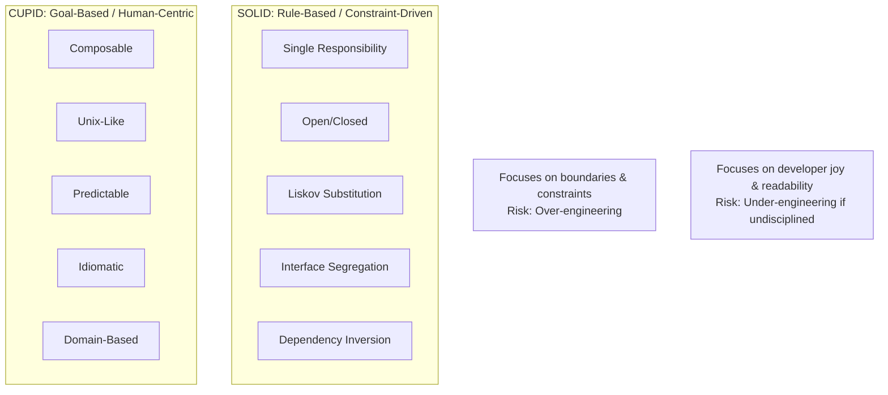

# Criticisms & Limits of SOLID: Modern Alternatives & Pragmatic Boundaries

> **One-line summary:** SOLID principles are historical heuristics, not religious dogmas—blindly applying them without context creates "Enterprise FizzBuzz" over-engineering, indirection fatigue, and premature abstraction.

| Attribute | Specification |
|---|---|
| **Level** | Advanced Foundational / Architectural Critique |
| **Prerequisites** | [01-single-responsibility.md](01-single-responsibility.md), [02-open-closed.md](02-open-closed.md), [03-liskov-substitution.md](03-liskov-substitution.md), [04-interface-segregation.md](04-interface-segregation.md), [05-dependency-inversion.md](05-dependency-inversion.md), [06-solid-in-practice.md](06-solid-in-practice.md) |
| **Estimated Reading Time** | 35 minutes |
| **Status** | Complete |
| **Category** | SOLID Principles |
| **Also Known As** | Beyond SOLID, Critique of OOP Dogma, CUPID Properties |
| **Languages Tested** | Java 25 (LTS) / TypeScript 5.8 (Node 24 native) / Python 3.14 |

---

## Table of Contents
- [1 The Problem](#1-the-problem)
- [2 Why It Exists](#2-why-it-exists)
- [3 What It Is](#3-what-it-is)
- [4 The Problem Without It](#4-the-problem-without-it)
- [5 How It Solves It](#5-how-it-solves-it)
- [6 How It Works](#6-how-it-works)
- [7 Real-World Examples](#7-real-world-examples)
- [8 When to Use and When NOT to Use](#8-when-to-use-and-when-not-to-use)
- [9 Variations and Language Idioms](#9-variations-and-language-idioms)
- [10 Relationship to Other Principles and Patterns](#10-relationship-to-other-principles-and-patterns)
- [11 Common Mistakes and Anti-Patterns](#11-common-mistakes-and-anti-patterns)
- [12 Testing and Design Verification](#12-testing-and-design-verification)
- [13 Performance, Concurrency and Security Notes](#13-performance-concurrency-and-security-notes)
- [14 Interview Questions](#14-interview-questions)
- [15 Practice Exercises](#15-practice-exercises)
- [16 Summary / Cheat Sheet](#16-summary--cheat-sheet)
- [17 Further Reading](#17-further-reading)

---

## 1 The Problem

Imagine an engineering team hired to build a simple internal user administration microservice. The service has one job: read a user record from a relational database, check if their subscription is active, and return a JSON payload.

A senior engineer, determined to write "proper production-grade SOLID code", architects the solution:
```
src/
  ├── domain/
  │   ├── model/
  │   │   ├── User.java
  │   │   └── IUser.java                 <-- Interface for a single entity
  │   └── ports/
  │       ├── IUserRepository.java       <-- Interface with 1 method
  │       ├── IUserValidator.java        <-- Interface for 1 validation method
  │       └── IUserResponsePresenter.java<-- Interface for JSON presentation
  ├── application/
  │   ├── services/
  │   │   ├── UserService.java
  │   │   └── IUserService.java          <-- Interface for 1 service
  │   └── factories/
  │       ├── UserFactory.java
  │       └── IUserFactory.java          <-- Abstract factory interface
  └── infrastructure/
      ├── persistence/
      │   ├── PostgresUserRepository.java
      │   └── OrmEntityMapper.java
      └── http/
          └── UserController.java
```

The result?
- To add a single boolean column (`isEmailVerified`), a developer must edit **14 separate files across 6 directory packages**.
- Onboarding a junior engineer takes three weeks because tracing what happens when a button is clicked requires stepping through 8 interface indirections and 4 proxy layers.
- The repository has **68 classes to execute three SQL queries**.

This is the nightmare of **"Enterprise FizzBuzz"**: applying SOLID dogmatically as a checklist rather than a problem-solving tool, creating paralyzing complexity, high developer cognitive fatigue, and collapsing sprint velocity.

---

## 2 Why It Exists

To understand the criticisms of SOLID, one must understand the **historical context of the 1990s and early 2000s** when Robert C. Martin formulated them:
1. **Slow C++ Compilers:** In the 1990s, changing a header file in a large C++ codebase triggered hours of recompilation across thousands of files. Principles like ISP and DIP were physically essential to prevent massive rebuild times.
2. **Brittle Memory Layouts:** In unmanaged languages like C++, adding a field to a base class shifted the memory offsets of every derived class. LSP was critical to prevent memory corruption.
3. **Heavyweight Waterfall Processes:** Architecture was often designed upfront by "Chief Architects" before implementation began.

### The Modern Reality
In modern software development (Java 25, TypeScript 5.8, Python 3.14, Go, Rust):
- Compilers are blazing fast; incremental compilation takes seconds.
- Memory is managed and garbage-collected; vtables and struct layouts are shielded from manual offset bugs.
- Agile and CI/CD dominate: systems evolve in continuous small deployments rather than 3-year waterfall releases.

When 1990s C++ architectural rules are blindly forced onto modern dynamic or multi-paradigm stacks, they often create more friction than they resolve.

---

## 3 What It Is: Critical Breakdown of Each Principle

Prominent software luminaries—including **Dan North** (creator of BDD), **Rich Hickey** (creator of Clojure), **John Ousterhout** (Stanford professor and author of *A Philosophy of Software Design*), and **Sandi Metz**—have published rigorous critiques of SOLID:

### 1. Critique of SRP: The Boundary Ambiguity
- **The Flaw:** "Reason to change" is completely subjective. What is "one reason"? Who defines an actor?
- **The Consequence:** Taken to an extreme, developers split cohesive code into dozens of 1-line classes, causing **Shotgun Surgery** (making a single business change requires editing 20 micro-classes) and creating **Anemic Domain Models** where entities have no logic and logic is scattered across disconnected service classes.

### 2. Critique of OCP: The Illusion of Total Closure
- **The Flaw:** You cannot make code closed to all future modifications. Trying to predict future changes leads to **Speculative Generality** (building complex strategy hierarchies for variations that never occur).
- **The Consequence:** As Sandi Metz famously warned:
  > *"Duplication is far cheaper than the wrong abstraction."*
  Modifying a clean, 10-line `if/else` statement when a requirement actually changes is 100x easier than unwinding a 5-layer abstract factory and strategy hierarchy built on an incorrect guess.

### 3. Critique of LSP: Inheritance is Already Outdated
- **The Flaw:** LSP is primarily an inheritance rule. Modern software engineering has largely embraced **Composition over Inheritance**.
- **The Consequence:** In languages like Go, Rust, or modern TypeScript, classical class inheritance is rare or nonexistent. Debating whether a Square is a Rectangle is an academic distraction when data and behaviors are composed through lightweight protocols and pure functions.

### 4. Critique of ISP: Proliferation of Shallow Interfaces
- **The Flaw:** Splitting interfaces to satisfy theoretical purity leads to hundreds of 1-method interfaces that destroy conceptual cohesion.
- **The Consequence:** As John Ousterhout points out, this creates **Shallow Modules**: an interface that has as much complexity in its declaration as it does in its implementation provides negative net value.

### 5. Critique of DIP: Dependency Injection Framework Paralysis
- **The Flaw:** DIP is often conflated with heavy runtime IoC containers (e.g. Spring, Guice, NestJS).
- **The Consequence:** Application startup times balloon, stack traces become 80 frames deep with framework reflection proxies, and runtime debugging becomes a nightmare because call graphs cannot be navigated statically in the IDE.

---

## 4 The Problem Without It: Over-Engineered vs. Direct Code

### The Over-Engineered SOLID Code (Enterprise FizzBuzz)

```java
// Over-engineered abstraction for a simple user greeting
interface IGreetingStrategy { String getGreeting(); }
class EnglishGreetingStrategy implements IGreetingStrategy { public String getGreeting() { return "Hello"; } }
interface IGreetingService { String greet(String name); }
class GreetingService implements IGreetingService {
    private final IGreetingStrategy strategy;
    public GreetingService(IGreetingStrategy strategy) { this.strategy = strategy; }
    public String greet(String name) { return strategy.getGreeting() + ", " + name; }
}
interface IGreetingServiceFactory { IGreetingService create(); }
class GreetingServiceFactory implements IGreetingServiceFactory {
    public IGreetingService create() { return new GreetingService(new EnglishGreetingStrategy()); }
}
```

### The Pragmatic Direct Alternative
```java
public class Greeter {
    public static String greet(String name, String language) {
        String greeting = "ES".equalsIgnoreCase(language) ? "Hola" : "Hello";
        return greeting + ", " + name;
    }
}
```
The direct version takes **5 lines**, is 100% testable, has zero cognitive overhead, and can be refactored into a strategy pattern in 10 minutes *if and when* 12 languages and complex localization rules actually arrive.

---

## 5 How It Solves It: Modern Alternatives to SOLID

### 1. Dan North's CUPID Properties
Dan North proposed **CUPID** as a human-centric, joy-oriented alternative to the mechanical rules of SOLID:

| Property | Description |
|---|---|
| **C - Composable** | Plays well with others; easy to combine, pipe, and assemble. |
| **U - Unix-like** | Does one thing well; predictable inputs, outputs, and clear scope. |
| **P - Predictable** | Does what it says; referentially transparent; zero hidden surprises or spooky side effects. |
| **I - Idiomatic** | Feels natural in the host language; uses native language idioms rather than forcing Java-style patterns everywhere. |
| **D - Domain-based** | The code speaks the language of the business domain, not the language of the design patterns book. |



### 2. John Ousterhout: "Deep Modules"
Instead of creating dozens of micro-classes with 1-line methods, design **Deep Modules**:
- **Interface:** Extremely small, simple, and intuitive.
- **Implementation:** Deep, powerful, hiding substantial complexity.
*Example:* The Unix file I/O interface (`open`, `read`, `write`, `close`) is 4 simple methods, but conceals thousands of lines of disk drivers, page caching, and journaling logic.

### 3. Kent Beck's 4 Rules of Simple Design
1. **Passes all tests:** Correctness is paramount.
2. **Reveals intent:** Clear, expressive naming and obvious structure.
3. **No duplication (DRY):** Eliminate knowledge duplication.
4. **Fewest elements:** Minimize classes, interfaces, and methods! *(The rule dogmatic SOLID always forgets!)*

---

## 6 How It Works: The Cost-of-Abstraction Curve

Every abstraction introduced into a codebase incurs a **permanent tax**:
- **Cognitive Tax:** Developers must learn the abstraction before they can understand the behavior.
- **Navigation Tax:** Jumping through interfaces instead of reading code linearly.
- **Maintenance Tax:** Updating the interface every time the signature evolves.

```
       Cost of
       Change
          ^
          |             / Over-Engineered (Indirection Fatigue)
          |            /
          |           /
          |          /       /-- Optimal Balance (Deep Modules / Seams)
          |         /       /
          |        /       /
          |       /       /
          |      /  _____/
          |     /  /
          |    /  /
          |   /  /
          |  /  /
          | /  /       Under-Engineered (Big Ball of Mud)
          +---------------------------------------------------->
                               Scale of Codebase / Team Size
```

An abstraction is only economically justified when the **Cost of Duplication / Friction** exceeds the **Cost of Indirection**.

---

## 7 Real-World Examples

### 1. The React / Frontend Evolution: Abandoning OOP Inheritance
Early React (2014) heavily leaned on class inheritance (`class MyComponent extends React.Component`). Developers created complex inheritance trees (`BasePage -> AuthenticatedPage -> FormPage -> CheckoutPage`), resulting in fragile base classes and severe LSP confusion.
In 2018, the React core team completely abandoned class inheritance in favor of **React Hooks** (composition of pure functions). Frontend architecture became vastly simpler, more composable (CUPID), and eliminated OOP inheritance hierarchies entirely.

### 2. The Go Programming Language Philosophy
The designers of Go (Rob Pike, Ken Thompson) deliberately omitted classical inheritance, abstract classes, and complex generics from the language. Rob Pike famously remarked:
> *"Clear is better than clever."*
Go codebases typically feature direct struct manipulation, explicit error handling (`if err != nil`), and small, single-method interfaces declared by consumers. Go is a living demonstration of software systems operating at planet scale without traditional OOP SOLID hierarchies.

### 3. Python: Embracing Duck Typing over Abstract Factories
In Python, writing Java-style `IUserManagerFactoryProvider` is considered an anti-pattern ("unpythonic"). Python embraces duck typing and structural protocols: if an object has a `.read()` method, pass it to the file parser. No formal interface hierarchy or DI container is required.

---

## 8 When to Use and When NOT to Use

| Context | SOLID Recommendation | Pragmatic Alternative |
|---|---|---|
| **Early Product Discovery / MVP** | **Skip SOLID** | Write direct, simple code. Validate product-market fit first. |
| **Stable Internal Scripts / Utilities** | **Skip SOLID** | Keep functions linear and procedural. |
| **Complex Domain Rules with Multiple Variants** | **Apply Pragmatic SOLID (SRP, OCP)** | Extract strategy patterns only when 3+ variations exist. |
| **Public API / SDKs with External Callers** | **Strict SOLID** | External developers cannot edit your code; they need stable interfaces. |
| **Microservice Boundary** | **Keep Inside Simple** | Apply DIP/SRP at the service boundary (HTTP/gRPC), but keep internal handler logic simple. |

---

## 9 Variations and Language Idioms

### Java 25: Records & Sealed Hierarchies
Instead of open polymorphism (OCP) requiring infinite strategy classes, modern Java uses **Sealed Interfaces**:
```java
public sealed interface PaymentMethod permits CreditCard, PayPal, Crypto {}
```
This bounds the hierarchy to known, verified types, allowing the compiler to enforce exhaustive pattern matching without leaking open-ended complexity.

### TypeScript: Discriminated Unions
TypeScript embraces Algebraic Data Types:
```typescript
type Result<T> = { success: true; data: T } | { success: false; error: string };
```
Handling failure via unions is simpler, more predictable (CUPID), and avoids complex exception hierarchies.

---

## 10 Relationship to Other Principles and Patterns

- **YAGNI (You Aren't Gonna Need It):** The primary antidote to over-zealous OCP and DIP. Never build an abstraction on the assumption that a requirement *might* arrive in the future.
- **KISS (Keep It Simple, Stupid):** Prioritizes human readability over theoretical architectural perfection.
- **Worse is Better (Gabriel):** Simple implementations that solve 80% of the problem with minimal complexity are historically more successful than 100% architecturally pure systems.

---

## 11 Common Mistakes and Anti-Patterns

| Anti-Pattern | Description | Production Consequence | Correct Remedy |
|---|---|---|---|
| **Architecture Astronautics** | Designing abstract frameworks instead of solving the immediate business problem. | Months of work with zero customer value shipped. | Build the concrete feature first; refactor later. |
| **Interface Shadowing** | Blindly pairing every `Foo` class with an `IFoo` interface. | Doubles the codebase file count with zero polymorphism benefit. | Delete `IFoo`; use concrete `Foo` directly. |
| **The Speculative Strategy Trap** | Creating a Strategy pattern for an algorithm that has only one implementation. | Indirection fatigue; developers must jump through files to find simple logic. | Inline the algorithm into a private method. |
| **Mocking Everything Syndrome** | Unit tests mocking every single collaborator until tests verify nothing real. | Tests pass, but production crashes on deployment because wiring was fake. | Use integration tests or real domain collaborators in tests. |
| **Indirection Hell** | Tracing a single user action requires jumping through 12 different files. | High onboarding costs; cognitive exhaustion during debugging. | Consolidate shallow classes into deep, cohesive modules. |
| **SOLID Dogmatism in Code Reviews** | Blocking pull requests because a simple private helper violates theoretical SRP. | Destroys team morale; fosters a culture of fear and over-engineering. | Focus reviews on customer value, bug prevention, and readability. |

---

## 12 Testing and Design Verification

A key symptom of over-engineered SOLID is **"Mock-Heavy, Value-Low" testing**:
```java
// Testing an over-engineered Greeter tests Mocks, not Behavior!
@Test
void shouldCallStrategy() {
    IGreetingStrategy mockStrategy = mock(IGreetingStrategy.class);
    when(mockStrategy.getGreeting()).thenReturn("Hello");
    GreetingService service = new GreetingService(mockStrategy);

    String result = service.greet("World");

    verify(mockStrategy).getGreeting(); // Verifies wiring, not business value!
}
```

Compare this to testing the pragmatic direct function:
```java
// Testing real behavior with zero mocks!
@Test
void shouldGreetUserCorrectly() {
    assertEquals("Hello, World", Greeter.greet("World", "EN"));
    assertEquals("Hola, World", Greeter.greet("World", "ES"));
}
```

---

## 13 Performance, Concurrency and Security Notes

### Performance
- **The Indirection Cost:** Deep layers of interfaces, factories, and proxy wrappers increase object allocation pressure, leading to higher garbage collection pause times.
- **JIT Inlining Limits:** Modern JVMs and V8 inline method calls up to a certain bytecode depth. Excessive layers of shallow wrapper classes exhaust the inlining budget, preventing the compiler from optimizing hot paths.

### Concurrency
- Over-engineered OOP hierarchies often hide state across multiple layers, making it difficult to reason about thread safety. Pragmatic, immutable data records passed to pure functions provide trivial concurrency safety.

### Security
- Complex abstraction layers obscure the **Security Audit Trail**. When tracing input sanitization through 14 layers of indirection, security auditors can easily miss an unsanitized database query.

---

## 14 Interview Questions

<details>
<summary><strong>1. What are the main criticisms of the Single Responsibility Principle?</strong></summary>

The primary criticism is that "reason to change" is highly subjective and ambiguously defined. Taken too far, it leads to extreme fragmentation where cohesive logic is scattered across dozens of 1-line classes (Shotgun Surgery), creating anemic domain models and high cognitive load.
</details>

<details>
<summary><strong>2. What is Dan North's CUPID framework and how does it contrast with SOLID?</strong></summary>

CUPID stands for Composable, Unix-like, Predictable, Idiomatic, and Domain-based. While SOLID is a set of mechanical rules and constraints designed to avoid failures in early OOP, CUPID focuses on developer joy, readability, and properties that make code pleasant and easy to work with in modern programming environments.
</details>

<details>
<summary><strong>3. What did Sandi Metz mean by "Duplication is far cheaper than the wrong abstraction"?</strong></summary>

When code is prematurely abstracted (e.g. into an OCP strategy or inheritance tree) based on an incorrect guess about future requirements, modifying that abstraction to fit reality is agonizing and risky. In contrast, if the code was simply duplicated in two places, understanding and refactoring it once the real pattern emerges is simple and safe.
</details>

<details>
<summary><strong>4. What is a "Deep Module" according to John Ousterhout, and how does it relate to SOLID?</strong></summary>

A Deep Module provides powerful, sophisticated functionality through a simple, cohesive interface (e.g. Unix file I/O). Ousterhout criticizes the misapplication of SOLID that produces "Shallow Modules"—classes with complex, fragmented interfaces that do very little actual work, maximizing indirection while minimizing benefit.
</details>

<details>
<summary><strong>5. Why is the "Interface-Per-Class" pattern considered an anti-pattern?</strong></summary>

Creating `IUserService` alongside `UserService` when there is only ever one implementation creates file clutter, makes IDE navigation tedious, and provides zero polymorphism. Interfaces should only be introduced when there are multiple implementations or when a real test seam for external I/O is required.
</details>

<details>
<summary><strong>6. How does modern Go or Rust design challenge traditional OOP SOLID?</strong></summary>

Go and Rust omit classical class inheritance, demonstrating that massive, reliable systems can be built without base classes or LSP hierarchies. They prioritize composition, structural interfaces, and explicit error handling over deep abstraction trees.
</details>

<details>
<summary><strong>7. When should a team intentionally choose NOT to follow SOLID?</strong></summary>

During early prototypes (MVPs), when writing short-lived scripts, when building throwaway tools, or when the problem domain is not yet well understood. In these contexts, speed of learning and rapid iteration are higher priorities than long-term decoupling.
</details>

<details>
<summary><strong>8. What is "Architecture Astronautics"?</strong></summary>

A term coined by Joel Spolsky describing engineers who become so obsessed with abstractions, design patterns, and theoretical purity that they float into the stratosphere, designing endless layers of meta-frameworks while failing to ship working software to end users.
</details>

---

## 15 Practice Exercises

### Exercise 1: Spot the Over-Engineering (Easy)
Evaluate this string reversal utility and identify why it is over-engineered:
```java
public interface IStringReverser { String reverse(String input); }
public class InPlaceStringReverser implements IStringReverser {
    public String reverse(String input) { return new StringBuilder(input).reverse().toString(); }
}
public class StringReverserFactory {
    public static IStringReverser create() { return new InPlaceStringReverser(); }
}
```

<details>
<summary><strong>Solution</strong></summary>

Reversing a string is a pure, deterministic operation that will never have alternate interchangeable strategies. Creating an interface, concretion, and factory is pure boilerplate.
**Pragmatic Fix:** A single static utility function:
```java
public class StringUtils {
    public static String reverse(String input) {
        return input == null ? null : new StringBuilder(input).reverse().toString();
    }
}
```
</details>

---

### Exercise 2: Simplify Enterprise User Lookup (Medium)
Refactor this over-engineered TypeScript pipeline into a clean, direct service:

```typescript
// Over-engineered
interface IQueryExecutor { query(sql: string): any; }
interface IUserSqlBuilder { buildSql(id: string): string; }
interface IUserHydrator { hydrate(row: any): User; }

class UserFinder {
    constructor(
        private qe: IQueryExecutor,
        private builder: IUserSqlBuilder,
        private hydrator: IUserHydrator
    ) {}

    find(id: string): User {
        const sql = this.builder.buildSql(id);
        const row = this.qe.query(sql);
        return this.hydrator.hydrate(row);
    }
}
```

<details>
<summary><strong>Solution</strong></summary>

```typescript
// Pragmatic Deep Module
class UserRepository {
    constructor(private db: DatabaseClient) {}

    async findById(id: string): Promise<User | null> {
        const row = await this.db.query("SELECT id, name, email FROM users WHERE id = $1", [id]);
        if (!row) return null;
        return { id: row.id, name: row.name, email: row.email };
    }
}
```
Eliminates 3 shallow interfaces and 2 trivial classes while keeping the database client injected for testing.
</details>

---

### Exercise 3: Rewrite to CUPID Properties (Hard)
Given a complex, fragmented Java banking validation pipeline (7 classes, 4 interfaces), rewrite the domain validation logic in Python to follow Dan North's CUPID properties (Composable, Unix-like, Predictable, Idiomatic, Domain-based).

<details>
<summary><strong>Solution</strong></summary>

```python
from dataclasses import dataclass

@dataclass(frozen=True)
class TransferRequest:
    from_account: str
    to_account: str
    amount: float

# Composable, Unix-like pure validation functions (Predictable & Idiomatic)
def validate_positive_amount(req: TransferRequest) -> str | None:
    return "Amount must be positive" if req.amount <= 0 else None

def validate_different_accounts(req: TransferRequest) -> str | None:
    return "Cannot transfer to same account" if req.from_account == req.to_account else None

# Pipeline composition
VALIDATORS = [validate_positive_amount, validate_different_accounts]

def validate_transfer(req: TransferRequest) -> list[str]:
    """Domain-based: Returns list of error messages, or empty list if valid."""
    return [err for v in VALIDATORS if (err := v(req)) is not None]

# Test
errors = validate_transfer(TransferRequest("ACC1", "ACC1", -50.0))
assert len(errors) == 2
assert "Amount must be positive" in errors
assert "Cannot transfer to same account" in errors
```
Clean, composable, zero boilerplate, zero class hierarchies.
</details>

---

## 16 Summary / Cheat Sheet

```
+--------------------------------------------------------------------------+
|                  CRITICISMS & LIMITS OF SOLID CHEAT SHEET                |
+--------------------------------------------------------------------------+
| PRINCIPLE | LEGITIMATE CRITIQUE                  | MODERN REMEDY         |
|-----------|--------------------------------------|-----------------------|
| SRP       | Ambiguous "reason to change"         | Deep cohesive modules |
| OCP       | Speculative over-generalization      | YAGNI / Rule of Three |
| LSP       | Inheritance is largely obsolete      | Composition & Protocols|
| ISP       | Proliferation of shallow interfaces  | Structural typing     |
| DIP       | DI framework paralysis & indirection | Currying / Direct DI  |
+--------------------------------------------------------------------------+
| ALTERNATIVES TO REMEMBER:                                                |
| 1. CUPID (Composable, Unix-like, Predictable, Idiomatic, Domain-based)   |
| 2. Deep Modules (Simple interface, rich hidden implementation)           |
| 3. Kent Beck's 4 Rules of Simple Design (Fewest elements rule!)          |
+--------------------------------------------------------------------------+
```

---

## 17 Further Reading

- Dan North, *CUPID—the joy of software*, dannorth.net/2022/02/10/cupid-for-joyful-coding/, 2022.
- John Ousterhout, *A Philosophy of Software Design*, Yakny Press, 2018.
- Sandi Metz, *The Wrong Abstraction*, sandimetz.com/blog/2016/1/20/the-wrong-abstraction, 2016.
- Rich Hickey, *Simple Made Easy* (Keynote Talk), Strange Loop, 2011.

### In Your Language
| Language Track | Deep Dive Reference |
|---|---|
| Java | [Java OOP & Design Patterns](file:///e:/Learning/engineering-notes/01-languages/java/24-design-patterns/README.md) |
| TypeScript | [TypeScript Design Patterns](file:///e:/Learning/engineering-notes/01-languages/typescript/17-design-patterns/README.md) |
| Python | [Python Design Patterns](file:///e:/Learning/engineering-notes/01-languages/python/23-design-patterns/README.md) |

---

[← Previous: 08 - SOLID & Functional Programming](file:///e:/Learning/engineering-notes/08-solid-design-patterns/02-solid-principles/08-solid-and-functional-programming.md) | [Module 02 Index](file:///e:/Learning/engineering-notes/08-solid-design-patterns/02-solid-principles/README.md) | [Next: Module 03 - General Design Principles →](file:///e:/Learning/engineering-notes/08-solid-design-patterns/03-design-principles/README.md)
