# General Design Principles Overview

> **One-line summary:** SOLID is only one pillar of software design; durable systems emerge from balancing simplicity (KISS, YAGNI, DRY), boundary discipline (Demeter, Tell-Don't-Ask, Fail-Fast), package topology (GRASP, Package Principles), and socio-technical reality (Conway's Law, Idempotency).

| Attribute | Specification |
|---|---|
| **Level** | Foundational / Architectural |
| **Prerequisites** | [Module 01: Foundations](file:///e:/Learning/engineering-notes/08-solid-design-patterns/01-foundations/README.md), [Module 02: SOLID Principles](file:///e:/Learning/engineering-notes/08-solid-design-patterns/02-solid-principles/README.md) |
| **Estimated Reading Time** | 15 minutes |
| **Status** | Complete |
| **Category** | General Design Principles |

---

## 1. Why SOLID Alone Is Not Enough

A codebase can satisfy all five SOLID principles on paper and still be miserable to operate, debug, or evolve:
- It can be **100% SOLID and over-engineered** because nobody applied **KISS** or **YAGNI**.
- It can have clean interfaces and still suffer **train-wreck coupling** (`order.getCustomer().getWallet().getCurrency()`) because nobody respected the **Law of Demeter** or **Tell, Don't Ask**.
- It can pass every unit test and still **double-charge customers during network retries** because **Idempotency** was ignored.
- It can have pristine classes packaged into **circularly dependent Maven/npm modules**, causing build gridlock because **Package Principles (ADP, SDP)** were violated.

Module 03 bridges the gap between **class-level OOP rules** and **real-world production system design**.

---

## 2. The Five Families of Design Principles

```mermaid
graph TD
    Root[General Design Principles] --> Simp[1. Simplicity & Scope]
    Root --> Bound[2. Encapsulation & Boundaries]
    Root --> Struct[3. Modularity & Responsibility]
    Root --> Rel[4. Reliability & Performance]
    Root --> Org[5. Evolution & Organization]

    Simp --> DRY[01 DRY & Rule of Three]
    Simp --> KISS[02 KISS]
    Simp --> YAGNI[03 YAGNI]

    Bound --> LoD[04 Law of Demeter]
    Bound --> SoC[05 Separation of Concerns]
    Bound --> TDA[06 Tell, Don't Ask]
    Bound --> POLA[07 Least Astonishment]
    Bound --> FF[08 Fail-Fast]

    Struct --> HCLC[10 High Cohesion / Low Coupling]
    Struct --> Ortho[11 Orthogonality]
    Struct --> Holly[13 Hollywood Principle / IoC]
    Struct --> GRASP[14 GRASP 9 Principles]
    Struct --> Pkg[15 Package Principles]

    Rel --> Postel[12 Postel's Law]
    Rel --> Perf[16 Premature Optimisation]
    Rel --> Idem[17 Idempotency]

    Org --> Boy[09 Boy Scout Rule]
    Org --> Conway[18 Conway's Law]
    Org --> Trade[19 Conflicts & Trade-offs]
```

---

## 3. Principle-to-Symptom Diagnostic Map

| If Your System Exhibits This Symptom | Reach For This Principle |
|---|---|
| Fixing one business rule requires hunting down 6 copy-pasted copies | [01 - DRY & Rule of Three](file:///e:/Learning/engineering-notes/08-solid-design-patterns/03-design-principles/01-dry-and-rule-of-three.md) |
| New hires take weeks to trace a simple feature through 12 layers | [02 - KISS Principle](file:///e:/Learning/engineering-notes/08-solid-design-patterns/03-design-principles/02-kiss-principle.md) |
| Half the codebase consists of unused "future-proof" plugin hooks | [03 - YAGNI](file:///e:/Learning/engineering-notes/08-solid-design-patterns/03-design-principles/03-yagni.md) |
| Callers chain `a.getB().getC().getD().execute()` everywhere | [04 - Law of Demeter](file:///e:/Learning/engineering-notes/08-solid-design-patterns/03-design-principles/04-law-of-demeter.md) |
| Business logic pulls getters out of an object to compute decisions externally | [06 - Tell, Don't Ask](file:///e:/Learning/engineering-notes/08-solid-design-patterns/03-design-principles/06-tell-dont-ask.md) |
| Bad input propagates 5 services deep before throwing a cryptic `NullPointerException` | [08 - Fail-Fast Principle](file:///e:/Learning/engineering-notes/08-solid-design-patterns/03-design-principles/08-fail-fast-principle.md) |
| Developers optimize micro-loops without profiling while ignoring $O(N^2)$ DB queries | [16 - Premature Optimisation](file:///e:/Learning/engineering-notes/08-solid-design-patterns/03-design-principles/16-premature-optimisation-and-measuring.md) |
| Network retries create duplicate orders or double payments | [17 - Idempotency Principle](file:///e:/Learning/engineering-notes/08-solid-design-patterns/03-design-principles/17-idempotency-principle.md) |
| Two teams constantly block each other modifying the same monolithic service | [18 - Conway's Law](file:///e:/Learning/engineering-notes/08-solid-design-patterns/03-design-principles/18-conways-law-and-socio-technical-design.md) |

---

## 4. Opposing Forces: Why Trade-offs Are Mandatory

No design principle is an absolute law. Every principle sits in tension with another:
- **DRY vs. Coupling:** Removing incidental duplication across unrelated domains couples them together.
- **Fail-Fast vs. Postel's Law:** Rejecting malformed input immediately protects invariants, while tolerant parsing eases distributed schema evolution.
- **KISS vs. OCP:** Adding polymorphic extension seams protects future growth at the cost of immediate simplicity.

Note [19 - Principles Conflicts & Trade-offs](file:///e:/Learning/engineering-notes/08-solid-design-patterns/03-design-principles/19-principles-conflicts-and-trade-offs.md) synthesizes how senior architects resolve these tensions deliberately.

---

[← Module 03 Index](file:///e:/Learning/engineering-notes/08-solid-design-patterns/03-design-principles/README.md) | [Next: 01 - DRY & The Rule of Three →](file:///e:/Learning/engineering-notes/08-solid-design-patterns/03-design-principles/01-dry-and-rule-of-three.md)
