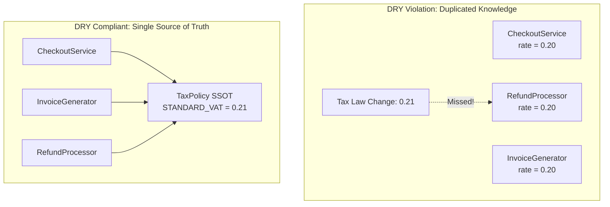
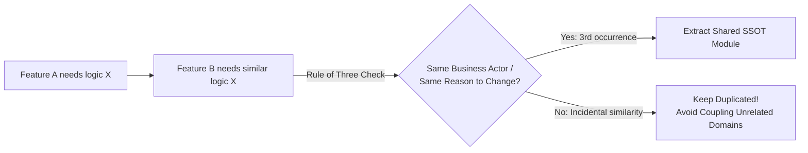

# DRY (Don't Repeat Yourself) & The Rule of Three

> **One-line summary:** Every piece of domain knowledge must have a single, unambiguous, authoritative representation within a system—but wait for three occurrences before abstracting incidental code similarity.

| Attribute | Specification |
|---|---|
| **Level** | Core / Foundational |
| **Prerequisites** | [03-coupling-and-cohesion.md](../01-foundations/03-coupling-and-cohesion.md), [01-single-responsibility.md](../02-solid-principles/01-single-responsibility.md) |
| **Estimated Reading Time** | 30 minutes |
| **Status** | Complete |
| **Category** | General Design Principles |
| **Also Known As** | Single Source of Truth (SSOT), Once and Only Once (OAOO) |
| **Languages Tested** | Java 25 (LTS) / TypeScript 5.8 (Node 24 native) / Python 3.14 |

---

## Table of Contents
- [1 The Problem](#1-the-problem)
- [2 Why It Exists](#2-why-it-exists)
- [3 What It Is](#3-what-it-is)
- [4 The Problem Without It](#4-the-problem-without-it)
- [5 How It Solves It](#5-how-it-solves-it)
- [6 How It Works](#6-how-it-works)
- [7 Real-World Examples](#7-real-world-examples)
- [8 When to Use and When NOT to Use](#8-when-to-use-and-when-not-to-use)
- [9 Variations and Language Idioms](#9-variations-and-language-idioms)
- [10 Relationship to Other Principles and Patterns](#10-relationship-to-other-principles-and-patterns)
- [11 Common Mistakes and Anti-Patterns](#11-common-mistakes-and-anti-patterns)
- [12 Testing and Design Verification](#12-testing-and-design-verification)
- [13 Performance, Concurrency and Security Notes](#13-performance-concurrency-and-security-notes)
- [14 Interview Questions](#14-interview-questions)
- [15 Practice Exercises](#15-practice-exercises)
- [16 Summary / Cheat Sheet](#16-summary--cheat-sheet)
- [17 Further Reading](#17-further-reading)

---

## 1 The Problem

Imagine an e-commerce platform operating across Europe. When the system was launched, the VAT rate (20%) and rounding rules (`Math.round(amount * 0.20 * 100) / 100`) were embedded independently in four different places:
1. `CheckoutService`: Calculates total due at payment capture.
2. `InvoicePdfGenerator`: Computes VAT line items for downloadable receipts.
3. `RefundProcessor`: Computes tax amounts to return on canceled orders.
4. `FrontendCartSummary`: Estimates tax in TypeScript for the browser shopping cart.

Eighteen months later, the government enacts a new statutory tax rate (21%) and mandates half-even banker's rounding for digital goods. Developers update `CheckoutService` and `FrontendCartSummary`, completely forgetting `RefundProcessor` and `InvoicePdfGenerator`.

Within 48 hours of deployment:
- Customers pay 21% VAT at checkout, receive PDF invoices showing 20% VAT, and get refunded 20% VAT upon cancellation—causing an accounting reconciliation discrepancy across 14,000 transactions and an urgent financial audit freeze.

Meanwhile, a second team on the same codebase commits the **opposite mistake**: seeing two functions that happen to iterate over a list and format a string (`formatUserCsv` and `formatAuditLogLine`), they prematurely merge them into a grotesque `GenericDelimiterFormatter` filled with boolean flags (`isAuditMode`, `includeHeaders`). Every time the CSV format changes, the audit log breaks.

---

## 2 Why It Exists

**DRY (Don't Repeat Yourself)** was coined by **Andy Hunt and Dave Thomas** in *The Pragmatic Programmer* (1999):
> *"Every piece of knowledge must have a single, unambiguous, authoritative representation within a system."*

Crucially, Hunt and Thomas were talking about **knowledge duplication**, not mere **syntactic text similarity**. Two blocks of code that look identical today might represent completely unrelated business concepts that evolve independently tomorrow.

To prevent premature abstraction from DRY abuse, **Martin Fowler** (attributing Don Roberts) popularized **The Rule of Three** in *Refactoring* (1999):
1. The first time you write something, just write it.
2. The second time you do something similar, wince at the duplication, but duplicate it anyway.
3. The third time you do something similar, **refactor** into a shared abstraction—because you now have enough evidence of the true axis of variation.

---

## 3 What It Is

DRY is the discipline of maintaining a **Single Source of Truth (SSOT)** for every business rule, schema, constant, and algorithm, while respecting **bounded contexts**:

1. **True DRY Violation (Knowledge Duplication):** Two modules encode the *exact same business rule* (e.g., VAT calculation, password complexity policy). If the rule changes, both must change identically.
2. **Coincidental Duplication (False DRY):** Two modules happen to have identical code structure *right now* (e.g., validation of a Shipping Address vs Billing Address, or two microservices sharing a `User` shape), but represent distinct domain concepts owned by different actors.



---

## 4 The Problem Without It

Here is naive code where VAT knowledge is duplicated across checkout and refund flows:

```java
// Naive Violation: Business rule duplicated across separate workflows
public class CheckoutServiceViolation {
    public double calculateCheckoutTotal(double netAmount) {
        double vat = Math.round(netAmount * 0.20 * 100.0) / 100.0;
        return netAmount + vat;
    }
}

public class RefundServiceViolation {
    public double calculateRefundAmount(double netAmount) {
        // Duplicated rule! Easily drifts out of sync!
        double vat = Math.round(netAmount * 0.20 * 100.0) / 100.0;
        return netAmount + vat;
    }
}
```

### The Change Request & Divergence Failure
Finance updates VAT to 21% in `CheckoutServiceViolation`, overlooking `RefundServiceViolation`.

```text
[Financial Reconciliation Report]
Checkout Collected: $121.00 (21% VAT)
Full Refund Issued: $120.00 (20% VAT - STALE DUPLICATE!)
[LEDGER ERROR] $1.00 shortfall per transaction across 14,000 refunds = $14,000 compliance gap.
```

---

## 5 How It Solves It

We consolidate the authoritative tax policy into a single `TaxPolicy` module used by both checkout and refund workflows. Note that we extract this *because* both operations represent the **same business knowledge** (statutory VAT calculation).

### Java Implementation (Java 25 LTS)

```java
package com.design.principles.dry;

record LineItem(String sku, double price, int qty) {}

// Single Source of Truth for VAT knowledge
class TaxPolicy {
    private static final double STANDARD_VAT = 0.20;

    public double taxFor(double netAmount) {
        return Math.round(netAmount * STANDARD_VAT * 100.0) / 100.0;
    }
}

public class DryApp {
    public static void main(String[] args) {
        TaxPolicy policy = new TaxPolicy();
        System.out.println("Java DRY Checkout Tax: $" + policy.taxFor(100.0));
        System.out.println("Java DRY Refund Tax: $" + policy.taxFor(50.0));
    }
}
```

### TypeScript Implementation (Node 24 Native)

```typescript
const STANDARD_VAT = 0.20;

// Authoritative VAT representation
export function taxFor(netAmount: number): number {
    return Math.round(netAmount * STANDARD_VAT * 100) / 100;
}

console.log("TS DRY Checkout Tax: $" + taxFor(100.0));
console.log("TS DRY Refund Tax: $" + taxFor(50.0));
```

### Python Implementation (Python 3.14)

```python
STANDARD_VAT = 0.20

def tax_for(net_amount: float) -> float:
    """Single Source of Truth for VAT computation."""
    return round(net_amount * STANDARD_VAT, 2)

if __name__ == "__main__":
    print("Python DRY Checkout Tax: $" + str(tax_for(100.0)))
    print("Python DRY Refund Tax: $" + str(tax_for(50.0)))
```

### Real Execution Output
```text
Java DRY Checkout Tax: $20.0
Java DRY Refund Tax: $10.0
TS DRY Checkout Tax: $20
TS DRY Refund Tax: $10
Python DRY Checkout Tax: $20.0
Python DRY Refund Tax: $10.0
```

---

## 6 How It Works: The Rule of Three & Wrong Abstraction

DRY is frequently misunderstood as *"never write the same two lines of code twice."* In reality, premature DRY creates **Wrong Abstractions**, which are far worse than duplication:



### How Wrong Abstractions Decay (Sandi Metz)
1. Developer A sees two similar methods and extracts `SharedHelper(arg1, arg2)`.
2. Developer B needs a slight variation, so they add a boolean flag: `SharedHelper(arg1, arg2, isSpecialCase)`.
3. Developer C adds another flag: `SharedHelper(arg1, arg2, isSpecialCase, skipValidation)`.
4. Within a year, `SharedHelper` is an unreadable 200-line tangle of conditional flags coupling four unrelated features together.

---

## 7 Real-World Examples

### 1. Schema Generation: OpenAPI / Protobuf (Cross-Language DRY)
In distributed systems, duplicating API payload definitions manually across Backend (Java), Frontend (TypeScript), and Mobile (Swift/Kotlin) causes constant serialization bugs. Industry practice uses a **Single Source of Truth** schema (`openapi.yaml` or `.proto` files) and generates client/server DTOs automatically at build time.

### 2. Infrastructure as Code (Terraform Modules)
Defining VPC subnets, security groups, and IAM policies manually per environment (`dev`, `staging`, `prod`) guarantees configuration drift. Reusable Terraform modules provide a single authoritative infrastructure definition parameterized by environment variables.

### 3. Database Constraints & Application Validation
Duplicating validation rules (e.g., email uniqueness or balance non-negativity) purely in the UI without database constraints risks corruption from batch scripts. Conversely, putting complex business rules only in SQL triggers makes them invisible to domain tests. Keep authoritative invariant checks in the domain model, backed by structural integrity constraints (`UNIQUE`, `NOT NULL`, `CHECK`) in the DB.

---

## 8 When to Use and When NOT to Use

| Scenario | Apply DRY? | Rationale |
|---|---|---|
| **Same business rule in 3+ workflows** | **Yes** | True knowledge duplication; divergence causes silent financial/logic bugs. |
| **Configuration, Constants, API Schemas** | **Yes** | Use SSOT config files, codegen, and shared constants. |
| **Two Microservices needing `Address` model** | **No (Duplicate)** | Sharing domain libraries across microservice boundaries creates distributed monolith coupling. |
| **Unit Test Setup Code (AAA)** | **No (Use DAMP)** | Tests should be **DAMP (Descriptive And Meaningful Phrases)**, not DRY. Over-DRYing tests into helper loops makes failures unreadable. |
| **2 occurrences of coincidental code** | **Wait (Rule of Three)** | Wait for a 3rd occurrence to confirm the pattern before abstracting. |

---

## 9 Variations and Language Idioms

- **DAMP (Descriptive And Meaningful Phrases):** Specifically for unit tests—readability inside each test case overrides eliminating setup duplication.
- **SSOT (Single Source of Truth):** Architectural extension of DRY to data, configuration, and documentation (e.g., generating API docs directly from annotations/types).
- **WET (Write Everything Twice / We Enjoy Typing):** Humorous reminder not to abstract until the 3rd duplication.

---

## 10 Relationship to Other Principles and Patterns

- **SRP (Single Responsibility Principle):** SRP protects DRY from creating God helpers. Only unify duplicated logic if it belongs to the **same actor**.
- **YAGNI & KISS:** The Rule of Three is YAGNI applied to abstraction—don't pay the complexity tax of a shared helper until duplication proves itself across three cases.
- **Template Method / Strategy Patterns:** Classic GoF patterns used to eliminate *algorithmic* duplication while allowing specific steps to vary cleanly.

---

## 11 Common Mistakes and Anti-Patterns

| Anti-Pattern | Description | Production Consequence | Correct Remedy |
|---|---|---|---|
| **Cargo-Cult DRY** | Merging two unrelated functions just because 5 lines of loop syntax look identical. | Couples unrelated features; boolean-flag explosion. | Keep incidental similarity separate until domain convergence is proven. |
| **Boolean Flag Parameterization** | Adding `boolean isAdmin` or `mode` flags to force a shared helper to serve divergent callers. | Combinatorial complexity ($2^N$ paths); fragile regressions. | Inline back into callers and split into distinct, focused functions. |
| **Shared Common Library Monolith** | Creating a `company-common-utils` package containing domain models shared across 12 microservices. | Every service must redeploy when one field changes; distributed monolith. | Duplicate small DTOs at service boundaries; only share pure infrastructure utilities. |
| **Over-DRY Unit Tests** | Putting test assertions inside `for` loops and complex inherited test fixtures. | Impossible to tell which test case failed or why without debugging the test itself. | Follow DAMP in tests: inline clear Arrange-Act-Assert blocks. |
| **Copy-Paste Business Constants** | Hardcoding `0.20` tax rate or `MAX_RETRIES = 3` across 8 files. | Silent drift when policies update. | Centralize into authoritative configuration or domain constants. |
| **Documentation Drift** | Writing separate manual API docs that repeat what OpenAPI annotations already express. | Docs go stale immediately after release. | Generate documentation directly from source schemas/code. |

---

## 12 Testing and Design Verification

Testing DRY code means testing the Single Source of Truth thoroughly once, rather than duplicating identical edge-case tests across four callers:

```java
// Test the authoritative TaxPolicy once with comprehensive boundary cases
class TaxPolicyTest {
    @Test
    void shouldRoundHalfUpCorrectly() {
        TaxPolicy policy = new TaxPolicy();
        assertEquals(20.00, policy.taxFor(100.00));
        assertEquals(0.03, policy.taxFor(0.14)); // 0.028 rounds to 0.03
    }
}
```

---

## 13 Performance, Concurrency and Security Notes

- **Performance:** Eliminating duplicated expensive computations (e.g., normalizing inputs or parsing regexes in 5 layers) via a single authoritative pipeline reduces CPU cycles and makes caching trivial.
- **Security:** Security controls (authentication checks, input sanitization, password hashing) **must** follow strict DRY. Having two separate auth-check implementations guarantees one will miss a vulnerability patch (e.g., JWT algorithm confusion).

---

## 14 Interview Questions

<details>
<summary><strong>1. What is the difference between knowledge duplication and code duplication in DRY?</strong></summary>

Knowledge duplication occurs when two places encode the exact same business rule, schema, or policy—if one changes, the other *must* change identically. Code duplication is merely similar syntax. Merging similar-looking code that represents unrelated business concepts (incidental duplication) creates toxic coupling.
</details>

<details>
<summary><strong>2. Explain the Rule of Three and why it protects codebases.</strong></summary>

The Rule of Three states that you should tolerate duplication twice and refactor into an abstraction only on the third occurrence. It protects codebases from premature abstraction: by the third occurrence, you actually see what varies and what stays constant, preventing you from building the wrong abstraction.
</details>

<details>
<summary><strong>3. Why should unit tests prefer DAMP over DRY?</strong></summary>

DAMP (Descriptive And Meaningful Phrases) prioritizes test readability and isolation. When tests are overly DRY (sharing complex setup helpers and loops), a failing test forces engineers to read multiple helper abstractions just to understand the input state. Mild duplication in test Arrange blocks makes each test self-contained and immediately understandable.
</details>

<details>
<summary><strong>4. Why is sharing a "Common Domain Model" library across microservices often an anti-pattern?</strong></summary>

In microservices, different bounded contexts have different views of concepts like `Customer` or `Order`. Sharing a single binary package across services forces coordinated lock-step deployments whenever any team modifies a field, destroying service autonomy. Duplicating small boundary DTOs preserves decoupling.
</details>

<details>
<summary><strong>5. How do you unwind a "Wrong Abstraction" caused by over-zealous DRY?</strong></summary>

As Sandi Metz prescribes:
1. Re-introduce duplication by copying the shared helper code back into each caller.
2. Delete the unused branches and boolean flags inside each caller's copy.
3. Now each caller has clean, focused code—and if a true shared pattern exists, it can be extracted cleanly later.
</details>

<details>
<summary><strong>6. How does OpenAPI / Protobuf code generation enforce DRY?</strong></summary>

It establishes a Single Source of Truth (the schema file) for API contracts. Both server stubs and client SDKs are generated automatically from that file, eliminating manual duplication of field names, types, and validation rules across languages.
</details>

<details>
<summary><strong>7. How does DRY interact with the Single Responsibility Principle (SRP)?</strong></summary>

SRP defines *ownership* by actor. You should only apply DRY across modules that answer to the **same actor**. If HR and Accounting happen to compute something identically today, merging them into one class violates SRP because future requests from HR will break Accounting.
</details>

<details>
<summary><strong>8. What are signs that a codebase has taken DRY too far?</strong></summary>

Shared helper functions with 5+ parameters including boolean mode flags (`isLegacy`, `skipCheck`), fragile inheritance hierarchies created just to share 10 lines of helper code, and regressions in Feature A whenever Feature B updates a shared utility.
</details>

---

## 15 Practice Exercises

### Exercise 1: Knowledge vs Incidental Duplication (Easy)
Two methods look nearly identical:
1. `validateShippingZip(String zip)` -> checks `zip.matches("\\d{5}")`
2. `validateEmployeeBadgeId(String id)` -> checks `id.matches("\\d{5}")`
Should you unify these into a single `validateFiveDigits(String s)` domain validator? Why or why not?

<details>
<summary><strong>Solution</strong></summary>

**No.** This is **incidental duplication**. US ZIP codes (which may expand to ZIP+4) and internal employee badge numbers (which may become alphanumeric) belong to completely unrelated business domains and change for different reasons. Merging them couples HR policy to Shipping logistics.
</details>

---

### Exercise 2: Unwind a Boolean-Flag Wrong Abstraction (Medium)
Refactor this over-DRY function back into clean, decoupled functions:
```typescript
function formatRecord(name: string, value: number, isCurrency: boolean, uppercase: boolean): string {
    const label = uppercase ? name.toUpperCase() : name;
    const formattedVal = isCurrency ? `$${value.toFixed(2)}` : `${value} units`;
    return `${label}: ${formattedVal}`;
}
```

<details>
<summary><strong>Solution</strong></summary>

Inline the branching flags into explicit, domain-named functions:
```typescript
function formatInvoiceLine(item: string, price: number): string {
    return `${item.toUpperCase()}: $${price.toFixed(2)}`;
}

function formatInventoryCount(sku: string, quantity: number): string {
    return `${sku}: ${quantity} units`;
}
```
</details>

---

### Exercise 3: Consolidate Duplicated Domain Policy (Hard)
In a Python billing app, `calculate_monthly_bill`, `preview_upgrade_cost`, and `generate_annual_quote` all independently duplicate tiered seat pricing (`<= 10 seats: $15/seat`, `> 10 seats: $12/seat`). Consolidate this knowledge into a single testable policy while keeping invoice formatting separate.

<details>
<summary><strong>Solution</strong></summary>

```python
class SeatPricingPolicy:
    BASE_RATE = 15.0
    VOLUME_RATE = 12.0
    VOLUME_THRESHOLD = 10

    def monthly_cost(self, seats: int) -> float:
        if seats <= 0:
            raise ValueError("Seats must be positive")
        rate = self.VOLUME_RATE if seats > self.VOLUME_THRESHOLD else self.BASE_RATE
        return seats * rate

policy = SeatPricingPolicy()
assert policy.monthly_cost(5) == 75.0
assert policy.monthly_cost(20) == 240.0
```
</details>

---

## 16 Summary / Cheat Sheet

```
+--------------------------------------------------------------------------+
|                       DRY & THE RULE OF THREE                            |
+--------------------------------------------------------------------------+
| CORE RULE      : Every piece of KNOWLEDGE must have a Single Source of   |
|                  Truth (SSOT) within its bounded context.                |
| RULE OF THREE  : Write it once; duplicate it twice; abstract on the 3rd. |
| KEY DISTINCTION: Knowledge Duplication (Refactor!) vs Incidental Code    |
|                  Similarity (Keep Separate!).                            |
| DANGER SIGN    : Shared helpers accumulating boolean flags (isModeX).    |
| IN TESTS       : Prefer DAMP (readable/isolated) over overly DRY loops.  |
+--------------------------------------------------------------------------+
```

---

## 17 Further Reading

- Andy Hunt & Dave Thomas, *The Pragmatic Programmer* (20th Anniversary Edition), Addison-Wesley, 2019.
- Sandi Metz, *The Wrong Abstraction*, sandimetz.com, 2016.
- Martin Fowler, *Refactoring*, Addison-Wesley, 2018.

### In Your Language
| Language Track | Deep Dive Reference |
|---|---|
| Java | [Java OOP & Design Patterns](file:///e:/Learning/engineering-notes/01-languages/java/24-design-patterns/README.md) |
| TypeScript | [TypeScript Design Patterns](file:///e:/Learning/engineering-notes/01-languages/typescript/17-design-patterns/README.md) |
| Python | [Python Design Patterns](file:///e:/Learning/engineering-notes/01-languages/python/23-design-patterns/README.md) |

---

[← Previous: 00 - General Principles Overview](file:///e:/Learning/engineering-notes/08-solid-design-patterns/03-design-principles/00-overview.md) | [Module 03 Index](file:///e:/Learning/engineering-notes/08-solid-design-patterns/03-design-principles/README.md) | [Next: 02 - KISS Principle →](file:///e:/Learning/engineering-notes/08-solid-design-patterns/03-design-principles/02-kiss-principle.md)
