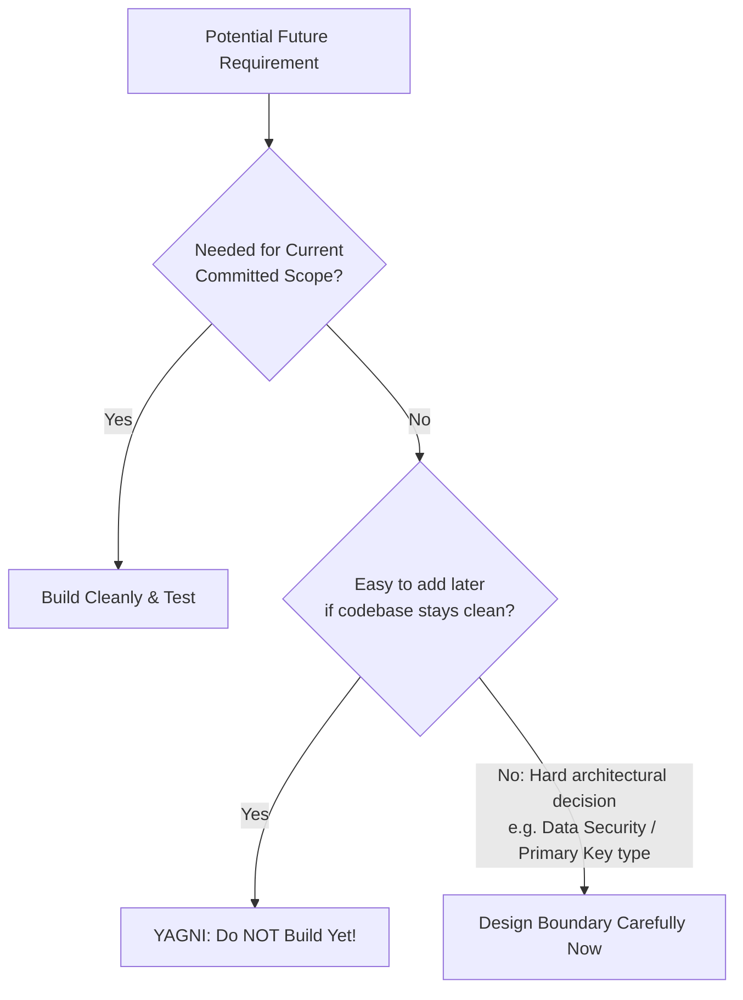

# YAGNI (You Aren't Gonna Need It)

> **One-line summary:** Never implement a feature, abstraction, or extension hook until it is actually required—speculative code carries immediate cost of build, delay, repair, and carry without delivering user value.

| Attribute | Specification |
|---|---|
| **Level** | Core / Foundational |
| **Prerequisites** | [02-kiss-principle.md](02-kiss-principle.md), [01-dry-and-rule-of-three.md](01-dry-and-rule-of-three.md) |
| **Estimated Reading Time** | 25 minutes |
| **Status** | Complete |
| **Category** | General Design Principles |
| **Also Known As** | Defer Commitment, Lean Architecture, Just-in-Time Design |
| **Languages Tested** | Java 25 (LTS) / TypeScript 5.8 (Node 24 native) / Python 3.14 |

---

## Table of Contents
- [1 The Problem](#1-the-problem)
- [2 Why It Exists](#2-why-it-exists)
- [3 What It Is](#3-what-it-is)
- [4 The Problem Without It](#4-the-problem-without-it)
- [5 How It Solves It](#5-how-it-solves-it)
- [6 How It Works](#6-how-it-works)
- [7 Real-World Examples](#7-real-world-examples)
- [8 When to Use and When NOT to Use](#8-when-to-use-and-when-not-to-use)
- [9 Variations and Language Idioms](#9-variations-and-language-idioms)
- [10 Relationship to Other Principles and Patterns](#10-relationship-to-other-principles-and-patterns)
- [11 Common Mistakes and Anti-Patterns](#11-common-mistakes-and-anti-patterns)
- [12 Testing and Design Verification](#12-testing-and-design-verification)
- [13 Performance, Concurrency and Security Notes](#13-performance-concurrency-and-security-notes)
- [14 Interview Questions](#14-interview-questions)
- [15 Practice Exercises](#15-practice-exercises)
- [16 Summary / Cheat Sheet](#16-summary--cheat-sheet)
- [17 Further Reading](#17-further-reading)

---

## 1 The Problem

A startup is building a B2B SaaS invoicing tool. The product requirement for V1 is straightforward: **support USD payments via Stripe for US customers.**

During sprint planning, an engineer argues: *"What if next year we expand to Europe, support 140 currencies, allow crypto wallets, and support multi-tenant database sharding? It'll be way harder to add later!"*

So the team spends six weeks building:
- A dynamic `CurrencyExchangeRateEngine` with abstract `RateProvider` plugins.
- A `MultiTenantShardingRouter` reading tenant routing tables.
- Unused `CryptoPaymentAdapter` stubs and `LocalizationBundle` overrides.

Two consequences hit immediately:
1. **Missed Market Window:** Launching V1 slips by six weeks; a competitor ships first and captures their early adopters.
2. **Wrong Guesses:** Eight months later, when international expansion *does* happen, the business model pivots to Stripe's built-in multi-currency settlement—making the entire custom `CurrencyExchangeRateEngine` dead weight that still has to be maintained, tested, and worked around in every pull request.

---

## 2 Why It Exists

YAGNI emerged from **Extreme Programming (XP)** in the late 1990s, popularized by **Ron Jeffries**, **Kent Beck**, and **Martin Fowler**.

In *Yagni* (martinfowler.com, 2015), Martin Fowler dismantled the myth that speculative features are "free if built early." Every speculative feature incurs **four distinct economic costs**:
1. **Cost of Build:** Time spent designing, coding, and testing a feature nobody wants today.
2. **Cost of Delay:** Opportunity cost—shipping real, revenue-generating features later.
3. **Cost of Carry:** Every unused abstraction clutters the codebase, slows down builds, confuses new engineers, and complicates refactoring of real features.
4. **Cost of Repair:** When the actual requirement eventually arrives, your early guess is almost always slightly wrong—costing *more* to rip out and fix than building it fresh with real requirements.

---

## 3 What It Is

YAGNI states:
> *"Always implement things when you actually need them, never when you just foresee that you may need them."*

Notice the crucial nuance: YAGNI applies to **presumptive features and speculative abstractions**, NOT to architectural cleanliness, automated tests, or modularity. Writing clean, cohesive, modular code makes future changes cheap—which is *why* you can safely defer building speculative features.



---

## 4 The Problem Without It

Here is speculative bloat added to an early-stage billing service that only needs USD pricing:

```java
// YAGNI Violation: Speculative multi-provider currency & plugin framework for 1 currency
import java.math.BigDecimal;
import java.util.Map;

interface ExchangeRateProvider {
    BigDecimal rate(String fromCurrency, String toCurrency);
}

class UnusedEuropeanCentralBankProvider implements ExchangeRateProvider {
    public BigDecimal rate(String from, String to) {
        throw new UnsupportedOperationException("Not yet integrated!");
    }
}

class SpeculativePricingEngine {
    private final Map<String, ExchangeRateProvider> providers;
    private final String defaultTargetCurrency;
    private final boolean enableDynamicRoundingPlugin;

    public SpeculativePricingEngine(
            Map<String, ExchangeRateProvider> providers,
            String defaultTargetCurrency,
            boolean enableDynamicRoundingPlugin) {
        this.providers = providers;
        this.defaultTargetCurrency = defaultTargetCurrency;
        this.enableDynamicRoundingPlugin = enableDynamicRoundingPlugin;
    }

    public BigDecimal calculatePrice(BigDecimal usdAmount, String targetCurrency) {
        if ("USD".equals(targetCurrency)) return usdAmount;
        return usdAmount.multiply(providers.get("ECB").rate("USD", targetCurrency));
    }
}
```

### The Friction Output
```text
[Developer Onboarding Friction]
- 4 extra interfaces/classes and 3 unused constructor flags required just to price in USD!
- NullPointerException risk if caller passes unknown currency or null provider map!
- Dead code coverage dragged down by unimplemented UnusedEuropeanCentralBankProvider!
```

---

## 5 How It Solves It

Keep the design clean, well-encapsulated, and focused strictly on today's requirement. When international currencies genuinely become a committed business priority, refactoring a clean `Money` or `PricingService` is fast and safe.

### Java Implementation (Java 25 LTS)

```java
package com.design.principles.yagni;

import java.math.BigDecimal;

// Clean, focused, easy to extend later if multi-currency arrives
public record UsdPrice(BigDecimal amount) {
    public UsdPrice {
        if (amount == null || amount.compareTo(BigDecimal.ZERO) < 0) {
            throw new IllegalArgumentException("Price cannot be negative");
        }
    }

    public UsdPrice applyDiscount(double discountRate) {
        return new UsdPrice(amount.multiply(BigDecimal.valueOf(1.0 - discountRate)));
    }
}
```

### TypeScript Implementation (Node 24 Native)

```typescript
export function applyDiscount(usdAmount: number, discountRate: number): number {
    if (usdAmount < 0) throw new Error("Price cannot be negative");
    if (discountRate < 0 || discountRate > 1) throw new Error("Invalid discount rate");
    return Number((usdAmount * (1 - discountRate)).toFixed(2));
}
```

### Python Implementation (Python 3.14)

```python
from decimal import Decimal

def apply_discount(usd_amount: Decimal, discount_rate: Decimal) -> Decimal:
    if usd_amount < 0:
        raise ValueError("Price cannot be negative")
    if not (Decimal("0") <= discount_rate <= Decimal("1")):
        raise ValueError("Invalid discount rate")
    return (usd_amount * (Decimal("1") - discount_rate)).quantize(Decimal("0.01"))
```

---

## 6 How It Works: Reversible vs. Irreversible Decisions

YAGNI does **not** mean "never think ahead." Architecturally, distinguish between **Two-Way Doors** (easy to change later) and **One-Way Doors** (expensive to change later):

| Decision Type | Example | YAGNI Stance |
|---|---|---|
| **Two-Way Door (Reversible)** | Adding a cache, extracting a strategy interface, supporting CSV export | **Defer strictly (YAGNI).** Refactor when needed. |
| **One-Way Door (Hard to Reverse)** | Choosing UTF-8 encoding, using UUIDs vs auto-increment IDs in public APIs, security/auth boundaries | **Plan upfront.** Skipping foundational hygiene here is negligence, not YAGNI. |

---

## 7 Real-World Examples

### 1. Early Twitter / WhatsApp Architecture
WhatsApp scaled to hundreds of millions of users with ~50 engineers by ruthlessly cutting speculative features (no ads engine, no complex profile customization, no multi-device sync initially) and keeping core Erlang messaging rock-solid.

### 2. GitHub's Early Monolith
GitHub operated for years on a clean Ruby on Rails monolith rather than prematurely splitting into dozens of microservices "for future Netflix scale." That focus allowed rapid product iteration until team size actually warranted selective service extraction.

### 3. Feature Flags Instead of Half-Built Branches
Modern continuous delivery avoids keeping half-implemented speculative frameworks in `main`. Teams build only the minimal vertical slice behind a feature flag and delete dead code immediately if an experiment fails.

---

## 8 When to Use and When NOT to Use

| Context | Apply YAGNI? | Rationale |
|---|---|---|
| **Unrequested product features ("maybe users will want...")** | **Yes** | Highest risk of wasted engineering effort. |
| **Speculative design patterns (factories for 1 class)** | **Yes** | Adds carry cost without current benefit. |
| **Clean code, unit tests, input validation, logging** | **NO** | Quality practices *enable* YAGNI by making future changes cheap. |
| **Public API versioning & backwards compatibility** | **NO** | Breaking external consumers later is a One-Way Door; design API contracts thoughtfully. |

---

## 9 Variations and Language Idioms

- **Last Responsible Moment (Lean Software Development):** Delay irreversible architectural commitments until the last moment before failing to decide becomes costly—maximizing real information before committing.
- **Tracer Bullet Development (*Pragmatic Programmer*):** Build a thin, working end-to-end vertical slice first, rather than building a speculative full framework layer-by-layer.

---

## 10 Relationship to Other Principles and Patterns

- **KISS:** YAGNI eliminates *unneeded scope*; KISS eliminates *unneeded complexity* in the required scope.
- **Rule of Three (DRY):** Don't build a generalized abstraction until three concrete use cases exist.
- **OCP (Open/Closed Principle):** Never add OCP extension seams speculatively; add them when a verified axis of change appears.

---

## 11 Common Mistakes and Anti-Patterns

| Anti-Pattern | Description | Production Consequence | Correct Remedy |
|---|---|---|---|
| **Using YAGNI as an Excuse for Sloppiness** | Skipping unit tests, error handling, or input validation claiming "YAGNI." | Production outages and unmaintainable spaghetti. | YAGNI applies to *features*, never to engineering quality. |
| **Speculative Abstraction ("Just in Case")** | Wrapping a single repository in 3 layers of generic base classes for "future NoSQL migration." | Every query takes 3x longer to write and debug. | Use a direct repository; swap behind an interface if migration actually happens. |
| **Dead Feature Configuration Flags** | Leaving unused config switches and commented-out code paths in production. | Confuses readers and creates untested dead branches. | Delete unused code immediately—Git preserves history. |
| **Premature Microservices** | Creating 10 services for a 2-developer MVP. | Network latency, distributed failures, CI/CD overhead. | Build a clean Modular Monolith first. |
| **Custom Internal Frameworks** | Building a generic internal ORM or DI container instead of using standard tools. | Team maintains homemade framework bugs forever. | Use boring, standard tools until concrete limits are hit. |
| **Building Admin UIs for Edge Cases** | Spending 2 weeks building a UI for a support action that happens once a year. | Delayed product launch. | Run a documented SQL/CLI script until frequency justifies a UI. |

---

## 12 Testing and Design Verification

YAGNI keeps test suites lean and fast:
- **Zero tests for dead code:** Every unused speculative branch requires either skipped tests or wasted test maintenance.
- **High signal-to-noise ratio:** 100% of your test suite verifies behavior actually used by real customers.

---

## 13 Performance, Concurrency and Security Notes

- **Performance:** Removing unused abstraction layers, unused plugin registries, and speculative serialization hooks reduces memory footprint and startup latency.
- **Security:** **Every line of unused speculative code is an unmonitored attack surface.** Dead admin endpoints or unmaintained plugin hooks frequently harbor critical security vulnerabilities (CVE risks).

---

## 14 Interview Questions

<details>
<summary><strong>1. What are the four costs of violating YAGNI according to Martin Fowler?</strong></summary>

1. **Cost of Build:** Time spent writing and testing unused code.
2. **Cost of Delay:** Opportunity cost of delaying features users actually need today.
3. **Cost of Carry:** Ongoing maintenance, cognitive load, and friction added to all future edits.
4. **Cost of Repair:** Cost of fixing or removing the wrong guess when real requirements arrive.
</details>

<details>
<summary><strong>2. Does YAGNI mean you shouldn't design clean abstractions or write unit tests?</strong></summary>

No. YAGNI applies strictly to **presumptive features and speculative generality**, not to code quality, modularity, or tests. In fact, clean code and comprehensive unit tests are *prerequisites* for YAGNI because they make refactoring cheap when new requirements finally arrive.
</details>

<details>
<summary><strong>3. How do you balance YAGNI against "One-Way Door" architectural decisions?</strong></summary>

Distinguish between reversible decisions (adding an export format, extracting a helper interface) and hard-to-reverse decisions (public REST API contract shape, database primary key types, security/auth model, data encoding). Apply strict YAGNI to reversible decisions, while investing thoughtful design in One-Way Doors.
</details>

<details>
<summary><strong>4. How does YAGNI conflict with the Open/Closed Principle (OCP), and how do you resolve it?</strong></summary>

OCP encourages adding abstract seams so future extensions require no modifications, whereas YAGNI warns against building seams for extensions that may never happen. Resolve this using the **Rule of Three**: write direct code first, and introduce OCP polymorphism only when concrete variation proves itself.
</details>

<details>
<summary><strong>5. Why is deleting dead code better than commenting it out "just in case"?</strong></summary>

Commented-out code creates visual noise, goes stale as surrounding code evolves, and misleads future engineers. Version control (Git) permanently preserves deleted code if it is ever genuinely needed again.
</details>

<details>
<summary><strong>6. What is the "Last Responsible Moment" principle?</strong></summary>

A Lean software principle stating that you should defer irreversible technical commitments until the last moment where delaying further would eliminate an important alternative—allowing you to make the decision with maximum real-world knowledge.
</details>

<details>
<summary><strong>7. How does YAGNI improve system security?</strong></summary>

Unused speculative code paths (such as unrequested export endpoints, fallback auth modes, or unused serialization plugins) often escape security audits and dependency patching, expanding the attack surface without delivering business value.
</details>

<details>
<summary><strong>8. Give an example of a real engineering scenario where skipping upfront planning in the name of YAGNI would be a mistake.</strong></summary>

Skipping encryption-at-rest, multi-region timezone handling (`UTC` storage), or audit logging in a financial or healthcare system. Migrating unencrypted legacy schemas or local-time database timestamps after launch is extraordinarily expensive and error-prone.
</details>

---

## 15 Practice Exercises

### Exercise 1: Triage Speculative Requirements (Easy)
Your team is building an internal CLI tool to resize PNG thumbnails. A teammate proposes adding: (a) SVG vector rasterization, (b) plugin support via dynamic DLL loading, and (c) clear error messages when a file path doesn't exist. Which items violate YAGNI, and which should stay?

<details>
<summary><strong>Solution</strong></summary>

- **(a) SVG rasterization & (b) Dynamic plugin loading:** Violate YAGNI—unrequested speculative features.
- **(c) Clear file-not-found error handling:** Essential robustness/Fail-Fast quality—keep it!
</details>

---

### Exercise 2: Strip Speculative Bloat (Medium)
Simplify this TypeScript logger that only needs to log JSON lines to `stdout` right now:
```typescript
interface LogTransport { write(msg: string): void; }
interface LogFormatter { format(level: string, msg: string): string; }
class SpeculativeLogger {
    constructor(private transports: LogTransport[], private formatter: LogFormatter) {}
    log(level: string, msg: string) {
        const out = this.formatter.format(level, msg);
        this.transports.forEach(t => t.write(out));
    }
}
```

<details>
<summary><strong>Solution</strong></summary>

```typescript
export function logJson(level: "INFO" | "WARN" | "ERROR", message: string): void {
    console.log(JSON.stringify({ timestamp: new Date().toISOString(), level, message }));
}
```
If multiple external log sinks (Datadog, File) are needed later, wrapping `logJson` behind an interface takes 5 minutes.
</details>

---

### Exercise 3: One-Way vs Two-Way Door Classification (Hard)
Classify each of these 4 architectural decisions for a new SaaS API as either **Defer (YAGNI)** or **Design Now (One-Way Door)** and explain why:
1. Supporting GraphQL in addition to REST.
2. Using opaque string IDs vs auto-incrementing integers in public URLs.
3. Caching user profiles in Redis.
4. Storing all timestamps in UTC ISO-8601.

<details>
<summary><strong>Solution</strong></summary>

1. **GraphQL support:** **Defer (YAGNI)** — Can be added as a separate gateway later if clients need it.
2. **Public ID format:** **Design Now (One-Way Door)** — Changing public API ID types breaks every external consumer integration and leaks sequential user counts.
3. **Redis caching:** **Defer (YAGNI)** — Add caching only when profiling shows DB read latency bottlenecks.
4. **UTC timestamps:** **Design Now (One-Way Door)** — Retroactively migrating ambiguous local timestamps in production databases is error-prone and lossy.
</details>

---

## 16 Summary / Cheat Sheet

```
+--------------------------------------------------------------------------+
|                         YAGNI (YOU AREN'T GONNA NEED IT)                 |
+--------------------------------------------------------------------------+
| CORE RULE      : Build only what is needed today; defer speculative      |
|                  features and generalizations.                           |
| 4 HIDDEN COSTS : Cost of Build, Cost of Delay, Cost of Carry,            |
|                  Cost of Repair.                                         |
| NOT AN EXCUSE  : Never skip tests, validation, security, or clean code.  |
| DECISION RULE  : Defer Two-Way Doors (reversible); design One-Way Doors  |
|                  (public IDs, security, UTC timestamps) carefully now.   |
+--------------------------------------------------------------------------+
```

---

## 17 Further Reading

- Martin Fowler, *Yagni*, martinfowler.com/bliki/Yagni.html, 2015.
- Kent Beck, *Extreme Programming Explained*, Addison-Wesley, 1999.
- Andy Hunt & Dave Thomas, *The Pragmatic Programmer* (Tracer Bullets), Addison-Wesley, 2019.

### In Your Language
| Language Track | Deep Dive Reference |
|---|---|
| Java | [Java OOP & Design Patterns](file:///e:/Learning/engineering-notes/01-languages/java/24-design-patterns/README.md) |
| TypeScript | [TypeScript Design Patterns](file:///e:/Learning/engineering-notes/01-languages/typescript/17-design-patterns/README.md) |
| Python | [Python Design Patterns](file:///e:/Learning/engineering-notes/01-languages/python/23-design-patterns/README.md) |

---

[← Previous: 02 - KISS Principle](file:///e:/Learning/engineering-notes/08-solid-design-patterns/03-design-principles/02-kiss-principle.md) | [Module 03 Index](file:///e:/Learning/engineering-notes/08-solid-design-patterns/03-design-principles/README.md) | [Next: 04 - Law of Demeter →](file:///e:/Learning/engineering-notes/08-solid-design-patterns/03-design-principles/04-law-of-demeter.md)
