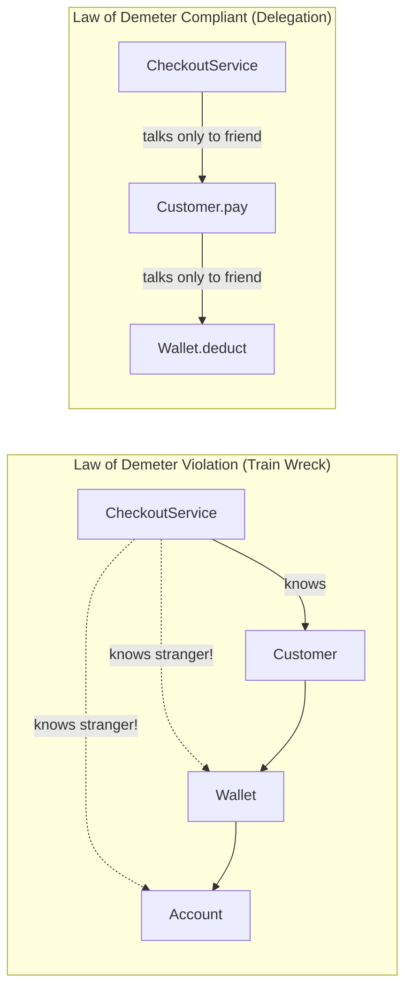

# Law of Demeter (Principle of Least Knowledge)

> **One-line summary:** Only talk to your immediate friends—never reach through one object's internal collaborators (`a.getB().getC().doX()`) to command a stranger.

| Attribute | Specification |
|---|---|
| **Level** | Core / Foundational |
| **Prerequisites** | [01-oop-pillars.md](../01-foundations/01-oop-pillars.md), [05-abstraction-and-information-hiding.md](../01-foundations/05-abstraction-and-information-hiding.md) |
| **Estimated Reading Time** | 30 minutes |
| **Status** | Complete |
| **Category** | General Design Principles |
| **Also Known As** | Principle of Least Knowledge (LoD), Don't Talk to Strangers |
| **Languages Tested** | Java 25 (LTS) / TypeScript 5.8 (Node 24 native) / Python 3.14 |

---

## Table of Contents
- [1 The Problem](#1-the-problem)
- [2 Why It Exists](#2-why-it-exists)
- [3 What It Is](#3-what-it-is)
- [4 The Problem Without It](#4-the-problem-without-it)
- [5 How It Solves It](#5-how-it-solves-it)
- [6 How It Works](#6-how-it-works)
- [7 Real-World Examples](#7-real-world-examples)
- [8 When to Use and When NOT to Use](#8-when-to-use-and-when-not-to-use)
- [9 Variations and Language Idioms](#9-variations-and-language-idioms)
- [10 Relationship to Other Principles and Patterns](#10-relationship-to-other-principles-and-patterns)
- [11 Common Mistakes and Anti-Patterns](#11-common-mistakes-and-anti-patterns)
- [12 Testing and Design Verification](#12-testing-and-design-verification)
- [13 Performance, Concurrency and Security Notes](#13-performance-concurrency-and-security-notes)
- [14 Interview Questions](#14-interview-questions)
- [15 Practice Exercises](#15-practice-exercises)
- [16 Summary / Cheat Sheet](#16-summary--cheat-sheet)
- [17 Further Reading](#17-further-reading)

---

## 1 The Problem

Imagine an e-commerce checkout service that needs to deduct \$35 from a customer's wallet. Instead of asking the `Customer` to handle payment, the developer writes a **"Train Wreck"** navigation chain:

```java
double balance = customer.getWallet().getAccount().getBalance();
if (balance >= 35.0) {
    customer.getWallet().getAccount().setBalance(balance - 35.0);
}
```

Six months later, the payments team upgrades `Wallet` to support multi-currency sub-wallets (`Map<Currency, WalletAccount>`). Instantly, **47 files across checkout, refunds, subscriptions, and loyalty services fail to compile**—and three nullable chains throw `NullPointerException` at runtime in production.

Why did changing `Wallet`'s internal structure break `CheckoutService`? Because `CheckoutService` knew intimate structural secrets three levels deep (`Customer` $\to$ `Wallet` $\to$ `Account` $\to$ `Balance`).

---

## 2 Why It Exists

The Law of Demeter was formulated by **Ian Holland** and **Karl Lieberherr** at Northeastern University in 1987 during the *Demeter Project* (an aspect-oriented software research project).

Its goal is **structural decoupling**: an object should assume as little as possible about the internal structure or properties of other objects. When a caller reaches deep into an object's internal graph, every intermediate class becomes a brittle compile-time and runtime dependency.

---

## 3 What It Is

Formally, a method `m` of an object `O` may invoke methods **only** on:
1. `O` itself (`this` / `self`).
2. `m`'s own parameters.
3. Any object created/instantiated inside `m`.
4. `O`'s direct component fields (instance variables).
5. Global/module constants accessible to `O`.

It must **NOT** invoke methods on objects returned by calling methods on those objects ("strangers").



---

## 4 The Problem Without It

Here is a naive payment flow reaching through `Customer` to mutate `Wallet` directly:

```java
// Naive Violation: Train-wreck reaching into internal Wallet state
class WalletViolation {
    public double balance;
    public WalletViolation(double balance) { this.balance = balance; }
    public double getBalance() { return balance; }
    public void setBalance(double balance) { this.balance = balance; }
}

class CustomerViolation {
    private WalletViolation wallet;
    public CustomerViolation(WalletViolation wallet) { this.wallet = wallet; }
    public WalletViolation getWallet() { return wallet; }
}

public class LodViolationApp {
    public static void main(String[] args) {
        CustomerViolation c = new CustomerViolation(new WalletViolation(100.0));
        // Train wreck! Caller acts on Wallet directly!
        if (c.getWallet().getBalance() >= 35.0) {
            c.getWallet().setBalance(c.getWallet().getBalance() - 35.0);
        }
    }
}
```

### The Blast Radius Output
```text
[Refactoring Failure]
Refactoring CustomerViolation to store List<Wallet> or external WalletService breaks 47 callers!
[Unit Test Pain]
Testing CheckoutService requires constructing nested mocks:
when(mockCustomer.getWallet()).thenReturn(mockWallet);
when(mockWallet.getBalance()).thenReturn(100.0);
```

---

## 5 How It Solves It

Instead of exposing `getWallet()` and forcing callers to manipulate balances externally, `Customer` exposes a behavioral method `pay(amount)` that delegates internally to `wallet.deduct(amount)`.

### Java Implementation (Java 25 LTS)

```java
package com.design.principles.lod;

class Wallet {
    private double balance;

    public Wallet(double balance) {
        this.balance = balance;
    }

    public boolean deduct(double amount) {
        if (amount > balance) return false;
        balance -= amount;
        return true;
    }

    public double getBalance() {
        return balance;
    }
}

class Customer {
    private final String name;
    private final Wallet wallet;

    public Customer(String name, Wallet wallet) {
        this.name = name;
        this.wallet = wallet;
    }

    // Immediate friend delegation: caller never sees Wallet!
    public boolean pay(double amount) {
        return wallet.deduct(amount);
    }

    public double balance() {
        return wallet.getBalance();
    }
}

public class LodApp {
    public static void main(String[] args) {
        Customer c = new Customer("Alice", new Wallet(100.0));
        boolean ok = c.pay(35.0);
        System.out.println("Java LoD Payment: " + ok + ", Remaining: $" + c.balance());
    }
}
```

### TypeScript Implementation (Node 24 Native)

```typescript
class Wallet {
    private balance: number;

    constructor(balance: number) {
        this.balance = balance;
    }

    deduct(amount: number): boolean {
        if (amount > this.balance) return false;
        this.balance -= amount;
        return true;
    }

    getBalance(): number {
        return this.balance;
    }
}

class Customer {
    private name: string;
    private wallet: Wallet;

    constructor(name: string, wallet: Wallet) {
        this.name = name;
        this.wallet = wallet;
    }

    pay(amount: number): boolean {
        return this.wallet.deduct(amount);
    }

    balance(): number {
        return this.wallet.getBalance();
    }
}

const c = new Customer("Alice", new Wallet(100.0));
console.log("TS LoD Payment: " + c.pay(35.0) + ", Remaining: $" + c.balance());
```

### Python Implementation (Python 3.14)

```python
class Wallet:
    def __init__(self, balance: float) -> None:
        self._balance = balance

    def deduct(self, amount: float) -> bool:
        if amount > self._balance:
            return False
        self._balance -= amount
        return True

    @property
    def balance(self) -> float:
        return self._balance

class Customer:
    def __init__(self, name: str, wallet: Wallet) -> None:
        self._name = name
        self._wallet = wallet

    def pay(self, amount: float) -> bool:
        return self._wallet.deduct(amount)

    def balance(self) -> float:
        return self._wallet.balance

if __name__ == "__main__":
    c = Customer("Alice", Wallet(100.0))
    print("Python LoD Payment: " + str(c.pay(35.0)) + ", Remaining: $" + str(c.balance()))
```

### Real Execution Output
```text
Java LoD Payment: true, Remaining: $65.0
TS LoD Payment: true, Remaining: $65
Python LoD Payment: True, Remaining: $65.0
```

---

## 6 How It Works: Counting Dots vs. Counting Types

A common misconception is *"never use more than one dot."* That is **false**.
- **Fluent Builders & Streams (`list.stream().filter(...).map(...).toList()`):** These are **NOT** Law of Demeter violations! Every chained call returns a `Stream` (or `this` in a Builder)—you are talking to the **same conceptual type**, not navigating hidden internal object graphs.
- **Data Structures (DTOs / Records):** Accessing nested fields of a passive JSON payload or DTO (`orderDto.shippingAddress().zipCode()`) has no hidden behavior to encapsulate. Demeter applies strictly to **behavioral objects**, not passive data bags.

---

## 7 Real-World Examples

### 1. Java Servlet / Spring `SecurityContext` Wrapper
Rather than forcing controllers to chain `SecurityContextHolder.getContext().getAuthentication().getPrincipal()`, clean web frameworks wrap this behind a single `CurrentUserService.getUserId()` facade.

### 2. Facade Pattern over Legacy Subsystems
When integrating a complex third-party ERP SDK that exposes deeply nested object graphs (`erp.getLedger().getFiscalPeriod().getTaxTable()`), wrapping it in an application Facade shields your entire domain from SDK upgrades.

### 3. Tell-Don't-Ask in Game Engines
Instead of `player.getInventory().getEquippedWeapon().getAmmo().decrement()`, game loops invoke `player.fireWeapon()`, keeping ammo rules, jams, and cooldowns encapsulated inside `Player` and `Weapon`.

---

## 8 When to Use and When NOT to Use

| Context | Apply Law of Demeter? | Rationale |
|---|---|---|
| **Behavioral Domain Objects & Services** | **Yes** | Prevents graph coupling and `NullPointerException` chains. |
| **DTOs / Immutable Records / JSON Configs** | **No** | Passive data containers have no behavior to hide. |
| **Fluent APIs / Streams / LINQ / Builders** | **No** | Chaining returns the same abstraction (`Stream`, `Builder`). |
| **Thin Passthrough Wrapper Hell** | **Watch Out!** | Don't turn `Customer` into a 60-method bloated "Middle Man" just forwarding every getter. |

---

## 9 Variations and Language Idioms

- **TypeScript Optional Chaining (`?.`):** `customer?.wallet?.balance` hides `null` crashes syntactically, **but still violates Law of Demeter structurally!** It silently masks tight coupling instead of encapsulating behavior.
- **Python Properties (`@property`):** Allow exposing computed properties cleanly while hiding internal delegation.

---

## 10 Relationship to Other Principles and Patterns

- **Tell, Don't Ask:** The behavioral twin of Law of Demeter—stop asking for sub-objects (`getWallet()`) and tell the object (`pay()`) what to do.
- **Information Hiding (Parnas):** Demeter enforces information hiding across object collaborations.
- **Facade & Mediator Patterns:** Structural patterns used to enforce Demeter across subsystems.

---

## 11 Common Mistakes and Anti-Patterns

| Anti-Pattern | Description | Production Consequence | Correct Remedy |
|---|---|---|---|
| **Train-Wreck Chains** | `a.getB().getC().getD().run()` | High coupling; fragile refactoring; null pointer traps. | Delegate via behavioral method on `a`. |
| **Middle Man Bloat** | Adding 40 trivial passthrough methods on `Customer` just to avoid one dot. | Class becomes a bloated forwarding shell. | Pass the needed collaborator directly or merge cohesive concepts. |
| **Masking Coupling with `?.`** | Using optional chaining `a?.b?.c?.x` as a band-aid for structural coupling. | Silent `undefined` bugs when structures change. | Encapsulate decision inside `a`. |
| **Mocking Returns of Mocks** | `when(a.getB()).thenReturn(mockB); when(mockB.getC())...` | Brittle tests coupled to internal structure. | Mock only direct collaborators. |
| **Applying LoD to Streams/Builders** | Breaking readable `stream().filter().map()` chains into 5 temp variables. | Verbose, harder-to-read code with zero decoupling gain. | Recognize fluent pipelines operate on one type. |
| **Applying LoD to Pure DTOs** | Writing `dto.getStreetName()` wrappers on `AddressDto` inside `OrderDto`. | Unnecessary boilerplate on passive data records. | Access passive DTO fields directly. |

---

## 12 Testing and Design Verification

Law of Demeter eliminates **nested mock setups** in unit tests:
```java
// Before LoD: Mocking 2 levels deep!
// Customer mockCust = mock(Customer.class);
// Wallet mockWallet = mock(Wallet.class);
// when(mockCust.getWallet()).thenReturn(mockWallet);

// After LoD: Test talks directly to Customer!
@Test
void shouldDeductFundsWhenCustomerPays() {
    Customer customer = new Customer("Alice", new Wallet(100.0));
    assertTrue(customer.pay(35.0));
    assertEquals(65.0, customer.balance());
}
```

---

## 13 Performance, Concurrency and Security Notes

- **Concurrency:** Train-wreck chains (`getWallet().setBalance(...)`) break thread safety because locks inside `Wallet` cannot protect check-then-act sequences performed externally by callers! Delegating `wallet.deduct(amount)` allows `Wallet` to make the check-and-deduct atomic.
- **Security:** Exposing `getWallet()` lets any caller inspect or mutate internal state indiscriminately. Hiding `Wallet` preserves encapsulation boundaries.

---

## 14 Interview Questions

<details>
<summary><strong>1. State the Law of Demeter in plain English and list its formal allowed targets.</strong></summary>

Plain English: "Only talk to your immediate friends; don't talk to strangers." Formally, a method `m` of object `O` may only call methods on: (1) `O` itself, (2) `m`'s parameters, (3) objects `m` creates, (4) `O`'s direct instance fields, and (5) global objects.
</details>

<details>
<summary><strong>2. Why do Fluent Builders and Java Streams (`stream().filter().map()`) NOT violate the Law of Demeter?</strong></summary>

Law of Demeter limits the number of *types* (collaborators) a method depends on, not the literal number of dots. Every method in a fluent builder or Stream returns the same type (`Stream<T>` or `Builder`), introducing zero new structural dependencies.
</details>

<details>
<summary><strong>3. Does Law of Demeter apply to DTOs and immutable records?</strong></summary>

No. DTOs and immutable records are passive data structures without hidden behavior. Reaching into `orderDto.shippingAddress().city()` is normal data navigation, whereas reaching into behavioral service graphs (`order.getCustomer().getPaymentGateway().charge()`) violates LoD.
</details>

<details>
<summary><strong>4. What is the "Middle Man" code smell caused by misapplying LoD?</strong></summary>

If `Customer` has 30 methods that merely forward calls one-for-one to `Wallet` or `Address` without adding domain value, `Customer` becomes a bloated Middle Man. If a caller genuinely operates extensively on `Wallet`, pass `Wallet` directly as a parameter instead of hiding it behind 30 trivial wrappers.
</details>

<details>
<summary><strong>5. How does Law of Demeter improve concurrency safety?</strong></summary>

When callers extract internal objects (`getWallet()`) and perform check-then-act sequences externally, internal locks or synchronization inside `Wallet` cannot prevent race conditions. Delegating `wallet.deduct(amount)` allows `Wallet` to protect its own invariants atomically.
</details>

<details>
<summary><strong>6. How do unit tests immediately reveal Law of Demeter violations?</strong></summary>

Whenever a unit test has to configure "mocks returning mocks" (e.g. `when(a.getB()).thenReturn(mockB); when(mockB.getC()).thenReturn(mockC)`), the system under test is violating the Law of Demeter.
</details>

<details>
<summary><strong>7. Why doesn't TypeScript optional chaining (`a?.b?.c`) fix a Law of Demeter violation?</strong></summary>

Optional chaining only prevents runtime `TypeError` on `null`/`undefined`—it still couples the caller to the deep structural shape `a -> b -> c`. If `b` is refactored, the caller still breaks.
</details>

<details>
<summary><strong>8. How do Law of Demeter and Tell, Don't Ask complement each other?</strong></summary>

Law of Demeter diagnoses *who* you are allowed to talk to (immediate friends only), while Tell, Don't Ask prescribes *how* to talk to them (send behavioral commands instead of querying internal state via getters).
</details>

---

## 15 Practice Exercises

### Exercise 1: Spot the Train Wreck (Easy)
Identify the Law of Demeter violation and propose a clean fix:
```java
String city = order.getCustomer().getPrimaryAddress().getCity();
```

<details>
<summary><strong>Solution</strong></summary>

`order` caller reaches through `Customer` and `Address`.
**Fix:** If `Order` frequently needs the shipping destination, expose `order.shippingCity()` (or store an immutable `ShippingAddress` snapshot directly on `Order`—which also protects historical orders if the customer moves!).
</details>

---

### Exercise 2: Refactor Nested Mocking in TypeScript (Medium)
Refactor `CartCheckout` so it does not reach into `user.getLoyaltyAccount().getPoints()`:
```typescript
class CartCheckout {
    applyPointsDiscount(user: User, pointsToUse: number): number {
        const available = user.getLoyaltyAccount().getPoints();
        if (available < pointsToUse) throw new Error("Not enough points");
        user.getLoyaltyAccount().setPoints(available - pointsToUse);
        return pointsToUse * 0.01;
    }
}
```

<details>
<summary><strong>Solution</strong></summary>

```typescript
class LoyaltyAccount {
    constructor(private points: number) {}
    redeem(pointsToUse: number): number {
        if (this.points < pointsToUse) throw new Error("Not enough points");
        this.points -= pointsToUse;
        return pointsToUse * 0.01;
    }
}

class User {
    constructor(private loyalty: LoyaltyAccount) {}
    redeemLoyaltyPoints(pointsToUse: number): number {
        return this.loyalty.redeem(pointsToUse);
    }
}

class CartCheckout {
    applyPointsDiscount(user: User, pointsToUse: number): number {
        return user.redeemLoyaltyPoints(pointsToUse);
    }
}
```
</details>

---

### Exercise 3: Design Thread-Safe Delegation in Python (Hard)
In a Python inventory system, `WarehouseService` currently calls `warehouse.get_bin(sku).get_stock().decrement(qty)`. Refactor this to obey Law of Demeter and protect stock invariants under concurrent updates using `threading.Lock`.

<details>
<summary><strong>Solution</strong></summary>

```python
import threading

class StockBin:
    def __init__(self, initial_qty: int) -> None:
        self._qty = initial_qty
        self._lock = threading.Lock()

    def reserve(self, qty: int) -> bool:
        with self._lock:
            if qty <= 0 or qty > self._qty:
                return False
            self._qty -= qty
            return True

class Warehouse:
    def __init__(self, bins: dict[str, StockBin]) -> None:
        self._bins = bins

    def reserve_stock(self, sku: str, qty: int) -> bool:
        bin_obj = self._bins.get(sku)
        if not bin_obj:
            return False
        return bin_obj.reserve(qty)
```
</details>

---

## 16 Summary / Cheat Sheet

```
+--------------------------------------------------------------------------+
|                    LAW OF DEMETER (LEAST KNOWLEDGE)                      |
+--------------------------------------------------------------------------+
| CORE RULE      : Only talk to immediate friends (self, params, direct    |
|                  fields, locally created objects); never strangers.      |
| DANGER SIGN    : Train wrecks (a.getB().getC().doX()); mocks returning   |
|                  mocks in unit tests.                                    |
| EXCEPTIONS     : Fluent Builders, Streams, and passive DTOs/Records.     |
| CAUTION        : Avoid creating "Middle Man" wrappers with 40 trivial    |
|                  passthrough methods.                                    |
+--------------------------------------------------------------------------+
```

---

## 17 Further Reading

- Karl Lieberherr & Ian Holland, *Assuring Good Style for Object-Oriented Programs*, IEEE Software, 1989.
- Andy Hunt & Dave Thomas, *The Pragmatic Programmer* (Law of Demeter section), Addison-Wesley, 2019.
- Martin Fowler, *TellDontAsk*, martinfowler.com/bliki/TellDontAsk.html, 2013.

### In Your Language
| Language Track | Deep Dive Reference |
|---|---|
| Java | [Java OOP & Design Patterns](file:///e:/Learning/engineering-notes/01-languages/java/24-design-patterns/README.md) |
| TypeScript | [TypeScript Design Patterns](file:///e:/Learning/engineering-notes/01-languages/typescript/17-design-patterns/README.md) |
| Python | [Python Design Patterns](file:///e:/Learning/engineering-notes/01-languages/python/23-design-patterns/README.md) |

---

[← Previous: 03 - YAGNI](file:///e:/Learning/engineering-notes/08-solid-design-patterns/03-design-principles/03-yagni.md) | [Module 03 Index](file:///e:/Learning/engineering-notes/08-solid-design-patterns/03-design-principles/README.md) | [Next: 05 - Separation of Concerns →](file:///e:/Learning/engineering-notes/08-solid-design-patterns/03-design-principles/05-separation-of-concerns.md)
