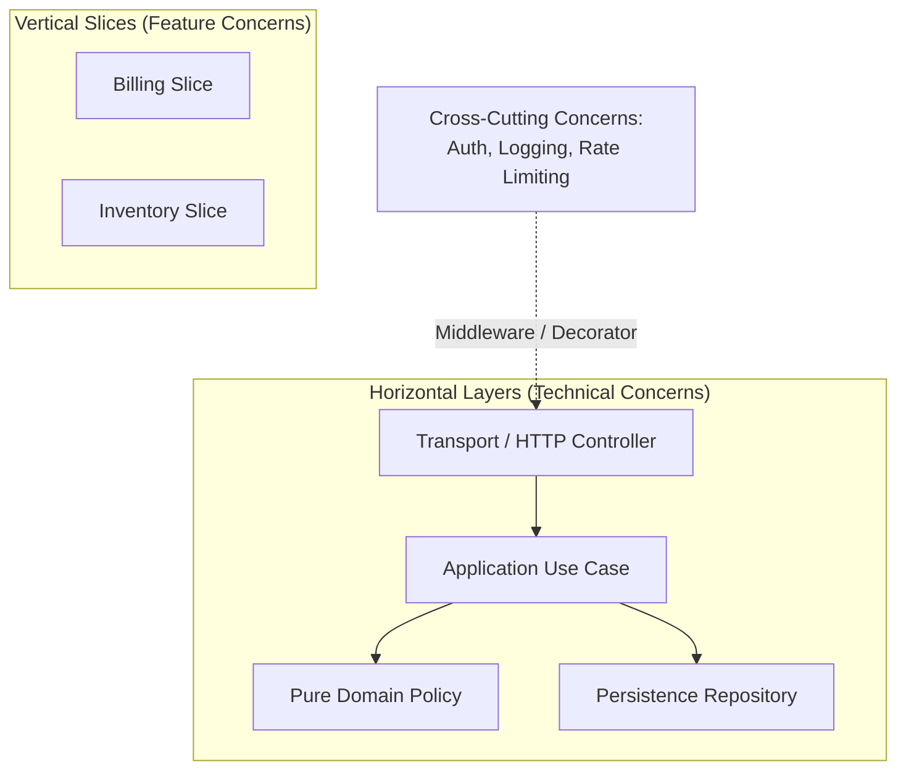

# Separation of Concerns (SoC)

> **One-line summary:** Divide a system into distinct, non-overlapping sections—where each section addresses one separate concern (such as transport, business rules, or persistence) so independent concerns can be understood, tested, and evolved in isolation.

| Attribute | Specification |
|---|---|
| **Level** | Core / Architectural |
| **Prerequisites** | [03-coupling-and-cohesion.md](../01-foundations/03-coupling-and-cohesion.md), [01-single-responsibility.md](../02-solid-principles/01-single-responsibility.md) |
| **Estimated Reading Time** | 30 minutes |
| **Status** | Complete |
| **Category** | General Design Principles |
| **Also Known As** | Modular Decomposition, Orthogonal Concern Partitioning |
| **Languages Tested** | Java 25 (LTS) / TypeScript 5.8 (Node 24 native) / Python 3.14 |

---

## Table of Contents
- [1 The Problem](#1-the-problem)
- [2 Why It Exists](#2-why-it-exists)
- [3 What It Is](#3-what-it-is)
- [4 The Problem Without It](#4-the-problem-without-it)
- [5 How It Solves It](#5-how-it-solves-it)
- [6 How It Works](#6-how-it-works)
- [7 Real-World Examples](#7-real-world-examples)
- [8 When to Use and When NOT to Use](#8-when-to-use-and-when-not-to-use)
- [9 Variations and Language Idioms](#9-variations-and-language-idioms)
- [10 Relationship to Other Principles and Patterns](#10-relationship-to-other-principles-and-patterns)
- [11 Common Mistakes and Anti-Patterns](#11-common-mistakes-and-anti-patterns)
- [12 Testing and Design Verification](#12-testing-and-design-verification)
- [13 Performance, Concurrency and Security Notes](#13-performance-concurrency-and-security-notes)
- [14 Interview Questions](#14-interview-questions)
- [15 Practice Exercises](#15-practice-exercises)
- [16 Summary / Cheat Sheet](#16-summary--cheat-sheet)
- [17 Further Reading](#17-further-reading)

---

## 1 The Problem

Imagine a web application endpoint written in a single handler function. When an HTTP request arrives to register a new user, that single 180-line function:
1. Parses raw HTTP JSON headers and cookies.
2. Checks password complexity rules and normalizes email strings.
3. Opens a PostgreSQL connection and runs raw `INSERT INTO users` SQL.
4. Formats an HTML welcome email and connects to an SMTP server.
5. Writes structured JSON metrics to stdout.

Three months later, the team faces three simultaneous changes:
- Frontend switches from REST JSON to gRPC.
- Security upgrades password hashing from SHA-256 to Argon2.
- DBA migrates the user table schema.

Because HTTP parsing, domain security, SQL persistence, and email formatting are braided together inside one function, **none of those three tasks can proceed independently**, and testing password validation requires mocking an HTTP request object and a live PostgreSQL driver.

---

## 2 Why It Exists

Edsger W. Dijkstra coined **"Separation of Concerns"** in his 1974 paper *On the Role of Scientific Thought*:
> *"Let me try to explain to you, what to my taste is characteristic for all intelligent thinking. It is, that one is willing to study in depth an aspect of one's subject matter in isolation for the sake of its own consistency, all the time knowing that one is occupying oneself only with one of the aspects."*

Human brains cannot simultaneously reason about TCP socket framing, SQL query plans, HTML CSS styling, and financial tax laws in the same mental frame. SoC exists to **decompose complexity along natural boundaries** so engineers can reason about one concern at a time.

---

## 3 What It Is

Separation of Concerns partitions a system across two complementary dimensions:
1. **Horizontal Separation (Technical Layers):** Separating Presentation/HTTP, Application Orchestration, Domain Policy, and Data Persistence.
2. **Vertical Separation (Feature / Bounded Context Slices):** Separating Billing, Inventory, Shipping, and Identity so feature teams own end-to-end slices without colliding.
3. **Cross-Cutting Concerns:** Isolating orthogonal operational concerns (Logging, Authentication, Metrics, Caching) using Middleware, Decorators, or AOP rather than scattering them inside business functions.



---

## 4 The Problem Without It

```java
// Naive Violation: Mixing HTTP transport, business logic, and SQL in one method
public class MonolithicEndpoint {
    public String handlePost(String rawJsonBody) {
        // Concern 1: HTTP/JSON parsing
        if (!rawJsonBody.contains("email")) return "400 Bad Request";
        String email = rawJsonBody.split(":")[1].replace("}", "").trim();

        // Concern 2: Business rule
        if (!email.contains("@")) return "422 Invalid Email";

        // Concern 3: SQL Persistence
        System.out.println("SQL INSERT INTO users VALUES ('" + email + "')");
        return "201 Created";
    }
}
```

---

## 5 How It Solves It

We partition the workflow into three focused modules: HTTP Transport (`UserController`), Pure Domain Policy (`UserRegistrationService`), and Persistence (`UserRepository`).

### Java Implementation (Java 25 LTS)

```java
package com.design.principles.soc;

record RegisterUserRequest(String email) {}

// Concern 1: Pure Domain Policy
class UserRegistrationService {
    private final UserRepository repo;
    public UserRegistrationService(UserRepository repo) { this.repo = repo; }

    public void register(String email) {
        if (email == null || !email.contains("@")) {
            throw new IllegalArgumentException("Invalid email address");
        }
        repo.saveEmail(email.trim().toLowerCase());
    }
}

// Concern 2: Persistence
interface UserRepository {
    void saveEmail(String normalizedEmail);
}

class InMemoryUserRepo implements UserRepository {
    public void saveEmail(String normalizedEmail) {
        System.out.println("Java SoC Repo: Saved " + normalizedEmail);
    }
}

// Concern 3: Transport / Controller
class UserController {
    private final UserRegistrationService service;
    public UserController(UserRegistrationService service) { this.service = service; }

    public String postRegister(RegisterUserRequest req) {
        try {
            service.register(req.email());
            return "201 Created";
        } catch (IllegalArgumentException e) {
            return "422 Unprocessable Entity: " + e.getMessage();
        }
    }
}
```

### TypeScript Implementation (Node 24 Native)

```typescript
interface UserRepository {
    saveEmail(email: string): void;
}

class UserRegistrationService {
    constructor(private repo: UserRepository) {}
    register(email: string): void {
        if (!email || !email.includes("@")) throw new Error("Invalid email");
        this.repo.saveEmail(email.trim().toLowerCase());
    }
}

class UserController {
    constructor(private service: UserRegistrationService) {}
    postRegister(body: { email: string }): string {
        try {
            this.service.register(body.email);
            return "201 Created";
        } catch (err: any) {
            return `422 Error: ${err.message}`;
        }
    }
}
```

### Python Implementation (Python 3.14)

```python
from typing import Protocol

class UserRepository(Protocol):
    def save_email(self, email: str) -> None: ...

class UserRegistrationService:
    def __init__(self, repo: UserRepository) -> None:
        self._repo = repo

    def register(self, email: str) -> None:
        if not email or "@" not in email:
            raise ValueError("Invalid email")
        self._repo.save_email(email.strip().lower())

class UserController:
    def __init__(self, service: UserRegistrationService) -> None:
        self._service = service

    def post_register(self, payload: dict[str, str]) -> str:
        try:
            self._service.register(payload.get("email", ""))
            return "201 Created"
        except ValueError as e:
            return f"422 Error: {e}"
```

---

## 6 How It Works

1. **Change Isolation:** Swapping REST for GraphQL only modifies `UserController`. Swapping PostgreSQL for DynamoDB only modifies `UserRepository`.
2. **Cross-Cutting Isolation:** Authentication, rate limiting, and request logging sit in HTTP middleware *outside* the domain service, keeping core business functions pure.

---

## 7 Real-World Examples

### 1. The Web Triad: HTML (Structure), CSS (Presentation), JS (Behavior)
The modern web separates document semantics (HTML), visual styling (CSS), and interactive behavior (JavaScript) so designers, accessibility engineers, and frontend programmers can evolve each layer cleanly.

### 2. TCP/IP & OSI Network Stack
Network communication separates physical framing (Layer 1/2), packet routing (IP Layer 3), reliable delivery (TCP Layer 4), and application protocols (HTTP Layer 7). HTTP works identically over Wi-Fi, fiber optics, or 5G without changing a single line of application code.

### 3. Express / FastAPI / Spring Middleware Pipelines
Authentication, CORS headers, request IDs, and exception mapping are extracted into reusable middleware layers rather than copy-pasted at the top of every route handler.

---

## 8 When to Use and When NOT to Use

| Context | SoC Guidance | Rationale |
|---|---|---|
| **Any Application Serving I/O + Domain Rules** | **Separate Transport, Domain, Persistence** | Essential for testability and maintainability. |
| **React / Frontend Components** | **Co-locate UI Concern by Component** | HTML+CSS+JS for *one widget* (e.g., `DatePicker.tsx`) is cohesive; don't split one button across 3 distant folders! |
| **Over-Layered Passthrough Architecture** | **Avoid Empty Layers** | If a Service Layer merely forwards calls 1-to-1 to a Repository with zero logic, collapse the unnecessary layer. |

---

## 9 Variations and Language Idioms

- **Vertical Slice Architecture (Jimmy Bogard):** Groups code by *feature slice* (`Features/RegisterUser/`) instead of separating all controllers into one giant folder and all services into another.
- **Aspect-Oriented Programming (AOP) / Decorators:** Separates cross-cutting concerns (`@Transactional`, `@Cacheable`, Python `@lru_cache`) cleanly from core logic.

---

## 10 Relationship to Other Principles and Patterns

- **SRP:** SRP is SoC applied at the class/actor boundary ("one reason to change").
- **MVC / MVP / MVVM:** Architectural UI patterns explicitly designed to separate state Model, rendering View, and input Control.
- **Decorator / Chain of Responsibility:** Patterns for layering cross-cutting concerns cleanly.

---

## 11 Common Mistakes and Anti-Patterns

| Anti-Pattern | Description | Production Consequence | Correct Remedy |
|---|---|---|---|
| **Smart UI / Fat Controller** | Putting SQL queries and complex pricing math inside HTTP controller routes. | Impossible to reuse logic in CLI/background jobs or unit-test cleanly. | Move domain rules into pure Domain Services. |
| **Lasagna Architecture** | Creating 6 mandatory horizontal layers even when 4 of them just pass arguments through unchanged. | High boilerplate and navigation fatigue. | Combine horizontal layers with Vertical Slice pragmatism. |
| **Scattering Cross-Cutting Concerns** | Copy-pasting `log.info(...)` and `if (!auth.check())` inside every domain method. | Security gaps and noisy business logic. | Extract into HTTP middleware or Decorators. |
| **Confusing File-Type Separation with SoC** | Putting `Button.html`, `Button.css`, `Button.ts` in 3 separate root directories. | Jumping across the repo to edit one component. | Group cohesive component files together (Vertical Cohesion). |
| **SQL in Domain Entities** | Calling ORM `ActiveRecord.save()` directly inside domain validation methods. | Domain logic cannot run without database connection. | Separate Domain Entities from Persistence Repositories. |
| **Leaking HTTP Status Codes into Domain** | Domain service returning `404` or `HttpStatus.BAD_REQUEST`. | Couples domain logic to HTTP transport; breaks gRPC/CLI reuse. | Throw domain exceptions or return typed `Result` objects; map to HTTP in Controller. |

---

## 12 Testing and Design Verification

With clean SoC, `UserRegistrationService` tests run in memory in < 1 ms without spinning up an HTTP server or database.

---

## 13 Performance, Concurrency and Security Notes

- **Security:** Isolating authentication and authorization into dedicated gateway/middleware boundaries guarantees no endpoint accidentally skips security checks.
- **Performance:** Keeping pure domain logic free of I/O makes it trivial to benchmark and optimize CPU-bound rules independently of network latency.

---

## 14 Interview Questions

<details>
<summary><strong>1. How does Separation of Concerns differ from Single Responsibility Principle (SRP)?</strong></summary>

SoC is the broader macro-architectural principle of partitioning a system into distinct, non-overlapping concerns (e.g., transport, business rules, persistence, logging). SRP is a specific class/module-level principle stating that a module should answer to one, and only one, business actor.
</details>

<details>
<summary><strong>2. What is the difference between Horizontal Layering and Vertical Slice Architecture?</strong></summary>

Horizontal layering groups code by technical role (`controllers/`, `services/`, `repositories/`). Vertical Slice Architecture groups code by business capability/feature (`features/checkout/`, `features/refunds/`), keeping each feature's concerns cohesive and independent of other features.
</details>

<details>
<summary><strong>3. What are "Cross-Cutting Concerns" and how do you separate them?</strong></summary>

Cross-cutting concerns are aspects like logging, metrics, authentication, caching, and transaction management that span across many business modules. They are separated using Middleware, Filters, Decorators, or Aspect-Oriented Programming (AOP) rather than repeating them inside business methods.
</details>

<details>
<summary><strong>4. Why shouldn't a Domain Service return HTTP status codes like 404 or 422?</strong></summary>

HTTP status codes belong to the **Transport concern**. Returning them from domain services couples business logic to web transport, making it awkward to reuse the same domain service from a CLI tool, Kafka consumer, or gRPC endpoint.
</details>

<details>
<summary><strong>5. Does putting HTML, CSS, and TypeScript for a single React component in one file violate SoC?</strong></summary>

No! A UI component's markup, styling, and interaction for *one widget* are tightly cohesive around that single visual concern. Separating technology file extensions across distant directories often harms cohesion without separating actual change reasons.
</details>

<details>
<summary><strong>6. What is "Lasagna Architecture"?</strong></summary>

An anti-pattern where SoC is taken too literally by forcing every request through 5+ rigid horizontal layers (Controller $\to$ Facade $\to$ Service $\to$ Manager $\to$ DAO $\to$ Entity) even when intermediate layers add zero logic, only forwarding parameters.
</details>

<details>
<summary><strong>7. How does SoC enable parallel team development?</strong></summary>

When transport, domain policy, persistence, and infrastructure are cleanly separated behind contracts, frontend, backend, and DBA engineers can work concurrently on their respective concerns without constant merge conflicts.
</details>

<details>
<summary><strong>8. How does TCP/IP exemplify Separation of Concerns?</strong></summary>

Each protocol layer handles one distinct concern (physical transmission, routing, reliable ordered delivery, application semantics) via standardized interfaces, allowing applications like HTTP to operate unchanged over Wi-Fi, Ethernet, or cellular links.
</details>

---

## 15 Practice Exercises

### Exercise 1: Identify Mixed Concerns (Easy)
List the distinct concerns mixed in a controller method that validates JWT tokens, parses CSV uploads, computes payroll taxes, and sends Slack notifications.

<details>
<summary><strong>Solution</strong></summary>

1. Authentication/Security (JWT validation)
2. Transport/Format Parsing (CSV parsing)
3. Domain Business Logic (Payroll tax calculation)
4. External Integration / Notification (Slack API)
</details>

---

### Exercise 2: Decouple HTTP from Domain (Medium)
Refactor a Python Flask/FastAPI route that directly computes discounts and writes SQL so that the domain logic can be tested without HTTP or SQL.

<details>
<summary><strong>Solution</strong></summary>

Extract `DiscountCalculator.compute(subtotal, tier)` into a pure domain function/class, extract `OrderRepo.save(...)` behind a protocol, and leave the route handler responsible solely for parsing request JSON and returning HTTP status codes.
</details>

---

### Exercise 3: Extract Cross-Cutting Timing Middleware (Hard)
Implement a reusable Decorator in TypeScript or Python that separates execution-time logging from core domain calculation without modifying the domain function.

<details>
<summary><strong>Solution</strong></summary>

```python
import time
from functools import wraps

def log_timing(fn):
    @wraps(fn)
    def wrapper(*args, **kwargs):
        start = time.perf_counter()
        result = fn(*args, **kwargs)
        print(f"{fn.__name__} took {(time.perf_counter() - start)*1000:.2f}ms")
        return result
    return wrapper
```
</details>

---

## 16 Summary / Cheat Sheet

```
+--------------------------------------------------------------------------+
|                        SEPARATION OF CONCERNS (SoC)                      |
+--------------------------------------------------------------------------+
| CORE RULE      : Partition software into distinct sections addressing    |
|                  non-overlapping concerns (Transport, Domain, Data).     |
| CROSS-CUTTING  : Isolate Auth, Logging, Metrics in Middleware/Decorators.|
| DANGER SIGN    : SQL inside UI controllers; HTTP 404s inside domain code.|
| BALANCE CHECK  : Avoid "Lasagna Architecture" of empty passthrough layers|
+--------------------------------------------------------------------------+
```

---

## 17 Further Reading

- Edsger W. Dijkstra, *On the Role of Scientific Thought* (EWD 447), 1974.
- Jimmy Bogard, *Vertical Slice Architecture*, jimmybogard.com, 2018.

### In Your Language
| Language Track | Deep Dive Reference |
|---|---|
| Java | [Java OOP & Design Patterns](file:///e:/Learning/engineering-notes/01-languages/java/24-design-patterns/README.md) |
| TypeScript | [TypeScript Design Patterns](file:///e:/Learning/engineering-notes/01-languages/typescript/17-design-patterns/README.md) |
| Python | [Python Design Patterns](file:///e:/Learning/engineering-notes/01-languages/python/23-design-patterns/README.md) |

---

[← Previous: 04 - Law of Demeter](file:///e:/Learning/engineering-notes/08-solid-design-patterns/03-design-principles/04-law-of-demeter.md) | [Module 03 Index](file:///e:/Learning/engineering-notes/08-solid-design-patterns/03-design-principles/README.md) | [Next: 06 - Tell, Don't Ask →](file:///e:/Learning/engineering-notes/08-solid-design-patterns/03-design-principles/06-tell-dont-ask.md)
