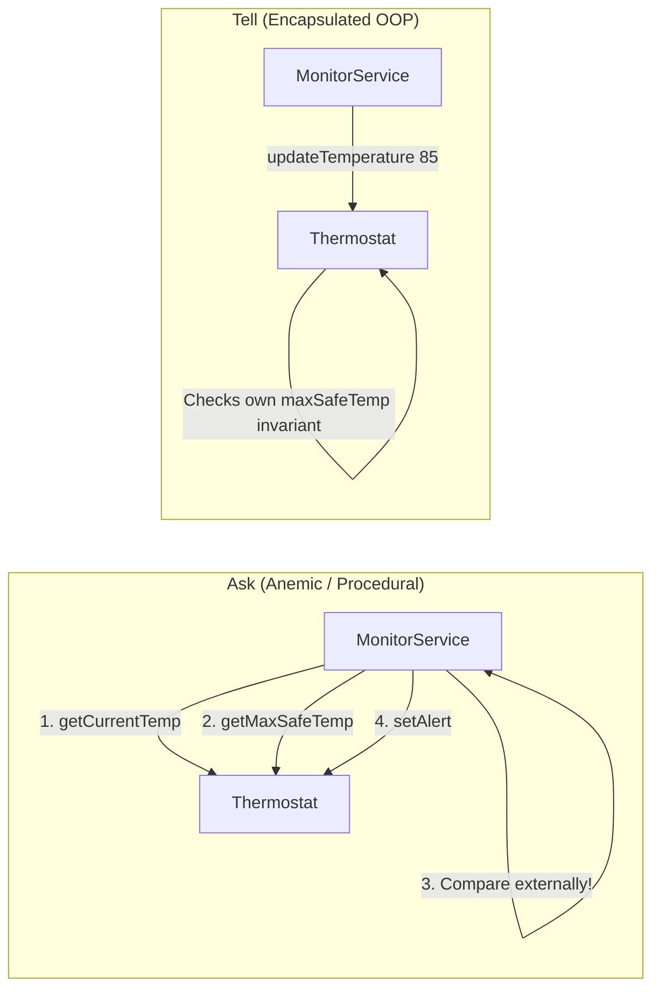

# Tell, Don't Ask

> **One-line summary:** Procedural code gets information then makes decisions; object-oriented code tells objects what to do—co-locating data with the behavior that operates on it.

| Attribute | Specification |
|---|---|
| **Level** | Core / Foundational |
| **Prerequisites** | [01-oop-pillars.md](../01-foundations/01-oop-pillars.md), [04-law-of-demeter.md](04-law-of-demeter.md) |
| **Estimated Reading Time** | 30 minutes |
| **Status** | Complete |
| **Category** | General Design Principles |
| **Also Known As** | Behavior-Data Co-location, Anti-Anemic Domain Principle |
| **Languages Tested** | Java 25 (LTS) / TypeScript 5.8 (Node 24 native) / Python 3.14 |

---

## Table of Contents
- [1 The Problem](#1-the-problem)
- [2 Why It Exists](#2-why-it-exists)
- [3 What It Is](#3-what-it-is)
- [4 The Problem Without It](#4-the-problem-without-it)
- [5 How It Solves It](#5-how-it-solves-it)
- [6 How It Works](#6-how-it-works)
- [7 Real-World Examples](#7-real-world-examples)
- [8 When to Use and When NOT to Use](#8-when-to-use-and-when-not-to-use)
- [9 Variations and Language Idioms](#9-variations-and-language-idioms)
- [10 Relationship to Other Principles and Patterns](#10-relationship-to-other-principles-and-patterns)
- [11 Common Mistakes and Anti-Patterns](#11-common-mistakes-and-anti-patterns)
- [12 Testing and Design Verification](#12-testing-and-design-verification)
- [13 Performance, Concurrency and Security Notes](#13-performance-concurrency-and-security-notes)
- [14 Interview Questions](#14-interview-questions)
- [15 Practice Exercises](#15-practice-exercises)
- [16 Summary / Cheat Sheet](#16-summary--cheat-sheet)
- [17 Further Reading](#17-further-reading)

---

## 1 The Problem

Imagine an industrial server room monitoring system. A `Thermostat` object stores `currentTemp` and `maxSafeTemp`, exposing getters and setters for both.

Every monitoring widget and cron worker queries the thermostat's getters and executes threshold logic externally:
```java
thermostat.setCurrentTemp(newTemp);
if (thermostat.getCurrentTemp() > thermostat.getMaxSafeTemp()) {
    coolingSystem.activate();
}
```
Soon, this exact `if (getCurrentTemp() > getMaxSafeTemp())` check is copied into 6 different services. Then Safety Engineering adds hysteresis (trigger cooling at `80C`, turn off at `75C`) and sensor-drift validation. Two services are updated; four are missed—causing cooling fans to oscillate wildly and overheat a server rack.

The root cause: `Thermostat` was reduced to a passive bag of getters/setters (**Anemic Domain Model**), forcing every caller to interrogate its internal state and make decisions on its behalf.

---

## 2 Why It Exists

**Tell, Don't Ask** was popularized by **Alec Sharp** (*Smalltalk by Example*, 1997) and **Andy Hunt & Dave Thomas** (*The Pragmatic Programmer*):
> *"Procedural code gets information then makes decisions. Object-oriented code tells objects to do things."*

OOP exists to bundle state and behavior together so objects guard their own invariants. When callers pull fields out via getters, perform logic externally, and push new values back via setters, encapsulation collapses into procedural C-style structs with extra ceremony.

---

## 3 What It Is

Tell, Don't Ask requires that when a decision depends entirely on an object's internal state, **that decision belongs inside a method on the object itself**.



---

## 4 The Problem Without It

```java
// Naive Violation: Asking for state and deciding externally
class ThermostatViolation {
    private int currentTemp;
    private int maxSafeTemp;

    public ThermostatViolation(int currentTemp, int maxSafeTemp) {
        this.currentTemp = currentTemp;
        this.maxSafeTemp = maxSafeTemp;
    }

    public int getCurrentTemp() { return currentTemp; }
    public void setCurrentTemp(int temp) { this.currentTemp = temp; }
    public int getMaxSafeTemp() { return maxSafeTemp; }
}

public class AskApp {
    public static void main(String[] args) {
        ThermostatViolation t = new ThermostatViolation(22, 80);
        t.setCurrentTemp(85);
        // Caller makes decisions on Thermostat's own state!
        if (t.getCurrentTemp() > t.getMaxSafeTemp()) {
            System.out.println("ALERT: Overheating!");
        }
    }
}
```

---

## 5 How It Solves It

Move the threshold check and alert trigger inside `Thermostat.updateTemperature(newTemp)`. Callers simply *tell* the thermostat the new reading.

### Java Implementation (Java 25 LTS)

```java
package com.design.principles.tda;

class Thermostat {
    private int currentTemp;
    private final int maxSafeTemp;

    public Thermostat(int initialTemp, int maxSafeTemp) {
        this.currentTemp = initialTemp;
        this.maxSafeTemp = maxSafeTemp;
    }

    // Tell, Don't Ask: Behavior co-located with state!
    public void updateTemperature(int newTemp) {
        this.currentTemp = newTemp;
        if (this.currentTemp > this.maxSafeTemp) {
            System.out.println("Java TDA ALERT: Overheating at " + currentTemp + "C! Triggering cooling.");
        } else {
            System.out.println("Java TDA OK: Temp nominal at " + currentTemp + "C.");
        }
    }
}

public class TdaApp {
    public static void main(String[] args) {
        Thermostat t = new Thermostat(22, 80);
        t.updateTemperature(85);
    }
}
```

### TypeScript Implementation (Node 24 Native)

```typescript
class Thermostat {
    private currentTemp: number;
    private readonly maxSafeTemp: number;

    constructor(initialTemp: number, maxSafeTemp: number) {
        this.currentTemp = initialTemp;
        this.maxSafeTemp = maxSafeTemp;
    }

    updateTemperature(newTemp: number): void {
        this.currentTemp = newTemp;
        if (this.currentTemp > this.maxSafeTemp) {
            console.log(`TS TDA ALERT: Overheating at ${this.currentTemp}C! Triggering cooling.`);
        }
    }
}

new Thermostat(22, 80).updateTemperature(85);
```

### Python Implementation (Python 3.14)

```python
class Thermostat:
    def __init__(self, initial_temp: int, max_safe_temp: int) -> None:
        self._current_temp = initial_temp
        self._max_safe_temp = max_safe_temp

    def update_temperature(self, new_temp: int) -> None:
        self._current_temp = new_temp
        if self._current_temp > self._max_safe_temp:
            print(f"Python TDA ALERT: Overheating at {self._current_temp}C! Triggering cooling.")

if __name__ == "__main__":
    Thermostat(22, 80).update_temperature(85)
```

### Real Execution Output
```text
Java TDA ALERT: Overheating at 85C! Triggering cooling.
TS TDA ALERT: Overheating at 85C! Triggering cooling.
Python TDA ALERT: Overheating at 85C! Triggering cooling.
```

---

## 6 How It Works

Co-locating data and behavior eliminates **Feature Envy** (a method in Class A obsessively calling getters on Class B). When `updateTemperature` owns its threshold rule, adding hysteresis or rate-of-change checks requires editing **one class**, and all callers inherit the fix automatically.

---

## 7 Real-World Examples

### 1. Domain-Driven Design (DDD) Aggregates
In DDD, an `Order` entity never exposes `order.getItems().add(item)` or `order.setStatus("PAID")`. Instead, callers tell it: `order.addItem(sku, qty)` and `order.markPaid(paymentId)`, allowing `Order` to enforce business invariants (e.g., cannot add items after shipping).

### 2. Java `Collection.removeIf(Predicate)`
Rather than asking a collection for its iterator and manually checking/removing elements in external loops (risking `ConcurrentModificationException`), you *tell* the collection `list.removeIf(item -> item.isExpired())`.

### 3. React / State Machine Actions (`dispatch`)
Instead of reading state fields externally and mutating sub-properties, Redux/useReducer callers *tell* the store `dispatch({ type: 'CHECKOUT_SUBMITTED' })`, letting the reducer guard state transitions atomically.

---

## 8 When to Use and When NOT to Use

| Context | Apply Tell, Don't Ask? | Rationale |
|---|---|---|
| **Domain Entities with Invariants** | **Yes** | Protects state transitions and eliminates Feature Envy. |
| **DTOs / Read Models / Serializers** | **No** | Reporting/UI serializers legitimately *ask* passive DTOs for fields to display. |
| **Pure Functional Pipelines** | **Different Paradigm** | FP separates immutable data records from pure functions explicitly; Tell, Don't Ask is specifically an OOP encapsulation rule. |

---

## 9 Variations and Language Idioms

- **Java:** Eliminate public setters (`setStatus`, `setBalance`); expose domain commands (`cancel()`, `withdraw(amount)`).
- **Python:** Use private attributes (`_balance`) and expose `@property` only for read-only inspection when callers truly need to display a value.

---

## 10 Relationship to Other Principles and Patterns

- **Law of Demeter:** Tell, Don't Ask and Law of Demeter eliminate train-wreck getter chains together.
- **Command Query Separation (CQS):** Tell methods are *Commands* (mutate state, return `void`/status); read-only display getters are *Queries*.
- **State Pattern:** Replaces external `if (obj.getState() == ...)` checks with polymorphic `obj.handle()` calls.

---

## 11 Common Mistakes and Anti-Patterns

| Anti-Pattern | Description | Production Consequence | Correct Remedy |
|---|---|---|---|
| **Anemic Domain Model** | Entities have only getters/setters while all rules live in `*Service` classes. | Business invariants duplicated and easily bypassed. | Move intrinsic state checks into Entity methods. |
| **Feature Envy** | Method A calls 6 getters on Object B to compute a value belonging to B. | Coupling to B's internals; breaks encapsulation. | Move Method into Object B. |
| **Exposing Mutable Collections** | `getItems()` returns raw internal `List`, letting callers call `.clear()`. | Silent invariant corruption. | Return `Collections.unmodifiableList()` and expose `addItem()`. |
| **Forbidding All Getters Dogmatically** | Refusing to expose `getName()` for UI rendering or JSON serialization. | Forces presentation logic inside domain entities (violating SRP!). | Allow read-only queries for reporting; forbid check-then-mutate asking. |
| **External Check-Then-Act** | `if (acc.getBalance() >= amt) acc.setBalance(...)` | Race conditions in multi-threaded apps. | Make `acc.withdraw(amt)` atomic inside `Account`. |
| **God Entity Overload** | Stuffing DB persistence or email sending inside `Order.markPaid()` just to "tell" it. | Violates SRP and DIP. | Keep external I/O in Application Services; keep pure state transitions on the Entity. |

---

## 12 Testing and Design Verification

Tell, Don't Ask tests verify **observable domain behavior** rather than mocking getter/setter interactions:
```java
@Test
void shouldRejectWithdrawalExceedingBalance() {
    BankAccount account = new BankAccount(100.0);
    assertThrows(IllegalStateException.class, () -> account.withdraw(150.0));
}
```

---

## 13 Performance, Concurrency and Security Notes

- **Concurrency:** External check-then-act (`if (getBalance() >= x) setBalance(...)`) is inherently non-atomic and vulnerable to TOCTOU race conditions. Co-locating `withdraw(x)` inside the object lets a single lock or atomic CAS protect the invariant.

---

## 14 Interview Questions

<details>
<summary><strong>1. What is the Tell, Don't Ask principle and what problem does it solve?</strong></summary>

Tell, Don't Ask advises sending behavioral commands to objects rather than querying their internal state via getters to make decisions externally. It solves Feature Envy, duplicated invariant checks, and the Anemic Domain Model anti-pattern.
</details>

<details>
<summary><strong>2. What is an "Anemic Domain Model" and why is it considered an anti-pattern?</strong></summary>

Coined by Martin Fowler, an Anemic Domain Model consists of domain objects that contain only fields, getters, and setters with zero behavior, while all business logic lives in external Service classes. It sacrifices OOP encapsulation, making invariants easy to bypass and logic hard to discover.
</details>

<details>
<summary><strong>3. Does Tell, Don't Ask mean objects should never have getters?</strong></summary>

No. Objects still need read-only queries (getters or DTO projections) for UI display, reporting, logging, and serialization. Tell, Don't Ask forbids **asking for state in order to make a decision on the object's behalf and mutate it back**.
</details>

<details>
<summary><strong>4. How does Tell, Don't Ask improve thread safety?</strong></summary>

If callers read state (`getBalance()`) and then write state (`setBalance()`), another thread can interleave between the two calls (a TOCTOU race condition). Moving the check-and-update inside a single `withdraw()` method lets the object synchronize or execute it atomically.
</details>

<details>
<summary><strong>5. How does Tell, Don't Ask relate to Functional Programming?</strong></summary>

Pure functional programming intentionally separates immutable data structures from pure functions (rejecting OOP state-behavior bundling). Tell, Don't Ask is specifically an OOP design rule; in FP, data invariants are enforced instead through smart constructors and immutable algebraic types.
</details>

<details>
<summary><strong>6. What is the "Feature Envy" code smell?</strong></summary>

Feature Envy occurs when a method in Class A spends more time calling getters on Class B than using its own fields. Moving that method onto Class B directly resolves Feature Envy and enforces Tell, Don't Ask.
</details>

<details>
<summary><strong>7. How do you avoid violating SRP when applying Tell, Don't Ask?</strong></summary>

Only move **intrinsic domain state rules** onto the entity (e.g., `order.cancel()`). Never put external infrastructure concerns (SQL queries, SMTP emails, HTTP calls) inside the entity.
</details>

<details>
<summary><strong>8. How does Martin Fowler's refactoring "Move Method" support Tell, Don't Ask?</strong></summary>

When you spot a service method pulling 4 getters out of an object to compute a result or validate an invariant, applying *Move Method* relocates that logic onto the data-owning object itself.
</details>

---

## 15 Practice Exercises

### Exercise 1: Eliminate External Status Check (Easy)
Refactor this caller code to follow Tell, Don't Ask:
```java
if (order.getStatus() == OrderStatus.PENDING && !order.getItems().isEmpty()) {
    order.setStatus(OrderStatus.CONFIRMED);
}
```

<details>
<summary><strong>Solution</strong></summary>

Move the transition rule inside `Order`:
```java
// Inside Order class:
public void confirm() {
    if (this.status != OrderStatus.PENDING) throw new IllegalStateException("Order not pending");
    if (this.items.isEmpty()) throw new IllegalStateException("Cannot confirm empty order");
    this.status = OrderStatus.CONFIRMED;
}
// Caller:
order.confirm();
```
</details>

---

### Exercise 2: Refactor Feature Envy in TypeScript (Medium)
Move the discount eligibility check inside `CustomerAccount`:
```typescript
class CustomerAccount {
    constructor(public points: number, public isSuspended: boolean) {}
}
function redeem(acc: CustomerAccount, cost: number) {
    if (!acc.isSuspended && acc.points >= cost) {
        acc.points -= cost;
        return true;
    }
    return false;
}
```

<details>
<summary><strong>Solution</strong></summary>

```typescript
class CustomerAccount {
    private points: number;
    private isSuspended: boolean;
    constructor(points: number, isSuspended: boolean) {
        this.points = points;
        this.isSuspended = isSuspended;
    }
    redeem(cost: number): boolean {
        if (this.isSuspended || cost <= 0 || this.points < cost) return false;
        this.points -= cost;
        return true;
    }
}
```
</details>

---

### Exercise 3: Protect Mutable Collection Invariant (Hard)
In Python, `ShoppingCart` exposes `cart.items` as a public list. External callers append items directly and forget to recalculate `cart.total`. Refactor `ShoppingCart` using Tell, Don't Ask so `items` cannot be mutated externally.

<details>
<summary><strong>Solution</strong></summary>

```python
from dataclasses import dataclass

@dataclass(frozen=True)
class CartItem:
    sku: str
    price: float

class ShoppingCart:
    def __init__(self) -> None:
        self._items: list[CartItem] = []

    def add_item(self, item: CartItem) -> None:
        if item.price < 0:
            raise ValueError("Negative price")
        self._items.append(item)

    @property
    def items(self) -> tuple[CartItem, ...]:
        return tuple(self._items)

    @property
    def total(self) -> float:
        return sum(i.price for i in self._items)
```
</details>

---

## 16 Summary / Cheat Sheet

```
+--------------------------------------------------------------------------+
|                             TELL, DON'T ASK                              |
+--------------------------------------------------------------------------+
| CORE RULE      : Tell objects what to do; don't ask for internal state to |
|                  make decisions externally.                              |
| FIXES SMELLS   : Anemic Domain Models, Feature Envy, TOCTOU races.       |
| EXCEPTION      : Read-only DTOs and UI queries may read state safely.    |
| GOLDEN CHECK   : If you see `if (obj.getX() ... ) obj.setY(...)`, move   |
|                  that logic inside `obj`!                                |
+--------------------------------------------------------------------------+
```

---

## 17 Further Reading

- Martin Fowler, *TellDontAsk*, martinfowler.com/bliki/TellDontAsk.html, 2013.
- Martin Fowler, *AnemicDomainModel*, martinfowler.com/bliki/AnemicDomainModel.html, 2003.

### In Your Language
| Language Track | Deep Dive Reference |
|---|---|
| Java | [Java OOP & Design Patterns](file:///e:/Learning/engineering-notes/01-languages/java/24-design-patterns/README.md) |
| TypeScript | [TypeScript Design Patterns](file:///e:/Learning/engineering-notes/01-languages/typescript/17-design-patterns/README.md) |
| Python | [Python Design Patterns](file:///e:/Learning/engineering-notes/01-languages/python/23-design-patterns/README.md) |

---

[← Previous: 05 - Separation of Concerns](file:///e:/Learning/engineering-notes/08-solid-design-patterns/03-design-principles/05-separation-of-concerns.md) | [Module 03 Index](file:///e:/Learning/engineering-notes/08-solid-design-patterns/03-design-principles/README.md) | [Next: 07 - Principle of Least Astonishment →](file:///e:/Learning/engineering-notes/08-solid-design-patterns/03-design-principles/07-principle-of-least-astonishment.md)
