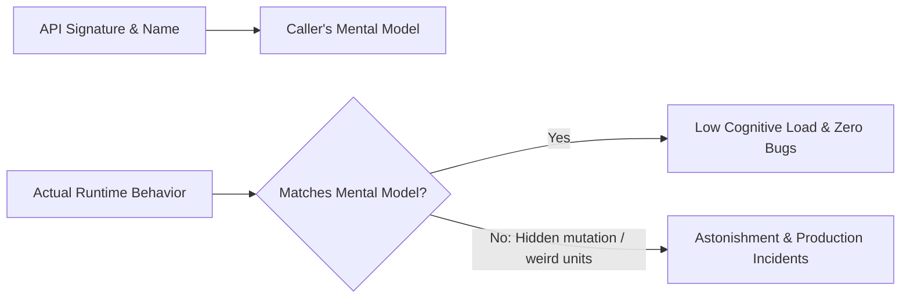

# Principle of Least Astonishment (POLA)

> **One-line summary:** A component, API, or interface should behave in the way most users and developers naturally expect—never hiding destructive side effects, surprising mutations, or counter-intuitive defaults behind innocent names.

| Attribute | Specification |
|---|---|
| **Level** | Core / Foundational |
| **Prerequisites** | [08-command-query-separation.md](../01-foundations/08-command-query-separation.md), [07-immutability-and-value-objects.md](../01-foundations/07-immutability-and-value-objects.md) |
| **Estimated Reading Time** | 25 minutes |
| **Status** | Complete |
| **Category** | General Design Principles |
| **Also Known As** | Principle of Least Surprise (POLS) |
| **Languages Tested** | Java 25 (LTS) / TypeScript 5.8 (Node 24 native) / Python 3.14 |

---

## Table of Contents
- [1 The Problem](#1-the-problem)
- [2 Why It Exists](#2-why-it-exists)
- [3 What It Is](#3-what-it-is)
- [4 The Problem Without It](#4-the-problem-without-it)
- [5 How It Solves It](#5-how-it-solves-it)
- [6 How It Works](#6-how-it-works)
- [7 Real-World Examples](#7-real-world-examples)
- [8 When to Use and When NOT to Use](#8-when-to-use-and-when-not-to-use)
- [9 Variations and Language Idioms](#9-variations-and-language-idioms)
- [10 Relationship to Other Principles and Patterns](#10-relationship-to-other-principles-and-patterns)
- [11 Common Mistakes and Anti-Patterns](#11-common-mistakes-and-anti-patterns)
- [12 Testing and Design Verification](#12-testing-and-design-verification)
- [13 Performance, Concurrency and Security Notes](#13-performance-concurrency-and-security-notes)
- [14 Interview Questions](#14-interview-questions)
- [15 Practice Exercises](#15-practice-exercises)
- [16 Summary / Cheat Sheet](#16-summary--cheat-sheet)
- [17 Further Reading](#17-further-reading)

---

## 1 The Problem

Imagine an internal SDK used by 40 developers. A method is named `getActiveUser(String id)`. A developer calls it inside a read-only billing report generator.

Unknown to the caller, `getActiveUser` contains a hidden optimization: if the user's session timestamp is stale, it silently resets `lastLoginAt = now()`, writes an `UPDATE` to the database, and if the user is inactive, returns `null` *after* deleting their temporary session tokens!

On Monday morning, running the read-only billing audit wipes active login sessions for 2,000 idle enterprise users. Why? Because the API violated the **Principle of Least Astonishment**: a method named `get...` mutated persistent state.

---

## 2 Why It Exists

POLA originated in human-computer interface design (Geoffrey James, *The Tao of Programming*, 1987; Joshua Bloch, *Effective Java*; Eric S. Raymond, *The Art of Unix Programming*):
> *"If a necessary feature has a high astonishment factor, it may be necessary to redesign the feature."*

Software engineers spend 10x more time reading and calling APIs than reading their internal implementation. If every method name lies about side effects, parameter units, or null behavior, developers must read the entire source code of every dependency to use it safely.

---

## 3 What It Is

POLA mandates that **naming, parameter semantics, return types, mutability, and defaults align with established domain and language conventions**:
1. **Honest Naming:** `get*` / `find*` / `is*` never mutate state; destructive actions use explicit verbs (`delete`, `purge`, `reset`).
2. **Consistent Units & Parameter Order:** Don't mix `timeoutSeconds` in one method and `timeoutMillis` in its sibling; prefer `Duration` types.
3. **Predictable Mutability:** Don't silently sort or mutate a caller's input list inside a helper named `calculateMedian(List<Double> values)`.
4. **Safe Defaults:** Never default dangerous operations (`deleteAll`, `overwrite = true`, `sslVerify = false`) to unsafe values.



---

## 4 The Problem Without It

```java
// Naive Violation: Surprising mutation & hidden side effects
import java.util.*;

class AstonishingStats {
    // Surprise 1: Named "median" (looks pure), but mutates the caller's input list via Collections.sort!
    public static double median(List<Double> scores) {
        Collections.sort(scores); // Mutates caller's list in place!
        int mid = scores.size() / 2;
        return scores.get(mid);
    }
}
```

### The Surprise Failure
A caller passes a chronologically ordered time-series list `List<Double> hourlyLatencies` to `median(hourlyLatencies)`, then renders a time-series chart—and the chart is now silently sorted by value instead of time!

---

## 5 How It Solves It

Keep read operations non-mutating, encode units explicitly in types, and make side effects obvious in method names.

### Java Implementation (Java 25 LTS)

```java
package com.design.principles.pola;

import java.time.Duration;
import java.util.*;

public class PolaStats {
    // Predictable: Never mutates caller's input list!
    public static double median(List<Double> scores) {
        if (scores == null || scores.isEmpty()) {
            throw new IllegalArgumentException("Scores cannot be empty");
        }
        List<Double> sortedCopy = new ArrayList<>(scores);
        Collections.sort(sortedCopy);
        return sortedCopy.get(sortedCopy.size() / 2);
    }

    // Predictable: Uses Duration instead of ambiguous int timeout!
    public static void configureTimeout(Duration timeout) {
        System.out.println("Java POLA Timeout configured: " + timeout.toMillis() + "ms");
    }
}
```

### TypeScript Implementation (Node 24 Native)

```typescript
// Predictable: Accepts readonly array and clones before sorting
export function median(scores: readonly number[]): number {
    if (scores.length === 0) throw new Error("Scores cannot be empty");
    const sorted = [...scores].sort((a, b) => a - b); // Numeric comparator, NOT lexicographic!
    return sorted[Math.floor(sorted.length / 2)];
}
```
*(Notice a classic JS astonishment trap avoided above: `Array.prototype.sort()` without a comparator sorts numbers **lexicographically** (`[10, 2]` instead of `[2, 10]`)! Always supply `(a, b) => a - b`.)*

### Python Implementation (Python 3.14)

```python
from collections.abc import Sequence

def median(scores: Sequence[float]) -> float:
    if not scores:
        raise ValueError("Scores cannot be empty")
    # sorted() returns a new list; never mutates caller's input!
    ordered = sorted(scores)
    return ordered[len(ordered) // 2]
```

---

## 6 How It Works

POLA reduces defect rates by aligning with **caller intuition**:
- **JavaScript `Array.sort()` vs Python `sorted()`:** Python explicitly separates mutating `.sort()` (returns `None`!) from non-mutating `sorted()` (returns a new list)—preventing callers from mistakenly thinking `.sort()` returns a sorted copy while leaving the original untouched.
- **Explicit Types (`Duration`, `Money`):** Passing `Duration.ofSeconds(5)` eliminates the classic Mars Climate Orbiter units bug (seconds vs milliseconds).

---

## 7 Real-World Examples

### 1. Java `Optional` vs `null` Returns
Returning `Optional<User>` from `findById(id)` explicitly signals to callers that absence is normal and expected—preventing unexpected `NullPointerException` surprises.

### 2. Python Mutable Default Argument Trap (`def add(x, items=[])`)
One of Python's most infamous POLA violations is using a mutable default argument (`items=[]`), which is shared across *every subsequent call* to the function. Python best practice always uses `items: list | None = None`.

### 3. HTTP Method Semantics (`GET` vs `POST` vs `DELETE`)
Web standards enforce POLA at the protocol level: `GET` requests must be safe and read-only (prefetchable by browsers and caches). Putting state deletion inside a `GET /users/delete/42` endpoint causes web crawlers and browser link prefetchers to wipe user accounts!

---

## 8 When to Use and When NOT to Use

| Context | Apply POLA? | Rationale |
|---|---|---|
| **Every Public API, Library, and Internal Method** | **Always** | Predictability is universally valuable. |
| **Legacy Compatibility Shims** | **Document Clearly** | If forced to preserve an existing surprising quirk for backwards compatibility, deprecate it and add a clean replacement. |

---

## 9 Variations and Language Idioms

- **Java:** Use `Duration`, `Instant`, `Optional`, and unmodifiable collections (`List.copyOf`).
- **TypeScript:** Use `readonly` arrays/fields and strict union return types.
- **Python:** Use `sorted()`, keyword-only arguments (`*` separator) for boolean flags so callers write `delete(force=True)` instead of `delete(True)`.

---

## 10 Relationship to Other Principles and Patterns

- **Command Query Separation (CQS):** CQS is the cornerstone of POLA—queries never mutate state.
- **Fail-Fast:** Failing loudly on invalid input is far less astonishing than silently corrupting state and crashing 10 minutes later.
- **CUPID ("Predictable"):** Dan North's "Predictable" property directly generalizes POLA.

---

## 11 Common Mistakes and Anti-Patterns

| Anti-Pattern | Description | Production Consequence | Correct Remedy |
|---|---|---|---|
| **Mutating Input Arguments** | Sorting or modifying a caller's passed list inside a calculation helper. | Corrupts caller's ordering/state silently. | Clone or use `readonly` / `sorted()`. |
| **Boolean Flag Blindness** | `createUser("alice", true, false, true)` | Impossible to guess what `true/false` means at call site. | Use named options object, enum, or keyword-only args. |
| **Side Effects in Getters** | `getConnectionCount()` resetting counters or opening sockets. | Breaks CQS and causes disasters in debuggers/serializers. | Separate query from command. |
| **Ambiguous Numeric Units** | `sleep(500)`—is that ms, seconds, or ticks? | 1000x timeout bugs. | Use `Duration` or include unit in name (`sleepMs`). |
| **Silent Failure / Swallowed Exceptions** | Catching `Exception` and returning `null` or `0`. | Masks outages; corrupts metrics. | Fail fast or return explicit `Result`/`Optional`. |
| **Unsafe Defaults** | `verifyTls = false` or `overwrite = true` by default. | Accidental data loss or security breach. | Always default to safe, non-destructive mode. |

---

## 12 Testing and Design Verification

Write explicit tests verifying **non-mutation** of caller inputs and boundary behaviors:
```java
@Test
void medianShouldNotMutateCallerList() {
    List<Double> original = new ArrayList<>(List.of(30.0, 10.0, 20.0));
    assertEquals(20.0, PolaStats.median(original));
    assertEquals(List.of(30.0, 10.0, 20.0), original); // Order preserved!
}
```

---

## 13 Performance, Concurrency and Security Notes

- **Security:** Unsafe defaults (`sslVerify = false`, permissive CORS `*`, unauthenticated fallback) are classic POLA violations that lead directly to CVEs. Always make the secure option the effortless default.

---

## 14 Interview Questions

<details>
<summary><strong>1. What is the Principle of Least Astonishment (POLA)?</strong></summary>

POLA states that software APIs, methods, and UIs should behave consistently with what users and callers reasonably expect from their names, conventions, and types—avoiding hidden side effects, surprising defaults, or counter-intuitive mutations.
</details>

<details>
<summary><strong>2. Give three famous examples of POLA violations in popular languages or protocols.</strong></summary>

1. JavaScript `[10, 2].sort()` sorting numbers alphabetically as `[10, 2]` unless a comparator is provided.
2. Python mutable default arguments (`def f(x=[])`) sharing state across calls.
3. Implementing state-deleting actions behind HTTP `GET` links (which browser prefetchers trigger automatically).
</details>

<details>
<summary><strong>3. How does Command Query Separation (CQS) enforce POLA?</strong></summary>

CQS guarantees that any method returning a query answer (`get*`, `calculate*`, `is*`) produces zero observable side effects. Callers are never surprised by state mutations when reading data.
</details>

<details>
<summary><strong>4. Why are boolean parameters like `render(true, false)` considered a POLA smell?</strong></summary>

At the call site, `true` and `false` carry zero semantic meaning—forcing readers to open the implementation or risk swapping flags silently. Using enums (`RenderMode.DARK`), options objects, or separate named methods (`renderDark()`) makes intent unmistakable.
</details>

<details>
<summary><strong>5. How do TypeScript `readonly` and Java `Duration` enforce POLA at compile time?</strong></summary>

`readonly` prevents functions from unexpectedly mutating caller arrays/objects, and `Duration` eliminates ambiguity between seconds, milliseconds, and nanoseconds.
</details>

<details>
<summary><strong>6. Why does Python's `list.sort()` return `None` instead of the sorted list?</strong></summary>

Guido van Rossum designed `list.sort()` to return `None` specifically to follow POLA: it signals unmistakably that the list was mutated in place, preventing callers from writing `new_list = old_list.sort()` while mistakenly assuming `old_list` stayed unchanged.
</details>

<details>
<summary><strong>7. Why should dangerous options never be the default?</strong></summary>

Callers frequently omit optional parameters expecting safe behavior. If `deleteFiles(path, recursive = true)` or `connect(verifySsl = false)` defaults to unsafe mode, a single omitted flag causes catastrophic data loss or security exposure.
</details>

<details>
<summary><strong>8. How do debuggers accidentally expose POLA violations in getters?</strong></summary>

Modern IDEs automatically invoke `toString()` and property getters when inspecting objects in the debugger watch window. If a getter has a hidden side effect (like incrementing a counter or mutating cache), simply *looking* at the object in a debugger changes program behavior!
</details>

---

## 15 Practice Exercises

### Exercise 1: Spot the Astonishment Traps (Easy)
Identify two POLA violations in: `User fetchUser(int id, boolean deleteIfInactive)`

<details>
<summary><strong>Solution</strong></summary>

1. **Violates CQS/Naming:** `fetchUser` implies a read-only query, yet it can delete records.
2. **Opaque boolean flag:** `fetchUser(42, true)` is unreadable at the call site.
**Fix:** Separate `findUser(id)` from `purgeInactiveUser(id)`.
</details>

---

### Exercise 2: Fix Python Mutable Default & Mutation (Medium)
Fix the two POLA bugs in this Python function:
```python
def append_tag(tag: str, tags: list[str] = []) -> list[str]:
    tags.append(tag)
    return tags
```

<details>
<summary><strong>Solution</strong></summary>

```python
from collections.abc import Sequence

def with_tag(tag: str, tags: Sequence[str] = ()) -> list[str]:
    return [*tags, tag]
```
Uses an immutable default tuple and returns a fresh list without mutating the caller's input.
</details>

---

### Exercise 3: Redesign Ambiguous Timeout API in Java (Hard)
Redesign `void connect(String host, int port, int timeout, boolean ssl)` into a fluent or typed Java 25 API obeying POLA.

<details>
<summary><strong>Solution</strong></summary>

```java
public record ConnectionConfig(String host, int port, Duration timeout, TlsMode tlsMode) {
    public enum TlsMode { STRICT_TLS, PLAINTEXT_DEV_ONLY }
    public static ConnectionConfig secureDefault(String host, int port) {
        return new ConnectionConfig(host, port, Duration.ofSeconds(10), TlsMode.STRICT_TLS);
    }
}
```
</details>

---

## 16 Summary / Cheat Sheet

```
+--------------------------------------------------------------------------+
|                  PRINCIPLE OF LEAST ASTONISHMENT (POLA)                  |
+--------------------------------------------------------------------------+
| CORE RULE      : Match caller expectations in naming, units, defaults,   |
|                  and side effects.                                       |
| GOLDEN HABITS  : 1. Queries never mutate state (CQS).                    |
|                  2. Never mutate caller's input collections silently.    |
|                  3. Use explicit unit types (Duration, Money) & enums.   |
|                  4. Default to safe, non-destructive, secure modes.      |
+--------------------------------------------------------------------------+
```

---

## 17 Further Reading

- Joshua Bloch, *Effective Java (3rd Edition)* (Items 50, 51, 55), Addison-Wesley, 2018.
- Eric S. Raymond, *The Art of Unix Programming* (Rule of Least Surprise), Addison-Wesley, 2003.

### In Your Language
| Language Track | Deep Dive Reference |
|---|---|
| Java | [Java OOP & Design Patterns](file:///e:/Learning/engineering-notes/01-languages/java/24-design-patterns/README.md) |
| TypeScript | [TypeScript Design Patterns](file:///e:/Learning/engineering-notes/01-languages/typescript/17-design-patterns/README.md) |
| Python | [Python Design Patterns](file:///e:/Learning/engineering-notes/01-languages/python/23-design-patterns/README.md) |

---

[← Previous: 06 - Tell, Don't Ask](file:///e:/Learning/engineering-notes/08-solid-design-patterns/03-design-principles/06-tell-dont-ask.md) | [Module 03 Index](file:///e:/Learning/engineering-notes/08-solid-design-patterns/03-design-principles/README.md) | [Next: 08 - Fail-Fast Principle →](file:///e:/Learning/engineering-notes/08-solid-design-patterns/03-design-principles/08-fail-fast-principle.md)
