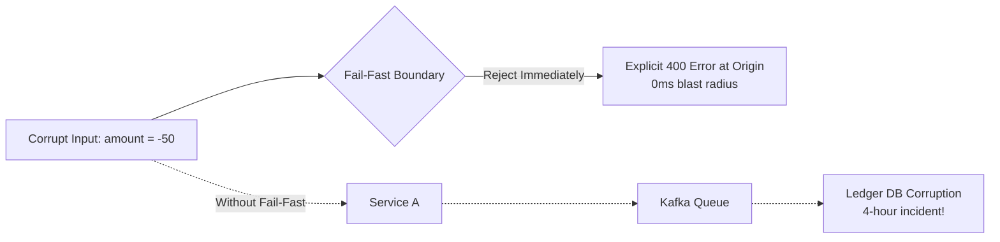

# Fail-Fast Principle

> **One-line summary:** Detect and report invalid state, corrupted inputs, and broken preconditions immediately at the boundary where they occur—before bad data propagates silently through downstream systems.

| Attribute | Specification |
|---|---|
| **Level** | Core / Foundational |
| **Prerequisites** | [09-design-by-contract-and-defensive-programming.md](../01-foundations/09-design-by-contract-and-defensive-programming.md), [07-immutability-and-value-objects.md](../01-foundations/07-immutability-and-value-objects.md) |
| **Estimated Reading Time** | 30 minutes |
| **Status** | Complete |
| **Category** | General Design Principles |
| **Also Known As** | Early Failure, Offensive Programming, Boundary Guarding |
| **Languages Tested** | Java 25 (LTS) / TypeScript 5.8 (Node 24 native) / Python 3.14 |

---

## Table of Contents
- [1 The Problem](#1-the-problem)
- [2 Why It Exists](#2-why-it-exists)
- [3 What It Is](#3-what-it-is)
- [4 The Problem Without It](#4-the-problem-without-it)
- [5 How It Solves It](#5-how-it-solves-it)
- [6 How It Works](#6-how-it-works)
- [7 Real-World Examples](#7-real-world-examples)
- [8 When to Use and When NOT to Use](#8-when-to-use-and-when-not-to-use)
- [9 Variations and Language Idioms](#9-variations-and-language-idioms)
- [10 Relationship to Other Principles and Patterns](#10-relationship-to-other-principles-and-patterns)
- [11 Common Mistakes and Anti-Patterns](#11-common-mistakes-and-anti-patterns)
- [12 Testing and Design Verification](#12-testing-and-design-verification)
- [13 Performance, Concurrency and Security Notes](#13-performance-concurrency-and-security-notes)
- [14 Interview Questions](#14-interview-questions)
- [15 Practice Exercises](#15-practice-exercises)
- [16 Summary / Cheat Sheet](#16-summary--cheat-sheet)
- [17 Further Reading](#17-further-reading)

---

## 1 The Problem

Imagine a microservice startup where a developer omits validation inside `TransferCommand` and uses defensive `if (x == null) return;` fallbacks everywhere.

At 11:00 AM, a buggy frontend form submits `{ fromAccount: "ACC-1", toAccount: "ACC-1", amount: -50 }`.
Instead of rejecting the request immediately with HTTP `400 Bad Request`:
1. The API returns `200 OK` and pushes the invalid event onto a Kafka queue.
2. Three hours later, a batch reconciliation worker consumes the event, crashes with a cryptic `NullPointerException` 9 layers deep, or worse—credits `"ACC-1"` with `-(-$50)` in a downstream ledger!
3. On-call engineers spend 4 hours tracing logs backwards across 5 services just to discover *where* the invalid negative transfer originated.

Silent tolerance of invalid state turns a 1-millisecond local validation error into a multi-hour distributed data-corruption incident.

---

## 2 Why It Exists

Jim Shore popularized **Fail Fast** in *IEEE Software* (2004):
> *"A fail-fast system is designed to immediately report at its interface any failure or condition that is likely to indicate a failure."*

When bugs surface **close to their origin** (both in time and call-stack depth), root cause diagnosis is instantaneous. When systems limp along with corrupted `null`s, empty strings, or fallback guesses, the eventual crash occurs far away from the bug—masking the true cause.

---

## 3 What It Is

Fail-Fast requires **eager validation at three levels**:
1. **Startup / Boot Time:** Validate required environment variables, DB connections, and config schemas before accepting traffic.
2. **Construction / Value Object Creation:** Enforce invariants inside constructors (`compact constructors` in Java records, smart constructors in TS/Python) so an invalid object *cannot exist in memory*.
3. **API / Boundary Entry:** Reject invalid payloads immediately with explicit contextual errors.



---

## 4 The Problem Without It

```java
// Naive Violation: Permissive constructor allows corrupted command into system
class TransferCommandViolation {
    String fromAccount;
    String toAccount;
    double amount;

    TransferCommandViolation(String fromAccount, String toAccount, double amount) {
        this.fromAccount = fromAccount;
        this.toAccount = toAccount;
        this.amount = amount; // Accepts negative amounts & identical accounts!
    }
}
```

---

## 5 How It Solves It

Validate every invariant eagerly inside the constructor / entry boundary so invalid commands fail immediately with clear diagnostic messages.

### Java Implementation (Java 25 LTS)

```java
package com.design.principles.failfast;

record TransferCommand(String fromAccount, String toAccount, double amount) {
    public TransferCommand {
        if (fromAccount == null || fromAccount.isBlank()) {
            throw new IllegalArgumentException("fromAccount required");
        }
        if (toAccount == null || toAccount.isBlank()) {
            throw new IllegalArgumentException("toAccount required");
        }
        if (fromAccount.equals(toAccount)) {
            throw new IllegalArgumentException("Cannot transfer to same account");
        }
        if (amount <= 0) {
            throw new IllegalArgumentException("Amount must be positive: " + amount);
        }
    }
}

public class FailFastApp {
    public static void main(String[] args) {
        try {
            new TransferCommand("ACC-1", "ACC-1", -50.0);
        } catch (IllegalArgumentException e) {
            System.out.println("Java Fail-Fast Caught: " + e.getMessage());
        }
    }
}
```

### TypeScript Implementation (Node 24 Native)

```typescript
export class TransferCommand {
    readonly fromAccount: string;
    readonly toAccount: string;
    readonly amount: number;

    constructor(fromAccount: string, toAccount: string, amount: number) {
        if (!fromAccount.trim()) throw new Error("fromAccount required");
        if (!toAccount.trim()) throw new Error("toAccount required");
        if (fromAccount === toAccount) throw new Error("Cannot transfer to same account");
        if (!Number.isFinite(amount) || amount <= 0) throw new Error("Amount must be positive");
        this.fromAccount = fromAccount;
        this.toAccount = toAccount;
        this.amount = amount;
    }
}
```

### Python Implementation (Python 3.14)

```python
from dataclasses import dataclass

@dataclass(frozen=True)
class TransferCommand:
    from_account: str
    to_account: str
    amount: float

    def __post_init__(self) -> None:
        if not self.from_account.strip():
            raise ValueError("from_account required")
        if not self.to_account.strip():
            raise ValueError("to_account required")
        if self.from_account == self.to_account:
            raise ValueError("Cannot transfer to same account")
        if self.amount <= 0:
            raise ValueError(f"Amount must be positive: {self.amount}")
```

### Real Execution Output
```text
Java Fail-Fast Caught: Cannot transfer to same account
```

---

## 6 How It Works

1. **Make Illegal States Unrepresentable:** Once `TransferCommand` constructs successfully, *every downstream consumer* is guaranteed `amount > 0` and `fromAccount != toAccount` without repeating defensive `null` checks everywhere.
2. **Startup Config Verification:** Applications should parse and validate all required env vars (`DATABASE_URL`, `JWT_SECRET`) on boot—crashing immediately in Kubernetes readiness probes rather than failing hours later on the first user request.

---

## 7 Real-World Examples

### 1. Java `ConcurrentModificationException` (Fail-Fast Iterators)
Java's `ArrayList` and `HashMap` iterators maintain an internal `modCount`. If a collection is structurally modified during iteration without using `iterator.remove()`, the iterator throws `ConcurrentModificationException` *immediately* rather than risking silent skipped elements or infinite loops.

### 2. TypeScript / Zod & Python Pydantic Schema Validation at API Boundaries
Modern web APIs validate incoming JSON payloads immediately at the controller boundary using Zod or Pydantic, returning structured `422` field errors before domain logic ever executes.

### 3. Java `Objects.requireNonNull(arg, "message")`
Standard JDK defensive guard used at method and constructor entry points to attach meaningful parameter names instead of letting a raw `NullPointerException` fire 5 frames deeper.

---

## 8 When to Use and When NOT to Use

| Context | Fail-Fast vs Tolerant | Rationale |
|---|---|---|
| **Financial / Security / State Mutations** | **Strict Fail-Fast** | Never guess or limp along with corrupt money or auth data. |
| **Application Startup / Config Loading** | **Strict Fail-Fast** | Crash on boot if secrets or DB URLs are missing. |
| **Batch ETL / CSV Analytics Import** | **Quarantine (Dead-Letter)** | Don't abort a 10M-row analytics import on 1 bad row—log/route the bad row to a Dead-Letter Queue (DLQ) and keep processing valid rows. |
| **Public API Schema Evolution (Extra JSON Fields)** | **Balance with Postel's Law** | Ignore unknown benign fields during rolling upgrades while strictly rejecting invalid required fields. |

---

## 9 Variations and Language Idioms

- **Parse, Don't Validate (Alexis King):** Instead of validating a raw `String` and passing the raw `String` along, parse it into a strong type (`EmailAddress`, `PositiveAmount`) so the type system proves validation already happened.
- **Compiler-Time Fail-Fast:** Using TypeScript `strictNullChecks`, Java `sealed` types, and Rust `Result` catches invalid states before the code even runs!

---

## 10 Relationship to Other Principles and Patterns

- **Design by Contract (DbC):** Fail-Fast is the runtime enforcement of DbC preconditions and class invariants.
- **Postel's Law:** The intentional counterpart—see [19 - Conflicts & Trade-offs](file:///e:/Learning/engineering-notes/08-solid-design-patterns/03-design-principles/19-principles-conflicts-and-trade-offs.md) for when to fail fast vs tolerate.
- **Immutability & Value Objects:** Self-validating immutable Value Objects guarantee fail-fast invariants permanently after construction.

---

## 11 Common Mistakes and Anti-Patterns

| Anti-Pattern | Description | Production Consequence | Correct Remedy |
|---|---|---|---|
| **Empty `catch` Blocks** | `catch (Exception e) {}` | Silent data loss and invisible outages. | Log with context and rethrow or convert to explicit failure result. |
| **Silent Fallback Defaults** | `port = env.get("PORT") ?? 8080` in prod when `PROD_DB_URL` is missing, falling back to `localhost`! | Production silently connects to wrong/empty DB or crashes mysteriously later. | Fail fast on missing required prod config. |
| **Null-Coalescing Everything** | Using `user?.profile?.name ?? "Unknown"` to hide missing required invariants. | Corrupt `"Unknown"` records written into billing databases. | Reject missing required fields at the boundary. |
| **Validating Too Late** | Checking `amount > 0` inside the SQL repository instead of the API/Command boundary. | Wasted CPU, partial side effects already executed. | Validate at the outermost boundary + constructor. |
| **Using `assert` for Production Input Validation** | Java `assert` and Python `assert` are stripped when `-ea` is off or `-O` is on! | All validation vanishes in optimized production runs. | Always throw explicit `IllegalArgumentException` / `ValueError`. |
| **Cryptic Error Messages** | Throwing `IllegalArgumentException("Invalid")` without field name or value. | Impossible to debug which field failed in production logs. | Include field name and invalid value (masking secrets/PII). |

---

## 12 Testing and Design Verification

Verify that invalid inputs fail immediately with explicit exception types and clear diagnostic messages:
```java
@Test
void shouldRejectSelfTransferImmediately() {
    var ex = assertThrows(IllegalArgumentException.class,
        () -> new TransferCommand("ACC-1", "ACC-1", 50.0));
    assertTrue(ex.getMessage().contains("same account"));
}
```

---

## 13 Performance, Concurrency and Security Notes

- **Security:** Fail-Fast prevents partial execution attacks and **fail-open** vulnerabilities. Always **fail closed** (deny access immediately if an auth token or signature check fails).
- **Performance:** Rejecting malformed requests in 0.1ms at the edge saves downstream database connections, thread pools, and network bandwidth.

---

## 14 Interview Questions

<details>
<summary><strong>1. What is the Fail-Fast principle and why does it reduce debugging time?</strong></summary>

Fail-Fast means surfacing errors immediately at the point where invalid state or input is detected, rather than allowing corrupted data to propagate. It reduces debugging time because the stack trace and logs point directly to the root cause rather than a symptom 5 layers downstream.
</details>

<details>
<summary><strong>2. Why should you NEVER use `assert` for validating user input in Java or Python?</strong></summary>

In Java, `assert` statements are disabled by default unless `-ea` is passed; in Python, `assert` statements are stripped completely when running with `-O` (optimized mode). Production input validation must always use explicit `if (...) throw/raise` checks.
</details>

<details>
<summary><strong>3. What does "Parse, Don't Validate" mean?</strong></summary>

Coined by Alexis King, it means transforming raw unvalidated inputs (`String email`) into validated domain types (`EmailAddress`) at the system boundary. Rather than re-validating raw strings in every function, downstream functions simply accept `EmailAddress`, leveraging the type system to prove validity.
</details>

<details>
<summary><strong>4. When is Fail-Fast the WRONG choice (e.g., in batch pipelines)?</strong></summary>

In large batch ETL jobs or stream consumers (like Kafka), crashing the entire worker process on a single malformed poison-pill message stalls all valid messages behind it. Instead, reject the individual message quickly into a Dead-Letter Queue (DLQ) and continue processing valid records.
</details>

<details>
<summary><strong>5. How does Fail-Fast apply to Kubernetes / Cloud service startup?</strong></summary>

Services should validate all required environment variables, secrets, and schema versions synchronously at startup and exit non-zero immediately if anything is misconfigured—allowing orchestrators to catch bad deploys during rolling updates before routing live traffic.
</details>

<details>
<summary><strong>6. What is the difference between Fail-Closed and Fail-Open in security?</strong></summary>

Fail-Closed denies access immediately when an authorization check errors or times out (Fail-Fast security). Fail-Open accidentally grants access when an error occurs (catastrophic security vulnerability).
</details>

<details>
<summary><strong>7. How does Java's `ArrayList` iterator implement Fail-Fast?</strong></summary>

`ArrayList` tracks a structural modification counter (`modCount`). When an iterator is created, it snapshots `expectedModCount = modCount`. On every `next()`, if `modCount != expectedModCount`, it throws `ConcurrentModificationException` immediately instead of silently skipping or duplicating elements.
</details>

<details>
<summary><strong>8. How do Fail-Fast and Postel's Law conflict?</strong></summary>

Fail-Fast urges strict rejection of unexpected input; Postel's Law urges being liberal/tolerant in what you accept. Senior engineers fail fast on *semantic/security invariants* (negative amounts, missing required IDs) while being tolerant of *benign schema evolution* (ignoring unknown extra JSON keys).
</details>

---

## 15 Practice Exercises

### Exercise 1: Spot the Silent Corruption Bug (Easy)
Why is this Python config loader dangerous in production?
```python
DB_HOST = os.environ.get("PROD_DB_HOST", "localhost")
```

<details>
<summary><strong>Solution</strong></summary>

If `PROD_DB_HOST` is accidentally omitted in deployment config, the app boots silently pointing at `localhost` instead of failing fast—causing confusing connection errors or accidental writes to a local container DB.
**Fix:** `DB_HOST = os.environ["PROD_DB_HOST"]` (raises `KeyError` immediately on boot if missing).
</details>

---

### Exercise 2: Make Illegal States Unrepresentable in TypeScript (Medium)
Refactor `setDiscount(percent: number)` using a validated Value Object or factory so negative or $> 100\%$ discounts cannot propagate.

<details>
<summary><strong>Solution</strong></summary>

```typescript
export class DiscountPercent {
    readonly value: number;
    private constructor(value: number) { this.value = value; }
    static of(percent: number): DiscountPercent {
        if (!Number.isFinite(percent) || percent < 0 || percent > 100) {
            throw new Error(`Invalid discount percent: ${percent}`);
        }
        return new DiscountPercent(percent);
    }
}
```
</details>

---

### Exercise 3: Design a Poison-Pill DLQ Handler in Java (Hard)
You process a stream of JSON `OrderEvent` records. Explain and implement how to combine Fail-Fast per-record validation with Dead-Letter Queue (DLQ) isolation so one bad record neither corrupts the DB nor halts the entire batch.

<details>
<summary><strong>Solution</strong></summary>

Validate each record eagerly at parse time (`OrderEvent.parse(json)`). Catch `ValidationException` per record, publish the raw payload + failure reason to a DLQ topic/list, increment a metric, and continue the batch loop.
</details>

---

## 16 Summary / Cheat Sheet

```
+--------------------------------------------------------------------------+
|                           FAIL-FAST PRINCIPLE                            |
+--------------------------------------------------------------------------+
| CORE RULE      : Surface invalid state immediately at the boundary where |
|                  it enters; never let corrupt data propagate silently.   |
| 3 BOUNDARIES   : 1. Boot/Config  2. Constructors  3. API Entrypoints.    |
| GOLDEN MANTRA  : "Parse, Don't Validate" — make illegal states           |
|                  unrepresentable in types.                               |
| DANGER SIGNS   : Empty catch blocks, silent fallback defaults, `assert`  |
|                  for user input, null-coalescing over broken invariants. |
+--------------------------------------------------------------------------+
```

---

## 17 Further Reading

- Jim Shore, *Fail Fast*, IEEE Software, 2004.
- Alexis King, *Parse, Don't Validate*, lexi-lambda.github.io, 2019.

### In Your Language
| Language Track | Deep Dive Reference |
|---|---|
| Java | [Java OOP & Design Patterns](file:///e:/Learning/engineering-notes/01-languages/java/24-design-patterns/README.md) |
| TypeScript | [TypeScript Design Patterns](file:///e:/Learning/engineering-notes/01-languages/typescript/17-design-patterns/README.md) |
| Python | [Python Design Patterns](file:///e:/Learning/engineering-notes/01-languages/python/23-design-patterns/README.md) |

---

[← Previous: 07 - Principle of Least Astonishment](file:///e:/Learning/engineering-notes/08-solid-design-patterns/03-design-principles/07-principle-of-least-astonishment.md) | [Module 03 Index](file:///e:/Learning/engineering-notes/08-solid-design-patterns/03-design-principles/README.md) | [Next: 09 - Boy Scout Rule & Continuous Refactoring →](file:///e:/Learning/engineering-notes/08-solid-design-patterns/03-design-principles/09-boy-scout-rule-and-continuous-refactoring.md)
