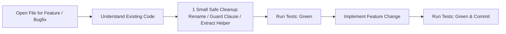

# The Boy Scout Rule & Continuous Refactoring

> **One-line summary:** Leave the campground cleaner than you found it—prevent software entropy through small, safe, incremental cleanups inside active feature work rather than risky big-bang rewrites.

| Attribute | Specification |
|---|---|
| **Level** | Core / Engineering Practice |
| **Prerequisites** | [10-what-is-good-design.md](../01-foundations/10-what-is-good-design.md), [07-solid-violations-spotting-guide.md](../02-solid-principles/07-solid-violations-spotting-guide.md) |
| **Estimated Reading Time** | 25 minutes |
| **Status** | Complete |
| **Category** | General Design Principles |
| **Also Known As** | Opportunistic Refactoring, Incremental Stewardship, Anti-Software-Rot |
| **Languages Tested** | Java 25 (LTS) / TypeScript 5.8 (Node 24 native) / Python 3.14 |

---

## Table of Contents
- [1 The Problem](#1-the-problem)
- [2 Why It Exists](#2-why-it-exists)
- [3 What It Is](#3-what-it-is)
- [4 The Problem Without It](#4-the-problem-without-it)
- [5 How It Solves It](#5-how-it-solves-it)
- [6 How It Works](#6-how-it-works)
- [7 Real-World Examples](#7-real-world-examples)
- [8 When to Use and When NOT to Use](#8-when-to-use-and-when-not-to-use)
- [9 Variations and Language Idioms](#9-variations-and-language-idioms)
- [10 Relationship to Other Principles and Patterns](#10-relationship-to-other-principles-and-patterns)
- [11 Common Mistakes and Anti-Patterns](#11-common-mistakes-and-anti-patterns)
- [12 Testing and Design Verification](#12-testing-and-design-verification)
- [13 Performance, Concurrency and Security Notes](#13-performance-concurrency-and-security-notes)
- [14 Interview Questions](#14-interview-questions)
- [15 Practice Exercises](#15-practice-exercises)
- [16 Summary / Cheat Sheet](#16-summary--cheat-sheet)
- [17 Further Reading](#17-further-reading)

---

## 1 The Problem

Over two years, a fast-growing SaaS codebase accumulates minor friction everywhere: cryptic variables named `d` or `tmp2`, 90-line nested functions, unused dead imports, and copy-pasted validation checks. Nobody wants to touch those files, so developers bolt new features *around* the mess—making each file slightly worse on every commit.

Eventually, sprint velocity collapses. Product leadership asks why simple features take 3 weeks instead of 2 days. Engineering proposes a **"6-month Refactoring Freeze / Big-Bang Rewrite."** Six months later, the rewrite is behind schedule, the legacy system still needs bug fixes, and the company suffers the classic **"Second System Effect."**

Software rots gradually, one small compromise at a time—and only continuous, small-scale stewardship prevents reaching the rewrite cliff.

---

## 2 Why It Exists

Robert C. Martin ("Uncle Bob") adapted the Boy Scouts of America motto (*"Leave the campground cleaner than you found it"*) to software craftsmanship in *Clean Code* (2008), alongside Martin Fowler's **Opportunistic Refactoring** and **Lehman's Law of Increasing Complexity** (1974):
> *"As an evolving program is continually changed, its complexity, reflecting deteriorating structure, increases unless work is done to maintain or reduce it."*

---

## 3 What It Is

The Boy Scout Rule mandates that **every time you touch a file for a feature or bugfix, you make one small, safe improvement** before committing—such as renaming a vague variable, extracting a cohesive helper, adding a guard clause, or removing dead code—**without delaying feature delivery or turning a 20-line PR into a 2,000-line diff**.



---

## 4 The Problem Without It

```java
// Legacy file untouched for 18 months: cryptic names, nested ifs, dead variables
public class BillingHelper {
    public double calc(double a, int t, boolean f) {
        double res = 0;
        int unusedFlag = 0; // dead code nobody deleted
        if (a > 0) {
            if (t == 1) {
                res = f ? a * 0.8 : a * 0.9;
            } else {
                res = a;
            }
        }
        return res;
    }
}
```
Next developer needs to add `t == 2` (corporate tier) and just adds another `else if (t == 2)` inside the deep nest, compounding the mess.

---

## 5 How It Solves It

Before adding the new tier, the developer spends 3 minutes leaving the method cleaner: deleting `unusedFlag`, adding a guard clause, and renaming `a`, `t`, `f` to domain names (`amount`, `tierCode`, `isAnnual`).

### Java Implementation (Java 25 LTS)

```java
package com.design.principles.boyscout;

public class BillingHelper {
    public double calculateDiscountedPrice(double amount, int tierCode, boolean isAnnualPlan) {
        if (amount <= 0) return 0;
        if (tierCode == 1) {
            return isAnnualPlan ? amount * 0.8 : amount * 0.9;
        }
        return amount;
    }
}
```

### TypeScript Implementation (Node 24 Native)

```typescript
export function calculateDiscountedPrice(amount: number, tierCode: number, isAnnualPlan: boolean): number {
    if (amount <= 0) return 0;
    if (tierCode === 1) return isAnnualPlan ? amount * 0.8 : amount * 0.9;
    return amount;
}
```

### Python Implementation (Python 3.14)

```python
def calculate_discounted_price(amount: float, tier_code: int, is_annual_plan: bool) -> float:
    if amount <= 0:
        return 0.0
    if tier_code == 1:
        return amount * (0.8 if is_annual_plan else 0.9)
    return amount
```

---

## 6 How It Works: The "Separate Cleanup Commit" Discipline

1. **Test Safety Net First:** Never refactor code without verifying existing tests (or adding a quick characterization test first).
2. **Keep Scope Bounded (The 15-Minute Rule):** Clean up *only* the area you are touching. Do not reformat unrelated files across the repository in a feature PR.
3. **Preparatory Refactoring (Kent Beck):** *"Make the change easy, then make the easy change."* Clean up the function in Commit 1 (pure refactor, zero behavior change), then add the feature in Commit 2.

---

## 7 Real-World Examples

### 1. Google's "Litterbug" & Readability Culture
Google engineering guidelines explicitly encourage opportunistic cleanups (fixing stale comments, tightening visibility, replacing deprecated APIs) within the scope of an active CL (changelist), keeping multi-billion-line monorepos healthy.

### 2. Martin Fowler's "Preparatory Refactoring"
Before implementing a new discount rule inside a tangled pricing method, Fowler extracts the existing calculation into clean named helpers first, commits, and then drops the new rule in cleanly in 5 lines.

### 3. Automated Dependency & Deprecation Hygiene
Upgrading one deprecated library call or removing an obsolete feature flag whenever you modify a nearby endpoint prevents massive multi-quarter "tech debt bankruptcy."

---

## 8 When to Use and When NOT to Use

| Context | Apply Boy Scout Rule? | Rationale |
|---|---|---|
| **Regular Feature / Bugfix PRs** | **Yes (Bounded)** | Small improvements compound over hundreds of PRs. |
| **3:00 AM Production Outage Hotfix** | **NO** | Keep emergency hotfixes minimal and surgical; clean up in a follow-up PR next morning. |
| **Unrelated Files / Massive Formatting Diffs** | **NO** | Polluting a feature PR with 40 touched files ruins `git blame` and blocks code reviews. |

---

## 9 Variations and Language Idioms

- **Structural vs Behavioral Commits (Kent Beck):** Keep *Tidyings* (renames, formatting, extracting private helpers) in separate commits from behavioral feature changes so reviewers can verify zero-risk refactors rapidly.
- **Automated Safe IDE Refactorings:** Use IDE `Rename Symbol`, `Extract Method`, and `Inline Variable` rather than manual find-and-replace.

---

## 10 Relationship to Other Principles and Patterns

- **Kent Beck's Tidy First?:** Modern formalization of the Boy Scout Rule—deciding *when* to tidy before vs after a behavioral change.
- **Strangler Fig Pattern:** Macro-scale incremental replacement when a legacy subsystem is too large for single-PR cleanups.

---

## 11 Common Mistakes and Anti-Patterns

| Anti-Pattern | Description | Production Consequence | Correct Remedy |
|---|---|---|---|
| **Drive-By Giant Diff** | Rewriting 30 unrelated files during a 10-line bugfix PR. | Unreviewable PR; merge conflicts; broken `git blame`. | Scope cleanups strictly to the files/functions you are touching. |
| **Refactoring Without Tests** | Renaming or restructuring legacy logic with zero test coverage. | Silent regressions in edge cases. | Write characterization tests first, then refactor. |
| **Mixing Cleanup + Feature in One Commit** | Hiding a 1-line bugfix inside a 400-line file move/rename. | Reviewers miss bugs; impossible to revert cleanly. | Separate refactor commit from feature commit. |
| **Asking Permission for Routine Hygiene** | Putting "rename variable" in a Jira backlog for 6 months instead of just doing it. | Cleanup never gets prioritized. | Treat minor hygiene as part of professional engineering craft. |
| **Gold-Plating** | Turning a simple helper into an abstract strategy factory "for cleanliness." | Violates KISS/YAGNI. | Only simplify and clarify—never invent speculative abstractions. |
| **Breaking Public Contracts** | Renaming public API fields or exported symbols without checking external consumers. | Breaks downstream clients. | Only rename private/internal symbols freely; deprecate public ones. |

---

## 12 Testing and Design Verification

Always run the test suite *between* the cleanup step and the new feature step:
1. Run tests $\to$ Green.
2. Perform Boy Scout cleanup $\to$ Run tests $\to$ Green.
3. Add new feature + new tests $\to$ Run tests $\to$ Green.

---

## 13 Performance, Concurrency and Security Notes

- **Security:** Opportunistically replacing deprecated insecure calls (e.g., `MD5` tokens or string-concatenated SQL) when touching nearby code eliminates latent vulnerabilities before audits catch them.

---

## 14 Interview Questions

<details>
<summary><strong>1. What is the Boy Scout Rule in software engineering?</strong></summary>

Popularized by Robert C. Martin, it states: *"Always leave the code you're editing cleaner than you found it."* Making small, safe improvements (better names, guard clauses, deleting dead code) during normal feature work prevents codebase rot without needing risky big-bang rewrites.
</details>

<details>
<summary><strong>2. What is "Preparatory Refactoring" (Kent Beck)?</strong></summary>

*"Make the change easy, then make the easy change."* Before forcing a new feature into messy code, you first refactor the existing structure cleanly (verified by tests), commit that refactor, and then implement the new feature cleanly on top.
</details>

<details>
<summary><strong>3. Why are "Big-Bang Rewrites" usually catastrophic failures?</strong></summary>

Big-bang rewrites freeze feature delivery for months, underestimate subtle undocumented edge cases built into legacy code over years, and create a moving target while the legacy app still evolves—often failing to ship on time or missing critical behavior.
</details>

<details>
<summary><strong>4. When should you deliberately skip the Boy Scout Rule?</strong></summary>

During urgent P0/P1 production hotfixes (where minimizing blast radius and diff size is critical) and when changes would spill into unrelated files outside the PR's scope.
</details>

<details>
<summary><strong>5. Why should structural cleanups be in a separate commit from behavioral feature changes?</strong></summary>

Separating commits allows code reviewers to verify the zero-behavior-change refactor quickly, preserves clean `git bisect` history, and makes reverting a buggy feature trivial without losing the cleanup.
</details>

<details>
<summary><strong>6. How do you safely apply the Boy Scout Rule to untested legacy code?</strong></summary>

First write **Characterization Tests** (tests that capture what the legacy code currently outputs, quirks and all), verify they pass, and *only then* perform small safe refactorings.
</details>

<details>
<summary><strong>7. How does Lehman's Law of Increasing Complexity explain why continuous refactoring is mandatory?</strong></summary>

Lehman's Law observes that as a software system evolves, its complexity naturally increases unless active work is continuously invested to reduce it. Without continuous refactoring, complexity eventually exceeds team comprehension.
</details>

<details>
<summary><strong>8. What is the difference between Boy Scout cleanup and Gold-Plating?</strong></summary>

Boy Scout cleanup *reduces* friction (deleting dead code, clarifying names, flattening nesting). Gold-plating *adds* unrequested complexity (speculative interfaces, unused config flags).
</details>

---

## 15 Practice Exercises

### Exercise 1: Identify Safe Boy Scout Improvements (Easy)
You open a file to fix a rounding bug and see: unused imports, a variable named `x1`, and a 4-level nested `if`. What 3 micro-cleanups can you safely apply in 2 minutes?

<details>
<summary><strong>Solution</strong></summary>

1. Delete unused imports.
2. Rename `x1` using IDE Rename Symbol.
3. Flatten the nested `if` with an early-return guard clause.
</details>

---

### Exercise 2: Separate Refactor Commit Plan (Medium)
You need to add a `SMS` notification branch to a 120-line `notifyUser` function. Outline the exact 2-commit sequence using Preparatory Refactoring.

<details>
<summary><strong>Solution</strong></summary>

- **Commit 1 (Refactor only):** Extract email formatting and SMTP dispatch into a private `sendEmailNotification()` helper; verify existing tests pass unchanged.
- **Commit 2 (Feature):** Add `sendSmsNotification()` and wire it into `notifyUser`, plus new unit tests.
</details>

---

### Exercise 3: Characterization Test Before Cleanup (Hard)
Before refactoring a legacy Python discount function with undocumented edge cases (`qty == 0`, negative prices), write a characterization test suite locking down current behavior before modifying any implementation lines.

<details>
<summary><strong>Solution</strong></summary>

```python
def test_legacy_discount_characterization():
    assert legacy_calc(100, 1) == 100
    assert legacy_calc(100, 10) == 90
    assert legacy_calc(100, 0) == 0
```
Once green, refactor safely knowing any accidental behavior drift fails immediately.
</details>

---

## 16 Summary / Cheat Sheet

```
+--------------------------------------------------------------------------+
|                 BOY SCOUT RULE & CONTINUOUS REFACTORING                  |
+--------------------------------------------------------------------------+
| CORE RULE      : Leave every file you touch slightly cleaner than you    |
|                  found it—one small, safe improvement at a time.         |
| SAFETY RULES   : 1. Ensure tests pass first.  2. Keep scope bounded.     |
|                  3. Separate cleanup commits from feature commits.       |
| SKIP WHEN      : 3:00 AM production hotfix (keep emergency diffs tiny).  |
+--------------------------------------------------------------------------+
```

---

## 17 Further Reading

- Robert C. Martin, *Clean Code* (Chapter 1), Prentice Hall, 2008.
- Kent Beck, *Tidy First?: A Personal Exercise in Empirical Software Design*, O'Reilly, 2023.

### In Your Language
| Language Track | Deep Dive Reference |
|---|---|
| Java | [Java OOP & Design Patterns](file:///e:/Learning/engineering-notes/01-languages/java/24-design-patterns/README.md) |
| TypeScript | [TypeScript Design Patterns](file:///e:/Learning/engineering-notes/01-languages/typescript/17-design-patterns/README.md) |
| Python | [Python Design Patterns](file:///e:/Learning/engineering-notes/01-languages/python/23-design-patterns/README.md) |

---

[← Previous: 08 - Fail-Fast Principle](file:///e:/Learning/engineering-notes/08-solid-design-patterns/03-design-principles/08-fail-fast-principle.md) | [Module 03 Index](file:///e:/Learning/engineering-notes/08-solid-design-patterns/03-design-principles/README.md) | [Next: 10 - High Cohesion & Low Coupling in Practice →](file:///e:/Learning/engineering-notes/08-solid-design-patterns/03-design-principles/10-high-cohesion-low-coupling-in-practice.md)
