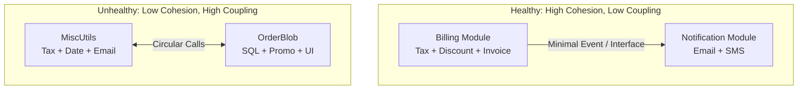

# High Cohesion & Low Coupling in Practice

> **One-line summary:** Group elements that change together for the same reason inside cohesive modules, and minimize the number and strength of connections between modules so changes stay localized.

| Attribute | Specification |
|---|---|
| **Level** | Core / Architectural |
| **Prerequisites** | [03-coupling-and-cohesion.md](../01-foundations/03-coupling-and-cohesion.md), [01-single-responsibility.md](../02-solid-principles/01-single-responsibility.md) |
| **Estimated Reading Time** | 30 minutes |
| **Status** | Complete |
| **Category** | General Design Principles |
| **Also Known As** | Larry Constantine Structured Design, Modular Cohesion |
| **Languages Tested** | Java 25 (LTS) / TypeScript 5.8 (Node 24 native) / Python 3.14 |

---

## Table of Contents
- [1 The Problem](#1-the-problem)
- [2 Why It Exists](#2-why-it-exists)
- [3 What It Is](#3-what-it-is)
- [4 The Problem Without It](#4-the-problem-without-it)
- [5 How It Solves It](#5-how-it-solves-it)
- [6 How It Works](#6-how-it-works)
- [7 Real-World Examples](#7-real-world-examples)
- [8 When to Use and When NOT to Use](#8-when-to-use-and-when-not-to-use)
- [9 Variations and Language Idioms](#9-variations-and-language-idioms)
- [10 Relationship to Other Principles and Patterns](#10-relationship-to-other-principles-and-patterns)
- [11 Common Mistakes and Anti-Patterns](#11-common-mistakes-and-anti-patterns)
- [12 Testing and Design Verification](#12-testing-and-design-verification)
- [13 Performance, Concurrency and Security Notes](#13-performance-concurrency-and-security-notes)
- [14 Interview Questions](#14-interview-questions)
- [15 Practice Exercises](#15-practice-exercises)
- [16 Summary / Cheat Sheet](#16-summary--cheat-sheet)
- [17 Further Reading](#17-further-reading)

---

## 1 The Problem

A team builds an e-commerce platform and places every helper function in `CommonUtils.java`, while splitting Checkout logic across six tightly intertwined services (`CartService`, `PromoService`, `InventoryService`, `PaymentService`, `TaxService`, `OrderService`) that all mutate shared database tables and call each other circularly.

Two opposite pathologies paralyze the team:
1. **Low Cohesion (`CommonUtils`):** `CommonUtils` has 45 unrelated methods (date parsing, CSV escaping, password hashing, invoice numbering). Every sprint touches `CommonUtils`, triggering massive merge conflicts.
2. **High Coupling (`Service Web`):** Changing `PromoService` breaks `InventoryService` and `TaxService` because they reach directly into each other's internal state and concrete implementations.

---

## 2 Why It Exists

Formulated by **Larry Constantine** in 1968 (*Structured Design*, with Ed Yourdon, 1979), **High Cohesion & Low Coupling** is the foundational metric of modular software architecture. Every principle in SOLID, GRASP, and Clean Architecture is ultimately a mechanism to maximize cohesion inside boundaries and minimize coupling across boundaries.

---

## 3 What It Is

- **Cohesion:** How strongly related the responsibilities inside a single module are. (Target: **Functional Cohesion**—everything works together toward one clear capability).
- **Coupling:** How strongly one module depends on the internal details of another. (Target: **Data/Contract Coupling** via narrow, stable interfaces).



---

## 4 The Problem Without It

```java
// Low Cohesion + High Coupling: OrderManager reaches into global static state and mixes unrelated tasks
class GlobalConfig {
    public static double taxRate = 0.08;
    public static String smtpHost = "smtp.internal";
}

class TangledOrderManager {
    public void processOrderAndFormatHtml(String item, double price) {
        double total = price * (1 + GlobalConfig.taxRate); // Common coupling to mutable global!
        String html = "<h1>Order: " + item + " $" + total + "</h1>"; // Presentation mixed with pricing!
        System.out.println("Sending via " + GlobalConfig.smtpHost + ": " + html);
    }
}
```

---

## 5 How It Solves It

Group cohesive pricing logic into `PricingEngine`, presentation into `ReceiptFormatter`, and communicate via a narrow immutable `OrderSummary` value object.

### Java Implementation (Java 25 LTS)

```java
package com.design.principles.cohesion;

record OrderSummary(String item, double netPrice, double totalWithTax) {}

// Cohesive Module 1: Pricing
class PricingEngine {
    private final double taxRate;
    public PricingEngine(double taxRate) { this.taxRate = taxRate; }
    public OrderSummary price(String item, double netPrice) {
        return new OrderSummary(item, netPrice, netPrice * (1.0 + taxRate));
    }
}

// Cohesive Module 2: Formatting (Coupled ONLY to OrderSummary data!)
class ReceiptFormatter {
    public String toText(OrderSummary summary) {
        return summary.item() + " -> Total: $" + String.format("%.2f", summary.totalWithTax());
    }
}
```

### TypeScript Implementation (Node 24 Native)

```typescript
interface OrderSummary { readonly item: string; readonly totalWithTax: number; }

class PricingEngine {
    constructor(private readonly taxRate: number) {}
    price(item: string, netPrice: number): OrderSummary {
        return { item, totalWithTax: netPrice * (1 + this.taxRate) };
    }
}

class ReceiptFormatter {
    toText(summary: OrderSummary): string {
        return `${summary.item} -> Total: $${summary.totalWithTax.toFixed(2)}`;
    }
}
```

### Python Implementation (Python 3.14)

```python
from dataclasses import dataclass

@dataclass(frozen=True)
class OrderSummary:
    item: str
    total_with_tax: float

class PricingEngine:
    def __init__(self, tax_rate: float) -> None:
        self._tax_rate = tax_rate

    def price(self, item: str, net_price: float) -> OrderSummary:
        return OrderSummary(item, net_price * (1.0 + self._tax_rate))

class ReceiptFormatter:
    def to_text(self, summary: OrderSummary) -> str:
        return f"{summary.item} -> Total: ${summary.total_with_tax:.2f}"
```

---

## 6 How It Works: Coupling & Cohesion Trade-off

Reducing coupling **too far** inside a single cohesive domain creates fragmentation (Shotgun Surgery). The right boundary is **Connascence & Change-Cohesion**: things that change together belong inside the same module; things that change for different reasons belong in separate modules connected by minimal contracts.

---

## 7 Real-World Examples

### 1. Unix Pipes (`grep | sort | uniq`)
Each tool has maximal cohesion (one job) and minimal coupling (plain UTF-8 lines over `stdin`/`stdout`).

### 2. Event-Driven Microservices (Domain Events)
Order Service emits `OrderPlaced(orderId, total)`. Analytics, Loyalty, and Email services subscribe independently without `OrderService` knowing they exist.

### 3. React Custom Hooks & Components
Cohesive UI state + markup lives inside a component; external API fetching is decoupled behind a clean hook or service boundary.

---

## 8 When to Use and When NOT to Use

| Context | Action | Rationale |
|---|---|---|
| **Module / Package Boundaries** | **Enforce High Cohesion, Low Coupling** | Isolates blast radius of changes. |
| **Intra-Module Helpers** | **Allow Tighter Collaboration** | Inside one cohesive module (e.g. `BTree` and `BTreeNode`), tighter coupling is normal and healthy. |

---

## 9 Variations and Language Idioms

- **Connascence (Meilir Page-Jones):** A modern refinement of coupling measuring *strength*, *degree*, and *locality* (e.g., Connascence of Name is weak; Connascence of Position or Execution Order is strong).
- **LCOM (Lack of Cohesion of Methods):** Static analysis metric measuring whether methods in a class actually share instance fields.

---

## 10 Relationship to Other Principles and Patterns

- **SRP & ISP:** Directly enforce cohesion (SRP) and narrow coupling contracts (ISP).
- **Package Principles (CCP, ADP):** Scale cohesion and coupling to JAR/npm/Python packages.

---

## 11 Common Mistakes and Anti-Patterns

| Anti-Pattern | Description | Production Consequence | Correct Remedy |
|---|---|---|---|
| **Coincidental Cohesion (`Utils`)** | Dumping unrelated static helpers into one class. | Merge conflicts and bloated transitive imports. | Move helpers to domain-specific modules. |
| **Temporal Cohesion** | Grouping unrelated tasks just because they run at startup (`initEverything()`). | Tightly couples DB, logging, and UI initialization. | Group by domain/actor, not execution time. |
| **Content / Common Coupling** | Sharing mutable global singletons across modules. | Hidden data races and spooky side effects. | Pass explicit immutable dependencies. |
| **Circular Module Dependencies** | Package A imports B, and B imports A. | Impossible to test or deploy independently. | Break cycle with DIP interface or event. |
| **Over-Fragmentation** | Splitting one cohesive 80-line algorithm into 12 tiny files. | Shotgun surgery; hard to read. | Keep cohesive steps together. |
| **Control Coupling** | Passing flag parameters (`doX(data, MODE_B)`) dictating internal control flow. | Caller knows internal branching logic. | Split into explicit methods or strategies. |

---

## 12 Testing and Design Verification

High cohesion + low coupling lets you test `PricingEngine` and `ReceiptFormatter` completely independently without mocks.

---

## 13 Performance, Concurrency and Security Notes

- **Concurrency:** Low coupling via immutable data contracts (`OrderSummary`) eliminates shared mutable state across threads.

---

## 14 Interview Questions

<details>
<summary><strong>1. Define Cohesion and Coupling in one sentence each.</strong></summary>

**Cohesion** measures how closely related the responsibilities inside a single module are; **Coupling** measures how strongly one module depends on the internal details of another.
</details>

<details>
<summary><strong>2. Why is "High Cohesion, Low Coupling" considered the master goal of modular design?</strong></summary>

High cohesion ensures related changes stay localized in one place, while low coupling ensures changing one module does not cascade breakages into unrelated modules.
</details>

<details>
<summary><strong>3. What is Coincidental Cohesion vs Functional Cohesion?</strong></summary>

**Coincidental Cohesion** (worst) groups unrelated utilities together arbitrarily (`MiscUtils`). **Functional Cohesion** (best) groups elements that all contribute to executing one well-defined domain capability.
</details>

<details>
<summary><strong>4. What is Temporal Cohesion?</strong></summary>

Grouping unrelated operations together purely because they execute at the same time (e.g., `onStartup()` initializing logging, database pools, and UI themes in one monolithic function).
</details>

<details>
<summary><strong>5. How does Connascence refine Coupling?</strong></summary>

Connascence classifies coupling by **strength** (e.g., Name < Type < Meaning < Position < Execution Order) and **locality**—teaching that stronger coupling is acceptable *inside* a cohesive module, while *across* module boundaries only weak coupling (Name/Type) should exist.
</details>

<details>
<summary><strong>6. What happens when you push Low Coupling too far inside a cohesive module?</strong></summary>

You get **Shotgun Surgery** and over-fragmentation: a single logical task is smeared across 15 disconnected micro-files, increasing indirection without reducing real change risk.
</details>

<details>
<summary><strong>7. How do Domain Events achieve Low Coupling across microservices?</strong></summary>

The producer publishes an immutable event (`OrderPaid`) without knowing which downstream consumers subscribe, completely eliminating compile-time and runtime coupling to consumers.
</details>

<details>
<summary><strong>8. How does LCOM (Lack of Cohesion of Methods) help spot God Classes?</strong></summary>

LCOM measures how many disjoint subsets of instance fields exist in a class. If half the methods only touch fields A/B and the other half only touch fields C/D, LCOM is high—proving the class should be split in two.
</details>

---

## 15 Practice Exercises

### Exercise 1: Classify Cohesion Type (Easy)
A class `StartupTasks` contains `connectDatabase()`, `loadCssTheme()`, and `scheduleLogRotation()`. What type of cohesion is this, and how should it be fixed?

<details>
<summary><strong>Solution</strong></summary>

**Temporal Cohesion** (grouped only because they run at startup). Split into `DatabaseInitializer`, `ThemeLoader`, and `LogScheduler`.
</details>

---

### Exercise 2: Break Circular Coupling (Medium)
`OrderService` calls `CustomerService.addLoyaltyPoints()`, and `CustomerService` calls `OrderService.getTotalSpent()`. Break this circular dependency using DIP or Domain Events.

<details>
<summary><strong>Solution</strong></summary>

Extract a `CustomerSpendingQuery` interface or have `OrderService` emit an `OrderCompleted` event that `LoyaltyHandler` subscribes to—eliminating the cycle completely.
</details>

---

### Exercise 3: Split Low-Cohesion `UserHelper` (Hard)
Split a class holding `hashPassword()`, `formatDisplayName()`, `sendResetEmail()`, and `saveToPostgres()` into cohesive modules communicating via immutable `UserRecord`.

<details>
<summary><strong>Solution</strong></summary>

Extract `PasswordHasher`, `UserFormatter`, `AuthEmailSender`, and `UserRepository`, each taking only `UserRecord` or primitive inputs.
</details>

---

## 16 Summary / Cheat Sheet

```
+--------------------------------------------------------------------------+
|                   HIGH COHESION & LOW COUPLING                           |
+--------------------------------------------------------------------------+
| HIGH COHESION  : Keep elements that change together inside one boundary. |
| LOW COUPLING   : Connect modules via minimal, stable data/interface      |
|                  contracts—never global state or internal details.       |
| WORST SMELLS   : CommonUtils (coincidental), A <-> B cycles, Globals.    |
+--------------------------------------------------------------------------+
```

---

## 17 Further Reading

- Ed Yourdon & Larry Constantine, *Structured Design*, Prentice Hall, 1979.
- Meilir Page-Jones, *What Every Programmer Should Know About Object-Oriented Design*, Dorset House, 1995.

### In Your Language
| Language Track | Deep Dive Reference |
|---|---|
| Java | [Java OOP & Design Patterns](file:///e:/Learning/engineering-notes/01-languages/java/24-design-patterns/README.md) |
| TypeScript | [TypeScript Design Patterns](file:///e:/Learning/engineering-notes/01-languages/typescript/17-design-patterns/README.md) |
| Python | [Python Design Patterns](file:///e:/Learning/engineering-notes/01-languages/python/23-design-patterns/README.md) |

---

[← Previous: 09 - Boy Scout Rule](file:///e:/Learning/engineering-notes/08-solid-design-patterns/03-design-principles/09-boy-scout-rule-and-continuous-refactoring.md) | [Module 03 Index](file:///e:/Learning/engineering-notes/08-solid-design-patterns/03-design-principles/README.md) | [Next: 11 - Orthogonality →](file:///e:/Learning/engineering-notes/08-solid-design-patterns/03-design-principles/11-orthogonality.md)
