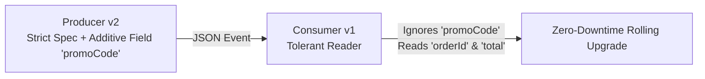

# Postel's Law (The Robustness Principle)

> **One-line summary:** Be conservative in what you send, be liberal in what you accept—enable backward-compatible schema and protocol evolution while knowing where strict rejection is mandatory for security and data integrity.

| Attribute | Specification |
|---|---|
| **Level** | Intermediate / Distributed & API Design |
| **Prerequisites** | [08-fail-fast-principle.md](08-fail-fast-principle.md), [07-principle-of-least-astonishment.md](07-principle-of-least-astonishment.md) |
| **Estimated Reading Time** | 30 minutes |
| **Status** | Complete |
| **Category** | General Design Principles |
| **Also Known As** | The Robustness Principle, Tolerant Reader Pattern (Martin Fowler) |
| **Languages Tested** | Java 25 (LTS) / TypeScript 5.8 (Node 24 native) / Python 3.14 |

---

## Table of Contents
- [1 The Problem](#1-the-problem)
- [2 Why It Exists](#2-why-it-exists)
- [3 What It Is](#3-what-it-is)
- [4 The Problem Without It](#4-the-problem-without-it)
- [5 How It Solves It](#5-how-it-solves-it)
- [6 How It Works](#6-how-it-works)
- [7 Real-World Examples](#7-real-world-examples)
- [8 When to Use and When NOT to Use](#8-when-to-use-and-when-not-to-use)
- [9 Variations and Language Idioms](#9-variations-and-language-idioms)
- [10 Relationship to Other Principles and Patterns](#10-relationship-to-other-principles-and-patterns)
- [11 Common Mistakes and Anti-Patterns](#11-common-mistakes-and-anti-patterns)
- [12 Testing and Design Verification](#12-testing-and-design-verification)
- [13 Performance, Concurrency and Security Notes](#13-performance-concurrency-and-security-notes)
- [14 Interview Questions](#14-interview-questions)
- [15 Practice Exercises](#15-practice-exercises)
- [16 Summary / Cheat Sheet](#16-summary--cheat-sheet)
- [17 Further Reading](#17-further-reading)

---

## 1 The Problem

Imagine an Order Service sending JSON events to an Analytics Service over Kafka. Initially, the event contains `{ "orderId": "ORD-1", "total": 99.50 }`.

During a rolling deployment, the Order Service team adds a new optional metadata field: `{ "orderId": "ORD-1", "total": 99.50, "promoCode": "SPRING" }`.

Because the Analytics Service configured its JSON deserializer with `FAIL_ON_UNKNOWN_PROPERTIES = true` (strict schema rejection), **every single event crashes the Analytics consumer at midnight**, backing up 2 million messages in Kafka until an emergency rollback is executed.

Conversely, in a later security incident, a developer makes an authentication parser *too* liberal—accepting malformed whitespace inside HTTP `Content-Length` headers—opening an HTTP Request Smuggling vulnerability! Understanding **where** to be tolerant (schema evolution) and **where** to be strict (security & invariants) is essential.

---

## 2 Why It Exists

Formulated by internet pioneer **Jon Postel** in **RFC 761 (TCP, 1980)**:
> *"Be conservative in what you do, be liberal in what you accept from others."*

In decentralized networks where independent teams deploy on independent schedules, requiring simultaneous lock-step upgrades across every producer and consumer is impossible. Postel's Law—later adapted into **Martin Fowler's Tolerant Reader Pattern**—allows distributed systems to evolve gracefully without breaking existing integrations.

---

## 3 What It Is

Postel's Law has two halves:
1. **Conservative Sender (Strict Writer):** Always emit clean, canonical, spec-compliant payloads with zero undocumented quirks or dirty formatting.
2. **Liberal Receiver (Tolerant Reader):** Ignore unrecognized additive fields, tolerate harmless casing/whitespace variations where safe, and extract only what you need—**while still failing fast on corrupted required invariants or security violations**.



---

## 4 The Problem Without It

```java
// Fragile Consumer: Crashes whenever an upstream producer adds any new JSON field!
record StrictOrderEvent(String orderId, double total) {
    static StrictOrderEvent parseStrict(java.util.Map<String, Object> payload) {
        if (payload.size() > 2) {
            throw new IllegalArgumentException("Unexpected extra fields in payload!");
        }
        return new StrictOrderEvent((String) payload.get("orderId"), (double) payload.get("total"));
    }
}
```

---

## 5 How It Solves It

Use a **Tolerant Reader**: validate required fields strictly (`Fail-Fast`), while ignoring unknown additive properties (`Postel's Law`).

### Java Implementation (Java 25 LTS)

```java
package com.design.principles.postel;

import java.util.Map;

record OrderEvent(String orderId, double total) {
    // Tolerant Reader: Validates required invariants strictly, ignores unknown additive fields
    public static OrderEvent fromPayload(Map<String, Object> payload) {
        if (payload == null || !payload.containsKey("orderId") || !payload.containsKey("total")) {
            throw new IllegalArgumentException("Missing required orderId or total");
        }
        String orderId = String.valueOf(payload.get("orderId")).trim();
        double total = ((Number) payload.get("total")).doubleValue();
        if (orderId.isEmpty() || total < 0) {
            throw new IllegalArgumentException("Invalid order invariants");
        }
        return new OrderEvent(orderId, total);
    }
}
```

### TypeScript Implementation (Node 24 Native)

```typescript
interface OrderEvent {
    readonly orderId: string;
    readonly total: number;
}

export function parseOrderEvent(payload: Record<string, unknown>): OrderEvent {
    if (typeof payload.orderId !== "string" || !payload.orderId.trim()) {
        throw new Error("Missing or invalid orderId");
    }
    if (typeof payload.total !== "number" || payload.total < 0) {
        throw new Error("Missing or invalid total");
    }
    // Ignores any unknown additive fields like payload.promoCode!
    return { orderId: payload.orderId.trim(), total: payload.total };
}
```

### Python Implementation (Python 3.14)

```python
from dataclasses import dataclass
from typing import Any

@dataclass(frozen=True)
class OrderEvent:
    order_id: str
    total: float

def parse_order_event(payload: dict[str, Any]) -> OrderEvent:
    order_id = payload.get("orderId")
    total = payload.get("total")
    if not isinstance(order_id, str) or not order_id.strip():
        raise ValueError("Missing or invalid orderId")
    if not isinstance(total, (int, float)) or total < 0:
        raise ValueError("Missing or invalid total")
    # Ignores extra keys gracefully
    return OrderEvent(order_id=order_id.strip(), total=float(total))
```

---

## 6 How It Works: The Modern Critique (RFC 9413)

Modern IETF guidance (**RFC 9413: *Maintaining Robust Protocols***, Martin Thomson & David Schinazi, 2023) highlights an essential caveat to Postel's Law:
- **The Ecosystem Decay Trap:** If receivers silently tolerate *broken* protocol syntax (like malformed HTTP headers or invalid TLS bytes), buggy senders never notice their bugs—forcing every future receiver to implement the same messy workarounds forever, and creating **parser-differential security exploits** (like HTTP Request Smuggling or HTML XSS quirks).
- **The Modern Synthesis:**
  - **Syntax & Security Boundaries:** Be **strict** (reject malformed syntax, ambiguous encodings, or invalid signatures).
  - **Schema Extensibility:** Be **tolerant** of explicitly designed extension points (unknown JSON keys, unknown HTTP headers, newer optional Protobuf fields).

---

## 7 Real-World Examples

### 1. Protobuf & gRPC Forward Compatibility
Protocol Buffers explicitly embeds Postel's Law: generated parsers silently preserve/ignore unknown field tags added by newer producers, allowing zero-downtime rolling upgrades across thousands of microservices.

### 2. HTML5 Browser Parsing vs XML Strictness
Early browsers liberally rendered broken HTML (`<b><i>text</b></i>`), enabling the rapid growth of the web—though causing decades of cross-browser quirk bugs until HTML5 standardized exact error-recovery rules.

### 3. Jackson `@JsonIgnoreProperties(ignoreUnknown = true)`
In Java/Spring microservices, configuring DTOs to ignore unknown JSON fields prevents downstream consumers from breaking whenever an upstream service adds a new response field.

---

## 8 When to Use and When NOT to Use

| Context | Postel's Law? | Rationale |
|---|---|---|
| **Additive JSON / Protobuf Schema Fields** | **Yes (Tolerant Reader)** | Enables independent microservice deployments. |
| **User Input Whitespace Trimming** | **Yes** | Trimming accidental spaces on `" alice@test.com "` improves UX safely. |
| **Cryptography / Auth / HTTP Framing** | **NO (Strict Fail-Fast)** | Tolerating malformed signatures or ambiguous headers causes critical CVEs. |
| **Financial / Core Invariants** | **NO (Strict Fail-Fast)** | Never guess or coerce negative or missing monetary amounts. |

---

## 9 Variations and Language Idioms

- **Jackson (`FAIL_ON_UNKNOWN_PROPERTIES = false`):** Standard tolerant JSON parsing in Java.
- **Pydantic (`model_config = ConfigDict(extra="ignore")`):** Standard tolerant schema parsing in Python.
- **Zod (`.strip()` vs `.strict()`):** Zod defaults to stripping unknown keys cleanly while strictly validating required types.

---

## 10 Relationship to Other Principles and Patterns

- **Fail-Fast Principle:** Direct tension—Fail-Fast guards *invariants & security*, while Postel's Law guards *additive schema evolution*.
- **Open/Closed Principle (OCP):** Tolerant Readers keep API consumers closed for modification when producers extend schemas additively.

---

## 11 Common Mistakes and Anti-Patterns

| Anti-Pattern | Description | Production Consequence | Correct Remedy |
|---|---|---|---|
| **Strict Unknown-Field Rejection on Public APIs** | Failing JSON deserialization when a producer adds a harmless optional field. | Breaks consumers during rolling deployments. | Ignore unknown fields (`ignoreUnknown = true`). |
| **Tolerating Malformed Security Headers** | Allowing ambiguous duplicate `Content-Length` headers instead of returning `400`. | HTTP Request Smuggling CVE. | Reject ambiguous framing strictly per RFC. |
| **Silent Data Coercion** | Coercing `"abc"` or `null` into `0` instead of failing. | Silent financial corruption. | Fail fast on invalid types for required fields. |
| **Emitting Sloppy Output ("Someone else will parse it")** | Emitting unescaped strings or invalid ISO dates because the receiver fixes them. | Violates "Conservative in what you send"; breaks strict clients. | Always emit canonical, spec-compliant payloads. |
| **Schema-Less `Map<String, Object>` Everywhere** | Accepting untyped bags without validating required fields. | Delayed `NullPointerException` downstream. | Validate required fields strictly; tolerate only extra fields. |
| **Assuming All Clients Upgraded Together** | Removing or renaming required JSON fields in one deploy. | Breaks older mobile/API clients. | Add new fields alongside old ones; deprecate gradually. |

---

## 12 Testing and Design Verification

Test both halves explicitly:
1. Producer sends valid canonical payload (strict writer test).
2. Consumer parses a payload containing extra future fields cleanly (`{"orderId":"1","total":10,"futureField":true}`), while still throwing on missing `orderId`.

---

## 13 Performance, Concurrency and Security Notes

- **Security (Parser Differentials):** Never apply Postel's Law to security parsers (JWTs, XML/HTML sanitizers, HTTP proxies, firewall rules). Ambiguity between two parsers ("one accepts, one rejects") is the root cause of request smuggling and WAF bypasses.

---

## 14 Interview Questions

<details>
<summary><strong>1. State Postel's Law and explain both halves.</strong></summary>

*"Be conservative in what you send, be liberal in what you accept."* Senders must emit strictly valid, canonical outputs; receivers should tolerate harmless variations and unknown additive extensions without crashing.
</details>

<details>
<summary><strong>2. What is Martin Fowler's "Tolerant Reader" pattern?</strong></summary>

An application of Postel's Law to API/event consumers: read only the specific fields your service needs and ignore unknown extra fields, rather than tightly binding to the entire producer schema.
</details>

<details>
<summary><strong>3. What is the modern security criticism of Postel's Law (RFC 9413)?</strong></summary>

RFC 9413 warns that silently accepting *malformed* protocol syntax hides sender bugs, entrenches technical debt across the ecosystem, and creates **parser differential vulnerabilities** (e.g., HTTP Request Smuggling) when proxies and backends interpret ambiguous inputs differently.
</details>

<details>
<summary><strong>4. How do you reconcile Postel's Law with Fail-Fast?</strong></summary>

Apply **Postel's Law** to *additive schema evolution* (ignoring unknown JSON fields) and harmless formatting (trimming whitespace), while applying **Fail-Fast** to *required domain invariants, invalid types, and security boundaries*.
</details>

<details>
<summary><strong>5. How does Protobuf achieve Postel's Law natively?</strong></summary>

Protobuf tags every field with a numeric ID and wire type. Older consumers encountering unfamiliar field numbers skip them cleanly using their wire length without failing deserialization.
</details>

<details>
<summary><strong>6. Why is `FAIL_ON_UNKNOWN_PROPERTIES = true` dangerous in microservice architectures?</strong></summary>

It creates **temporal coupling**: if Producer v2 adds one optional field during a rolling deployment, every Consumer v1 immediately crashes until upgraded.
</details>

<details>
<summary><strong>7. Why should you still be "Conservative in what you send"?</strong></summary>

Emitting sloppy or non-standard output shifts debugging burden onto every consumer and guarantees failure when interacting with strict standards-compliant parsers.
</details>

<details>
<summary><strong>8. Give an example where being "liberal in what you accept" causes a vulnerability.</strong></summary>

Accepting JWT tokens with `"alg": "none"`, accepting duplicate `Host` or `Content-Length` HTTP headers, or tolerating invalid UTF-8 overlong encodings in path traversal filters.
</details>

---

## 15 Practice Exercises

### Exercise 1: Tolerant vs Strict Boundary Triage (Easy)
Which of these should be **Tolerated** vs **Rejected Strictly**?
1. Extra `"debugTraceId"` field in a webhook JSON payload.
2. Negative `quantity: -3` in an order item.
3. Trailing whitespace `"  user@example.com  "` on a login form.

<details>
<summary><strong>Solution</strong></summary>

1. **Tolerate & ignore** (additive schema evolution).
2. **Reject strictly (Fail-Fast)** (violates domain invariant).
3. **Tolerate & trim** (harmless user input UX).
</details>

---

### Exercise 2: Fix Fragile JSON Consumer in TypeScript (Medium)
Update a strict parser that rejects any object with `Object.keys(payload).length !== 2` so it tolerates extra fields while strictly validating `id: string` and `amount: number`.

<details>
<summary><strong>Solution</strong></summary>

Validate `typeof payload.id === "string"` and `typeof payload.amount === "number" && payload.amount >= 0`, and return `{ id: payload.id, amount: payload.amount }` without checking total key count.
</details>

---

### Exercise 3: Design Zero-Downtime Event Evolution in Python (Hard)
Write a Python `parse_v1_user` function and unit tests verifying both backward compatibility with v2 payloads (containing extra `role` and `region` keys) and strict rejection when `user_id` is missing or invalid.

<details>
<summary><strong>Solution</strong></summary>

```python
def parse_v1_user(data: dict) -> dict:
    uid = data.get("user_id")
    if not isinstance(uid, str) or not uid:
        raise ValueError("Missing valid user_id")
    return {"user_id": uid}

assert parse_v1_user({"user_id": "u1", "role": "admin"}) == {"user_id": "u1"}
```
</details>

---

## 16 Summary / Cheat Sheet

```
+--------------------------------------------------------------------------+
|                 POSTEL'S LAW (THE ROBUSTNESS PRINCIPLE)                  |
+--------------------------------------------------------------------------+
| CORE RULE      : Be conservative in what you send; liberal in what you   |
|                  accept.                                                 |
| TOLERATE       : Unknown additive JSON/Protobuf fields, benign whitespace|
| REJECT STRICTLY: Invalid required invariants, security/auth ambiguity,   |
|                  malformed protocol framing (RFC 9413).                  |
| PATTERN        : Tolerant Reader (Martin Fowler).                        |
+--------------------------------------------------------------------------+
```

---

## 17 Further Reading

- Jon Postel, *RFC 761: Transmission Control Protocol*, 1980.
- Martin Thomson & David Schinazi, *RFC 9413: Maintaining Robust Protocols*, 2023.
- Martin Fowler, *TolerantReader*, martinfowler.com/bliki/TolerantReader.html, 2011.

### In Your Language
| Language Track | Deep Dive Reference |
|---|---|
| Java | [Java OOP & Design Patterns](file:///e:/Learning/engineering-notes/01-languages/java/24-design-patterns/README.md) |
| TypeScript | [TypeScript Design Patterns](file:///e:/Learning/engineering-notes/01-languages/typescript/17-design-patterns/README.md) |
| Python | [Python Design Patterns](file:///e:/Learning/engineering-notes/01-languages/python/23-design-patterns/README.md) |

---

[← Previous: 11 - Orthogonality](file:///e:/Learning/engineering-notes/08-solid-design-patterns/03-design-principles/11-orthogonality.md) | [Module 03 Index](file:///e:/Learning/engineering-notes/08-solid-design-patterns/03-design-principles/README.md) | [Next: 13 - Hollywood Principle & IoC →](file:///e:/Learning/engineering-notes/08-solid-design-patterns/03-design-principles/13-hollywood-principle-and-inversion-of-control.md)
