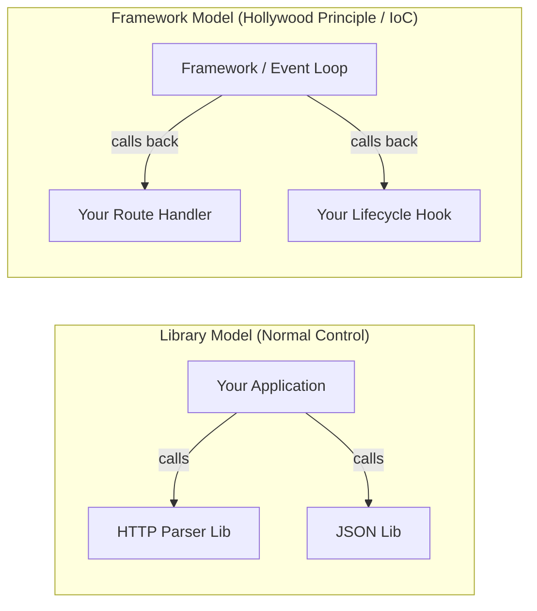

# Hollywood Principle & Inversion of Control (IoC)

> **One-line summary:** "Don't call us, we'll call you"—frameworks and high-level coordinators own the execution lifecycle and invoke pluggable domain hooks, eliminating duplicated boilerplate and cyclic dependencies.

| Attribute | Specification |
|---|---|
| **Level** | Intermediate / Architectural |
| **Prerequisites** | [05-dependency-inversion.md](../02-solid-principles/05-dependency-inversion.md), [02-open-closed.md](../02-solid-principles/02-open-closed.md) |
| **Estimated Reading Time** | 30 minutes |
| **Status** | Complete |
| **Category** | General Design Principles |
| **Also Known As** | Don't Call Us We'll Call You, Callback Inversion, Framework Lifecycle |
| **Languages Tested** | Java 25 (LTS) / TypeScript 5.8 (Node 24 native) / Python 3.14 |

---

## Table of Contents
- [1 The Problem](#1-the-problem)
- [2 Why It Exists](#2-why-it-exists)
- [3 What It Is](#3-what-it-is)
- [4 The Problem Without It](#4-the-problem-without-it)
- [5 How It Solves It](#5-how-it-solves-it)
- [6 How It Works](#6-how-it-works)
- [7 Real-World Examples](#7-real-world-examples)
- [8 When to Use and When NOT to Use](#8-when-to-use-and-when-not-to-use)
- [9 Variations and Language Idioms](#9-variations-and-language-idioms)
- [10 Relationship to Other Principles and Patterns](#10-relationship-to-other-principles-and-patterns)
- [11 Common Mistakes and Anti-Patterns](#11-common-mistakes-and-anti-patterns)
- [12 Testing and Design Verification](#12-testing-and-design-verification)
- [13 Performance, Concurrency and Security Notes](#13-performance-concurrency-and-security-notes)
- [14 Interview Questions](#14-interview-questions)
- [15 Practice Exercises](#15-practice-exercises)
- [16 Summary / Cheat Sheet](#16-summary--cheat-sheet)
- [17 Further Reading](#17-further-reading)

---

## 1 The Problem

In a traditional procedural script or library-driven program, **your application code sits in the driver's seat**: it opens sockets, runs the `while (true)` event loop, parses HTTP framing, manages thread pools, handles shutdown signals, and calls helper libraries manually.

When a team writes 12 microservices this way, every service copies 400 lines of identical HTTP server startup, graceful shutdown, health-check registration, and exception-handling boilerplate. Worse, when a security patch is required in the HTTP request lifecycle, all 12 services must be manually edited.

**Inversion of Control (IoC)** flips the relationship: a framework or high-level orchestrator owns the lifecycle loop and invokes *your* domain handlers when events occur.

---

## 2 Why It Exists

Coined in the 1980s (MacApp framework, later popularized by Ralph Johnson, Richard Sweet, and the Gang of Four in 1994), the **Hollywood Principle** (*"Don't call us, we'll call you"*) defines the fundamental boundary between a **Library** and a **Framework**:
- **Library:** You call the library's functions (`Math.max()`, `json.loads()`). *Your code is in control.*
- **Framework:** The framework owns the main execution loop and calls *your* registered handlers/hooks (`@GetMapping`, React `useEffect`, FastAPI `@app.get`). *The framework is in control.*

---

## 3 What It Is

Inversion of Control transfers runtime flow-control from custom domain code to a reusable coordinator (framework, template method, or event loop), preventing **cyclic dependencies** between low-level hooks and high-level workflows.



---

## 4 The Problem Without It

```java
// Without IoC: Every job duplicates setup, transaction boundary, error handling, and teardown!
class CsvImportJob {
    public void run() {
        System.out.println("1. Acquire DB lock & begin transaction");
        try {
            System.out.println("2. Importing CSV rows...");
            System.out.println("3. Commit transaction");
        } catch (Exception e) {
            System.out.println("Rollback transaction");
        } finally {
            System.out.println("4. Release DB lock");
        }
    }
}
```

---

## 5 How It Solves It

A high-level `JobRunner` (or Template Method / Callback Coordinator) owns the lifecycle (lock, transaction, rollback, release) and calls the domain hook when ready.

### Java Implementation (Java 25 LTS)

```java
package com.design.principles.hollywood;

@FunctionalInterface
interface JobTask {
    void execute();
}

// High-level coordinator owns lifecycle ("Don't call us, we'll call you")
class JobRunner {
    public void runInTransaction(JobTask task) {
        System.out.println("JobRunner: Begin transaction");
        try {
            task.execute(); // IoC callback into domain code!
            System.out.println("JobRunner: Commit transaction");
        } catch (RuntimeException e) {
            System.out.println("JobRunner: Rollback transaction (" + e.getMessage() + ")");
        }
    }
}

public class HollywoodApp {
    public static void main(String[] args) {
        new JobRunner().runInTransaction(() -> System.out.println("Java Domain: Importing CSV rows"));
    }
}
```

### TypeScript Implementation (Node 24 Native)

```typescript
function runInTransaction(task: () => void): void {
    console.log("JobRunner: Begin transaction");
    try {
        task();
        console.log("JobRunner: Commit transaction");
    } catch (e: any) {
        console.log(`JobRunner: Rollback (${e.message})`);
    }
}

runInTransaction(() => console.log("TS Domain: Importing CSV rows"));
```

### Python Implementation (Python 3.14)

```python
from typing import Callable

def run_in_transaction(task: Callable[[], None]) -> None:
    print("JobRunner: Begin transaction")
    try:
        task()
        print("JobRunner: Commit transaction")
    except Exception as e:
        print(f"JobRunner: Rollback ({e})")

if __name__ == "__main__":
    run_in_transaction(lambda: print("Python Domain: Importing CSV rows"))
```

---

## 6 How It Works

IoC appears in four primary runtime forms:
1. **Callbacks / Lambdas:** Passing a handler function to `array.map()`, `button.onClick()`, or `runInTransaction()`.
2. **Template Method:** Base class implements the skeleton algorithm and invokes abstract subclass hooks.
3. **IoC Containers (Spring, NestJS, FastAPI):** Container instantiates, wires, and invokes controllers/listeners on HTTP requests.
4. **Event Loops & Reactive Streams:** Node.js libuv / Netty invokes registered callbacks when I/O completes.

---

## 7 Real-World Examples

### 1. Spring Boot & NestJS Web Controllers
You never write `main()` HTTP socket loops—you annotate `@RestController` / `@Controller` and the framework invokes your method when a matching HTTP request arrives.

### 2. JUnit / Pytest Test Runners
You don't write a `for` loop calling `test1()`, `test2()`. You annotate `@Test` (or prefix `def test_`), and the runner discovers, isolates, executes, and reports results.

### 3. React Component Lifecycle
You write declarative JSX and hooks; React's reconciliation engine decides *when* to call your render function and `useEffect` callbacks.

---

## 8 When to Use and When NOT to Use

| Context | Library (Direct Control) vs Framework (IoC) | Rationale |
|---|---|---|
| **HTTP Routing, DI Wiring, Test Runners** | **Framework / IoC** | Eliminates duplicated lifecycle, threading, and error-handling plumbing. |
| **Pure Utilities (Math, JSON, Date Formatting)** | **Library** | Calling `Math.round()` directly is simpler and keeps your code framework-agnostic. |
| **Core Domain Business Logic** | **Keep Framework-Free!** | Don't let Spring/React IoC annotations pollute pure domain entities (DIP). |

---

## 9 Variations and Language Idioms

- **Java:** `@FunctionalInterface` lambdas, Template Method abstract classes, Spring IoC.
- **TypeScript:** Event listeners, Promise `.then()`, NestJS decorators.
- **Python:** Context managers (`with transaction():`), decorators (`@app.route`), `pytest` fixtures.

---

## 10 Relationship to Other Principles and Patterns

- **DIP & DI:** IoC is the *runtime control flow* inversion; DIP is the *compile-time source dependency* inversion; DI is the *wiring pattern*.
- **Template Method & Observer & Strategy:** GoF patterns built directly on the Hollywood Principle.

---

## 11 Common Mistakes and Anti-Patterns

| Anti-Pattern | Description | Production Consequence | Correct Remedy |
|---|---|---|---|
| **Framework Lock-In in Domain** | Putting `@Autowired`, `@Entity`, or Express `req`/`res` inside core business rules. | Cannot reuse domain logic outside the framework. | Keep domain logic plain POJOs/functions; wire at the outer layer. |
| **Callback Hell (Pyramid of Doom)** | Nesting 6 levels of asynchronous callbacks. | Unreadable error handling and control flow. | Use `async/await` or Promises. |
| **Subclasses Calling Superclass Loops** | Low-level hook reaching back up to manipulate the framework's lifecycle directly. | Re-entrancy bugs and infinite recursion. | Respect one-way downward invocation from coordinator to hook. |
| **Over-Abstracted Homegrown Frameworks** | Writing a custom IoC reflection framework for a small app. | Magic debugging nightmares. | Use simple functions/constructors or battle-tested frameworks. |
| **Hidden Thread-Local Magic** | Relying on implicit global context variables instead of explicit parameters. | Breaks in async/reactive/virtual-thread pools unless propagated carefully. | Pass context explicitly where possible. |
| **Ignoring Lifecycle Cleanup** | Registering callbacks/listeners without unsubscribing on teardown. | Memory leaks in long-running processes. | Pair registration with cleanup hooks. |

---

## 12 Testing and Design Verification

Testing IoC callbacks cleanly means testing the domain task **independently** of the framework container:
`new CsvImportTask().execute()` runs as a plain unit test without booting Spring or Node HTTP servers.

---

## 13 Performance, Concurrency and Security Notes

- **Performance:** Reflection-based IoC containers add startup latency; compile-time DI (Micronaut, Dagger, manual factories) avoids runtime reflection overhead.

---

## 14 Interview Questions

<details>
<summary><strong>1. What is the Hollywood Principle ("Don't call us, we'll call you")?</strong></summary>

It is the core principle behind Inversion of Control: high-level coordinators or frameworks own the control loop and lifecycle, calling into low-level domain hooks when needed—rather than low-level code calling upward or managing boilerplate loops itself.
</details>

<details>
<summary><strong>2. What is the fundamental difference between a Library and a Framework?</strong></summary>

Your application code calls a **Library** (you control the flow). A **Framework** calls your application code (the framework controls the flow via Inversion of Control).
</details>

<details>
<summary><strong>3. Distinguish Inversion of Control (IoC), Dependency Injection (DI), and Dependency Inversion (DIP).</strong></summary>

- **IoC:** Framework/runtime owns execution flow and calls your hooks.
- **DI:** Design pattern of passing collaborators into a component (constructor/setter) rather than instantiating them inside.
- **DIP:** Architectural principle that high-level policy and low-level details both depend on domain-owned abstractions.
</details>

<details>
<summary><strong>4. Which GoF Design Patterns embody the Hollywood Principle?</strong></summary>

**Template Method** (base class calls abstract step hooks), **Observer** (subject notifies registered listeners), and **Command/Strategy** callbacks.
</details>

<details>
<summary><strong>5. How does Python's `with` context manager implement IoC cleanly?</strong></summary>

The context manager owns resource acquisition (`__enter__`) and guaranteed cleanup (`__exit__`) around your `with` block, eliminating duplicated `try/finally` boilerplate.
</details>

<details>
<summary><strong>6. Why should core domain entities avoid depending on IoC framework annotations?</strong></summary>

Coupling domain logic to framework annotations violates DIP and makes domain code harder to test, migrate, or reuse in CLI/serverless contexts without booting the framework.
</details>

<details>
<summary><strong>7. How does IoC prevent cyclic dependencies in Template Method hierarchies?</strong></summary>

The parent algorithm calls downward into protected hook methods on the child, and child hooks never call back up into the parent's orchestration loop—enforcing a strict one-way dependency flow.
</details>

<details>
<summary><strong>8. What is the main debugging trade-off of heavy IoC frameworks?</strong></summary>

Because wiring and control flow happen dynamically via reflection or container registries, stack traces become deep and static "Find Usages" navigation in an IDE can miss framework-invoked entrypoints.
</details>

---

## 15 Practice Exercises

### Exercise 1: Identify Library vs Framework (Easy)
Classify each as Library or Framework (IoC): (a) Python `json.loads()`, (b) React, (c) Spring Web `@RestController`, (d) Lodash `_.uniq()`.

<details>
<summary><strong>Solution</strong></summary>

Libraries: (a) `json.loads`, (d) Lodash. Frameworks (IoC): (b) React, (c) Spring Web.
</details>

---

### Exercise 2: Extract Lifecycle Runner in TypeScript (Medium)
Write a `withTiming(label: string, fn: () => T): T` IoC wrapper that measures execution duration and logs errors cleanly around any callback.

<details>
<summary><strong>Solution</strong></summary>

```typescript
function withTiming<T>(label: string, fn: () => T): T {
    const start = performance.now();
    try {
        return fn();
    } finally {
        console.log(`${label}: ${(performance.now() - start).toFixed(2)}ms`);
    }
}
```
</details>

---

### Exercise 3: Python Context Manager for Resource Lifecycle (Hard)
Implement a Python `@contextmanager` `managed_lock(name)` that acquires and always releases a lock even if the inner domain block raises an exception.

<details>
<summary><strong>Solution</strong></summary>

```python
from contextlib import contextmanager

@contextmanager
def managed_lock(name: str):
    print(f"Acquired {name}")
    try:
        yield
    finally:
        print(f"Released {name}")
```
</details>

---

## 16 Summary / Cheat Sheet

```
+--------------------------------------------------------------------------+
|                HOLLYWOOD PRINCIPLE & INVERSION OF CONTROL                |
+--------------------------------------------------------------------------+
| CORE RULE      : "Don't call us, we'll call you." Frameworks/runners own |
|                  control flow and invoke domain hooks/callbacks.         |
| LIBRARY vs FW  : You call a Library; a Framework calls you.              |
| PATTERNS       : Template Method, Observer, Context Managers, DI IoC.    |
+--------------------------------------------------------------------------+
```

---

## 17 Further Reading

- Martin Fowler, *InversionOfControl*, martinfowler.com/bliki/InversionOfControl.html, 2005.
- Ralph Johnson & Brian Foote, *Designing Reusable Classes*, 1988.

### In Your Language
| Language Track | Deep Dive Reference |
|---|---|
| Java | [Java OOP & Design Patterns](file:///e:/Learning/engineering-notes/01-languages/java/24-design-patterns/README.md) |
| TypeScript | [TypeScript Design Patterns](file:///e:/Learning/engineering-notes/01-languages/typescript/17-design-patterns/README.md) |
| Python | [Python Design Patterns](file:///e:/Learning/engineering-notes/01-languages/python/23-design-patterns/README.md) |

---

[← Previous: 12 - Postel's Law](file:///e:/Learning/engineering-notes/08-solid-design-patterns/03-design-principles/12-postels-law-robustness-principle.md) | [Module 03 Index](file:///e:/Learning/engineering-notes/08-solid-design-patterns/03-design-principles/README.md) | [Next: 14 - GRASP Principles →](file:///e:/Learning/engineering-notes/08-solid-design-patterns/03-design-principles/14-grasp-principles.md)
