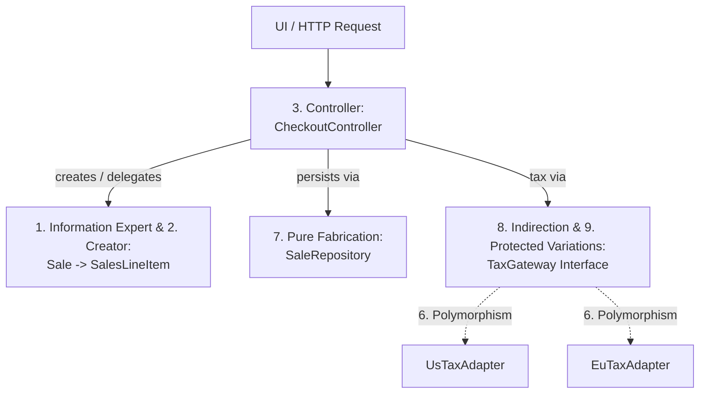

# GRASP Principles (General Responsibility Assignment Software Patterns)

> **One-line summary:** Craig Larman's 9 foundational principles answer the hardest question in object-oriented design: *which class should own which responsibility?*

| Attribute | Specification |
|---|---|
| **Level** | Intermediate / Core OOP Architecture |
| **Prerequisites** | [01-oop-pillars.md](../01-foundations/01-oop-pillars.md), [10-high-cohesion-low-coupling-in-practice.md](10-high-cohesion-low-coupling-in-practice.md) |
| **Estimated Reading Time** | 40 minutes |
| **Status** | Complete |
| **Category** | General Design Principles |
| **Also Known As** | Craig Larman's 9 Responsibility Patterns |
| **Languages Tested** | Java 25 (LTS) / TypeScript 5.8 (Node 24 native) / Python 3.14 |

---

## Table of Contents
- [1 The Problem](#1-the-problem)
- [2 Why It Exists](#2-why-it-exists)
- [3 What It Is](#3-what-it-is)
- [4 The Problem Without It](#4-the-problem-without-it)
- [5 How It Solves It](#5-how-it-solves-it)
- [6 How It Works](#6-how-it-works)
- [7 Real-World Examples](#7-real-world-examples)
- [8 When to Use and When NOT to Use](#8-when-to-use-and-when-not-to-use)
- [9 Variations and Language Idioms](#9-variations-and-language-idioms)
- [10 Relationship to Other Principles and Patterns](#10-relationship-to-other-principles-and-patterns)
- [11 Common Mistakes and Anti-Patterns](#11-common-mistakes-and-anti-patterns)
- [12 Testing and Design Verification](#12-testing-and-design-verification)
- [13 Performance, Concurrency and Security Notes](#13-performance-concurrency-and-security-notes)
- [14 Interview Questions](#14-interview-questions)
- [15 Practice Exercises](#15-practice-exercises)
- [16 Summary / Cheat Sheet](#16-summary--cheat-sheet)
- [17 Further Reading](#17-further-reading)

---

## 1 The Problem

You are designing a Point-of-Sale (POS) retail system with `Register`, `Sale`, `SalesLineItem`, `ProductCatalog`, and `TaxGateway`. A junior engineer asks:
- *Who should calculate the subtotal of a `SalesLineItem`?*
- *Who should create `SalesLineItem` instances?*
- *Where do we put database persistence—inside `Sale`, even though `Sale` is a domain concept?*

Without systematic responsibility assignment rules, teams guess randomly: UI buttons create SQL rows, `Register` computes line-item math externally, and domain entities get bloated with infrastructure persistence code.

---

## 2 Why It Exists

Formulated by **Craig Larman** in *Applying UML and Patterns* (1997), **GRASP** (*General Responsibility Assignment Software Patterns*) provides a rigorous, repeatable vocabulary of **9 principles** for assigning object responsibilities *before* reaching for complex GoF patterns.

---

## 3 What It Is: The 9 GRASP Principles

| # | GRASP Principle | Core Question Answered |
|---|---|---|
| 1 | **Information Expert** | Who should compute X? $\to$ The class holding the data needed to compute X. |
| 2 | **Creator** | Who should instantiate Y? $\to$ The class that aggregates, contains, or closely initializes Y. |
| 3 | **Controller** | Who handles incoming UI/system events? $\to$ A non-UI use-case coordinator (`CheckoutController`). |
| 4 | **Low Coupling** | How to minimize dependency impact? $\to$ Assign responsibilities to keep dependencies minimal. |
| 5 | **High Cohesion** | How to keep classes focused? $\to$ Assign related responsibilities together. |
| 6 | **Polymorphism** | How to handle type-based variations? $\to$ Assign variant behavior to polymorphic subtypes. |
| 7 | **Pure Fabrication** | Where to put logic that doesn't belong to any domain entity (e.g. DB saving)? $\to$ Invent a cohesive artificial class (`SaleRepository`). |
| 8 | **Indirection** | How to decouple two volatile components? $\to$ Insert an intermediary (`TaxGatewayAdapter`). |
| 9 | **Protected Variations** | How to shield stability from predicted change? $\to$ Wrap unstable points behind interfaces. |



---

## 4 The Problem Without It

```java
// GRASP Violations: Register calculates line-item math externally (violates Information Expert)
// and Sale directly saves itself to SQL (violates High Cohesion / Pure Fabrication)
class SaleViolation {
    public java.util.List<double[]> rawItems = new java.util.ArrayList<>();
    public void saveToPostgres() {
        System.out.println("SQL INSERT directly inside domain Sale!");
    }
}
```

---

## 5 How It Solves It

Apply **Information Expert** (`SalesLineItem.subtotal()`, `Sale.total()`), **Creator** (`Sale.addLineItem()`), and **Pure Fabrication** (`SaleRepository.save(sale)`).

### Java Implementation (Java 25 LTS)

```java
package com.design.principles.grasp;

import java.util.*;

// 1. Information Expert: Knows its own price and quantity
record SalesLineItem(String sku, double unitPrice, int qty) {
    public double subtotal() {
        return unitPrice * qty;
    }
}

// 1. Information Expert + 2. Creator (creates & aggregates SalesLineItem)
class Sale {
    private final List<SalesLineItem> items = new ArrayList<>();

    public void addLineItem(String sku, double unitPrice, int qty) {
        items.add(new SalesLineItem(sku, unitPrice, qty)); // Creator!
    }

    public double total() {
        return items.stream().mapToDouble(SalesLineItem::subtotal).sum(); // Information Expert!
    }
}

// 7. Pure Fabrication: Artificial service class keeping Sale cohesive!
interface SaleRepository {
    void save(Sale sale);
}

class InMemorySaleRepository implements SaleRepository {
    public void save(Sale sale) {
        System.out.println("Java GRASP Pure Fabrication saved Sale total: $" + sale.total());
    }
}
```

### TypeScript Implementation (Node 24 Native)

```typescript
class SalesLineItem {
    constructor(readonly sku: string, readonly unitPrice: number, readonly qty: number) {}
    subtotal(): number { return this.unitPrice * this.qty; }
}

class Sale {
    private items: SalesLineItem[] = [];
    addLineItem(sku: string, unitPrice: number, qty: number): void {
        this.items.push(new SalesLineItem(sku, unitPrice, qty));
    }
    total(): number {
        return this.items.reduce((sum, item) => sum + item.subtotal(), 0);
    }
}
```

### Python Implementation (Python 3.14)

```python
from dataclasses import dataclass

@dataclass(frozen=True)
class SalesLineItem:
    sku: str
    unit_price: float
    qty: int

    def subtotal(self) -> float:
        return self.unit_price * self.qty

class Sale:
    def __init__(self) -> None:
        self._items: list[SalesLineItem] = []

    def add_line_item(self, sku: str, unit_price: float, qty: int) -> None:
        self._items.append(SalesLineItem(sku, unit_price, qty))

    def total(self) -> float:
        return sum(item.subtotal() for item in self._items)
```

---

## 6 How It Works

Notice how **Pure Fabrication** balances **Information Expert**:
- Technically, `Sale` holds all the data to serialize itself to PostgreSQL.
- *However*, putting SQL inside `Sale` destroys **High Cohesion** and increases **Coupling** to JDBC.
- Therefore, GRASP prescribes **Pure Fabrication**: invent a non-domain helper (`SaleRepository`) specifically to preserve high cohesion and low coupling!

---

## 7 Real-World Examples

### 1. Spring `@RestController` (GRASP Controller)
Receives incoming HTTP input, delegates to domain services/entities, and never contains raw domain calculations.

### 2. DDD Repositories (GRASP Pure Fabrication)
`OrderRepository` does not exist in the real-world retail domain—it is a pure technical fabrication invented to keep `Order` free of database plumbing.

### 3. Adapter / Strategy (GRASP Indirection + Protected Variations)
Wrapping Stripe or Twilio behind a `PaymentGateway` interface protects the core checkout flow from third-party API changes.

---

## 8 When to Use and When NOT to Use

| Context | GRASP Guidance | Rationale |
|---|---|---|
| **Domain Modeling & Object Design** | **Always** | Provides clear, objective reasoning for class responsibilities. |
| **Pure Fabrication vs Information Expert** | **Prefer Information Expert first** | Only introduce Pure Fabrication when adding the behavior would hurt cohesion/coupling (e.g., DB persistence, logging). |

---

## 9 Variations and Language Idioms

- **Pure Fabrication** maps directly to *Services*, *Repositories*, and *Gateways* in DDD and Clean Architecture.
- **Protected Variations** is Craig Larman's broader generalization of Parnas's *Information Hiding* and Bertrand Meyer's *Open/Closed Principle*.

---

## 10 Relationship to Other Principles and Patterns

- **Tell, Don't Ask:** Directly reinforces **Information Expert** (don't pull data out of `SalesLineItem` to multiply externally).
- **SOLID:** GRASP's *High Cohesion*, *Low Coupling*, *Polymorphism*, and *Protected Variations* form the direct conceptual foundation behind SOLID.

---

## 11 Common Mistakes and Anti-Patterns

| Anti-Pattern | Description | Production Consequence | Correct Remedy |
|---|---|---|---|
| **Active Record Domain Bloat** | Putting SQL queries inside `Sale` because it's the "Information Expert" of its fields. | Destroys cohesion and unit testability. | Extract a `SaleRepository` (Pure Fabrication). |
| **Bloated Session Controller** | Putting all 20 use cases into one `SystemController`. | Violates High Cohesion & SRP. | Create focused Use-Case Controllers (`CheckoutController`, `RefundController`). |
| **Anemic Line Items** | Computing `item.price * item.qty` externally inside `Register`. | Violates Information Expert. | Put `subtotal()` on `SalesLineItem`. |
| **Excessive Pure Fabrications** | Inventing `SubtotalCalculatorService` when `SalesLineItem` already owns the data. | Anemic domain model + unnecessary classes. | Use Information Expert for intrinsic domain math. |
| **Missing Indirection on External SDKs** | Calling `StripeSDK.charge()` directly inside `Sale`. | High coupling to vendor SDK. | Insert `PaymentGateway` indirection. |
| **Speculative Protected Variations** | Wrapping stable constants in interfaces. | Violates YAGNI. | Only protect *real* points of instability. |

---

## 12 Testing and Design Verification

`SalesLineItemTest` and `SaleTest` verify all domain math in memory in microseconds because `SaleRepository` (Pure Fabrication) isolated persistence cleanly.

---

## 13 Performance, Concurrency and Security Notes

- **Security:** Assigning incoming event authorization cleanly to the **Controller** boundary prevents unauthenticated requests from reaching domain entities.

---

## 14 Interview Questions

<details>
<summary><strong>1. What does GRASP stand for and who created it?</strong></summary>

**General Responsibility Assignment Software Patterns**, formalized by **Craig Larman** in *Applying UML and Patterns* (1997). It consists of 9 principles guiding how responsibilities are assigned to classes and objects.
</details>

<details>
<summary><strong>2. Explain "Information Expert" with an example.</strong></summary>

Assign a responsibility to the class that has the information needed to fulfill it. For example, `SalesLineItem` has `unitPrice` and `qty`, so `SalesLineItem` should compute `subtotal()`, and `Sale` has the list of line items, so `Sale` should compute `total()`.
</details>

<details>
<summary><strong>3. When does "Pure Fabrication" override "Information Expert"?</strong></summary>

When assigning a responsibility (like saving to a relational database or logging to disk) to the domain expert (`Sale`) would violate High Cohesion and Low Coupling. You fabricate an artificial service class (`SaleRepository`) to hold persistence responsibility cleanly.
</details>

<details>
<summary><strong>4. What are the criteria for the GRASP "Creator" pattern?</strong></summary>

Class B should instantiate Class A if B contains/aggregates A, records A, closely uses A, or has the initializing data for A (e.g., `Sale` creates `SalesLineItem`).
</details>

<details>
<summary><strong>5. What is a GRASP "Controller" and what should it NOT do?</strong></summary>

A Controller is a non-UI object responsible for receiving and coordinating a system operation/event (e.g., `CheckoutController`). It should delegate work to domain objects and **not** perform heavy business calculations or raw SQL itself.
</details>

<details>
<summary><strong>6. How do "Indirection" and "Protected Variations" relate to SOLID's DIP and OCP?</strong></summary>

**Protected Variations** identifies points of likely instability and wraps them behind a stable interface (like OCP). **Indirection** inserts an intermediary object/adapter between two components to decouple them (like DIP/Adapter).
</details>

<details>
<summary><strong>7. Why are "Low Coupling" and "High Cohesion" called evaluative principles in GRASP?</strong></summary>

Unlike Creator or Controller (which tell you *what* role to assign), Low Coupling and High Cohesion are continuous **evaluative criteria** used to judge *every* design choice across all the other principles.
</details>

<details>
<summary><strong>8. Give an example of a Pure Fabrication in standard enterprise architectures.</strong></summary>

Repositories (`OrderRepository`), Data Mappers, Serializers (`JsonOrderMapper`), and Event Buses—none of these exist in the physical business domain, yet they are essential for clean software separation.
</details>

---

## 15 Practice Exercises

### Exercise 1: Apply Information Expert & Creator (Easy)
Given `Library`, `Book`, and `Loan`, who should instantiate `Loan` and who should calculate overdue late fees?

<details>
<summary><strong>Solution</strong></summary>

- **Creator:** `Library` (or `Member` / `LoanFactory`) records and aggregates active loans, creating `Loan`.
- **Information Expert:** `Loan` holds `dueDate` and `returnDate`, so `Loan` computes `isOverdue()` and `lateFee()`.
</details>

---

### Exercise 2: Identify Pure Fabrication Need (Medium)
A `Patient` entity currently has `exportToHl7Xml()` and `saveToOracleDb()`. Explain which GRASP principles are violated and what classes to fabricate.

<details>
<summary><strong>Solution</strong></summary>

Violates **High Cohesion** and **Low Coupling**. Fabricate `Hl7PatientExporter` and `PatientRepository` (**Pure Fabrications**) to keep `Patient` cohesive around clinical domain invariants.
</details>

---

### Exercise 3: Implement Protected Variations in Python (Hard)
Wrap an unstable shipping carrier rate API (`FedExApi`, `UpsApi`) behind a GRASP Protected Variations + Polymorphism protocol `ShippingRateProvider` so `CheckoutController` never changes when carriers are added.

<details>
<summary><strong>Solution</strong></summary>

Define `class ShippingRateProvider(Protocol): def quote(self, weight_kg: float) -> float: ...` and inject concrete adapters into `CheckoutController`.
</details>

---

## 16 Summary / Cheat Sheet

```
+--------------------------------------------------------------------------+
|                           GRASP (9 PRINCIPLES)                           |
+--------------------------------------------------------------------------+
| 1. Information Expert  : Put behavior where the data lives.              |
| 2. Creator             : Aggregator/container creates its parts.         |
| 3. Controller          : Non-UI coordinator handles system events.       |
| 4. Low Coupling        : Minimize inter-class dependencies.              |
| 5. High Cohesion       : Keep class responsibilities tightly focused.    |
| 6. Polymorphism        : Use subtypes for type-varying behavior.         |
| 7. Pure Fabrication    : Invent artificial classes (Repos) for cohesion. |
| 8. Indirection         : Insert intermediaries to decouple volatile parts|
| 9. Protected Variations: Wrap unstable points behind stable interfaces.  |
+--------------------------------------------------------------------------+
```

---

## 17 Further Reading

- Craig Larman, *Applying UML and Patterns* (3rd Edition), Prentice Hall, 2004.

### In Your Language
| Language Track | Deep Dive Reference |
|---|---|
| Java | [Java OOP & Design Patterns](file:///e:/Learning/engineering-notes/01-languages/java/24-design-patterns/README.md) |
| TypeScript | [TypeScript Design Patterns](file:///e:/Learning/engineering-notes/01-languages/typescript/17-design-patterns/README.md) |
| Python | [Python Design Patterns](file:///e:/Learning/engineering-notes/01-languages/python/23-design-patterns/README.md) |

---

[← Previous: 13 - Hollywood Principle & IoC](file:///e:/Learning/engineering-notes/08-solid-design-patterns/03-design-principles/13-hollywood-principle-and-inversion-of-control.md) | [Module 03 Index](file:///e:/Learning/engineering-notes/08-solid-design-patterns/03-design-principles/README.md) | [Next: 15 - Package & Component Principles →](file:///e:/Learning/engineering-notes/08-solid-design-patterns/03-design-principles/15-package-and-component-principles.md)
