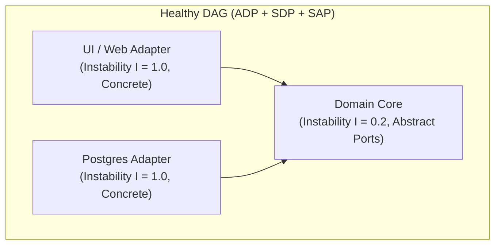

# Package & Component Principles (REP, CCP, CRP, ADP, SDP, SAP)

> **One-line summary:** SOLID governs classes; Robert C. Martin's six Component Principles govern how classes are grouped into deployable packages (JARs, npm packages, Python wheels) without cyclic build gridlock or forced mass redeployments.

| Attribute | Specification |
|---|---|
| **Level** | Advanced Architectural |
| **Prerequisites** | [03-coupling-and-cohesion.md](../01-foundations/03-coupling-and-cohesion.md), [05-dependency-inversion.md](../02-solid-principles/05-dependency-inversion.md) |
| **Estimated Reading Time** | 35 minutes |
| **Status** | Complete |
| **Category** | General Design Principles |
| **Also Known As** | Component Cohesion & Coupling Principles (*Clean Architecture* Ch. 13–14) |
| **Languages Tested** | Java 25 (LTS) / TypeScript 5.8 (Node 24 native) / Python 3.14 |

---

## Table of Contents
- [1 The Problem](#1-the-problem)
- [2 Why It Exists](#2-why-it-exists)
- [3 What It Is](#3-what-it-is)
- [4 The Problem Without It](#4-the-problem-without-it)
- [5 How It Solves It](#5-how-it-solves-it)
- [6 How It Works](#6-how-it-works)
- [7 Real-World Examples](#7-real-world-examples)
- [8 When to Use and When NOT to Use](#8-when-to-use-and-when-not-to-use)
- [9 Variations and Language Idioms](#9-variations-and-language-idioms)
- [10 Relationship to Other Principles and Patterns](#10-relationship-to-other-principles-and-patterns)
- [11 Common Mistakes and Anti-Patterns](#11-common-mistakes-and-anti-patterns)
- [12 Testing and Design Verification](#12-testing-and-design-verification)
- [13 Performance, Concurrency and Security Notes](#13-performance-concurrency-and-security-notes)
- [14 Interview Questions](#14-interview-questions)
- [15 Practice Exercises](#15-practice-exercises)
- [16 Summary / Cheat Sheet](#16-summary--cheat-sheet)
- [17 Further Reading](#17-further-reading)

---

## 1 The Problem

Imagine a multi-module monorepo with 18 Maven/Gradle/npm packages. Every class inside each package respects SOLID cleanly—yet the engineering organization suffers daily build nightmares:
1. **The "Morning-After" Breakage:** Team A modifies `common-utils` and publishes `v2.1`. Because `common-utils` bundles PDF rendering, Auth JWTs, and SQL helpers together, Team B's Auth service breaks compilation even though it never uses PDF rendering.
2. **Circular Package Deadlock:** `orders-pkg` imports `billing-pkg`, which imports `users-pkg`, which imports `orders-pkg`. Neither Maven nor Nx can build any package independently; running a single unit test compiles all 18 modules.
3. **Painful Core Edits:** A foundational `domain-core` package depends on a volatile `ui-experiments` package—making the most critical business rules fragile whenever UI experiments change.

Clean classes placed into poorly structured packages still produce an unmaintainable **Big Ball of Mud** at the deployment boundary.

---

## 2 Why It Exists

In *Agile Software Development, Principles, Patterns, and Practices* (2002) and *Clean Architecture* (2017), **Robert C. Martin** defined six principles for organizing **Components** (the smallest independently deployable units: JARs, DLLs, npm packages, Python wheels):
- **3 Cohesion Principles** (what belongs *inside* a package): **REP**, **CCP**, **CRP**.
- **3 Coupling Principles** (how packages *depend* on each other): **ADP**, **SDP**, **SAP**.

---

## 3 What It Is

### Part A: Component Cohesion (Inside the Package)
| Principle | Rule | Tension |
|---|---|---|
| **REP (Reuse/Release Equivalence)** | The granule of reuse is the granule of release. Only group classes into a library if they can be versioned and released together. | Pulls toward *bigger* packages for convenience. |
| **CCP (Common Closure Principle)** | Gather into a component classes that change for the same reasons and at the same times. *(SRP at the package level!)* | Pulls toward *focused* packages per actor/change-axis. |
| **CRP (Common Reuse Principle)** | Don't force users of a component to depend on things they don't use. *(ISP at the package level!)* | Pulls toward *smaller* packages so consumers avoid bloat. |

### Part B: Component Coupling (Between Packages)
| Principle | Rule |
|---|---|
| **ADP (Acyclic Dependencies Principle)** | Allow **no cycles** in the component dependency graph (must be a Directed Acyclic Graph — DAG). |
| **SDP (Stable Dependencies Principle)** | Depend in the direction of **stability** ($I = \frac{C_e}{C_a + C_e}$). Volatile packages may depend on stable packages, never vice versa. |
| **SAP (Stable Abstractions Principle)** | A component should be as **abstract** as it is **stable**. Stable core packages should consist mostly of interfaces/abstract types so they remain extensible (OCP). |



---

## 4 The Problem Without It

```text
// Cyclic Dependency Violation (Violates ADP):
[orders-pkg] ---> [billing-pkg] ---> [users-pkg] ---> [orders-pkg]

Result:
[ERROR] Maven / Nx Build Failed: Cyclic dependency detected between orders-pkg and billing-pkg!
[DEPLOY] Changing 1 line in Billing forces full re-release of Orders, Users, and 12 downstream apps!
```

---

## 5 How It Solves It

1. **Break Cycles (ADP):** Apply Dependency Inversion (DIP)—extract `OrderSummaryPort` into a shared stable abstraction or into `billing-pkg`, inverting the arrow so `orders-pkg` no longer imports `billing-pkg` concretions, or split the shared contract into a lower DAG node.
2. **Separate Unrelated Releases (CRP + CCP):** Split `mega-common` into `pdf-renderer`, `jwt-auth`, and `sql-helpers`.

### Java / TypeScript / Python Module Boundary Example

#### Java 25 (JPMS `module-info.java` enforcing DAG & encapsulation)
```java
// module-info.java in domain.core (Stable & Abstract)
module com.company.domain.core {
    exports com.company.domain.ports; // Only public ports exposed!
    // Zero dependencies on infrastructure or web frameworks!
}
```

#### TypeScript (Nx / Monorepo Workspace `package.json` DAG)
```typescript
// packages/domain-core/src/index.ts (Exports strictly stable interfaces & pure domain)
export interface PaymentPort {
    charge(orderId: string, amount: number): Promise<void>;
}
```

#### Python (`pyproject.toml` clean package boundaries)
```python
# src/domain_core/ports.py — zero imports from infra_postgres or web_fastapi!
from typing import Protocol

class PaymentPort(Protocol):
    def charge(self, order_id: str, amount: float) -> None: ...
```

---

## 6 How It Works: The Stability & Abstractness Metrics

Robert C. Martin defined exact mathematical metrics for package health:
1. **Fan-in ($C_a$, Afferent Coupling):** Number of external classes depending on classes inside this package.
2. **Fan-out ($C_e$, Efferent Coupling):** Number of external classes that this package depends on.
3. **Instability ($I$):**
   $$I = \frac{C_e}{C_a + C_e} \in [0, 1]$$
   - $I = 0$: Maximally **Stable** (many depend on it, it depends on nothing—hard to change).
   - $I = 1$: Maximally **Instable** (depends on others, nobody depends on it—easy to change).
4. **Abstractness ($A$):** Ratio of interfaces/abstract classes to total classes in the package ($A \in [0, 1]$).
5. **The Main Sequence ($A + I = 1$):**
   - **Zone of Pain ($A \approx 0, I \approx 0$):** Rigid concrete utility everyone depends on (e.g., hardcoded `DatabaseHelper`!).
   - **Zone of Uselessness ($A \approx 1, I \approx 1$):** Abstract interfaces nobody implements or depends on.

---

## 7 Real-World Examples

### 1. Java Platform Module System (JPMS / JDK 9+)
The JDK itself was broken into a strict DAG (`java.base` $\leftarrow$ `java.sql` $\leftarrow$ `java.desktop`), eliminating cyclic dependencies across standard libraries.

### 2. Nx / Turborepo Monorepo Task Graphs
Nx enforces ADP and module-boundary tags (`scope:domain` cannot depend on `scope:infra`) in CI, enabling incremental builds that skip untouched packages.

### 3. SLF4J vs Logback (`slf4j-api` vs `logback-classic`)
`slf4j-api` is maximally stable and abstract ($I \approx 0, A \approx 1$); concrete logging backends depend on `slf4j-api`, never the reverse.

---

## 8 When to Use and When NOT to Use

| Project Size | Component Strategy | Rationale |
|---|---|---|
| **Small / Single-Service App (< 20k LOC)** | **Single deployable package + internal folders** | Don't split into 15 npm/Maven packages prematurely; use package-by-feature directories first. |
| **Multi-Team Monorepo / Shared Libraries** | **Strict REP, CCP, CRP, ADP, SDP, SAP** | Prevents cyclic builds, version hell, and cross-team lockstep deploys. |

---

## 9 Variations and Language Idioms

- **Java:** Maven/Gradle subprojects + JPMS `module-info.java` + ArchUnit `slices().matching(...).should().beFreeOfCycles()`.
- **TypeScript:** npm/pnpm workspaces + ESLint `@nx/enforce-module-boundaries` + `dependency-cruiser`.
- **Python:** `import-linter` contracts + separate distribution wheels in monorepos.

---

## 10 Relationship to Other Principles and Patterns

- **CCP** is **SRP** scaled up to deployable packages.
- **CRP** is **ISP** scaled up to deployable packages.
- **SDP + SAP** together form **DIP** and **OCP** scaled up to deployable packages.

---

## 11 Common Mistakes and Anti-Patterns

| Anti-Pattern | Description | Production Consequence | Correct Remedy |
|---|---|---|---|
| **The `common-utils` Dumping Ground** | Putting unrelated PDF, Auth, and Date code in one shared package. | Violates CRP & CCP; trivial edits trigger mass redeploys. | Split by capability/release cadence. |
| **Cyclic Package Dependencies** | `pkgA` imports `pkgB` and `pkgB` imports `pkgA`. | Violates ADP; breaks incremental builds and unit isolation. | Break cycle with DIP interface or new shared port package. |
| **Concrete Stable Core (Zone of Pain)** | Domain core has concrete SQL/HTTP helpers everyone depends on ($I=0, A=0$). | Impossible to swap implementations without breaking all consumers. | Apply SAP: make stable core abstract via interfaces. |
| **Premature Micro-Packages** | Splitting a 1,000-line app into 25 separately published npm packages. | Versioning & publishing overhead overwhelms development. | Keep inside one package with clean folder boundaries until reuse/team scale requires splitting. |
| **Stable Package Depending on Volatile Package** | Core billing library importing a beta UI formatting package. | Violates SDP; UI churn breaks billing builds. | Invert dependency so UI imports Billing. |
| **Ignoring Unused Transitive Dependencies** | Pulling 40MB of heavy SDKs via one shared helper package. | Bloated Docker images and cold-start latency. | Respect CRP: split heavy optional dependencies into separate packages. |

---

## 12 Testing and Design Verification

Automate **ADP Cycle Detection** in CI:
- **Java (ArchUnit):** `slices().matching("com.app.(*)..").should().beFreeOfCycles()`
- **TypeScript (`dependency-cruiser`):** Reject circular imports (`circular: true` rule).

---

## 13 Performance, Concurrency and Security Notes

- **Performance & Security:** Respecting **CRP** prevents shipping unused heavy transitive dependencies—shrinking container sizes, Lambda cold starts, and third-party CVE exposure!

---

## 14 Interview Questions

<details>
<summary><strong>1. Name the 3 Component Cohesion Principles and explain the tension between them.</strong></summary>

1. **REP (Reuse/Release Equivalence):** Group classes released/versioned together.
2. **CCP (Common Closure):** Group classes that change together for the same reason (pulls toward larger, feature-complete packages).
3. **CRP (Common Reuse):** Don't force users to depend on classes they don't use (pulls toward smaller packages).
Every package boundary balances REP+CCP (convenience & localized edits) against CRP (minimal consumer bloat).
</details>

<details>
<summary><strong>2. What is the Acyclic Dependencies Principle (ADP) and how do you break a cycle?</strong></summary>

The dependency graph between deployable components must be a Directed Acyclic Graph (no cycles). Break a cycle either by (1) applying **DIP** (inserting an interface so the arrow reverses) or (2) extracting the mutually needed classes into a new third package that both depend on.
</details>

<details>
<summary><strong>3. Explain the Instability metric $I = C_e / (C_a + C_e)$ and the Stable Dependencies Principle (SDP).</strong></summary>

$C_a$ is incoming dependencies (fan-in); $C_e$ is outgoing dependencies (fan-out). $I = 0$ means maximally stable (hard to change because many depend on it); $I = 1$ means maximally instable (easy to change). **SDP** states dependencies should always point in the direction of stability (higher $I \to$ lower $I$).
</details>

<details>
<summary><strong>4. What is the Stable Abstractions Principle (SAP)?</strong></summary>

A stable component ($I \approx 0$) should also be abstract ($A \approx 1$) so it can be extended without modification (OCP). Together, SDP and SAP ensure unstable concrete implementations depend on stable abstract policies.
</details>

<details>
<summary><strong>5. What are the "Zone of Pain" and "Zone of Uselessness" on the $A$-$I$ graph?</strong></summary>

- **Zone of Pain ($A=0, I=0$):** Highly stable yet completely concrete (e.g., database schemas or rigid utility classes)—painful to change because everything depends on it and it has no extension seams.
- **Zone of Uselessness ($A=1, I=1$):** Purely abstract interfaces that nobody depends on or implements.
</details>

<details>
<summary><strong>6. How do CCP and CRP map to SOLID principles?</strong></summary>

**CCP** is the package-level equivalent of **SRP** (group things that change for the same reason). **CRP** is the package-level equivalent of **ISP** (don't force consumers to depend on unused code).
</details>

<details>
<summary><strong>7. Why does violating CRP increase security risk and cloud costs?</strong></summary>

Bundling unrelated dependencies into one `common` package forces every service to download unused third-party libraries—increasing Docker image sizes, serverless cold-start times, and vulnerability (CVE) surface area.
</details>

<details>
<summary><strong>8. When should you NOT split a codebase into multiple published packages?</strong></summary>

When a single small team maintains a cohesive application with no external library consumers. Premature package splitting creates versioning and build-pipeline friction without real decoupling benefits.
</details>

---

## 15 Practice Exercises

### Exercise 1: Compute Instability ($I$) (Easy)
Package `CoreAuth` has 12 external classes depending on it ($C_a = 12$) and depends on 3 external logger/crypto classes ($C_e = 3$). Compute $I$.

<details>
<summary><strong>Solution</strong></summary>

$I = \frac{3}{12 + 3} = \frac{3}{15} = 0.20$ (Relatively stable).
</details>

---

### Exercise 2: Break a Package Cycle (Medium)
`billing-pkg` depends on `orders-pkg.OrderDto`, and `orders-pkg` depends on `billing-pkg.InvoiceService`. Propose two ways to satisfy ADP.

<details>
<summary><strong>Solution</strong></summary>

1. **Extract Shared Contracts:** Move `OrderDto` into a new `orders-contracts` package that both `orders-pkg` and `billing-pkg` depend on.
2. **DIP:** Define `InvoicingPort` inside `orders-pkg` and have `billing-pkg.InvoiceService` implement it (inverting the arrow).
</details>

---

### Exercise 3: Split a Violating `shared-common` Package (Hard)
`shared-common` contains: `JwtValidator`, `S3Uploader`, `MoneyValueObject`, and `ExcelReportWriter`. A lightweight edge API only needs `MoneyValueObject` and `JwtValidator`, but currently pulls Apache POI (20MB) and AWS SDK (40MB). Regroup according to CRP and CCP.

<details>
<summary><strong>Solution</strong></summary>

Split into: `domain-primitives` (`Money`), `auth-security` (`JwtValidator`), `storage-s3` (`S3Uploader`), and `reporting-excel` (`ExcelReportWriter`). The edge API now pulls only `domain-primitives` and `auth-security` (< 100KB).
</details>

---

## 16 Summary / Cheat Sheet

```
+--------------------------------------------------------------------------+
|                    PACKAGE & COMPONENT PRINCIPLES                        |
+--------------------------------------------------------------------------+
| COHESION : REP (Release=Reuse) | CCP (Change Together) | CRP (No Bloat)  |
| COUPLING : ADP (No Cycles/DAG) | SDP (Depend on Stable)| SAP (Stable=Abs)|
| METRIC   : Instability I = Ce / (Ca + Ce). Keep stable core abstract!    |
+--------------------------------------------------------------------------+
```

---

## 17 Further Reading

- Robert C. Martin, *Clean Architecture* (Chapters 13–14: Component Cohesion & Coupling), Prentice Hall, 2017.

### In Your Language
| Language Track | Deep Dive Reference |
|---|---|
| Java | [Java OOP & Design Patterns](file:///e:/Learning/engineering-notes/01-languages/java/24-design-patterns/README.md) |
| TypeScript | [TypeScript Design Patterns](file:///e:/Learning/engineering-notes/01-languages/typescript/17-design-patterns/README.md) |
| Python | [Python Design Patterns](file:///e:/Learning/engineering-notes/01-languages/python/23-design-patterns/README.md) |

---

[← Previous: 14 - GRASP Principles](file:///e:/Learning/engineering-notes/08-solid-design-patterns/03-design-principles/14-grasp-principles.md) | [Module 03 Index](file:///e:/Learning/engineering-notes/08-solid-design-patterns/03-design-principles/README.md) | [Next: 16 - Premature Optimisation & Measuring →](file:///e:/Learning/engineering-notes/08-solid-design-patterns/03-design-principles/16-premature-optimisation-and-measuring.md)
