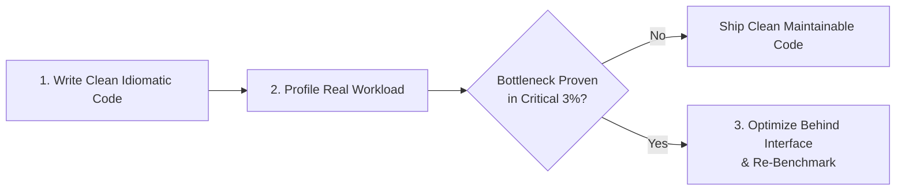

# Premature Optimisation & Measuring First

> **One-line summary:** Write clear, idiomatic code first and measure with a profiler before optimizing—guesswork micro-optimizations obfuscate design while missing the actual $O(N^2)$ or I/O bottlenecks.

| Attribute | Specification |
|---|---|
| **Level** | Core / Engineering Practice |
| **Prerequisites** | [02-kiss-principle.md](02-kiss-principle.md), [03-yagni.md](03-yagni.md) |
| **Estimated Reading Time** | 30 minutes |
| **Status** | Complete |
| **Category** | General Design Principles |
| **Also Known As** | Knuth's Law, Measure-Driven Optimization, Make It Work-Right-Fast |
| **Languages Tested** | Java 25 (LTS) / TypeScript 5.8 (Node 24 native) / Python 3.14 |

---

## Table of Contents
- [1 The Problem](#1-the-problem)
- [2 Why It Exists](#2-why-it-exists)
- [3 What It Is](#3-what-it-is)
- [4 The Problem Without It](#4-the-problem-without-it)
- [5 How It Solves It](#5-how-it-solves-it)
- [6 How It Works](#6-how-it-works)
- [7 Real-World Examples](#7-real-world-examples)
- [8 When to Use and When NOT to Use](#8-when-to-use-and-when-not-to-use)
- [9 Variations and Language Idioms](#9-variations-and-language-idioms)
- [10 Relationship to Other Principles and Patterns](#10-relationship-to-other-principles-and-patterns)
- [11 Common Mistakes and Anti-Patterns](#11-common-mistakes-and-anti-patterns)
- [12 Testing and Design Verification](#12-testing-and-design-verification)
- [13 Performance, Concurrency and Security Notes](#13-performance-concurrency-and-security-notes)
- [14 Interview Questions](#14-interview-questions)
- [15 Practice Exercises](#15-practice-exercises)
- [16 Summary / Cheat Sheet](#16-summary--cheat-sheet)
- [17 Further Reading](#17-further-reading)

---

## 1 The Problem

An engineer spends three days rewriting a readable 15-line invoice formatting loop using manual `char[]` byte buffers, bit-shifting tricks, and custom object-pooling—introducing two off-by-one memory bugs and making the code unreadable—in order to save 400 nanoseconds per request.

Meanwhile, the endpoint takes **850 milliseconds** per request because it executes an unindexed **N+1 SQL query** inside a loop! Saving 400 nanoseconds on CPU formatting improved total latency by 0.00005% while permanently damaging maintainability.

---

## 2 Why It Exists

In 1974 (*Structured Programming with go to Statements*), **Donald Knuth** wrote:
> *"Programmers waste enormous amounts of time thinking about, or worrying about, the speed of noncritical parts of their programs, and these attempts at efficiency actually have a strong negative impact when debugging and maintenance are considered. We should forget about small efficiencies, say about 97% of the time: premature optimization is the root of all evil. Yet we should not pass up our opportunities in that critical 3%."*

**Kent Beck** summarized the discipline as:
1. **Make it work** (correctness).
2. **Make it right** (clean, modular, maintainable).
3. **Make it fast** (profile the 3% hot path and optimize with evidence).

---

## 3 What It Is

Avoiding premature optimization does **NOT** mean ignoring basic algorithmic complexity ($O(N^2)$ nested loops, N+1 DB queries) or picking obviously terrible architectures. It means:
- **Design cleanly first** using standard data structures (`HashMap`, `Set`, `List`).
- **Benchmark and profile** with real data (`JFR`/`async-profiler`, V8 `--prof`, Python `cProfile`) to locate the critical 3%.
- **Optimize only proven bottlenecks**, preserving clean interfaces so optimization stays encapsulated behind abstractions.



---

## 4 The Problem Without It

```java
// Premature Micro-Optimization: Custom mutable byte-pool & bit-hacks for a cold admin report
class PrematureOptimizer {
    // Hardcoded unsafe shared buffer saves 200ns allocation, creates race conditions!
    private static final StringBuilder SHARED_BUILDER = new StringBuilder(1024);

    public synchronized String formatAdminBanner(String user) {
        SHARED_BUILDER.setLength(0);
        SHARED_BUILDER.append("Welcome ").append(user);
        return SHARED_BUILDER.toString();
    }
}
```
Sharing a mutable `StringBuilder` forces `synchronized` locking (destroying throughput under concurrency!) just to avoid a trivial young-gen allocation that HotSpot Escape Analysis would have eliminated automatically!

---

## 5 How It Solves It

Write clean, thread-safe, idiomatic code first; when profiling proves an $O(N^2)$ or I/O bottleneck, fix the actual algorithmic/I/O root cause cleanly.

### Java Implementation (Java 25 LTS)

```java
package com.design.principles.perf;

import java.util.*;

public class CleanPricingLookup {
    // Choose the right asymptotic data structure (O(1) HashMap vs O(N) scan) cleanly,
    // without arcane bit-hacks or unsafe shared buffers!
    public static double totalPrice(List<String> cartSkus, Map<String, Double> catalog) {
        double sum = 0.0;
        for (String sku : cartSkus) {
            sum += catalog.getOrDefault(sku, 0.0);
        }
        return sum;
    }
}
```

### TypeScript Implementation (Node 24 Native)

```typescript
export function totalPrice(cartSkus: readonly string[], catalog: ReadonlyMap<string, number>): number {
    let sum = 0;
    for (const sku of cartSkus) {
        sum += catalog.get(sku) ?? 0;
    }
    return sum;
}
```

### Python Implementation (Python 3.14)

```python
def total_price(cart_skus: list[str], catalog: dict[str, float]) -> float:
    return sum(catalog.get(sku, 0.0) for sku in cart_skus)
```

---

## 6 How It Works: Why JITs Beat Clever Micro-Hacks

Modern runtimes (JVM HotSpot C2, V8 TurboFan, Python 3.14 specializing interpreter) aggressively optimize clean, standard idioms:
- **Escape Analysis:** Short-lived objects that never escape a method are allocated on the stack or eliminated completely.
- **Inlining:** Clean, small methods are inlined into direct machine instructions.
- Meanwhile, hand-written `synchronized` object pools or convoluted caching layers often *defeat* JIT optimizations and cause GC promotion leaks!

---

## 7 Real-World Examples

### 1. Java `String` Concatenation vs Manual `StringBuilder`
For single-line expressions (`"Hello " + name`), `javac` compiles to `invokedynamic` `StringConcatFactory`—matching or beating manual `StringBuilder` boilerplate while staying vastly cleaner. (Manual `StringBuilder` is only needed inside large loops).

### 2. N+1 Queries vs CPU Micro-Loops
In web backends, 90% of latency comes from network/DB roundtrips (`N+1` queries, missing SQL indexes, unbatched HTTP calls)—not local `for` loops vs `.stream()`.

### 3. Clean Abstractions Enable Safe Optimization
Because `UserRepository` sits behind an interface (DIP), you can start with a clean 10-line SQL query, and later drop in a Redis read-through cache or batch loader *behind the interface* without touching a single domain caller.

---

## 8 When to Use and When NOT to Use

| Decision | Premature Optimization vs Good Engineering | Guidance |
|---|---|---|
| **Picking `HashMap`/`Set` ($O(1)$) over nested `List` ($O(N^2)$)** | **Good Engineering (Do Now!)** | Choosing clean asymptotic complexity is not premature optimization—it's basic competence. |
| **Bit-twiddling, manual object pools, unsafe memory hacks** | **Premature Optimization (Defer!)** | Only do this in the profiled 3% hot path (e.g., HFT, game engines, codecs). |
| **Adding Redis caching before launch with 10 users** | **Premature Optimization (Defer!)** | Caches add invalidation bugs; wait until DB metrics show load. |

---

## 9 Variations and Language Idioms

- **Benchmarking Tools:** Java **JMH** (prevents dead-code elimination illusions), Node **`node --prof`** / `perf_hooks`, Python **`cProfile`** / **`timeit`**.
- **Mechanical Sympathy:** Understanding hardware realities (L1/L2 cache locality, avoiding unnecessary allocations in tight loops) when profiling proves a CPU-bound hot path.

---

## 10 Relationship to Other Principles and Patterns

- **KISS & YAGNI:** Guard against adding complex caching/pooling before metrics prove necessity.
- **Flyweight & Proxy (Cache) Patterns:** Patterns to apply *after* profiling identifies memory or I/O bottlenecks.

---

## 11 Common Mistakes and Anti-Patterns

| Anti-Pattern | Description | Production Consequence | Correct Remedy |
|---|---|---|---|
| **Guesswork Optimization** | Optimizing a loop by intuition without running a profiler. | Wastes days on code representing 0.1% of runtime. | Always profile first (flame graphs). |
| **Premature Redis Caching** | Adding distributed caching on day one for unmeasured endpoints. | Stale cache bugs, thundering herds, ops complexity. | Measure DB latency first; tune SQL indexes before caching. |
| **Micro-Benchmarking Without JMH** | Measuring Java/JS loops with `System.nanoTime()` without warmup. | JIT dead-code elimination gives fake 0ms timings. | Use JMH / `perf_hooks` / `timeit`. |
| **Mutable Shared Pools** | Reusing mutable arrays/builders globally to dodge GC. | Thread contention and data corruption bugs. | Let generational GC handle short-lived objects. |
| **Confusing $O(N^2)$ Sloppiness with "Clean Code"** | Writing nested loops over 50k items claiming "premature optimization is evil." | Production timeouts as data grows. | Use appropriate $O(1)$ / $O(N \log N)$ collections upfront. |
| **Optimizing Cold Startup Paths** | Obfuscating CLI config parsing to save 2ms at startup. | Unreadable config code. | Focus strictly on hot paths. |

---

## 12 Testing and Design Verification

Always pair performance optimizations with:
1. Functional correctness tests (behavior unchanged).
2. A repeatable benchmark comparing *before* vs *after* on realistic input sizes.

---

## 13 Performance, Concurrency and Security Notes

- **Concurrency:** Prematurely replacing immutable objects with mutable pooled buffers frequently introduces subtle race conditions and memory leaks.

---

## 14 Interview Questions

<details>
<summary><strong>1. Quote Donald Knuth's full statement on premature optimization—what does the often-forgotten 3% mean?</strong></summary>

*"We should forget about small efficiencies, say about 97% of the time: premature optimization is the root of all evil. Yet we should not pass up our opportunities in that critical 3%."* The 3% refers to actual measured hot paths (identified via profiling) where algorithmic or system-level optimization yields massive real gains.
</details>

<details>
<summary><strong>2. Is choosing a `HashSet` ($O(1)$) instead of `List.contains()` ($O(N)$) premature optimization?</strong></summary>

No. Selecting appropriate asymptotic data structures and avoiding obvious $O(N^2)$ nested scans or N+1 SQL queries is fundamental algorithm design, not premature micro-optimization.
</details>

<details>
<summary><strong>3. Explain Kent Beck's "Make it work, make it right, make it fast."</strong></summary>

1. **Make it work:** Solve the problem correctly with passing tests.
2. **Make it right:** Refactor for clarity, modularity, and clean abstractions.
3. **Make it fast:** Profile realistic workloads and optimize proven bottlenecks behind those clean abstractions.
</details>

<details>
<summary><strong>4. Why do naive `System.nanoTime()` micro-benchmarks lie in Java or JavaScript?</strong></summary>

Because JIT compilers perform warmup optimization, loop unrolling, and **dead-code elimination** (if results aren't consumed). Dedicated harnesses like JMH handle warmup iterations and blackhole sinks properly.
</details>

<details>
<summary><strong>5. Why is adding a Redis cache on day one often an anti-pattern?</strong></summary>

Distributed caching introduces cache invalidation bugs, eventual consistency issues, serialization overhead, and extra infrastructure—while a properly indexed relational database easily handles thousands of QPS cleanly.
</details>

<details>
<summary><strong>6. How do clean DIP interfaces make late optimization safe?</strong></summary>

Because callers depend on an interface (`CatalogRepository`), you can introduce batching, read replicas, or an in-memory cache behind the interface later without modifying any domain or caller code.
</details>

<details>
<summary><strong>7. Why does sharing a mutable `StringBuilder` across requests often make performance WORSE?</strong></summary>

Synchronizing access serializes concurrent threads, destroying multi-core scalability, whereas modern young-gen allocators allocate and reclaim short-lived local objects lock-free in nanoseconds.
</details>

<details>
<summary><strong>8. What is the first tool you reach for when an endpoint takes 2 seconds?</strong></summary>

A profiler / distributed trace (e.g., OpenTelemetry trace, SQL query log, JFR / Flame Graph) to see whether time is spent in DB queries, external HTTP calls, GC pauses, or CPU loops—never guesswork code edits.
</details>

---

## 15 Practice Exercises

### Exercise 1: Micro-Optimization vs Macro-Bottleneck (Easy)
An endpoint takes 900ms: 880ms in 50 sequential SQL `SELECT` queries inside a loop, and 20ms in JSON serialization. Where should engineering effort go?

<details>
<summary><strong>Solution</strong></summary>

Fix the N+1 SQL query using a single `WHERE id IN (...)` batch query (cutting 880ms down to ~15ms). Do not touch JSON serialization.
</details>

---

### Exercise 2: Fix $O(N^2)$ Lookup Cleanly (Medium)
Replace a nested `for` loop matching 10,000 orders against 10,000 customers in Python/TypeScript with an $O(N)$ dictionary/Map lookup while keeping the code clean and readable.

<details>
<summary><strong>Solution</strong></summary>

Build `customer_by_id = {c.id: c for c in customers}` once in $O(N)$, then look up `customer_by_id.get(order.customer_id)` in $O(1)$.
</details>

---

### Exercise 3: Encapsulate Memoization Behind a Clean Boundary (Hard)
In Java or Python, wrap an expensive pure calculation `computeTaxBracket(...)` with a clean cache/memoization decorator without polluting the pure calculation function itself.

<details>
<summary><strong>Solution</strong></summary>

In Python: `@functools.lru_cache(maxsize=1024)` above the pure function. In Java: wrap `TaxCalculator` in a `CachingTaxCalculator implements TaxCalculator` Decorator.
</details>

---

## 16 Summary / Cheat Sheet

```
+--------------------------------------------------------------------------+
|                 PREMATURE OPTIMISATION & MEASURING FIRST                 |
+--------------------------------------------------------------------------+
| ORDER OF WORK  : 1. Make it work -> 2. Make it right -> 3. Make it fast. |
| DO NOW         : Pick right Big-O data structures (Map/Set) & avoid N+1. |
| DEFER          : Bit-hacks, custom pools, speculative distributed caches.|
| GOLDEN RULE    : Never optimize without a profiler / flame graph!        |
+--------------------------------------------------------------------------+
```

---

## 17 Further Reading

- Donald Knuth, *Structured Programming with go to Statements*, ACM Computing Surveys, 1974.
- Brendan Gregg, *Systems Performance*, Addison-Wesley, 2020.

### In Your Language
| Language Track | Deep Dive Reference |
|---|---|
| Java | [Java OOP & Design Patterns](file:///e:/Learning/engineering-notes/01-languages/java/24-design-patterns/README.md) |
| TypeScript | [TypeScript Design Patterns](file:///e:/Learning/engineering-notes/01-languages/typescript/17-design-patterns/README.md) |
| Python | [Python Design Patterns](file:///e:/Learning/engineering-notes/01-languages/python/23-design-patterns/README.md) |

---

[← Previous: 15 - Package & Component Principles](file:///e:/Learning/engineering-notes/08-solid-design-patterns/03-design-principles/15-package-and-component-principles.md) | [Module 03 Index](file:///e:/Learning/engineering-notes/08-solid-design-patterns/03-design-principles/README.md) | [Next: 17 - Idempotency Principle →](file:///e:/Learning/engineering-notes/08-solid-design-patterns/03-design-principles/17-idempotency-principle.md)
