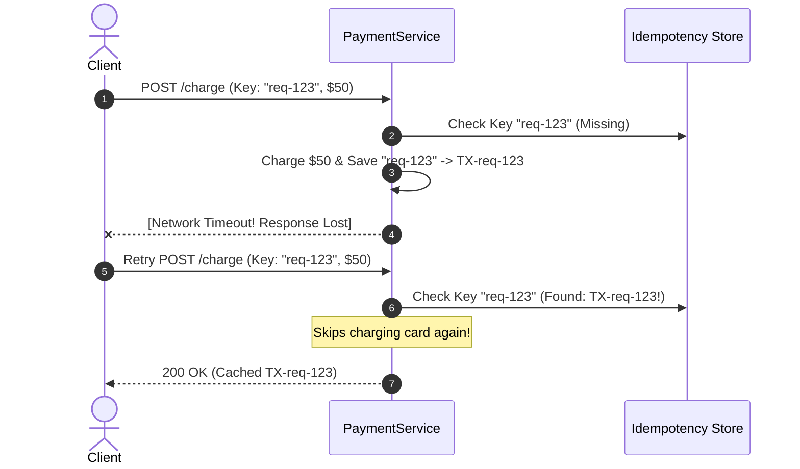

# Idempotency Principle

> **One-line summary:** An operation is idempotent if executing it multiple times with the same inputs produces the exact same system state and outcome as executing it once—making network retries, webhook redeliveries, and crash recovery safe.

| Attribute | Specification |
|---|---|
| **Level** | Intermediate / Distributed & API Design |
| **Prerequisites** | [08-fail-fast-principle.md](08-fail-fast-principle.md), [07-immutability-and-value-objects.md](../01-foundations/07-immutability-and-value-objects.md) |
| **Estimated Reading Time** | 35 minutes |
| **Status** | Complete |
| **Category** | General Design Principles |
| **Also Known As** | Safe Retryability, At-Least-Once Deduplication, $f(f(x)) = f(x)$ |
| **Languages Tested** | Java 25 (LTS) / TypeScript 5.8 (Node 24 native) / Python 3.14 |

---

## Table of Contents
- [1 The Problem](#1-the-problem)
- [2 Why It Exists](#2-why-it-exists)
- [3 What It Is](#3-what-it-is)
- [4 The Problem Without It](#4-the-problem-without-it)
- [5 How It Solves It](#5-how-it-solves-it)
- [6 How It Works](#6-how-it-works)
- [7 Real-World Examples](#7-real-world-examples)
- [8 When to Use and When NOT to Use](#8-when-to-use-and-when-not-to-use)
- [9 Variations and Language Idioms](#9-variations-and-language-idioms)
- [10 Relationship to Other Principles and Patterns](#10-relationship-to-other-principles-and-patterns)
- [11 Common Mistakes and Anti-Patterns](#11-common-mistakes-and-anti-patterns)
- [12 Testing and Design Verification](#12-testing-and-design-verification)
- [13 Performance, Concurrency and Security Notes](#13-performance-concurrency-and-security-notes)
- [14 Interview Questions](#14-interview-questions)
- [15 Practice Exercises](#15-practice-exercises)
- [16 Summary / Cheat Sheet](#16-summary--cheat-sheet)
- [17 Further Reading](#17-further-reading)

---

## 1 The Problem

A mobile user taps **"Pay \$50.00"** in an e-commerce app while riding an elevator. The request reaches the payment server, charges the user's card, and commits the order—but the cellular connection drops before the HTTP `200 OK` response reaches the phone.

The mobile client sees a network timeout and automatically retries the `POST /payments` request twice. Without idempotency:
- The customer is charged **\$150.00** (three separate charges!) and receives three duplicate orders.
- Downstream inventory deducts 3x stock.
- Customer support is flooded with chargeback disputes.

In distributed systems, **exactly-once network delivery is mathematically impossible** (Two Generals' Problem). Systems can only guarantee **at-least-once delivery**—meaning **retries will happen**, and operations must be idempotent to survive them safely.

---

## 2 Why It Exists

Borrowed from mathematics ($f(f(x)) = f(x)$, e.g., `abs(abs(-5)) == 5`), Idempotency is foundational to HTTP (RFC 9110: `GET`, `PUT`, `DELETE` are idempotent; `POST` is not by default) and distributed systems (Stripe API `Idempotency-Key`, Kafka consumers, Kubernetes controllers).

---

## 3 What It Is

An operation $O$ is idempotent if applying $O$ once or $N$ times leaves the server state identical to applying $O$ once:
- **Natural Idempotency:** Setting absolute target state (`SET status = 'CANCELLED'`, `PUT /users/42 {name: "Alice"}`, `DELETE /orders/99`).
- **Keyed Idempotency (Idempotency Keys):** Attaching a client-generated unique token (`Idempotency-Key: uuid`) to non-natural mutations (like `charge($50)` or `incrementBalance`) so the server records the first execution atomically and replays the cached outcome on retries.



---

## 4 The Problem Without It

```java
// Naive Violation: Non-idempotent charge increments ledger on every network retry
class UnsafePaymentProcessor {
    private double ledgerTotal = 0.0;
    public String charge(double amount) {
        ledgerTotal += amount; // Retrying 3 times charges 3x!
        return "TX-" + System.nanoTime();
    }
}
```

---

## 5 How It Solves It

Require an `idempotencyKey` per logical operation, store the processed result atomically, and return the recorded result on duplicate keys without re-executing side effects.

### Java Implementation (Java 25 LTS)

```java
package com.design.principles.idempotency;

import java.util.*;

record PaymentResult(String txId, double chargedAmount, String status) {}

class IdempotentPaymentProcessor {
    private final Map<String, PaymentResult> processedKeys = new HashMap<>();
    private double ledgerTotal = 0.0;

    public PaymentResult charge(String idempotencyKey, double amount) {
        if (idempotencyKey == null || idempotencyKey.isBlank()) {
            throw new IllegalArgumentException("Idempotency-Key required");
        }
        if (processedKeys.containsKey(idempotencyKey)) {
            return processedKeys.get(idempotencyKey); // Safe replay!
        }
        ledgerTotal += amount;
        PaymentResult result = new PaymentResult("TX-" + idempotencyKey, amount, "CHARGED");
        processedKeys.put(idempotencyKey, result);
        return result;
    }

    public double getLedgerTotal() { return ledgerTotal; }
}

public class IdempotencyApp {
    public static void main(String[] args) {
        IdempotentPaymentProcessor p = new IdempotentPaymentProcessor();
        var r1 = p.charge("req-123", 50.0);
        var r2 = p.charge("req-123", 50.0); // Network retry with same key!
        System.out.println("Java Idempotent Ledger: $" + p.getLedgerTotal() + " | Same tx: " + r1.txId().equals(r2.txId()));
    }
}
```

### TypeScript Implementation (Node 24 Native)

```typescript
interface PaymentResult { readonly txId: string; readonly amount: number; }

class IdempotentPaymentProcessor {
    private processed = new Map<string, PaymentResult>();
    private ledgerTotal = 0;

    charge(idempotencyKey: string, amount: number): PaymentResult {
        const existing = this.processed.get(idempotencyKey);
        if (existing) return existing;
        this.ledgerTotal += amount;
        const res = { txId: `TX-${idempotencyKey}`, amount };
        this.processed.set(idempotencyKey, res);
        return res;
    }
    getLedgerTotal(): number { return this.ledgerTotal; }
}

const p = new IdempotentPaymentProcessor();
p.charge("req-123", 50);
p.charge("req-123", 50);
console.log("TS Idempotent Ledger: $" + p.getLedgerTotal());
```

### Python Implementation (Python 3.14)

```python
from dataclasses import dataclass

@dataclass(frozen=True)
class PaymentResult:
    tx_id: str
    amount: float

class IdempotentPaymentProcessor:
    def __init__(self) -> None:
        self._processed: dict[str, PaymentResult] = {}
        self.ledger_total = 0.0

    def charge(self, idempotency_key: str, amount: float) -> PaymentResult:
        if idempotency_key in self._processed:
            return self._processed[idempotency_key]
        self.ledger_total += amount
        res = PaymentResult(f"TX-{idempotency_key}", amount)
        self._processed[idempotency_key] = res
        return res

if __name__ == "__main__":
    p = IdempotentPaymentProcessor()
    p.charge("req-123", 50.0)
    p.charge("req-123", 50.0)
    print("Python Idempotent Ledger: $" + str(p.ledger_total))
```

### Real Execution Output
```text
Java Idempotent Ledger: $50.0 | Same tx: true
TS Idempotent Ledger: $50
Python Idempotent Ledger: $50.0
```

---

## 6 How It Works in Production Databases

In-memory `HashMap`s only work for single-node demos. In production distributed systems:
1. **Atomic Database Unique Constraint (`INSERT ... ON CONFLICT DO NOTHING`):** Store `idempotency_key` in the same ACID database transaction as the ledger mutation (`orders` + `idempotency_keys` table).
2. **Payload Mismatch Guard:** Store a SHA-256 hash of the request payload alongside the key. If a client accidentally reuses `"req-123"` with `$100` instead of `$50`, **Fail-Fast with `422` / `409 Conflict`**!
3. **Key Expiration (TTL):** Prune idempotency keys after 24–72 hours to keep storage bounded.

---

## 7 Real-World Examples

### 1. Stripe API `Idempotency-Key` Header
Stripe requires clients to send a UUIDv4 in `Idempotency-Key` on `POST /v1/charges` retries, saving the exact HTTP status and JSON body for 24 hours.

### 2. SQL `INSERT ... ON CONFLICT DO NOTHING` / `UPSERT`
Database-level upserts and unique constraints make event-consumer deduplication atomic without distributed locks.

### 3. Kubernetes Declarative Reconciliation (`kubectl apply`)
Applying the same Kubernetes Deployment YAML 100 times converges to the exact same cluster state—unlike imperative `create` scripts that fail on the second run.

---

## 8 When to Use and When NOT to Use

| Context | Idempotency Needed? | Rationale |
|---|---|---|
| **Payments, Order Creation, Email/SMS Dispatch** | **Mandatory** | Retries without deduplication cause double charges and spam. |
| **Message Queue / Webhook Consumers** | **Mandatory** | Kafka, SQS, and webhooks guarantee *at-least-once* delivery, never exactly-once. |
| **Pure Read Queries (`GET`)** | **Naturally Idempotent** | Safe to retry automatically without extra keys. |

---

## 9 Variations and Language Idioms

- **Optimistic Concurrency Control (Version / ETag):** `UPDATE accounts SET balance = 50, version = 2 WHERE id = 1 AND version = 1`—if retried, `version = 1` matches 0 rows!
- **Transactional Outbox + Inbox Pattern:** Recording processed `message_id` in an `inbox_events` table inside the same DB transaction as business updates.

---

## 10 Relationship to Other Principles and Patterns

- **Fail-Fast:** Reject missing `Idempotency-Key` or conflicting payload hashes immediately.
- **Transactional Outbox / Inbox:** Distributed enterprise patterns implementing reliable idempotent messaging.

---

## 11 Common Mistakes and Anti-Patterns

| Anti-Pattern | Description | Production Consequence | Correct Remedy |
|---|---|---|---|
| **Check-Then-Insert Race Condition** | `if (!db.exists(key)) { charge(); db.insert(key); }` without a DB lock or `UNIQUE` constraint. | Two concurrent retries both pass `exists()` and double-charge! | Use a `UNIQUE` DB constraint or distributed lock (`INSERT ON CONFLICT`). |
| **Generating Idempotency Key on the Server** | Server creates `UUID.randomUUID()` inside the `POST` handler. | Every retry gets a brand-new key, defeating deduplication! | **Client** must generate the key once before retrying. |
| **Ignoring Payload Hash Mismatch** | Returning cached `$50` success when client reuses key for `$500`. | Silent financial mismatch. | Hash request parameters and reject mismatches with `409`/`422`. |
| **Treating `POST` Retries as Safe Without Keys** | Enabling HTTP client auto-retries on all endpoints blindly. | Duplicate records on transient 502/timeouts. | Only auto-retry `GET`/`PUT`/`DELETE` or `POST` with `Idempotency-Key`. |
| **Never Expiring Keys** | Keeping idempotency tables forever without TTL. | Unbounded DB table growth. | Expire keys via TTL (e.g., 24–72h). |
| **Forgetting External Side Effects** | Rolling back DB on failure after already calling Stripe/Twilio. | Card charged with no local order record. | Persist pending key *before* external call, or use Outbox pattern. |

---

## 12 Testing and Design Verification

Always write a **Duplicate Delivery Test**: invoke the handler twice with the exact same `idempotencyKey` and assert the ledger/side-effect count equals `1`.

---

## 13 Performance, Concurrency and Security Notes

- **Concurrency:** In-flight duplicate requests arriving simultaneously with the same key must either block/lock on the key or fail fast with `409 Conflict (Request in progress)`—never execute twice!

---

## 14 Interview Questions

<details>
<summary><strong>1. Define Idempotency mathematically and in distributed systems.</strong></summary>

Mathematically, $f(f(x)) = f(x)$. In distributed systems, an operation is idempotent if executing it multiple times with the same inputs produces the exact same persistent state as executing it once—making network retries safe.
</details>

<details>
<summary><strong>2. Why MUST the client generate the Idempotency Key rather than the server?</strong></summary>

If the server generated the key upon receiving the request, two retries of the same failed network call would receive two distinct keys, making it impossible for the server to recognize them as the same logical attempt.
</details>

<details>
<summary><strong>3. Which HTTP methods are idempotent by specification (RFC 9110)?</strong></summary>

`GET`, `HEAD`, `OPTIONS`, `PUT`, and `DELETE` are idempotent. `POST` and `PATCH` are **not** idempotent by default unless explicitly designed with idempotency keys or absolute state replacements.
</details>

<details>
<summary><strong>4. How do you prevent a race condition when two identical retries arrive at the exact same millisecond?</strong></summary>

Insert the `idempotency_key` into a database table with a `UNIQUE` constraint (or acquire a Redis `SETNX` lock) **before** executing the operation, rather than doing a non-atomic `SELECT` check followed by `INSERT`.
</details>

<details>
<summary><strong>5. What should happen if a client reuses an Idempotency Key with different request parameters (e.g. $100 instead of $50)?</strong></summary>

The server should store a cryptographic hash of the original request payload alongside the key and **Fail-Fast with `422` or `409 Conflict`**, preventing silent parameter mismatches.
</details>

<details>
<summary><strong>6. Distinguish "Natural Idempotency" from "Keyed Idempotency".</strong></summary>

Natural idempotency sets an absolute state (`PUT /profile {name: "Bob"}` or `UPDATE orders SET status='PAID'`), which is inherently repeatable. Keyed idempotency tracks unique client tokens to make relative deltas (`credit +$50`, `sendEmail`) repeatable safely.
</details>

<details>
<summary><strong>7. Why does "At-Least-Once" message delivery require idempotent consumers?</strong></summary>

Message brokers (Kafka, SQS, RabbitMQ) redeliver messages whenever a consumer crashes before acknowledging (`ack`) or when network acks drop. Consumers must deduplicate by `message_id` or design handlers to be naturally idempotent.
</details>

<details>
<summary><strong>8. How does Optimistic Concurrency Control (version numbers) achieve idempotency?</strong></summary>

`UPDATE items SET qty = qty - 1, version = 2 WHERE id = 10 AND version = 1` succeeds only once; any duplicate retry carrying `version = 1` matches zero rows and leaves state unchanged.
</details>

---

## 15 Practice Exercises

### Exercise 1: Classify Idempotent Operations (Easy)
Which are naturally idempotent? (a) `DELETE /users/7`, (b) `POST /cart/add-item`, (c) `UPDATE users SET verified = true WHERE id = 7`, (d) `UPDATE accounts SET balance = balance - 10`.

<details>
<summary><strong>Solution</strong></summary>

(a) and (c) are naturally idempotent (or converged state). (b) and (d) are relative deltas and **not** idempotent without idempotency keys or version guards.
</details>

---

### Exercise 2: Add Payload Hash Guard in TypeScript (Medium)
Extend `IdempotentPaymentProcessor` so reusing `"req-123"` with `$100` after `$50` throws a `ConflictError`.

<details>
<summary><strong>Solution</strong></summary>

Store `{ amount, result }` in the map; if `existing && existing.amount !== amount`, throw `new Error("409 Conflict: Idempotency key reused with different payload")`.
</details>

---

### Exercise 3: Atomic SQL Deduplication Design (Hard)
Write the PostgreSQL SQL pattern combining `idempotency_keys` (`UNIQUE`) and `ledger_entries` inside one `BEGIN ... COMMIT` transaction so concurrent retries cannot double-credit.

<details>
<summary><strong>Solution</strong></summary>

```sql
BEGIN;
INSERT INTO idempotency_keys (key) VALUES ('req-123') ON CONFLICT (key) DO NOTHING;
-- Check affected row count: if 0, ROLLBACK and return cached result; if 1, proceed with ledger INSERT and COMMIT.
```
</details>

---

## 16 Summary / Cheat Sheet

```
+--------------------------------------------------------------------------+
|                          IDEMPOTENCY PRINCIPLE                           |
+--------------------------------------------------------------------------+
| CORE RULE      : Executing an operation 1 or N times leaves identical    |
|                  system state: f(f(x)) = f(x).                           |
| HOW TO BUILD   : 1. Client generates Idempotency-Key before retrying.    |
|                  2. Atomic UNIQUE DB insert or Optimistic Version check. |
|                  3. Reject key reuse with mismatched payload hashes.     |
+--------------------------------------------------------------------------+
```

---

## 17 Further Reading

- Stripe Engineering, *Designing Robust and Predictable APIs with Idempotency*, stripe.com/blog/idempotency, 2017.
- Pat Helland, *Idempotence Is Not a Medical Condition*, ACM Queue, 2012.

### In Your Language
| Language Track | Deep Dive Reference |
|---|---|
| Java | [Java OOP & Design Patterns](file:///e:/Learning/engineering-notes/01-languages/java/24-design-patterns/README.md) |
| TypeScript | [TypeScript Design Patterns](file:///e:/Learning/engineering-notes/01-languages/typescript/17-design-patterns/README.md) |
| Python | [Python Design Patterns](file:///e:/Learning/engineering-notes/01-languages/python/23-design-patterns/README.md) |

---

[← Previous: 16 - Premature Optimisation](file:///e:/Learning/engineering-notes/08-solid-design-patterns/03-design-principles/16-premature-optimisation-and-measuring.md) | [Module 03 Index](file:///e:/Learning/engineering-notes/08-solid-design-patterns/03-design-principles/README.md) | [Next: 18 - Conway's Law →](file:///e:/Learning/engineering-notes/08-solid-design-patterns/03-design-principles/18-conways-law-and-socio-technical-design.md)
