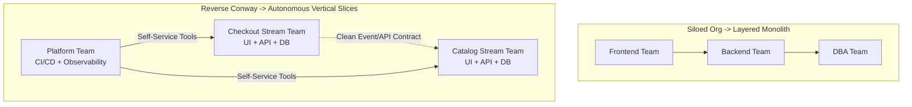

# Conway's Law & Socio-Technical Design

> **One-line summary:** Organizations design systems that mirror their internal communication structures—use the Reverse Conway Maneuver and Team Topologies to align team boundaries with desired software module boundaries.

| Attribute | Specification |
|---|---|
| **Level** | Intermediate / Socio-Technical Architecture |
| **Prerequisites** | [01-single-responsibility.md](../02-solid-principles/01-single-responsibility.md), [15-package-and-component-principles.md](15-package-and-component-principles.md) |
| **Estimated Reading Time** | 30 minutes |
| **Status** | Complete |
| **Category** | General Design Principles |
| **Also Known As** | Mirroring Hypothesis, Reverse Conway Maneuver, Socio-Technical Architecture |
| **Languages Tested** | Java 25 (LTS) / TypeScript 5.8 (Node 24 native) / Python 3.14 |

---

## Table of Contents
- [1 The Problem](#1-the-problem)
- [2 Why It Exists](#2-why-it-exists)
- [3 What It Is](#3-what-it-is)
- [4 The Problem Without It](#4-the-problem-without-it)
- [5 How It Solves It](#5-how-it-solves-it)
- [6 How It Works](#6-how-it-works)
- [7 Real-World Examples](#7-real-world-examples)
- [8 When to Use and When NOT to Use](#8-when-to-use-and-when-not-to-use)
- [9 Variations and Language Idioms](#9-variations-and-language-idioms)
- [10 Relationship to Other Principles and Patterns](#10-relationship-to-other-principles-and-patterns)
- [11 Common Mistakes and Anti-Patterns](#11-common-mistakes-and-anti-patterns)
- [12 Testing and Design Verification](#12-testing-and-design-verification)
- [13 Performance, Concurrency and Security Notes](#13-performance-concurrency-and-security-notes)
- [14 Interview Questions](#14-interview-questions)
- [15 Practice Exercises](#15-practice-exercises)
- [16 Summary / Cheat Sheet](#16-summary--cheat-sheet)
- [17 Further Reading](#17-further-reading)

---

## 1 The Problem

An enterprise software company wants to transition from a tangled monolith to clean, autonomous vertical domain services (Checkout, Catalog, Fulfillment).

However, management keeps the organization structured into **horizontal technical silos**:
- A Frontend Team (React)
- A Backend API Team (Java)
- A Database Team (PostgreSQL stored procedures)
- A DevOps/QA Release Team

Every single product feature ("Add gift cards") requires Jira handoffs across all four siloed teams! Because the Frontend, Backend, and DBA teams don't own end-to-end business capabilities, the resulting architecture inevitably turns into a **3-tier distributed monolith** where changes stall in cross-team ticket queues for weeks.

---

## 2 Why It Exists

In 1968, computer programmer **Melvin Conway** published *How Do Committees Invent?* in *Datamation*:
> *"Organizations which design systems are constrained to produce designs which are copies of the communication structures of these organizations."*

If you assign 4 separate groups to build a compiler, you will get a **4-pass compiler**. You cannot draw clean architectural module boxes on a whiteboard while leaving conflicting team structures unchanged—organizational gravity always wins.

---

## 3 What It Is

**Socio-Technical Design** treats team structure and software architecture as one coupled system:
- **Conway's Law (Diagnostic):** Look at your org chart to predict your system's coupling bottlenecks.
- **Reverse Conway Maneuver (Action):** Deliberately reorganize teams into cross-functional **Stream-Aligned Teams** matching the desired bounded contexts so the software naturally evolves clean interfaces.



---

## 4 The Problem Without It

```text
[Symptom in Codebase]
- Shared single SQL database schema with 180 foreign-key-linked tables owned by one DBA team.
- Any team renaming a column breaks 4 other teams' queries.
- Package structure organized by technical role (/controllers, /services, /sql) rather than domain boundary (/checkout, /catalog).
```

---

## 5 How It Solves It: Codebase & Package Alignment

Align repository boundaries, code owners (`CODEOWNERS`), and package APIs with **Stream-Aligned Team Boundaries**.

### Java / TypeScript / Python Workspace Boundary Examples

#### Java (`CODEOWNERS` + Package-by-Feature)
```java
// Package-by-Feature aligned to Checkout Team ownership:
// src/main/java/com/company/checkout/CheckoutFacade.java
// Other teams (Catalog, Billing) may ONLY call CheckoutFacade or subscribe to CheckoutEvents!
package com.company.checkout;

public interface CheckoutFacade {
    String initiateCheckout(String cartId);
}
```

#### TypeScript (Monorepo `CODEOWNERS` + Explicit Exports)
```typescript
// packages/checkout/src/index.ts — Public contract owned by Checkout Team
export type OrderConfirmedEvent = { readonly orderId: string; readonly total: number };
export interface CheckoutApi {
    submitOrder(cartId: string): Promise<OrderConfirmedEvent>;
}
```

#### Python (Bounded Context Package Isolation)
```python
# checkout/public_api.py — Only sanctioned cross-team interface
from dataclasses import dataclass

@dataclass(frozen=True)
class OrderConfirmedEvent:
    order_id: str
    total: float
```

---

## 6 How It Works: The 4 Team Topologies (Skelton & Pais)

Matthew Skelton and Manuel Pais (*Team Topologies*, 2019) formalized how to structure teams for fast flow:
1. **Stream-Aligned Team:** Cross-functional team owning one end-to-end business slice (e.g., Checkout).
2. **Platform Team:** Provides self-service internal infrastructure (CI/CD, Kubernetes, telemetry) so Stream teams don't wait on tickets.
3. **Enabling Team:** Temporarily upskills Stream teams on new tech (e.g., security, ML) without taking permanent ownership.
4. **Complicated-Subsystem Team:** Isolates deep specialist math/algorithms (e.g., video codecs, fraud ML models).

---

## 7 Real-World Examples

### 1. Amazon's "Two-Pizza Teams" & API Mandate
Amazon restructured engineering into small, autonomous, cross-functional teams owning individual services end-to-end, communicating strictly through documented service interfaces—directly leveraging Reverse Conway to achieve massive parallel scaling.

### 2. Netflix Microservice Ownership
Each Netflix streaming capability (Recommendations, Playback, Billing) is owned by a dedicated team operating its own codebase, database, and on-call rotation.

### 3. Spotify Squads & Internal Developer Platforms
Stream-aligned squads ship independently using a paved-road internal developer portal (Backstage) maintained by a Platform team.

---

## 8 When to Use and When NOT to Use

| Context | Guidance | Rationale |
|---|---|---|
| **Scaling Beyond 20–30 Engineers** | **Apply Reverse Conway + Stream Teams** | Prevents cross-team coordination bottlenecks. |
| **Tiny 3–6 Person Startup** | **Keep One Cohesive Team & Monolith** | Splitting 4 developers into 4 "microservices teams" destroys flexibility. |

---

## 9 Variations and Language Idioms

- **GitHub `CODEOWNERS`:** Explicitly encodes team ownership boundaries into PR review automation.
- **Bounded Contexts (DDD):** The software counterpart to Stream-Aligned Teams.

---

## 10 Relationship to Other Principles and Patterns

- **SRP ("One Actor"):** Conway's Law is SRP scaled to the entire engineering organization.
- **Package Principles (CCP/ADP):** Package boundaries must match team ownership boundaries so teams can release independently.

---

## 11 Common Mistakes and Anti-Patterns

| Anti-Pattern | Description | Production Consequence | Correct Remedy |
|---|---|---|---|
| **Horizontal Silo Teams** | Separating Frontend, Backend, DBA into isolated orgs. | Every feature requires slow cross-team handoffs; 3-tier monolith. | Form cross-functional Stream-Aligned teams. |
| **Shared Production Database Across Teams** | Two independent teams reading/writing each other's raw SQL tables. | Schema changes break other teams without warning. | Enforce database-per-bounded-context; communicate via APIs/events. |
| **Microservices Without Team Autonomy** | Splitting into 20 services still owned by 1 central release team. | Distributed latency + monolithic bottleneck. | Only split services when independent teams own them. |
| **Gatekeeper Platform Team** | Platform team requires manual Jira tickets for every deploy or DB change. | Slows down every stream team. | Build self-service paved-road tooling. |
| **Package-by-Layer (`controllers/`, `models/`)** | Mixing all teams' code into shared layer folders. | Merge conflicts and unclear ownership. | Organize by feature/domain (`checkout/`, `catalog/`). |
| **Ignoring Cognitive Load** | Assigning 8 unrelated domains to one 5-person team. | Burnout and shallow expertise. | Cap team scope to fit team cognitive capacity. |

---

## 12 Testing and Design Verification

Use `CODEOWNERS` + architectural boundary tests (`ArchUnit` / `dependency-cruiser`) to verify that Team A's modules only call Team B's explicit public facade—never internal classes.

---

## 13 Performance, Concurrency and Security Notes

- **Security:** Clear ownership boundaries (`CODEOWNERS`) ensure every module has accountable reviewers for security patches and dependency upgrades.

---

## 14 Interview Questions

<details>
<summary><strong>1. State Conway's Law and explain why it matters to software architects.</strong></summary>

Conway's Law states that organizations design systems mirroring their internal communication structures. If teams are siloed horizontally (UI, Backend, DBA), the architecture becomes a coupled layered monolith regardless of whiteboard diagrams.
</details>

<details>
<summary><strong>2. What is the "Reverse Conway Maneuver"?</strong></summary>

Deliberately restructuring engineering teams into cross-functional, domain-aligned squads matching the desired architectural bounded contexts—letting organizational structure naturally reinforce clean module boundaries.
</details>

<details>
<summary><strong>3. Why does sharing a single database schema across independent teams violate Conway's Law boundaries?</strong></summary>

Raw SQL table sharing creates tight implicit coupling: teams cannot evolve schemas independently without breaking another team's queries, recreating monolithic coordination overhead.
</details>

<details>
<summary><strong>4. Name the four Team Topologies defined by Skelton and Pais.</strong></summary>

1. Stream-Aligned Teams, 2. Platform Teams, 3. Enabling Teams, and 4. Complicated-Subsystem Teams.
</details>

<details>
<summary><strong>5. How does Conway's Law relate to Robert C. Martin's Single Responsibility Principle (SRP)?</strong></summary>

SRP defines module boundaries around **actors** (stakeholders/teams). Conway's Law explains why: when two separate organizational actors share one module, communication friction and regressions explode.
</details>

<details>
<summary><strong>6. When does creating microservices backfire due to Conway's Law?</strong></summary>

When a small 5-person team creates 15 microservices—they pay full distributed-systems complexity while still coordinating everything inside one tiny team.
</details>

<details>
<summary><strong>7. How does Package-by-Feature reflect socio-technical alignment?</strong></summary>

Grouping files by business domain (`checkout/`, `inventory/`) instead of technical layer (`controllers/`, `services/`) lets one stream-aligned team own an entire folder and deploy/refactor safely without stepping on other teams.
</details>

<details>
<summary><strong>8. What is the role of a Platform Team in modern Team Topologies?</strong></summary>

To reduce cognitive load on Stream-Aligned teams by providing self-service infrastructure, CI/CD, and observability tools—acting as an internal product team rather than a ticket-blocking gatekeeper.
</details>

---

## 15 Practice Exercises

### Exercise 1: Diagnose Organizational Coupling (Easy)
A company has 3 teams: UI, Java API, and Oracle DBA. Adding a new column to the user profile takes 4 weeks. Diagnose via Conway's Law and propose a fix.

<details>
<summary><strong>Solution</strong></summary>

Horizontal silos force 3-way handoffs for every vertical feature. Apply Reverse Conway: form cross-functional vertical Stream Teams owning UI + API + schema slice end-to-end.
</details>

---

### Exercise 2: Reorganize Package-by-Layer to Package-by-Feature (Medium)
Given `controllers/{Order,User}`, `services/{Order,User}`, `repos/{Order,User}`, reorganize into team-aligned boundaries with explicit public APIs.

<details>
<summary><strong>Solution</strong></summary>

`orders/{OrderController, OrderService, OrderRepo, OrderFacade(public)}` and `users/{UserController, UserService, UserRepo, UserFacade(public)}`.
</details>

---

### Exercise 3: Enforce Cross-Team Boundary in CI (Hard)
Write an ArchUnit rule or `dependency-cruiser` config forbidding `com.company.billing` from accessing `com.company.orders.internal..`, permitting access only to `com.company.orders.api..`.

<details>
<summary><strong>Solution</strong></summary>

```java
noClasses().that().resideInAPackage("..orders.internal..")
    .should().onlyBeAccessed().byAnyPackage("..orders.."); // Enforce orders.internal encapsulation
```
</details>

---

## 16 Summary / Cheat Sheet

```
+--------------------------------------------------------------------------+
|                   CONWAY'S LAW & SOCIO-TECHNICAL DESIGN                  |
+--------------------------------------------------------------------------+
| CONWAY'S LAW   : Architecture mirrors team communication structure.      |
| REVERSE CONWAY : Align cross-functional Stream Teams to bounded contexts.|
| CODE PRACTICE  : Package-by-feature, CODEOWNERS, private internal pkgs,  |
|                  database-per-context, self-service Platform tooling.    |
+--------------------------------------------------------------------------+
```

---

## 17 Further Reading

- Melvin Conway, *How Do Committees Invent?*, Datamation, 1968.
- Matthew Skelton & Manuel Pais, *Team Topologies*, IT Revolution Press, 2019.

### In Your Language
| Language Track | Deep Dive Reference |
|---|---|
| Java | [Java OOP & Design Patterns](file:///e:/Learning/engineering-notes/01-languages/java/24-design-patterns/README.md) |
| TypeScript | [TypeScript Design Patterns](file:///e:/Learning/engineering-notes/01-languages/typescript/17-design-patterns/README.md) |
| Python | [Python Design Patterns](file:///e:/Learning/engineering-notes/01-languages/python/23-design-patterns/README.md) |

---

[← Previous: 17 - Idempotency Principle](file:///e:/Learning/engineering-notes/08-solid-design-patterns/03-design-principles/17-idempotency-principle.md) | [Module 03 Index](file:///e:/Learning/engineering-notes/08-solid-design-patterns/03-design-principles/README.md) | [Next: 19 - Principles Conflicts & Trade-offs →](file:///e:/Learning/engineering-notes/08-solid-design-patterns/03-design-principles/19-principles-conflicts-and-trade-offs.md)
