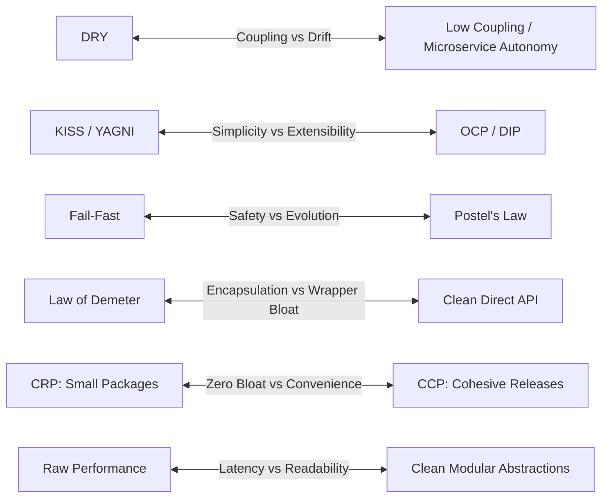

# Principles Conflicts & Architectural Trade-offs

> **One-line summary:** Software design principles exist in deliberate tension—architectural maturity means choosing the right side of a trade-off based on volatility, blast radius, and team context rather than blindly obeying a single rule.

| Attribute | Specification |
|---|---|
| **Level** | Advanced Synthesis |
| **Prerequisites** | [01-dry-and-rule-of-three.md](01-dry-and-rule-of-three.md) through [18-conways-law-and-socio-technical-design.md](18-conways-law-and-socio-technical-design.md) |
| **Estimated Reading Time** | 30 minutes |
| **Status** | Complete |
| **Category** | General Design Principles |
| **Also Known As** | Engineering Trade-off Matrix, Principle Tension Resolution |
| **Languages Tested** | Java 25 (LTS) / TypeScript 5.8 (Node 24 native) / Python 3.14 |

---

## Table of Contents
- [1 The Problem](#1-the-problem)
- [2 Why It Exists](#2-why-it-exists)
- [3 What It Is](#3-what-it-is)
- [4 The Problem Without It](#4-the-problem-without-it)
- [5 How It Solves It](#5-how-it-solves-it)
- [6 How It Works](#6-how-it-works)
- [7 Real-World Examples](#7-real-world-examples)
- [8 When to Use and When NOT to Use](#8-when-to-use-and-when-not-to-use)
- [9 Variations and Language Idioms](#9-variations-and-language-idioms)
- [10 Relationship to Other Principles and Patterns](#10-relationship-to-other-principles-and-patterns)
- [11 Common Mistakes and Anti-Patterns](#11-common-mistakes-and-anti-patterns)
- [12 Testing and Design Verification](#12-testing-and-design-verification)
- [13 Performance, Concurrency and Security Notes](#13-performance-concurrency-and-security-notes)
- [14 Interview Questions](#14-interview-questions)
- [15 Practice Exercises](#15-practice-exercises)
- [16 Summary / Cheat Sheet](#16-summary--cheat-sheet)
- [17 Further Reading](#17-further-reading)

---

## 1 The Problem

Junior engineers often treat design principles as absolute mathematical axioms: *"Always DRY everything! Always follow OCP! Never duplicate a line! Always fail fast!"*

Then two principles collide directly in a real pull request:
- **Conflict 1:** Extracting duplicated `Address` logic across `ShippingService` and `BillingService` satisfies **DRY**, yet couples two unrelated bounded contexts (**SRP / Low Coupling**).
- **Conflict 2:** Adding a `DiscountStrategy` interface satisfies **OCP**, yet violates **KISS** and **YAGNI** when only one discount exists.
- **Conflict 3:** Rejecting unknown JSON fields satisfies **Fail-Fast**, yet breaks zero-downtime microservice deployments (**Postel's Law**).

Without a principled trade-off framework, code reviews degenerate into endless philosophical arguments.

---

## 2 Why It Exists

In *Fundamentals of Software Architecture* (Mark Richards & Neal Ford, 2020), the First Law of Software Architecture states:
> *"Everything in software architecture is a trade-off."*

Every principle optimizes one quality attribute (modifiability, safety, speed of initial delivery, autonomy) at the expense of another. Architectural judgment is knowing **which force dominates in the current context**.

---

## 3 What It Is: The 6 Core Principle Conflicts



---

## 4 The Problem Without It

```java
// Unresolved Conflict: Over-applying DRY across microservice boundaries creates a shared-library monolith!
// packages/common-domain/OrderAddress.java
public record OrderAddress(String street, String zip, boolean taxExemptFlagForBilling, String gateCodeForCourier) {}
// Now Billing and Courier teams block each other on every PR!
```

---

## 5 How It Solves It: Context-Driven Resolution Rules

### Resolution Table for the 6 Major Conflicts

| Conflict | Favor Left Side When... | Favor Right Side When... |
|---|---|---|
| **DRY vs Low Coupling** | Both usages encode the **same domain knowledge** inside one bounded context (e.g. VAT math). | Usages sit in **different actors/microservices** (duplicate small DTOs instead of coupling!). |
| **KISS/YAGNI vs OCP/DIP** | Feature has **1–2 stable variants**, early MVP, or internal utility. | **3+ variants exist** (Rule of Three), high churn, or public SDK extension hook. |
| **Fail-Fast vs Postel's Law** | Invalid required invariants, security/auth headers, negative money. | Additive optional JSON/Protobuf fields, benign whitespace trimming. |
| **Law of Demeter vs Middle Man** | Reaching into **behavioral services** (`a.getB().getC().save()`). | Navigating passive DTOs/Records (`dto.address().city()`) or avoiding 30 forwarding wrappers. |
| **DRY vs DAMP (Tests)** | Production domain rules and constants. | Unit test setup blocks—duplicate small Arrange blocks so each test stays readable. |
| **Performance vs Clean Abstractions** | Profiled **3% hot path** (HFT, rendering loop, N+1 DB batching). | **97% normal business code**—keep clean interfaces until profiler proves a bottleneck. |

### Multi-Language Example: Resolving Fail-Fast + Postel's Law Together

#### Java 25 LTS
```java
record ApiPayload(String userId, double amount) {
    static ApiPayload parse(java.util.Map<String, Object> raw) {
        // Fail-Fast on required domain invariants:
        if (!raw.containsKey("userId") || ((Number) raw.get("amount")).doubleValue() <= 0) {
            throw new IllegalArgumentException("Invalid required fields");
        }
        // Postel's Law: Ignore unknown additive keys like raw.get("clientVersion")!
        return new ApiPayload(String.valueOf(raw.get("userId")), ((Number) raw.get("amount")).doubleValue());
    }
}
```

#### TypeScript 5.8
```typescript
function parsePayload(raw: Record<string, unknown>): { userId: string; amount: number } {
    if (typeof raw.userId !== "string" || typeof raw.amount !== "number" || raw.amount <= 0) {
        throw new Error("Invalid required fields"); // Fail-Fast
    }
    return { userId: raw.userId, amount: raw.amount }; // Postel's Law strips extra keys
}
```

#### Python 3.14
```python
def parse_payload(raw: dict) -> dict:
    uid, amt = raw.get("userId"), raw.get("amount")
    if not isinstance(uid, str) or not isinstance(amt, (int, float)) or amt <= 0:
        raise ValueError("Invalid required fields")  # Fail-Fast
    return {"userId": uid, "amount": float(amt)}     # Postel's Law ignores extras
```

---

## 6 How It Works: Documenting Trade-offs with ADRs

Whenever a team resolves a major architectural conflict (e.g., choosing duplication over shared library coupling, or choosing a Modular Monolith over Microservices), record it in an **Architecture Decision Record (ADR)** noting: *Context, Decision, Alternatives Considered, and Consequences*.

---

## 7 Real-World Examples

### 1. Microservice DTO Duplication vs Shared DRY Libraries
Netflix and Amazon explicitly duplicate small boundary DTOs across services (sacrificing syntactic DRY) to preserve independent deployment autonomy (Low Coupling / Conway's Law).

### 2. HTTP & JSON APIs (Strict Invariants + Tolerant Extras)
Stripe's API rejects missing/invalid required fields strictly (`400`, Fail-Fast) while safely ignoring additive response fields on client SDKs (Postel's Law).

### 3. React Hooks vs Class Inheritance
React traded classical OOP inheritance extensibility for simple functional composition (KISS + Orthogonality).

---

## 8 When to Use and When NOT to Use

| Situation | Decision Guidance |
|---|---|
| **Two principles conflict in a PR** | Identify the **dominant risk** (regression vs coupling vs delay) and pick explicitly. |
| **Both options are cheap to reverse** | Pick **KISS / YAGNI** (simpler code wins by default). |

---

## 9 Variations and Language Idioms

- **Decision Matrices & ADRs:** Standardize trade-off evaluation across teams so decisions aren't re-litigated every sprint.

---

## 10 Relationship to Other Principles and Patterns

Synthesizes **Module 02 (SOLID)** and **Module 03 (General Design Principles)** into a unified decision framework.

---

## 11 Common Mistakes and Anti-Patterns

| Anti-Pattern | Description | Production Consequence | Correct Remedy |
|---|---|---|---|
| **Principle Dogmatism** | Treating one rule (e.g. DRY) as an unbreakable law regardless of context. | Toxic coupling or over-engineering. | Weigh competing forces explicitly. |
| **Flip-Flopping Without ADRs** | Reversing architectural choices every 3 months as new seniors join. | Half-migrated inconsistent codebase. | Document trade-offs in ADRs. |
| **False Dichotomy** | Assuming you must pick 100% Fail-Fast OR 100% Postel's Law. | Fragile APIs or corrupt data. | Apply Fail-Fast to invariants and Postel to unknown extra fields. |
| **Optimizing for Hypothetical Scale** | Trading KISS for distributed complexity before hitting 100 users. | Slow feature velocity. | Match complexity to actual current scale. |
| **Unmeasured Performance Trade-offs** | Sacrificing readability for unverified micro-optimizations. | Unmaintainable code with zero real speedup. | Profile first before trading clarity for speed. |
| **Ignoring Team Topology** | Designing decoupled packages that one siloed team still deploys together. | Wasted abstraction effort. | Align boundaries with team autonomy. |

---

## 12 Testing and Design Verification

Architectural trade-offs are verified via **Fitness Functions** (ArchUnit rules, latency budgets, and contract tests) ensuring chosen boundaries hold over time.

---

## 13 Performance, Concurrency and Security Notes

- **Security:** When **Security (Fail-Fast / Fail-Closed)** conflicts with **Convenience / Tolerance (Postel's Law)**, **Security always wins**.

---

## 14 Interview Questions

<details>
<summary><strong>1. Give a concrete example where DRY conflicts with Low Coupling, and explain how to decide.</strong></summary>

Two microservices (`Billing` and `Shipping`) both need an `Address` structure. Sharing a common `Address` library satisfies DRY, but couples both teams' release cycles and schemas. Unless they share the exact same business actor and lifecycle, duplicate the small DTO per service to preserve Low Coupling and autonomy.
</details>

<details>
<summary><strong>2. How do KISS/YAGNI conflict with OCP/DIP?</strong></summary>

OCP and DIP encourage adding abstract interfaces and extension seams for future variations, while KISS and YAGNI warn against paying abstraction tax before variations exist. Resolve via the **Rule of Three**: write simple direct code first, and introduce OCP/DIP abstractions when real variation or testing friction proves the need.
</details>

<details>
<summary><strong>3. How do Fail-Fast and Postel's Law coexist in a modern REST/Kafka API?</strong></summary>

Fail-Fast on required fields, type mismatches, negative amounts, and security tokens; apply Postel's Law by ignoring unknown additive fields so producers can roll out new fields without breaking older consumers.
</details>

<details>
<summary><strong>4. Why does the First Law of Software Architecture say "Everything is a trade-off"?</strong></summary>

Every architectural choice improves certain qualities (e.g., decoupling, throughput, extensibility) while degrading others (simplicity, latency, operational cost). There are no universal "best" designs—only designs whose trade-offs match the system's priorities.
</details>

<details>
<summary><strong>5. When should you trade away Clean Code / Readability for Performance?</strong></summary>

Only after profiling (flame graphs / JMH) proves a specific 3% hot path is a real bottleneck, and ideally encapsulate that optimization behind a clean interface so the rest of the codebase stays readable.
</details>

<details>
<summary><strong>6. Why do unit tests intentionally trade away DRY for DAMP?</strong></summary>

Making tests overly DRY with shared loops and multi-layered fixtures makes failing tests cryptic to diagnose. Mild Arrange duplication (DAMP) keeps each test self-contained and immediately understandable.
</details>

<details>
<summary><strong>7. How does Law of Demeter conflict with avoiding "Middle Man" classes?</strong></summary>

Hiding every sub-object method behind 30 trivial one-line passthrough wrappers satisfies Demeter literally while creating a bloated Middle Man class. If a caller genuinely needs extensive access to a collaborator, pass that collaborator directly or expose a cohesive domain operation instead.
</details>

<details>
<summary><strong>8. What is an Architecture Decision Record (ADR) and how does it help resolve principle conflicts?</strong></summary>

An ADR is a short markdown document capturing the context, chosen trade-off, rejected alternatives, and consequences of an architectural decision—preventing teams from repeatedly debating settled trade-offs.
</details>

---

## 15 Practice Exercises

### Exercise 1: Resolve Microservice Shared Library Debate (Easy)
Two teams (`Auth` and `Orders`) want to share one `company-models` npm package. List the trade-off and recommend a decision.

<details>
<summary><strong>Solution</strong></summary>

Sharing `company-models` reduces minor DTO duplication (DRY) at the cost of lock-step deployments and transitive dependency bloat (high coupling, violates CRP). Recommend duplicating small boundary types per service and sharing only pure infrastructure utilities if needed.
</details>

---

### Exercise 2: Balance KISS vs OCP for Notification Channels (Medium)
Your startup only sends Email notifications today, though Marketing *might* want SMS next year. Should you build a full `NotificationChannelRegistry` + `AbstractNotifierFactory` today?

<details>
<summary><strong>Solution</strong></summary>

No—favor **KISS / YAGNI** today with a clean `EmailNotifier` (behind a simple 1-method `Notifier` interface if needed for unit testing). Add a channel map/registry only when SMS actually enters committed scope.
</details>

---

### Exercise 3: Write a 10-Line ADR for Fail-Fast vs Postel's Law (Hard)
Draft a concise ADR for an enterprise event bus choosing JSON schema evolution rules.

<details>
<summary><strong>Solution</strong></summary>

- **Context:** Producers and consumers deploy independently on Kafka.
- **Decision:** Consumers must ignore unknown additive JSON fields (`ignoreUnknown = true`) while failing fast to a Dead-Letter Queue if required fields or invariants fail validation.
- **Consequences:** Enables zero-downtime rolling producer upgrades while protecting downstream ledger integrity.
</details>

---

## 16 Summary / Cheat Sheet

```
+--------------------------------------------------------------------------+
|                  PRINCIPLES CONFLICTS & TRADE-OFFS                       |
+--------------------------------------------------------------------------+
| DRY vs COUPLING     : DRY within bounded context; duplicate across svcs. |
| KISS vs OCP/DIP     : KISS first; add OCP/DIP seams at Rule of Three.    |
| FAIL-FAST vs POSTEL : Strict on invariants/security; tolerant on extras. |
| PERF vs CLARITY     : Clarity first; optimize only profiled 3% hot paths.|
+--------------------------------------------------------------------------+
```

---

## 17 Further Reading

- Mark Richards & Neal Ford, *Fundamentals of Software Architecture*, O'Reilly, 2020.
- Michael Nygard, *Documenting Architecture Decisions (ADRs)*, 2011.

### In Your Language
| Language Track | Deep Dive Reference |
|---|---|
| Java | [Java OOP & Design Patterns](file:///e:/Learning/engineering-notes/01-languages/java/24-design-patterns/README.md) |
| TypeScript | [TypeScript Design Patterns](file:///e:/Learning/engineering-notes/01-languages/typescript/17-design-patterns/README.md) |
| Python | [Python Design Patterns](file:///e:/Learning/engineering-notes/01-languages/python/23-design-patterns/README.md) |

---

[← Previous: 18 - Conway's Law](file:///e:/Learning/engineering-notes/08-solid-design-patterns/03-design-principles/18-conways-law-and-socio-technical-design.md) | [Module 03 Index](file:///e:/Learning/engineering-notes/08-solid-design-patterns/03-design-principles/README.md) | [Next: 20 - General Principles Cheat Sheet →](file:///e:/Learning/engineering-notes/08-solid-design-patterns/03-design-principles/20-principles-cheat-sheet.md)
