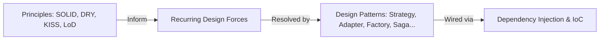

# Introduction to Design Patterns: Overview

> **One-line summary:** Design patterns are not copy-paste templates or magic silver bullets—they are a shared engineering vocabulary of proven solutions to recurring structural forces.

| Attribute | Specification |
|---|---|
| **Level** | Foundational / Bridge |
| **Prerequisites** | [Module 02: SOLID Principles](file:///e:/Learning/engineering-notes/08-solid-design-patterns/02-solid-principles/README.md), [Module 03: General Design Principles](file:///e:/Learning/engineering-notes/08-solid-design-patterns/03-design-principles/README.md) |
| **Estimated Reading Time** | 15 minutes |
| **Status** | Complete |
| **Category** | Patterns Introduction |

---

## 1. The Role of Design Patterns

If SOLID and General Design Principles tell us *what* properties healthy software has (low coupling, high cohesion, open for extension), **Design Patterns** show us *how* classes and objects collaborate mechanically to achieve those properties.

---

## 2. The Three Classical GoF Categories (Plus Modern Extensions)

1. **Creational Patterns (Module 05):** Decouple *how* objects are constructed, pooled, or wired from the code that uses them (`Factory Method`, `Abstract Factory`, `Builder`, `Prototype`, `Singleton`, `Object Pool`).
2. **Structural Patterns (Module 06):** Compose objects and interfaces into larger flexible structures (`Adapter`, `Bridge`, `Composite`, `Decorator`, `Facade`, `Flyweight`, `Proxy`, `Null Object`).
3. **Behavioral Patterns (Module 07):** Govern algorithms, state transitions, and communication protocols between objects (`Strategy`, `Observer`, `Command`, `State`, `Template Method`, `Chain of Responsibility`, `Iterator`, `Mediator`, `Memento`, `Visitor`).
4. **Modern Concurrency, Enterprise, Distributed & Functional Patterns (Modules 08–12):** Extend GoF into multi-threaded runtimes, persistence layers, microservices, and functional programming.

---

## 3. Pattern Fever Warning

Knowing 23 patterns makes every problem look like a nail. Always remember **Joshua Kerievsky's rule** (*Refactoring to Patterns*):
> *"Do not design upfront with patterns. Evolve toward patterns through refactoring when concrete friction appears."*

---

[← Module 04 Index](file:///e:/Learning/engineering-notes/08-solid-design-patterns/04-patterns-intro/README.md) | [Next: 01 - What Are Design Patterns? →](file:///e:/Learning/engineering-notes/08-solid-design-patterns/04-patterns-intro/01-what-are-patterns.md)
