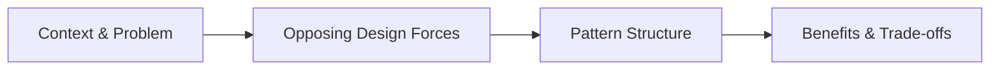

# What Are Design Patterns?

> **One-line summary:** A design pattern is a named, reusable architectural solution to a recurring design problem within a specific context—providing shared vocabulary, explicit trade-offs, and structural clarity without prescribing rigid boilerplate.

| Attribute | Specification |
|---|---|
| **Level** | Core / Foundational |
| **Prerequisites** | [00-overview.md](00-overview.md), [01-oop-pillars.md](../01-foundations/01-oop-pillars.md) |
| **Estimated Reading Time** | 25 minutes |
| **Status** | Complete |
| **Category** | Patterns Introduction |
| **Also Known As** | Software Design Patterns, GoF Pattern Anatomy |
| **Languages Tested** | Java 25 (LTS) / TypeScript 5.8 (Node 24 native) / Python 3.14 |

---

## Table of Contents
- [1 The Problem](#1-the-problem)
- [2 Why It Exists](#2-why-it-exists)
- [3 What It Is](#3-what-it-is)
- [4 The Problem Without It](#4-the-problem-without-it)
- [5 How It Solves It](#5-how-it-solves-it)
- [6 How It Works](#6-how-it-works)
- [7 Real-World Examples](#7-real-world-examples)
- [8 When to Use and When NOT to Use](#8-when-to-use-and-when-not-to-use)
- [9 Variations and Language Idioms](#9-variations-and-language-idioms)
- [10 Relationship to Other Principles and Patterns](#10-relationship-to-other-principles-and-patterns)
- [11 Common Mistakes and Anti-Patterns](#11-common-mistakes-and-anti-patterns)
- [12 Testing and Design Verification](#12-testing-and-design-verification)
- [13 Performance, Concurrency and Security Notes](#13-performance-concurrency-and-security-notes)
- [14 Interview Questions](#14-interview-questions)
- [15 Practice Exercises](#15-practice-exercises)
- [16 Summary / Cheat Sheet](#16-summary--cheat-sheet)
- [17 Further Reading](#17-further-reading)

---

## 1 The Problem

Two senior engineers are reviewing a pull request for a payment gateway integration. One says:
*"We need an intermediary class here that wraps Stripe's incompatible SDK signature into our internal `PaymentProcessor` interface, plus a wrapper that adds exponential-backoff retries around it without modifying the Stripe class itself."*

Without shared pattern names, every architectural discussion requires explaining basic object collaborations from scratch in 200-word paragraphs. With pattern vocabulary, the engineer simply says:
*"Use an **Adapter** for the Stripe SDK and wrap it in a retry **Decorator**."*
Both engineers immediately share the exact class topology, responsibilities, and trade-offs in two words.

---

## 2 Why It Exists

In 1977, architect **Christopher Alexander** (*A Pattern Language*) noticed that great buildings and towns reuse recurring structural solutions to human spatial problems. In 1994, **Erich Gamma, Richard Helm, Ralph Johnson, and John Vlissides** (the **Gang of Four**) brought this concept to software in *Design Patterns: Elements of Reusable Object-Oriented Software*, cataloging 23 foundational patterns.

---

## 3 What It Is: Pattern vs. Algorithm vs. Idiom vs. Framework

| Concept | Scope | Example |
|---|---|---|
| **Algorithm** | Step-by-step computational procedure for solving a math/data problem | QuickSort, Dijkstra's Shortest Path |
| **Language Idiom** | Low-level convention specific to one programming language | Python Context Manager (`with`), Java `try-with-resources` |
| **Design Pattern** | Language-independent object/module collaboration solving structural forces | Strategy, Adapter, Observer, Circuit Breaker |
| **Framework** | Concrete executable codebase you plug handlers into (IoC) | Spring Boot, NestJS, FastAPI |

### The 4 Essential Elements of Every Pattern (GoF)
1. **Pattern Name:** Shared vocabulary handle.
2. **Problem & Context:** When to apply it and what opposing forces exist.
3. **Solution:** Abstract participants, relationships, and responsibilities (not rigid copy-paste code!).
4. **Consequences:** Trade-offs, memory/indirection costs, and benefits.



---

## 4 The Problem Without It

Reinventing ad-hoc, inconsistently named designs (`StripeHelperWrapperManager`, `RetryThingy`) across different parts of the codebase obscures architectural intent and makes onboarding new engineers slow.

---

## 5 How It Solves It

Naming and structuring collaborations explicitly around proven patterns makes intent immediately clear in Java, TypeScript, and Python:

### Java / TypeScript / Python Quick Illustration (Strategy Intent)

#### Java 25 LTS
```java
interface RetryPolicy { int maxAttempts(); }
class ExponentialRetryPolicy implements RetryPolicy {
    public int maxAttempts() { return 3; }
}
```

#### TypeScript 5.8
```typescript
type RetryPolicy = (attempt: number) => number; // Idiomatic functional Strategy!
const exponentialBackoff: RetryPolicy = attempt => 100 * (2 ** attempt);
```

#### Python 3.14
```python
from typing import Callable
RetryPolicy = Callable[[int], int]
exponential_backoff: RetryPolicy = lambda attempt: 100 * (2 ** attempt)
```

---

## 6 How It Works: "Patterns Are Discovered, Not Invented"

As **Peter Norvig** famously demonstrated (1998), 16 of the 23 GoF patterns become invisible or trivial in languages with first-class functions (TypeScript, Python, Java 8+ lambdas). A pattern is *not* a mandatory class diagram—it is a structural solution to a missing language feature or recurring domain force.

---

## 7 Real-World Examples

1. **Java `java.io.BufferedInputStream`**: Classic **Decorator** pattern.
2. **DOM `addEventListener`**: Classic **Observer** pattern.
3. **Spring `JdbcTemplate` / Python `contextlib`**: Classic **Template Method / Strategy / IoC** pattern.

---

## 8 When to Use and When NOT to Use

| Context | Guidance |
|---|---|
| **Recurring design friction** (duplication, rigid switches, incompatible APIs) | Select the minimal pattern that resolves the force. |
| **Greenfield trivial code** | Never force patterns upfront ("Pattern Fever"). |

---

## 9 Variations and Language Idioms

- **OOP Classes vs First-Class Functions:** Command, Strategy, and Visitor often collapse into plain lambdas or pattern matching in modern Java 25, TypeScript, and Python.

---

## 10 Relationship to Other Principles and Patterns

Patterns are concrete implementations of **Module 02 (SOLID)** and **Module 03 (General Design Principles)**.

---

## 11 Common Mistakes and Anti-Patterns

| Anti-Pattern | Description | Production Consequence | Correct Remedy |
|---|---|---|---|
| **Pattern Fever** | Cramming 8 GoF patterns into a 200-line CRUD app. | Unreadable Enterprise FizzBuzz. | Refactor *to* patterns only on proven friction. |
| **Cargo-Cult Copying** | Copying GoF C++ class diagrams verbatim into Python/TS instead of using lambdas. | Massive unnecessary boilerplate. | Use idiomatic language equivalents. |
| **Confusing Patterns with Algorithms** | Calling Binary Search a design pattern. | Terminology confusion in interviews. | Algorithms solve computation; patterns solve structure/coupling. |
| **Naming Classes After Patterns Blindly** | `UserFactoryManagerBuilderProxy` when `UserService` suffices. | Confusing over-abstracted names. | Name classes after *domain concepts* first, pattern role second if helpful. |
| **Ignoring Consequences** | Adopting Singleton or Flyweight without noting thread-safety/testing costs. | Hidden global state bugs. | Always evaluate the Consequences section. |
| **Applying Patterns Upfront** | Designing 5 layers before writing 1 working test. | Violates YAGNI. | Let tests and Rule of Three reveal needed patterns. |

---

## 12 Testing and Design Verification

Patterns like Strategy, Adapter, and Factory exist primarily to create **clean test seams** so business logic can be verified independently of external I/O.

---

## 13 Performance, Concurrency and Security Notes

Every structural pattern introduces at least one level of indirection; verify whether thread-safety (e.g., Singleton, Flyweight, Object Pool) requires synchronization or immutability.

---

## 14 Interview Questions

<details>
<summary><strong>1. What are the four essential components of a Design Pattern according to the Gang of Four?</strong></summary>

1. Pattern Name, 2. Problem (Context & Forces), 3. Solution (Abstract structure & collaborations), and 4. Consequences (Trade-offs, benefits, and costs).
</details>

<details>
<summary><strong>2. Distinguish a Design Pattern from an Algorithm, an Idiom, and a Framework.</strong></summary>

An **Algorithm** computes a specific result (e.g., QuickSort). An **Idiom** is language-specific syntax/convention (e.g., Python `with`). A **Design Pattern** is a language-independent architectural collaboration. A **Framework** is executable code owning the runtime lifecycle (IoC).
</details>

<details>
<summary><strong>3. What did Peter Norvig mean by "16 of 23 GoF patterns are invisible or simpler in dynamic/functional languages"?</strong></summary>

Many GoF patterns (Strategy, Command, Factory Method, Iterator) were workarounds for 1994 C++/Java lacking first-class functions, closures, and built-in generators. In Python, TypeScript, and modern Java, passing a lambda or generator replaces multiple boilerplate classes.
</details>

<details>
<summary><strong>4. What is "Pattern Fever" and how do you avoid it?</strong></summary>

Pattern Fever is forcing design patterns onto simple problems prematurely just to feel "architectural." Avoid it via YAGNI, KISS, and Joshua Kerievsky's *Refactoring to Patterns* approach.
</details>

<details>
<summary><strong>5. What are the three classical GoF pattern categories?</strong></summary>

**Creational** (object instantiation), **Structural** (composition of classes/objects), and **Behavioral** (algorithms and communication protocols).
</details>

<details>
<summary><strong>6. Why is shared vocabulary one of the highest-value benefits of design patterns?</strong></summary>

Saying "wrap that legacy SDK in an Adapter and add a caching Proxy" communicates complex multi-class relationships, invariants, and trade-offs in seconds with zero ambiguity.
</details>

<details>
<summary><strong>7. Why are GoF patterns NOT copy-paste code templates?</strong></summary>

Patterns describe *relationships and responsibilities* that adapt to the host language and domain context—not fixed syntax to copy verbatim.
</details>

<details>
<summary><strong>8. Who pioneered the concept of "Pattern Languages" before software engineering?</strong></summary>

Building architect **Christopher Alexander** in *A Pattern Language* (1977) and *The Timeless Way of Building* (1979).
</details>

---

## 15 Practice Exercises

### Exercise 1: Classify Concepts (Easy)
Classify each as Algorithm, Idiom, Pattern, or Framework: (a) MergeSort, (b) Python `with open(...)`, (c) Adapter, (d) NestJS.

<details>
<summary><strong>Solution</strong></summary>

(a) Algorithm, (b) Idiom, (c) Design Pattern, (d) Framework.
</details>

---

### Exercise 2: Simplify GoF Boilerplate in TypeScript (Medium)
Replace a 3-class `ComparatorStrategy` hierarchy with an idiomatic TypeScript function type.

<details>
<summary><strong>Solution</strong></summary>

`type SortStrategy<T> = (a: T, b: T) => number;` — pass arrow functions directly to `items.sort(strategy)`.
</details>

---

### Exercise 3: Identify Forces Before Picking a Pattern (Hard)
You must integrate 3 third-party shipping APIs (`FedEx`, `UPS`, `DHL`) that each have incompatible method names and XML/JSON formats into one checkout service. Identify the forces and pattern.

<details>
<summary><strong>Solution</strong></summary>

Forces: incompatible external APIs + need for uniform checkout interface (DIP/OCP). Pattern: **Adapter** (one per carrier implementing a unified `ShippingGateway` port).
</details>

---

## 16 Summary / Cheat Sheet

```
+--------------------------------------------------------------------------+
|                         WHAT ARE DESIGN PATTERNS?                        |
+--------------------------------------------------------------------------+
| DEFINITION : Named, reusable collaboration solving recurring forces.     |
| 4 PARTS    : Name + Problem/Forces + Solution + Consequences.            |
| RULE       : Patterns are evolved into via refactoring, never forced!    |
+--------------------------------------------------------------------------+
```

---

## 17 Further Reading

- Erich Gamma et al., *Design Patterns: Elements of Reusable Object-Oriented Software*, Addison-Wesley, 1994.
- Peter Norvig, *Design Patterns in Dynamic Programming*, norvig.com/design-patterns, 1998.

### In Your Language
| Language Track | Deep Dive Reference |
|---|---|
| Java | [Java OOP & Design Patterns](file:///e:/Learning/engineering-notes/01-languages/java/24-design-patterns/README.md) |
| TypeScript | [TypeScript Design Patterns](file:///e:/Learning/engineering-notes/01-languages/typescript/17-design-patterns/README.md) |
| Python | [Python Design Patterns](file:///e:/Learning/engineering-notes/01-languages/python/23-design-patterns/README.md) |

---

[← Previous: 00 - Patterns Intro Overview](file:///e:/Learning/engineering-notes/08-solid-design-patterns/04-patterns-intro/00-overview.md) | [Module 04 Index](file:///e:/Learning/engineering-notes/08-solid-design-patterns/04-patterns-intro/README.md) | [Next: 02 - How to Read & Choose Patterns →](file:///e:/Learning/engineering-notes/08-solid-design-patterns/04-patterns-intro/02-how-to-read-and-choose-patterns.md)
