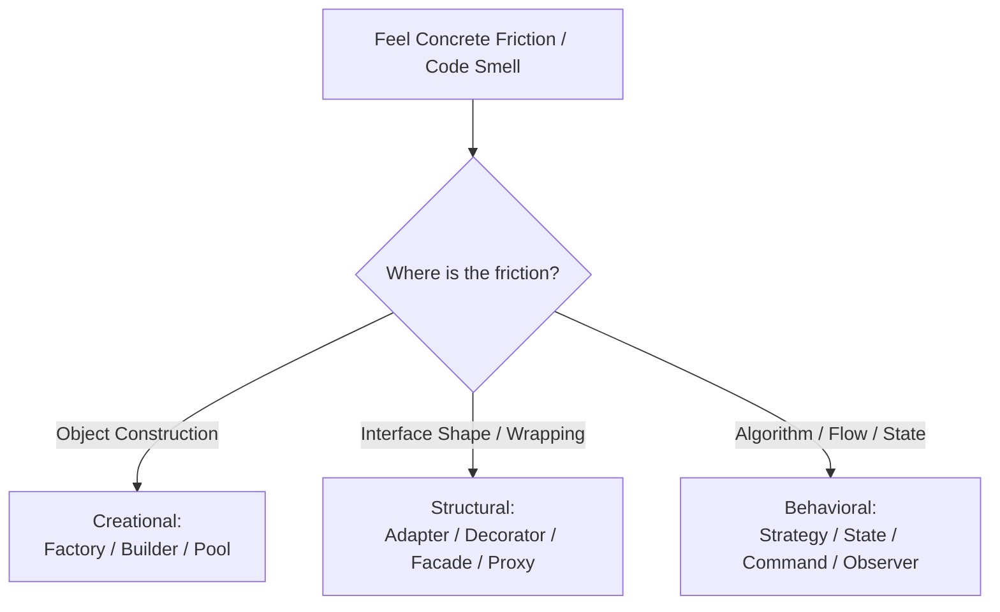

# How to Read & Choose Design Patterns

> **One-line summary:** Choose design patterns by diagnosing the exact structural friction in your code—never by memorizing class diagrams or cramming patterns into greenfield code upfront.

| Attribute | Specification |
|---|---|
| **Level** | Core / Practical Methodology |
| **Prerequisites** | [01-what-are-patterns.md](01-what-are-patterns.md), [06-solid-in-practice.md](../02-solid-principles/06-solid-in-practice.md) |
| **Estimated Reading Time** | 25 minutes |
| **Status** | Complete |
| **Category** | Patterns Introduction |
| **Also Known As** | Pattern Selection Heuristics, Refactoring to Patterns |
| **Languages Tested** | Java 25 (LTS) / TypeScript 5.8 (Node 24 native) / Python 3.14 |

---

## Table of Contents
- [1 The Problem](#1-the-problem)
- [2 Why It Exists](#2-why-it-exists)
- [3 What It Is](#3-what-it-is)
- [4 The Problem Without It](#4-the-problem-without-it)
- [5 How It Solves It](#5-how-it-solves-it)
- [6 How It Works](#6-how-it-works)
- [7 Real-World Examples](#7-real-world-examples)
- [8 When to Use and When NOT to Use](#8-when-to-use-and-when-not-to-use)
- [9 Variations and Language Idioms](#9-variations-and-language-idioms)
- [10 Relationship to Other Principles and Patterns](#10-relationship-to-other-principles-and-patterns)
- [11 Common Mistakes and Anti-Patterns](#11-common-mistakes-and-anti-patterns)
- [12 Testing and Design Verification](#12-testing-and-design-verification)
- [13 Performance, Concurrency and Security Notes](#13-performance-concurrency-and-security-notes)
- [14 Interview Questions](#14-interview-questions)
- [15 Practice Exercises](#15-practice-exercises)
- [16 Summary / Cheat Sheet](#16-summary--cheat-sheet)
- [17 Further Reading](#17-further-reading)

---

## 1 The Problem

After learning the 23 GoF patterns, many developers suffer from **"Pattern Hammer Syndrome"**:
- When a class has 4 constructor arguments, they invent a `Builder` + `Director`.
- When a `switch` has 2 cases, they invent an `AbstractFactory` + `Strategy`.
- When two objects look slightly similar, they force a `Visitor` or `Bridge`.

The code turns into a maze of indirection. Worse, when a *real* design problem hits—such as needing undo/redo history (`Command` + `Memento`) or wrapping a legacy vendor SDK (`Adapter`)—developers pick the wrong look-alike pattern (`Facade` vs `Adapter`, `Decorator` vs `Proxy`, `Strategy` vs `State`) because they memorized UML shapes instead of **intent and forces**.

---

## 2 Why It Exists

In *Refactoring to Patterns* (2004), **Joshua Kerievsky** showed that patterns are most effective as **refactoring targets**, not upfront blueprints:
1. Write simple, direct code first (KISS + YAGNI).
2. Let tests and real feature changes expose concrete friction (code smells).
3. Select the exact pattern whose **Intent** resolves that friction.

---

## 3 What It Is: Symptom-to-Pattern Triage Matrix

| Code Smell / Friction You Feel | Likely Pattern Target |
|---|---|
| Telescoping constructors (`new Pizza(a, b, null, true, false, null)`) | **Builder** |
| Branching `switch(type)` selecting an algorithm at runtime | **Strategy** |
| Complex `if (status == ...)` state transition rules across methods | **State** |
| Incompatible third-party API signature | **Adapter** |
| Need to stack optional behaviors (logging, caching, retries) dynamically | **Decorator** |
| Subsystem has 12 complex classes; callers just want one simple workflow | **Facade** |
| Need to queue, log, retry, or undo operations | **Command** |
| Multiple observers must react automatically to an event | **Observer / Pub-Sub** |
| Guarding every caller with `if (user != null)` checks | **Null Object** |



---

## 4 The Problem Without It

Misdiagnosing **State** vs **Strategy** or **Adapter** vs **Decorator**:
- Using inheritance subclasses instead of **Decorator** causes $2^N$ class explosion when combining logging + compression + encryption.
- Using **Singleton** for a stateful DB connection pool causes global test pollution instead of **Dependency Injection + Pool**.

---

## 5 How It Solves It: Look-Alike Disambiguation

Many patterns look **identical** in UML diagrams (a wrapper delegating to an interface!). You distinguish them strictly by **Intent**:

| Wrapper Pattern | UML Structure | Distinct Architectural Intent |
|---|---|---|
| **Adapter** | Wrapper $\to$ Adaptee | **Changes interface** from incompatible A to expected B |
| **Decorator** | Wrapper(Component) $\to$ Component | **Adds responsibilities** dynamically while keeping the *same* interface |
| **Proxy** | Proxy(Subject) $\to$ Subject | **Controls access** (lazy load, auth, caching, remote RPC) keeping the *same* interface |
| **Facade** | Facade $\to$ Subsystem A, B, C | **Simplifies** a complex multi-class subsystem behind a unified entry point |

---

## 6 How It Works: Reading Any Pattern in 4 Questions

Whenever you study a pattern in Modules 05–12, ask these 4 questions first:
1. **What breaks without it?** (The exact Change Request failure).
2. **What varies?** (Which axis of change is encapsulated?).
3. **What is the cost?** (Extra classes, indirection, memory, runtime overhead?).
4. **Is there a simpler native idiom?** (e.g. lambda instead of Strategy class; `record` instead of Builder).

---

## 7 Real-World Examples

1. **Java `InputStream` wrappers**: `BufferedInputStream(FileInputStream)` is **Decorator** (adds buffering, same interface); `InputStreamReader(InputStream)` is **Adapter** (bridges byte stream to character `Reader` interface).
2. **Spring `@Transactional` / `@Cacheable` beans**: **Proxy** pattern controlling transaction/cache lifecycle transparently.
3. **Stripe SDK client**: **Facade** hiding HTTP retries, signing, serialization, and auth headers behind `stripe.charges.create(...)`.

---

## 8 When to Use and When NOT to Use

- **Use a pattern** when code smells (Rule of Three, switch explosion, telescoping constructors, incompatible SDKs) appear in real work.
- **Avoid a pattern** when simpler language features (`record`, named parameters, lambdas, plain `if/else` for 2 fixed cases) solve the problem cleanly.

---

## 9 Variations and Language Idioms

- **Java:** Records + `switch` expressions simplify Factory & Visitor; lambdas simplify Strategy & Command.
- **TypeScript:** Options objects (`{ host, port, tls = true }`) replace 80% of Builder use cases!
- **Python:** Keyword arguments with defaults replace Builder; `@dataclass(frozen=True)` + functions simplify Creational/Behavioral patterns.

---

## 10 Relationship to Other Principles and Patterns

See [Module 18: Pattern Selection](file:///e:/Learning/engineering-notes/08-solid-design-patterns/18-pattern-selection/README.md) for full interactive decision trees across all 60+ patterns.

---

## 11 Common Mistakes and Anti-Patterns

| Anti-Pattern | Description | Production Consequence | Correct Remedy |
|---|---|---|---|
| **Pattern Fever** | Designing every class as a Factory/Strategy/Visitor before writing tests. | Bloat and slow velocity. | Refactor *to* patterns on friction. |
| **UML-Driven Confusion** | Picking Decorator when you actually need Adapter or Proxy. | Broken abstractions. | Match by *intent*, not diagram shape. |
| **Builder for 3 Fields** | Writing a 40-line Builder in Python/TS where keyword args or options objects exist. | Unnecessary boilerplate. | Use native language idioms. |
| **Pattern Stacking** | Wrapping `AbstractFactoryProviderStrategyProxy` for trivial calls. | Un-debuggable stack traces. | Keep layers shallow and cohesive. |
| **Ignoring Language Evolution** | Copying 1994 C++ pattern workarounds into Java 25 / Python 3.14. | Fighting modern language ergonomics. | Use lambdas, records, protocols. |
| **Never Removing Patterns** | Keeping a Strategy hierarchy after 3 of 4 variants were deleted years ago. | Dead indirection. | Refactor *away* from patterns when complexity shrinks! |

---

## 12 Testing and Design Verification

Before introducing a pattern, write a failing test or identify a concrete maintainability pain; verify after refactoring that the test suite is simpler and requires fewer mocks.

---

## 13 Performance, Concurrency and Security Notes

Every pattern adds indirection; verify whether a Flyweight/Singleton introduces shared mutable state (concurrency hazard) or whether a Proxy handles auth checks fail-closed.

---

## 14 Interview Questions

<details>
<summary><strong>1. How do Adapter, Decorator, Proxy, and Facade differ if their code looks similar?</strong></summary>

By **intent**: Adapter converts an incompatible interface; Decorator adds behavior to the same interface; Proxy controls access to the same interface; Facade simplifies a multi-class subsystem behind a new high-level interface.
</details>

<details>
<summary><strong>2. What does "Refactoring to Patterns" mean?</strong></summary>

Coined by Joshua Kerievsky: start with simple code and evolve *toward* a design pattern through small safe refactorings only when real code smells/volatility justify the abstraction—and refactor *away* from patterns if complexity shrinks.
</details>

<details>
<summary><strong>3. When do Strategy and State patterns differ despite having identical class diagrams?</strong></summary>

In **Strategy**, the *caller* selects and injects an algorithm (e.g., `ZipCompression` vs `GzipCompression`), and strategies are unaware of each other. In **State**, the object transitions *itself* between states (`Draft` $\to$ `Published` $\to$ `Archived`) based on lifecycle rules.
</details>

<details>
<summary><strong>4. Why are Builders rarely needed in TypeScript and Python?</strong></summary>

TypeScript supports typed options objects (`config: ServerOptions`) with optional properties and defaults; Python supports named keyword arguments (`connect(host="x", timeout=5)`), making telescoping constructors uncommon.
</details>

<details>
<summary><strong>5. What is the difference between Factory Method and Abstract Factory?</strong></summary>

**Factory Method** creates *one* product via inheritance/overriding a creation method. **Abstract Factory** creates *families* of related/compatible products (e.g., `DarkButton` + `DarkCheckbox`) via composition.
</details>

<details>
<summary><strong>6. What are the 4 questions to ask before introducing any pattern?</strong></summary>

1. What breaks without it? 2. What axis varies? 3. What is the complexity/runtime cost? 4. Is there a simpler native language idiom?
</details>

<details>
<summary><strong>7. Why should you refactor *away* from a pattern sometimes?</strong></summary>

If business requirements simplify (e.g., 4 payment providers consolidate down to 1), keeping an unused Strategy + Factory hierarchy adds dead indirection tax (YAGNI).
</details>

<details>
<summary><strong>8. Which pattern solves `if (x != null)` checks scattered across 20 callers?</strong></summary>

**Null Object Pattern** (or language-native `Optional<T>` / `Result`), providing a safe no-op implementation instead of `null`.
</details>

---

## 15 Practice Exercises

### Exercise 1: Pattern Triage (Easy)
Match each scenario to the best pattern:
1. Wrapping a legacy SOAP XML client behind a clean `WeatherClient` interface.
2. Adding retry logic and metrics timing around an existing `HttpClient` without editing it.
3. Preventing 10 callers from checking `if (logger != null)` before logging.

<details>
<summary><strong>Solution</strong></summary>

1. **Adapter**, 2. **Decorator**, 3. **Null Object**.
</details>

---

### Exercise 2: Simplify Unnecessary Builder in TypeScript (Medium)
Replace a 4-method `UserQueryBuilder` with an idiomatic TypeScript options interface and default values.

<details>
<summary><strong>Solution</strong></summary>

`function findUsers(opts: { limit?: number; activeOnly?: boolean; role?: string } = {}) { ... }`
</details>

---

### Exercise 3: Distinguish State vs Strategy (Hard)
You are building a document approval workflow (`Draft` $\to$ `UnderReview` $\to$ `Approved` $\to$ `Archived`) where calling `publish()` behaves differently per stage and advances the stage. Explain why **State** fits better than **Strategy**.

<details>
<summary><strong>Solution</strong></summary>

In an approval workflow, transitions follow strict internal lifecycle rules (`Draft` cannot jump to `Archived` directly) and states know their valid next states—classic **State** pattern, not independent caller-selected **Strategy**.
</details>

---

## 16 Summary / Cheat Sheet

```
+--------------------------------------------------------------------------+
|                   HOW TO READ & CHOOSE PATTERNS                          |
+--------------------------------------------------------------------------+
| RULE 1 : Diagnose friction FIRST; never force patterns upfront.          |
| RULE 2 : Match by INTENT, not UML diagram similarity.                    |
| RULE 3 : Prefer native language idioms (lambdas, options) over boilerplate|
| RULE 4 : Refactor AWAY from patterns if complexity disappears.           |
+--------------------------------------------------------------------------+
```

---

## 17 Further Reading

- Joshua Kerievsky, *Refactoring to Patterns*, Addison-Wesley, 2004.

### In Your Language
| Language Track | Deep Dive Reference |
|---|---|
| Java | [Java OOP & Design Patterns](file:///e:/Learning/engineering-notes/01-languages/java/24-design-patterns/README.md) |
| TypeScript | [TypeScript Design Patterns](file:///e:/Learning/engineering-notes/01-languages/typescript/17-design-patterns/README.md) |
| Python | [Python Design Patterns](file:///e:/Learning/engineering-notes/01-languages/python/23-design-patterns/README.md) |

---

[← Previous: 01 - What Are Design Patterns?](file:///e:/Learning/engineering-notes/08-solid-design-patterns/04-patterns-intro/01-what-are-patterns.md) | [Module 04 Index](file:///e:/Learning/engineering-notes/08-solid-design-patterns/04-patterns-intro/README.md) | [Next: 03 - Dependency Injection →](file:///e:/Learning/engineering-notes/08-solid-design-patterns/04-patterns-intro/03-dependency-injection.md)
