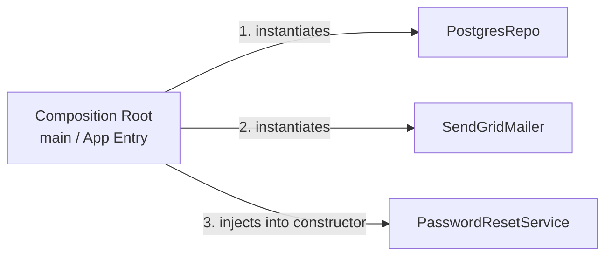

# Dependency Injection (DI)

> **One-line summary:** Pass a component's collaborators into it from the outside (via a Composition Root) rather than letting the component instantiate or locate them internally—unlocking testability, modularity, and DIP compliance without framework magic.

| Attribute | Specification |
|---|---|
| **Level** | Core / Foundational Pattern |
| **Prerequisites** | [04-programming-to-interfaces.md](../01-foundations/04-programming-to-interfaces.md), [05-dependency-inversion.md](../02-solid-principles/05-dependency-inversion.md) |
| **Estimated Reading Time** | 35 minutes |
| **Status** | Complete |
| **Category** | Patterns Introduction / Wiring |
| **Also Known As** | Pure DI, Constructor Injection, Composition Root Pattern |
| **Languages Tested** | Java 25 (LTS) / TypeScript 5.8 (Node 24 native) / Python 3.14 |

---

## Table of Contents
- [1 The Problem](#1-the-problem)
- [2 Why It Exists](#2-why-it-exists)
- [3 What It Is](#3-what-it-is)
- [4 The Problem Without It](#4-the-problem-without-it)
- [5 How It Solves It](#5-how-it-solves-it)
- [6 How It Works](#6-how-it-works)
- [7 Real-World Examples](#7-real-world-examples)
- [8 When to Use and When NOT to Use](#8-when-to-use-and-when-not-to-use)
- [9 Variations and Language Idioms](#9-variations-and-language-idioms)
- [10 Relationship to Other Principles and Patterns](#10-relationship-to-other-principles-and-patterns)
- [11 Common Mistakes and Anti-Patterns](#11-common-mistakes-and-anti-patterns)
- [12 Testing and Design Verification](#12-testing-and-design-verification)
- [13 Performance, Concurrency and Security Notes](#13-performance-concurrency-and-security-notes)
- [14 Interview Questions](#14-interview-questions)
- [15 Practice Exercises](#15-practice-exercises)
- [16 Summary / Cheat Sheet](#16-summary--cheat-sheet)
- [17 Further Reading](#17-further-reading)

---

## 1 The Problem

Imagine a `PasswordResetService` that instantiates its own `PostgresUserRepo` and `SendGridMailer` using `new` inside its constructor.

Two immediate disasters hit:
1. **Untestable Code:** Running unit tests triggers real PostgreSQL connections and sends real SendGrid emails!
2. **Hidden Dependencies:** Callers constructing `new PasswordResetService()` have no idea it requires valid database credentials and internet access to run.

---

## 2 Why It Exists

Coined by **Martin Fowler** in 2004 (*Inversion of Control Containers and the Dependency Injection Pattern*) and expanded by **Mark Seemann** (*Dependency Injection Principles, Practices, and Patterns*), DI separates **object construction/wiring** from **object behavior/use**.

Crucially: **Dependency Injection is a 3-line design technique, NOT a framework!** You do not need Spring, Guice, or NestJS to practice DI (**Pure DI**).

---

## 3 What It Is

There are three ways to inject dependencies (with **Constructor Injection** as the gold standard):
1. **Constructor Injection (Preferred):** Collaborators are passed into the constructor, marked `final`/`readonly`, guaranteeing the object is never in a half-initialized state.
2. **Method Injection:** Passing a per-call dependency directly into the method (`service.render(formatter)`).
3. **Setter/Property Injection (Avoid unless optional):** Mutable setter methods—risks `NullPointerException` if callers forget to set them.



---

## 4 The Problem Without It

```java
// Anti-Pattern: Self-wiring + Service Locator
class PasswordResetViolation {
    // Impossible to swap for in-memory fake in unit tests!
    private final SmtpMailer mailer = new SmtpMailer("smtp.prod.internal", 25);

    public void reset(String email) {
        mailer.send(email, "Reset token: 1234");
    }
}
```

---

## 5 How It Solves It

Accept `EmailSender` via constructor injection and assemble the real dependency graph once inside `main()` (the **Composition Root**).

### Java Implementation (Java 25 LTS — Pure DI)

```java
package com.design.patterns.di;

interface EmailSender {
    void send(String to, String body);
}

class SmtpEmailSender implements EmailSender {
    public void send(String to, String body) {
        System.out.println("Java SMTP -> " + to + ": " + body);
    }
}

class PasswordResetService {
    private final EmailSender emailSender;

    public PasswordResetService(EmailSender emailSender) {
        if (emailSender == null) throw new IllegalArgumentException("emailSender required");
        this.emailSender = emailSender;
    }

    public void reset(String email) {
        emailSender.send(email, "Your reset link: https://example.com/reset");
    }
}

public class PureDiApp {
    public static void main(String[] args) {
        // Composition Root: all wiring lives here!
        EmailSender sender = new SmtpEmailSender();
        PasswordResetService service = new PasswordResetService(sender);
        service.reset("alice@example.com");
    }
}
```

### TypeScript Implementation (Node 24 Native)

```typescript
interface EmailSender {
    send(to: string, body: string): void;
}

class PasswordResetService {
    private readonly emailSender: EmailSender;
    constructor(emailSender: EmailSender) {
        this.emailSender = emailSender;
    }
    reset(email: string): void {
        this.emailSender.send(email, "Reset link sent");
    }
}
```

### Python Implementation (Python 3.14)

```python
from typing import Protocol

class EmailSender(Protocol):
    def send(self, to: str, body: str) -> None: ...

class PasswordResetService:
    def __init__(self, email_sender: EmailSender) -> None:
        self._email_sender = email_sender

    def reset(self, email: str) -> None:
        self._email_sender.send(email, "Reset link sent")
```

---

## 6 How It Works: The Composition Root

All `new` calls for volatile services are pushed outward to **one single location** at the application entry point (`main()`, Spring `@Configuration`, FastAPI dependency factory). Domain classes contain zero wiring logic.

---

## 7 Real-World Examples

1. **Pure DI in Go & Rust:** Large Go servers wire entire dependency graphs explicitly in `cmd/server/main.go` with zero reflection containers.
2. **FastAPI `Depends()`:** Injects database sessions and auth users cleanly into route handlers.
3. **Angular / NestJS Constructor Injection:** Resolves services declaratively from module providers.

---

## 8 When to Use and When NOT to Use

- **Inject (DI):** Repositories, HTTP clients, clocks (`java.time.Clock`), random/UUID generators, mailers, loggers.
- **Construct Directly (`new`):** Value Objects (`Money`, `LocalDate`), DTOs, collections (`ArrayList`), pure math utilities.

---

## 9 Variations and Language Idioms

- **Functional DI:** Passing functions/closures instead of class instances (`createResetHandler(sendEmail)`).
- **Constructor Over-Injection Smell:** Having >5 constructor parameters signals an SRP violation (split into a Facade/Aggregate Service).

---

## 10 Relationship to Other Principles and Patterns

- **DIP:** DI is the *pattern* that implements the *principle* of DIP.
- **Abstract Factory:** Used when DI needs to create *runtime-parameterized* objects on demand.

---

## 11 Common Mistakes and Anti-Patterns

| Anti-Pattern | Description | Production Consequence | Correct Remedy |
|---|---|---|---|
| **Service Locator** | Calling `Locator.get(EmailSender.class)` inside methods. | Hides dependencies; fails at runtime instead of compile time. | Use explicit Constructor Injection. |
| **Field Injection (`@Autowired` on field)** | Bypassing constructors via reflection. | Cannot construct cleanly in unit tests; mutable fields. | Use Constructor Injection (`final`). |
| **Captive Dependency** | Injecting a short-lived `RequestScoped` DB session into a `Singleton` service! | Stale/closed DB connections shared across users! | Match lifetimes: singletons must only depend on singletons or factories. |
| **Control Freak (`new Service()`)** | Calling `new PostgresRepo()` inside business classes. | Impossible to unit test without DB. | Inject via constructor. |
| **Bastard Injection** | Adding a default no-arg constructor `PasswordResetService() { this(new SmtpMailer()); }`. | Couples domain package back to infrastructure! | Keep only the explicit dependency constructor. |
| **Injecting Value Objects / Data** | Injecting `User` via DI container instead of passing it as a method argument. | Conflates long-lived services with per-request runtime data. | Pass runtime data as method args; inject services in constructors. |

---

## 12 Testing and Design Verification

Constructor injection lets tests supply a 2-line lambda or fake directly—zero mocking frameworks needed.

---

## 13 Performance, Concurrency and Security Notes

- **Concurrency (Captive Dependency Bug):** Never inject a non-thread-safe request-scoped object into a singleton—always use a `Provider<T>` / factory or align scopes.

---

## 14 Interview Questions

<details>
<summary><strong>1. What is Dependency Injection and how does it differ from Dependency Inversion?</strong></summary>

**DIP** is an architectural principle (high-level policy and low-level details depend on abstractions). **DI** is the concrete technique of supplying those abstractions into a class from the outside (e.g., via its constructor).
</details>

<details>
<summary><strong>2. Why is Constructor Injection preferred over Setter or Field Injection?</strong></summary>

Constructor injection makes dependencies explicit, allows fields to be immutable (`final`/`readonly`), guarantees objects are never partially constructed, and makes plain unit testing trivial without reflection.
</details>

<details>
<summary><strong>3. What is a "Composition Root"?</strong></summary>

The single centralized place at the application entry point (`main()`, startup config) where the entire object graph is wired together.
</details>

<details>
<summary><strong>4. Explain the "Captive Dependency" bug.</strong></summary>

It occurs when a long-lived Singleton holds a direct reference to a short-lived Scoped/Transient dependency (like an HTTP request context or DB transaction), trapping it alive past its intended lifetime and causing concurrency/stale-state bugs.
</details>

<details>
<summary><strong>5. Why is the Service Locator pattern considered an anti-pattern?</strong></summary>

It hides a class's true dependencies behind a global registry lookup, turning missing-dependency compile errors into runtime crashes and coupling every class to the locator.
</details>

<details>
<summary><strong>6. What is "Pure DI" (or "Poor Man's DI")?</strong></summary>

Practicing Dependency Injection manually using plain constructor calls in the Composition Root—without any IoC container framework like Spring or Guice.
</details>

<details>
<summary><strong>7. Why should you inject `java.time.Clock` instead of calling `Instant.now()` inside business logic?</strong></summary>

Calling `Instant.now()` couples business logic to system wall-clock time, making expiration/billing tests flaky or requiring `Thread.sleep`. Injecting `Clock` lets tests pass `Clock.fixed(...)` deterministically.
</details>

<details>
<summary><strong>8. What does having 7+ constructor parameters indicate?</strong></summary>

**Constructor Over-Injection**—a strong signal that the class violates SRP and should be decomposed into smaller cohesive services or Facade aggregates.
</details>

---

## 15 Practice Exercises

### Exercise 1: Identify Injection Types (Easy)
Which is Constructor, Setter, or Method injection? (a) `new OrderSvc(repo)`, (b) `svc.render(pdfFormatter)`, (c) `svc.setLogger(log)`.

<details>
<summary><strong>Solution</strong></summary>

(a) Constructor, (b) Method, (c) Setter.
</details>

---

### Exercise 2: Fix Hidden `Clock` Dependency (Medium)
Refactor `boolean isExpired(Instant expiresAt) { return Instant.now().isAfter(expiresAt); }` in Java/TS/Python so expiration can be tested deterministically.

<details>
<summary><strong>Solution</strong></summary>

Inject `Clock clock` (Java) or `nowFn: () => number` (TS/Python) into the constructor/function.
</details>

---

### Exercise 3: Wire a 3-Layer Pure DI Composition Root (Hard)
Write a pure `main()` Composition Root in Python or TypeScript wiring `SqliteRepo` $\to$ `BillingService` $\to$ `CheckoutController` without any framework.

<details>
<summary><strong>Solution</strong></summary>

```python
repo = SqliteRepo("app.db")
billing = BillingService(repo)
controller = CheckoutController(billing)
```
</details>

---

## 16 Summary / Cheat Sheet

```
+--------------------------------------------------------------------------+
|                        DEPENDENCY INJECTION (DI)                         |
+--------------------------------------------------------------------------+
| CORE RULE      : Pass collaborators IN via constructor; wire everything  |
|                  once in the Composition Root.                           |
| AVOID          : Service Locator, Field Injection, Captive Dependencies. |
| PURE DI        : DI does NOT require Spring/NestJS—just constructors!    |
+--------------------------------------------------------------------------+
```

---

## 17 Further Reading

- Mark Seemann, *Dependency Injection Principles, Practices, and Patterns*, Manning, 2019.
- Martin Fowler, *Inversion of Control Containers and the Dependency Injection Pattern*, 2004.

### In Your Language
| Language Track | Deep Dive Reference |
|---|---|
| Java | [Java OOP & Design Patterns](file:///e:/Learning/engineering-notes/01-languages/java/24-design-patterns/README.md) |
| TypeScript | [TypeScript Design Patterns](file:///e:/Learning/engineering-notes/01-languages/typescript/17-design-patterns/README.md) |
| Python | [Python Design Patterns](file:///e:/Learning/engineering-notes/01-languages/python/23-design-patterns/README.md) |

---

[← Previous: 02 - How to Read & Choose Patterns](file:///e:/Learning/engineering-notes/08-solid-design-patterns/04-patterns-intro/02-how-to-read-and-choose-patterns.md) | [Module 04 Index](file:///e:/Learning/engineering-notes/08-solid-design-patterns/04-patterns-intro/README.md) | [Next: 04 - IoC Containers →](file:///e:/Learning/engineering-notes/08-solid-design-patterns/04-patterns-intro/04-inversion-of-control-containers.md)
