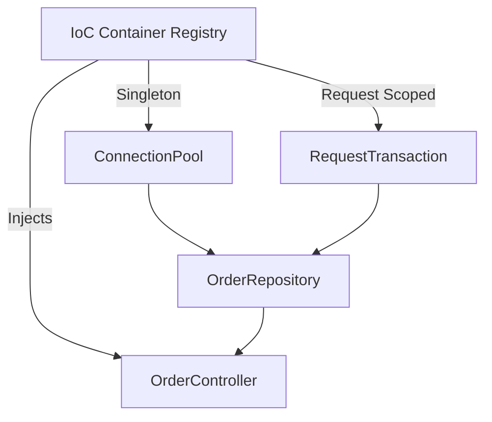

# Inversion of Control (IoC) Containers

> **One-line summary:** An IoC Container automates the Composition Root—resolving transitive dependency graphs, managing object lifetimes (Singleton, Scoped, Transient), and registering cross-cutting proxies at startup or compile time.

| Attribute | Specification |
|---|---|
| **Level** | Intermediate / Enterprise Architecture |
| **Prerequisites** | [03-dependency-injection.md](03-dependency-injection.md), [13-hollywood-principle-and-inversion-of-control.md](../03-design-principles/13-hollywood-principle-and-inversion-of-control.md) |
| **Estimated Reading Time** | 30 minutes |
| **Status** | Complete |
| **Category** | Patterns Introduction / Wiring |
| **Also Known As** | DI Container, ApplicationContext (Spring), Dependency Injector |
| **Languages Tested** | Java 25 (LTS) / TypeScript 5.8 (Node 24 native) / Python 3.14 |

---

## Table of Contents
- [1 The Problem](#1-the-problem)
- [2 Why It Exists](#2-why-it-exists)
- [3 What It Is](#3-what-it-is)
- [4 The Problem Without It](#4-the-problem-without-it)
- [5 How It Solves It](#5-how-it-solves-it)
- [6 How It Works](#6-how-it-works)
- [7 Real-World Examples](#7-real-world-examples)
- [8 When to Use and When NOT to Use](#8-when-to-use-and-when-not-to-use)
- [9 Variations and Language Idioms](#9-variations-and-language-idioms)
- [10 Relationship to Other Principles and Patterns](#10-relationship-to-other-principles-and-patterns)
- [11 Common Mistakes and Anti-Patterns](#11-common-mistakes-and-anti-patterns)
- [12 Testing and Design Verification](#12-testing-and-design-verification)
- [13 Performance, Concurrency and Security Notes](#13-performance-concurrency-and-security-notes)
- [14 Interview Questions](#14-interview-questions)
- [15 Practice Exercises](#15-practice-exercises)
- [16 Summary / Cheat Sheet](#16-summary--cheat-sheet)
- [17 Further Reading](#17-further-reading)

---

## 1 The Problem

In a small app with 10 classes, manual Pure DI in `main()` is 15 lines and crystal clear. In an enterprise application with **250 services, 40 repositories, 15 HTTP controllers, database connection pools, transaction proxies, and per-HTTP-request scopes**, manually writing `main()` wiring becomes a 1,500-line maze where forgetting to close a per-request DB session or changing one constructor signature forces editing dozens of wiring factories.

---

## 2 Why It Exists

IoC Containers (Spring IoC, Google Guice, NestJS Injector, .NET `IServiceCollection`) exist to automate **Auto-Wiring** (resolving the DAG of constructor dependencies), **Lifetime Management** (Singleton vs Request-Scoped vs Transient), and **AOP Interception** (wrapping beans in `@Transactional` or `@Cacheable` proxies).

---

## 3 What It Is: The 3 Core Container Lifetimes

| Lifetime / Scope | Behavior | Typical Use Cases |
|---|---|---|
| **Singleton** | Created once per container; shared across all threads/requests | Stateless Services, `DataSource` connection pool, Config |
| **Scoped (Request)** | Created once per HTTP request or logical unit of work; disposed at end | `DbContext` / Transaction Manager, `CurrentUserContext` |
| **Transient (Prototype)** | Fresh instance created every time it is requested/injected | Stateful lightweight helpers, Builders |



---

## 4 The Problem Without It

Manual wiring of deep graphs with mixed lifetimes (Singleton + Request-Scoped) quickly leads to manual factory proliferation and leaked per-request resources.

---

## 5 How It Solves It: A Minimal Educational IoC Container

Understanding how a container actually works removes the "magic." Under the hood, an IoC container is simply a **Map of `(Token/Type) -> Factory/Singleton Instance`** with cycle detection!

### Java / TypeScript / Python Minimal Container

#### Java 25 LTS
```java
package com.design.patterns.ioc;

import java.util.*;
import java.util.function.Supplier;

class MiniContainer {
    private final Map<Class<?>, Supplier<?>> factories = new HashMap<>();
    private final Map<Class<?>, Object> singletons = new HashMap<>();

    public <T> void registerSingleton(Class<T> type, Supplier<T> factory) {
        factories.put(type, () -> singletons.computeIfAbsent(type, k -> factory.get()));
    }

    @SuppressWarnings("unchecked")
    public <T> T resolve(Class<T> type) {
        Supplier<?> supplier = factories.get(type);
        if (supplier == null) throw new IllegalStateException("Unregistered: " + type.getName());
        return (T) supplier.get();
    }
}
```

#### TypeScript 5.8
```typescript
class MiniContainer {
    private singletons = new Map<string, unknown>();
    private factories = new Map<string, () => unknown>();

    registerSingleton<T>(token: string, factory: () => T): void {
        this.factories.set(token, () => {
            if (!this.singletons.has(token)) this.singletons.set(token, factory());
            return this.singletons.get(token);
        });
    }

    resolve<T>(token: string): T {
        const f = this.factories.get(token);
        if (!f) throw new Error(`Unregistered token: ${token}`);
        return f() as T;
    }
}
```

#### Python 3.14
```python
from typing import Callable, Any

class MiniContainer:
    def __init__(self) -> None:
        self._factories: dict[type, Callable[[], Any]] = {}
        self._singletons: dict[type, Any] = {}

    def register_singleton(self, cls: type, factory: Callable[[], Any]) -> None:
        self._factories[cls] = lambda: self._singletons.setdefault(cls, factory())

    def resolve(self, cls: type) -> Any:
        if cls not in self._factories:
            raise KeyError(f"Unregistered: {cls.__name__}")
        return self._factories[cls]()
```

---

## 6 How It Works: Reflection vs. Compile-Time DI

1. **Runtime Reflection Containers (Spring, Guice, NestJS):** Scan annotations at startup, build the dependency DAG via reflection, and verify wiring at runtime boot. *Trade-off:* slower startup (cold starts in serverless) and runtime errors if a bean is missing.
2. **Compile-Time DI (Dagger, Micronaut, Avaje Inject):** Generate plain `new` factory code at compile time! *Benefit:* zero reflection, instant startup, GraalVM native friendly, and compile-time missing-bean errors.

---

## 7 Real-World Examples

1. **Spring Framework `ApplicationContext`**: Manages singleton beans, request/session scopes, `@Transactional` JDK/CGLIB proxies, and lifecycle hooks (`@PostConstruct`, `@PreDestroy`).
2. **NestJS Module Container**: Resolves `@Injectable()` providers per module boundary with `Scope.DEFAULT` (singleton) or `Scope.REQUEST`.
3. **FastAPI `Depends()`**: Request-scoped DAG dependency resolver using Python type annotations and generator `yield` cleanup!

---

## 8 When to Use and When NOT to Use

| Context | Use IoC Container? | Rationale |
|---|---|---|
| **Large Enterprise Web Apps (50+ services, AOP)** | **Yes** | Automates scopes, transactions, and wiring cleanly. |
| **Small Libraries / SDKs** | **NO (Use Pure DI)** | Libraries must NEVER force a specific IoC framework onto their consumers! |
| **Serverless / CLI Tools (< 15 classes)** | **Prefer Pure DI / Compile-Time DI** | Avoids 500ms–2s reflection cold-start penalty. |

---

## 9 Variations and Language Idioms

- **Python FastAPI `yield` Dependencies:** Cleanly handles setup + teardown (e.g. `try: yield db finally: db.close()`).
- **TypeScript `tsyringe` / `inversify` vs Pure Factory Modules:** Because TypeScript interfaces vanish at runtime, TypeScript runtime containers require string/Symbol injection tokens or classes.

---

## 10 Relationship to Other Principles and Patterns

- **Register / Service Locator Misuse:** Never inject the `ApplicationContext` / Container itself into business services—that degrades DI back into the Service Locator anti-pattern!
- **Proxy & Decorator:** IoC containers heavily use Proxy/Decorator to wrap beans with cross-cutting concerns.

---

## 11 Common Mistakes and Anti-Patterns

| Anti-Pattern | Description | Production Consequence | Correct Remedy |
|---|---|---|---|
| **Injecting the Container (`ApplicationContext`)** | Business service calling `ctx.getBean(Foo.class)`. | Reverts DI into Service Locator; hides dependencies. | Inject `Foo` directly in constructor. |
| **Circular Bean Dependencies (`A -> B -> A`)** | Service A injects B, and B injects A. | Container startup crash (`BeanCurrentlyInCreationException`). | Extract shared concern to Service C or use Events. |
| **Captive Request Scope in Singleton** | Injecting request-scoped auth context directly into a Singleton without a proxy/provider. | Cross-user data leakage or closed connection crashes! | Use scoped proxy or `Provider<T>`. |
| **Using IoC Container Inside Unit Tests** | Booting full Spring context for every 5ms unit test. | 10-minute CI test runs. | Instantiate classes with plain `new` in unit tests! |
| **Field Injection (`@Autowired` fields)** | Skipping constructors. | Unusable outside container. | Always use constructor injection. |
| **TypeScript Interface Token Illusion** | Trying to inject a TS `interface` at runtime without a Symbol token. | Runtime crash because TS erases interfaces during compilation. | Use abstract classes or explicit `InjectionToken` symbols. |

---

## 12 Testing and Design Verification

Golden Rule: **Your unit tests must NOT need the IoC container.** Reserve container tests strictly for thin integration/smoke tests verifying wiring at startup.

---

## 13 Performance, Concurrency and Security Notes

- **Concurrency:** Singleton beans in Spring/NestJS are shared across all concurrent threads—they MUST be stateless or thread-safe.

---

## 14 Interview Questions

<details>
<summary><strong>1. Explain the three standard IoC Container lifetimes: Singleton, Scoped, and Transient.</strong></summary>

**Singleton** creates one shared instance for the container's entire life; **Scoped** creates one instance per HTTP request/unit-of-work and disposes it afterward; **Transient** creates a fresh instance on every injection.
</details>

<details>
<summary><strong>2. Why do TypeScript interfaces need explicit `InjectionToken`s or Symbols in runtime IoC containers?</strong></summary>

TypeScript interfaces exist only at compile time and are completely erased when compiled to JavaScript, so runtime containers like NestJS or InversifyJS need a runtime class constructor or `Symbol` token as the lookup key.
</details>

<details>
<summary><strong>3. Compare Runtime Reflection DI (Spring) vs Compile-Time DI (Dagger / Micronaut).</strong></summary>

Runtime reflection discovers and wires beans on startup—flexible, but adds cold-start latency, memory overhead, and runtime failure risk. Compile-time DI generates plain `new` wiring code during compilation—instant startup, zero reflection, and compile-time safety.
</details>

<details>
<summary><strong>4. Why should you NEVER inject the IoC Container itself into a business service?</strong></summary>

Doing so turns Dependency Injection into the **Service Locator** anti-pattern—hiding dependencies, breaking static graph validation, and coupling domain services directly to the container API.
</details>

<details>
<summary><strong>5. How do IoC containers implement `@Transactional` or `@Cacheable` without editing your service class?</strong></summary>

By generating a **Proxy** (JDK dynamic proxy or CGLIB subclass) at startup that wraps your bean, starts/commits transactions or checks caches around method invocations, and delegates inward.
</details>

<details>
<summary><strong>6. Why must Singleton beans never store per-request user state in instance fields?</strong></summary>

Because a Singleton is shared concurrently across all incoming HTTP requests, mutable instance fields cause cross-user data corruption and race conditions.
</details>

<details>
<summary><strong>7. How do you break a circular dependency (`ServiceA <-> ServiceB`) detected by an IoC container?</strong></summary>

Extract the shared logic into a third `ServiceC` that both depend on, or decouple one direction via an asynchronous Domain Event.
</details>

<details>
<summary><strong>8. Why shouldn't an open-source utility library bundle an IoC container?</strong></summary>

Libraries should use Pure DI / simple builders so consumers can integrate them into *any* application (Spring, Quarkus, plain `main()`, or serverless) without container conflicts.
</details>

---

## 15 Practice Exercises

### Exercise 1: Identify Scope Bug (Easy)
A Singleton `ReportService` injects a Request-Scoped `UserSession` directly in its constructor. What happens on Request #2?

<details>
<summary><strong>Solution</strong></summary>

**Captive Dependency:** `ReportService` holds Request #1's `UserSession` forever, leaking User 1's identity to User 2! Fix by injecting a `Provider<UserSession>` / request-scoped proxy or passing `UserSession` as a method parameter.
</details>

---

### Exercise 2: Add Cycle Detection to `MiniContainer` (Medium)
Add a `Set<Class<?>> resolving` stack to `MiniContainer.resolve()` so `A -> B -> A` throws `CircularDependencyException` immediately instead of `StackOverflowError`.

<details>
<summary><strong>Solution</strong></summary>

Before invoking factory, `if (!resolving.add(type)) throw new IllegalStateException("Cycle detected: " + type);` and remove in `finally`.
</details>

---

### Exercise 3: FastAPI-style `yield` Lifecycle Scope in Python (Hard)
Implement a Python context-managed scope resolver in `MiniContainer` that runs generator cleanup (`finally: conn.close()`) when a simulated request finishes.

<details>
<summary><strong>Solution</strong></summary>

Use `contextlib.ExitStack` per request scope, entering generator dependencies via `stack.enter_context(...)` and automatically unwinding all teardowns at request end.
</details>

---

## 16 Summary / Cheat Sheet

```
+--------------------------------------------------------------------------+
|                         IoC CONTAINERS CHEAT SHEET                       |
+--------------------------------------------------------------------------+
| ROLE       : Automates Composition Root DAG, Lifetimes, and AOP Proxies. |
| SCOPES     : Singleton (stateless), Scoped (per-request), Transient.     |
| GOLDEN RULE: Unit tests must NEVER boot the IoC container; test with `new`|
+--------------------------------------------------------------------------+
```

---

## 17 Further Reading

- Martin Fowler, *Inversion of Control Containers and the Dependency Injection Pattern*, 2004.
- Mark Seemann, *Dependency Injection Principles, Practices, and Patterns*, Manning, 2019.

### In Your Language
| Language Track | Deep Dive Reference |
|---|---|
| Java | [Java OOP & Design Patterns](file:///e:/Learning/engineering-notes/01-languages/java/24-design-patterns/README.md) |
| TypeScript | [TypeScript Design Patterns](file:///e:/Learning/engineering-notes/01-languages/typescript/17-design-patterns/README.md) |
| Python | [Python Design Patterns](file:///e:/Learning/engineering-notes/01-languages/python/23-design-patterns/README.md) |

---

[← Previous: 03 - Dependency Injection](file:///e:/Learning/engineering-notes/08-solid-design-patterns/04-patterns-intro/03-dependency-injection.md) | [Module 04 Index](file:///e:/Learning/engineering-notes/08-solid-design-patterns/04-patterns-intro/README.md) | [Next: 05 - Pattern Languages & Catalogues History →](file:///e:/Learning/engineering-notes/08-solid-design-patterns/04-patterns-intro/05-pattern-languages-and-catalogues-history.md)
