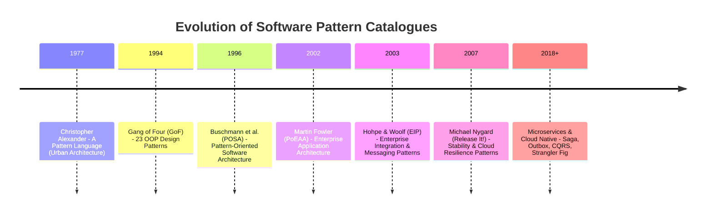

# Pattern Languages & Catalogues: Historical Lineage

> **One-line summary:** Software design patterns evolved from physical architecture (1977) through object-oriented classes (GoF 1994), enterprise applications (PoEAA 2002), messaging (EIP 2003), and modern cloud-native distributed systems.

| Attribute | Specification |
|---|---|
| **Level** | Foundational / Historical Context |
| **Prerequisites** | [01-what-are-patterns.md](01-what-are-patterns.md) |
| **Estimated Reading Time** | 25 minutes |
| **Status** | Complete |
| **Category** | Patterns Introduction |
| **Also Known As** | Pattern Catalogues, GoF vs POSA vs PoEAA vs Cloud |
| **Languages Tested** | Java 25 (LTS) / TypeScript 5.8 (Node 24 native) / Python 3.14 |

---

## Table of Contents
- [1 The Problem](#1-the-problem)
- [2 Why It Exists](#2-why-it-exists)
- [3 What It Is](#3-what-it-is)
- [4 The Problem Without It](#4-the-problem-without-it)
- [5 How It Solves It](#5-how-it-solves-it)
- [6 How It Works](#6-how-it-works)
- [7 Real-World Examples](#7-real-world-examples)
- [8 When to Use and When NOT to Use](#8-when-to-use-and-when-not-to-use)
- [9 Variations and Language Idioms](#9-variations-and-language-idioms)
- [10 Relationship to Other Principles and Patterns](#10-relationship-to-other-principles-and-patterns)
- [11 Common Mistakes and Anti-Patterns](#11-common-mistakes-and-anti-patterns)
- [12 Testing and Design Verification](#12-testing-and-design-verification)
- [13 Performance, Concurrency and Security Notes](#13-performance-concurrency-and-security-notes)
- [14 Interview Questions](#14-interview-questions)
- [15 Practice Exercises](#15-practice-exercises)
- [16 Summary / Cheat Sheet](#16-summary--cheat-sheet)
- [17 Further Reading](#17-further-reading)

---

## 1 The Problem

Many engineers think "Design Patterns" means *only* the 23 Gang of Four (GoF) OOP patterns from 1994. When they face distributed microservices, database transactions, or asynchronous message queues, they try to solve distributed failures with `Singleton` and `AbstractFactory`—completely unaware of **PoEAA** (`Unit of Work`, `Repository`, `Outbox`), **EIP** (`Dead Letter Channel`, `Idempotent Receiver`), and **Cloud Resilience Patterns** (`Circuit Breaker`, `Saga`, `Bulkhead`).

---

## 2 Why It Exists

Every era of computing surfaced new dominant architectural forces, producing a corresponding pattern catalogue:



---

## 3 What It Is: Pattern Catalogue vs. Pattern Language

- **Pattern Catalogue:** A flat dictionary of independent solutions (e.g., the 23 GoF patterns).
- **Pattern Language:** A *generative network* of interconnected patterns where applying Pattern A naturally leads to selecting Pattern B or C to solve secondary forces (e.g., *Domain-Driven Design* or *Microservices Patterns*: `API Gateway` $\to$ `Circuit Breaker` $\to$ `Bulkhead`).

### The 5 Major Software Pattern Catalogues Mapped to This Track

| Catalogue | Seminal Work | Primary Forces Addressed | Modules in This Track |
|---|---|---|---|
| **GoF (1994)** | Gamma, Helm, Johnson, Vlissides | In-process OOP object creation, structure, behavior | Modules 05, 06, 07 |
| **POSA (1996–2007)** | Buschmann et al. | Concurrency, Reactor/Proactor, Active Object, Broker | Modules 08, 10 |
| **PoEAA (2002)** | Martin Fowler | ORM, Repository, Unit of Work, DTO, Service Layer | Module 09 |
| **EIP (2003)** | Gregor Hohpe & Bobby Woolf | Async messaging, Dead-Letter Queue, Idempotent Receiver | Module 11 |
| **Cloud / Stability (2007+)** | Michael Nygard, Chris Richardson | Circuit Breaker, Saga, Outbox, Strangler Fig, CQRS | Modules 10, 11 |

---

## 4 The Problem Without It

Treating GoF as the complete universe of design patterns leaves engineers blind to distributed failure modes (cascading timeouts solved by `Circuit Breaker`, dual-write data loss solved by `Transactional Outbox`).

---

## 5 How It Solves It

By mapping problems to the right **architectural scale**:
- **Micro-scale (Class/Object):** GoF Patterns (`Strategy`, `Adapter`, `Builder`).
- **Meso-scale (Application/DB):** PoEAA Patterns (`Repository`, `Unit of Work`, `Specification`).
- **Macro-scale (Distributed/Cloud):** EIP & Cloud Patterns (`Circuit Breaker`, `Saga`, `Outbox`).

---

## 6 How It Works

Each subsequent catalogue builds *on top* of earlier ones rather than replacing them: for example, a Cloud **Transactional Outbox** uses an Enterprise **Unit of Work**, which delegates to a GoF **Observer** or **Command** handler!

---

## 7 Real-World Examples

1. **Spring Ecosystem:** Combines GoF (`Proxy`, `Template Method` in `JdbcTemplate`), PoEAA (`Repository` in Spring Data), EIP (Spring Integration), and Cloud (`Resilience4j` Circuit Breaker).
2. **PostgreSQL + Kafka Pipelines:** Combine PoEAA `Unit of Work` with EIP `Outbox` and `Idempotent Receiver`.
3. **Kubernetes / Envoy Service Mesh:** Implements Nygard's `Circuit Breaker`, `Retry`, and `Bulkhead` at the infrastructure proxy layer.

---

## 8 When to Use and When NOT to Use

Use the lowest-scale pattern that solves your actual problem: don't reach for distributed `Saga` orchestration when a single ACID database `Unit of Work` suffices.

---

## 9 Variations and Language Idioms

Modern languages absorb classic GoF patterns directly into syntax (`yield` for Iterator, `async/await` for Reactor callbacks, `sealed` + pattern matching for Visitor), shifting engineering focus toward **Meso- and Macro-scale patterns** (Modules 08–12).

---

## 10 Relationship to Other Principles and Patterns

See [ROADMAP.md](file:///e:/Learning/engineering-notes/08-solid-design-patterns/ROADMAP.md) for the full progression across all 21 modules.

---

## 11 Common Mistakes and Anti-Patterns

| Anti-Pattern | Description | Production Consequence | Correct Remedy |
|---|---|---|---|
| **GoF Tunnel Vision** | Knowing only the 23 GoF patterns in a cloud/microservice job. | Missing Saga, Outbox, Circuit Breaker, Idempotency. | Study PoEAA, EIP, and Cloud catalogues. |
| **Applying Macro Patterns to Monoliths** | Building distributed Sagas inside a single PostgreSQL database. | Massive unnecessary complexity. | Use local ACID transactions (`Unit of Work`). |
| **Cargo-Culting 1994 C++ UML** | Implementing manual GoF `Iterator` classes in Python/TS. | Fighting native language generators. | Use built-in `yield` / `Symbol.iterator`. |
| **Confusing Pattern Language with Catalogue** | Applying patterns in isolation without seeing how they compose. | Mismatched boundaries. | Trace upstream/downstream pattern links. |
| **Ignoring Anti-Pattern Catalogues** | Learning patterns without learning failure modes (Module 13). | Golden Hammer syndrome. | Study Anti-Patterns alongside Patterns. |
| **Memorizing Names Without Forces** | Reciting definitions without knowing what breaks without the pattern. | Failing system design interviews. | Always anchor on Section 1 & Section 4 (The Problem). |

---

## 12 Testing and Design Verification

Match test strategy to pattern scale: GoF patterns are verified with fast in-memory unit tests; PoEAA patterns with DB integration tests; Cloud patterns with fault-injection/chaos tests.

---

## 13 Performance, Concurrency and Security Notes

Each catalogue addresses distinct runtime forces: POSA targets concurrency/latency; PoEAA targets DB roundtrips & consistency; Cloud patterns target partial network failures & blast-radius isolation.

---

## 14 Interview Questions

<details>
<summary><strong>1. What is the difference between a Pattern Catalogue and a Pattern Language?</strong></summary>

A **Pattern Catalogue** is a collection of standalone patterns indexed for lookup (like GoF). A **Pattern Language** is an interconnected grammar of patterns that work together sequentially to solve a complete architectural domain (like Microservices or Christopher Alexander's architectural language).
</details>

<details>
<summary><strong>2. Name the four major software pattern books/catalogues after GoF (1994).</strong></summary>

1. **POSA** (Buschmann et al., 1996) — Architectural & Concurrency patterns.
2. **PoEAA** (Martin Fowler, 2002) — Enterprise Application & Persistence patterns.
3. **EIP** (Hohpe & Woolf, 2003) — Asynchronous Messaging & Integration patterns.
4. **Release It!** (Michael Nygard, 2007) — Cloud Stability & Resilience patterns.
</details>

<details>
<summary><strong>3. Why are many 1994 GoF patterns now built directly into modern languages?</strong></summary>

Modern languages internalized common patterns: `for-each`/`yield` internalized **Iterator**, lambdas/closures internalized **Strategy** and **Command**, and `record`/keyword args reduced **Builder** boilerplate.
</details>

<details>
<summary><strong>4. Which pattern catalogue addresses ORM, Unit of Work, and Service Layer?</strong></summary>

Martin Fowler's **Patterns of Enterprise Application Architecture (PoEAA)**, covered in Module 09.
</details>

<details>
<summary><strong>5. Which pattern catalogue addresses Circuit Breaker and Bulkhead?</strong></summary>

Michael Nygard's **Stability / Cloud Resilience Patterns** (*Release It!*), covered in Module 11.
</details>

<details>
<summary><strong>6. Who introduced the concept of Pattern Languages before software engineering?</strong></summary>

Architect **Christopher Alexander** in *A Pattern Language* (1977).
</details>

<details>
<summary><strong>7. Why is studying Anti-Patterns as important as studying Patterns?</strong></summary>

Recognizing anti-patterns (God Class, Golden Hammer, Distributed Monolith) helps engineers diagnose existing legacy decay and know when a pattern is being misapplied.
</details>

<details>
<summary><strong>8. How do GoF, PoEAA, and Cloud patterns work together in a single checkout endpoint?</strong></summary>

A **Service Layer** (PoEAA) wraps the transaction in a **Unit of Work** (PoEAA), selects pricing via **Strategy** (GoF), calls Stripe through an **Adapter** (GoF) protected by a **Circuit Breaker** (Cloud), and records an **Outbox** event (EIP/Cloud).
</details>

---

## 15 Practice Exercises

### Exercise 1: Map Scenario to Catalogue (Easy)
Which catalogue (GoF, PoEAA, EIP, Cloud) covers: (a) Circuit Breaker, (b) Decorator, (c) Unit of Work, (d) Dead-Letter Channel?

<details>
<summary><strong>Solution</strong></summary>

(a) Cloud/Stability, (b) GoF, (c) PoEAA, (d) EIP.
</details>

---

### Exercise 2: Identify Modern Language Replacements (Medium)
For Java 25, TypeScript, and Python, list which native language feature replaces classic GoF **Iterator** and **Strategy** classes.

<details>
<summary><strong>Solution</strong></summary>

Iterator $\to$ `Iterable`/generators (`yield`); Strategy $\to$ lambdas/first-class functions (`Function`, arrow functions, `Callable`).
</details>

---

### Exercise 3: Trace a Multi-Catalogue Checkout Flow (Hard)
Sketch how GoF `Adapter`, PoEAA `Repository` + `Unit of Work`, and Cloud `Circuit Breaker` + `Outbox` collaborate in one order placement transaction.

<details>
<summary><strong>Solution</strong></summary>

Controller $\to$ Service Layer (`Unit of Work` begins DB tx) $\to$ `OrderRepository` saves Order + `Outbox` row $\to$ commits DB tx $\to$ async worker calls `PaymentAdapter` wrapped in `Circuit Breaker`.
</details>

---

## 16 Summary / Cheat Sheet

```
+--------------------------------------------------------------------------+
|                 PATTERN LANGUAGES & CATALOGUES LINEAGE                   |
+--------------------------------------------------------------------------+
| 1977 Alexander (Buildings) -> 1994 GoF (OOP) -> 1996 POSA (Concurrency)  |
| -> 2002 PoEAA (Enterprise/DB) -> 2003 EIP (Messaging) -> 2007+ Cloud     |
+--------------------------------------------------------------------------+
```

---

## 17 Further Reading

- Christopher Alexander, *A Pattern Language*, Oxford University Press, 1977.
- Martin Fowler, *Patterns of Enterprise Application Architecture*, Addison-Wesley, 2002.
- Gregor Hohpe & Bobby Woolf, *Enterprise Integration Patterns*, Addison-Wesley, 2003.
- Michael Nygard, *Release It!* (2nd Edition), Pragmatic Bookshelf, 2018.

### In Your Language
| Language Track | Deep Dive Reference |
|---|---|
| Java | [Java OOP & Design Patterns](file:///e:/Learning/engineering-notes/01-languages/java/24-design-patterns/README.md) |
| TypeScript | [TypeScript Design Patterns](file:///e:/Learning/engineering-notes/01-languages/typescript/17-design-patterns/README.md) |
| Python | [Python Design Patterns](file:///e:/Learning/engineering-notes/01-languages/python/23-design-patterns/README.md) |

---

[← Previous: 04 - IoC Containers](file:///e:/Learning/engineering-notes/08-solid-design-patterns/04-patterns-intro/04-inversion-of-control-containers.md) | [Module 04 Index](file:///e:/Learning/engineering-notes/08-solid-design-patterns/04-patterns-intro/README.md) | [Next: Module 05 - Creational Patterns →](file:///e:/Learning/engineering-notes/08-solid-design-patterns/05-creational-patterns/README.md)
