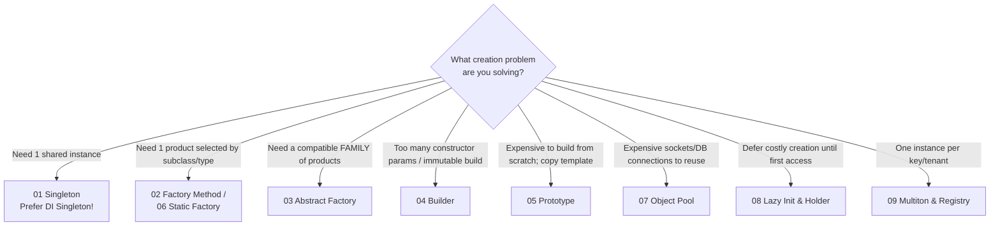

# Creational Design Patterns Overview

> **One-line summary:** Creational patterns abstract the instantiation process—hiding *which* concrete classes are created, *how* they are assembled, and *how* their lifetimes and pools are managed.

| Attribute | Specification |
|---|---|
| **Level** | Core / Foundational |
| **Prerequisites** | [Module 04: Patterns Intro](file:///e:/Learning/engineering-notes/08-solid-design-patterns/04-patterns-intro/README.md) |
| **Estimated Reading Time** | 15 minutes |
| **Status** | Complete |
| **Category** | Creational Patterns |

---

## 1. Why `new` Is Architectural Glue

Every time business logic writes `new StripePaymentClient(...)`, it creates **compile-time and runtime coupling** to a concrete class:
- You cannot substitute a fake in unit tests without hacks.
- You cannot swap implementations based on environment/config without editing the caller (violating OCP).
- Complex objects with 10 optional fields turn into unreadable telescoping constructors.

---

## 2. Creational Pattern Selection Map

---

[← Module 05 Index](file:///e:/Learning/engineering-notes/08-solid-design-patterns/05-creational-patterns/README.md) | [Next: 01 - Singleton Pattern →](file:///e:/Learning/engineering-notes/08-solid-design-patterns/05-creational-patterns/01-singleton.md)
