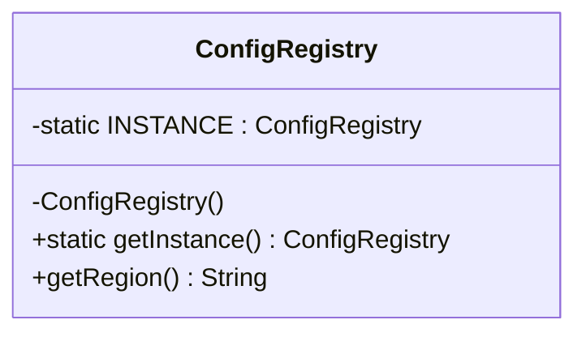

# Singleton Pattern

> **One-line summary:** Ensure a class has only one instance and provide a global point of access to it—while recognizing why unmanaged global singletons are an anti-pattern that should almost always be replaced by Dependency Injection singletons.

| Attribute | Specification |
|---|---|
| **Level** | Core / Foundational |
| **Prerequisites** | [03-dependency-injection.md](../04-patterns-intro/03-dependency-injection.md), [07-immutability-and-value-objects.md](../01-foundations/07-immutability-and-value-objects.md) |
| **Estimated Reading Time** | 30 minutes |
| **Status** | Complete |
| **Category** | Creational |
| **Origin** | GoF 1994 |
| **Also Known As** | Global Single Instance, Bill Pugh Holder, Enum Singleton |
| **Languages Tested** | Java 25 (LTS) / TypeScript 5.8 (Node 24 native) / Python 3.14 |

---

## Table of Contents
- [1 The Problem](#1-the-problem)
- [2 Why It Exists](#2-why-it-exists)
- [3 What It Is](#3-what-it-is)
- [4 The Problem Without It](#4-the-problem-without-it)
- [5 How It Solves It](#5-how-it-solves-it)
- [6 How It Works](#6-how-it-works)
- [7 Real-World Examples](#7-real-world-examples)
- [8 When to Use and When NOT to Use](#8-when-to-use-and-when-not-to-use)
- [9 Variations and Language Idioms](#9-variations-and-language-idioms)
- [10 Relationship to Other Principles and Patterns](#10-relationship-to-other-principles-and-patterns)
- [11 Common Mistakes and Anti-Patterns](#11-common-mistakes-and-anti-patterns)
- [12 Testing and Design Verification](#12-testing-and-design-verification)
- [13 Performance, Concurrency and Security Notes](#13-performance-concurrency-and-security-notes)
- [14 Interview Questions](#14-interview-questions)
- [15 Practice Exercises](#15-practice-exercises)
- [16 Summary / Cheat Sheet](#16-summary--cheat-sheet)
- [17 Further Reading](#17-further-reading)

---

## 1 The Problem

An application loads immutable environment configuration (`region`, `maxConnections`, `featureFlags`) from disk/vault or manages an exclusive hardware driver handle (`java.lang.Runtime`). If every service calls `new ConfigLoader()` independently:
1. Disk/network I/O repeats 500 times per second, exhausting file descriptors.
2. Two components read conflicting snapshots of configuration during a hot reload.
3. Uncoordinated instances overwrite the same exclusive lock file.

Yet, when developers reach for the classic `Config.getInstance()` global static Singleton, a **second disaster** often replaces the first: unit tests bleed mutable global state into each other, and swapping `Config` for a test double becomes impossible!

---

## 2 Why It Exists

Formulated by the **Gang of Four (1994)** to guarantee controlled single-instance access to scarce, unique resources—such as a hardware device manager, thread/connection pool coordinator, or read-only runtime environment (`java.lang.Runtime.getRuntime()`).

---

## 3 What It Is

Singleton restricts instantiation of a class to **one object** by making its constructor private and exposing a static accessor (or, in modern architectures, registering a single instance inside an **IoC Container**).



---

## 4 The Problem Without It

```java
// Naive Non-Thread-Safe Singleton (Race condition on first concurrent access!)
class BrokenLazySingleton {
    private static BrokenLazySingleton instance;
    private BrokenLazySingleton() {}
    public static BrokenLazySingleton getInstance() {
        if (instance == null) { // Thread A and B BOTH enter here simultaneously!
            instance = new BrokenLazySingleton(); // Creates TWO instances!
        }
        return instance;
    }
}
```

---

## 5 How It Solves It

### Java Implementation (Java 25 LTS — Bill Pugh Holder & Enum Singleton)

```java
package com.design.patterns.creational.singleton;

// 1. Bill Pugh Initialization-on-Demand Holder (Lazy + Thread-Safe via JVM classloader lock)
public class ConfigRegistry {
    private ConfigRegistry() {}

    private static class Holder {
        private static final ConfigRegistry INSTANCE = new ConfigRegistry();
    }

    public static ConfigRegistry getInstance() {
        return Holder.INSTANCE;
    }

    public String getRegion() {
        return "us-east-1";
    }
}

// 2. Joshua Bloch Enum Singleton (Serialization & Reflection-proof!)
enum RuntimeMetrics {
    INSTANCE;
    public void record(String metric) {
        System.out.println("Metric: " + metric);
    }
}
```

### TypeScript Implementation (Node 24 Native — ES Module Singleton)

In TypeScript/Node.js, ES modules are evaluated once and cached by the module loader—making an exported `const` instance the cleanest thread-safe singleton!

```typescript
class ConfigRegistry {
    readonly region = "us-east-1";
    private constructor() {}
    static readonly instance = new ConfigRegistry();
}

export const configRegistry = ConfigRegistry.instance;
console.log("TS Singleton region:", configRegistry.region);
```

### Python Implementation (Python 3.14 — Module-Level & `__new__`)

In Python, module imports are cached in `sys.modules`, making module-level instances the idiomatic Pythonic singleton. For class-level enforcement with thread safety:

```python
import threading

class ConfigRegistry:
    _instance = None
    _lock = threading.Lock()

    def __new__(cls):
        if cls._instance is None:
            with cls._lock:
                if cls._instance is None:
                    cls._instance = super().__new__(cls)
        return cls._instance

    def get_region(self) -> str:
        return "us-east-1"
```

---

## 6 How It Works: Why `Holder` Is Thread-Safe

In Java, the JVM guarantees that class initialization (`<clinit>`) of the inner `static class Holder` is executed **lazily on first reference to `Holder.INSTANCE`** and is **strictly synchronized by the JVM classloader**—requiring zero `synchronized` lock overhead on subsequent `getInstance()` calls!

---

## 7 Real-World Examples

1. **Java `java.lang.Runtime.getRuntime()`**: Eagerly created single instance representing the current JVM process.
2. **Java `java.util.logging.LogManager` / SLF4J `LoggerFactory`**: Single logging coordinator per classloader.
3. **Node.js `require()` / ES Module Cache**: Database pools (`pg.Pool`) exported from `db.ts` are naturally singletons per worker process.

---

## 8 When to Use and When NOT to Use

| Context | Use Classic `getInstance()`? | Modern Alternative |
|---|---|---|
| **Immutable/Stateless Process Resource (`Runtime`)** | **Yes** | Enum or Holder Singleton. |
| **Application Services (`UserService`, `OrderRepo`)** | **NO (Anti-Pattern!)** | Register as **Singleton-scoped bean in DI / IoC Container** so tests can still inject fakes! |
| **Mutable Global Caches / Session State** | **NO** | Causes hidden coupling and flaky tests; use scoped state or explicit injection. |

---

## 9 Variations and Language Idioms

- **Double-Checked Locking (DCL):** Requires `volatile` in Java (`private static volatile Singleton instance;`) to prevent instruction reordering before constructor completion!
- **DI-Managed Singleton vs GoF Singleton:** A **DI Singleton** has a normal public constructor; the Composition Root creates one instance and passes it everywhere—preserving testability.

---

## 10 Relationship to Other Principles and Patterns

- **SRP Violation:** Classic `getInstance()` mixes *domain logic* with *instance lifecycle control*.
- **DIP Violation:** Callers invoking `Config.getInstance()` hardwire themselves to a concrete global class instead of an injected interface.
- **Multiton / Object Pool:** Generalize Singleton from 1 instance to $N$ keyed or pooled instances.

---

## 11 Common Mistakes and Anti-Patterns

| Anti-Pattern | Description | Production Consequence | Correct Remedy |
|---|---|---|---|
| **DCL Without `volatile` (Java)** | `private static Foo instance;` in Double-Checked Locking. | Thread B sees partially constructed object! | Add `volatile` or use Bill Pugh `Holder` / `enum`. |
| **Global Mutable State** | Storing mutable user/request data on a Singleton. | Cross-request race conditions & test pollution. | Keep singletons strictly stateless or immutable. |
| **Singletonitis (Using for Everything)** | Making `OrderService`, `UserService`, `DbConn` all `getInstance()`. | Untestable monolith; hidden dependencies. | Use DI Singleton scope with public constructors. |
| **Reflection & Serialization Bypass** | Private constructor bypassed via `setAccessible(true)` or `ObjectInputStream`. | Two singleton instances exist! | Use Java `enum` Singleton. |
| **Testing Order Dependency** | Test A mutates Singleton state, causing Test B to fail randomly. | Flaky CI builds. | Inject fresh instances per test via constructors. |
| **Python `__init__` Re-execution** | Defining `__new__` without guarding `__init__` re-runs `__init__` on every call! | Resets instance state unexpectedly! | Guard initialization or use a module-level singleton. |

---

## 12 Testing and Design Verification

Prefer **Constructor Injection** (`OrderService(Config config)`) even when `Config` is a Singleton in production—so tests can pass `new Config("test-region")` without touching global static state.

---

## 13 Performance, Concurrency and Security Notes

- **Concurrency:** Always protect lazy initialization with JVM class-init locks (`Holder`), `enum`, or `volatile` DCL.
- **Security:** Never store per-user credentials or PII inside a process-wide singleton.

---

## 14 Interview Questions

<details>
<summary><strong>1. Why is the GoF Singleton often considered an anti-pattern in modern OOP?</strong></summary>

1. It introduces hidden global state, coupling callers tightly to a concrete static method (violating DIP).
2. It makes unit testing hard because mocks/fakes cannot easily be substituted and state leaks between tests.
3. It violates SRP by mixing business behavior with instance-lifetime management.
Modern apps use **DI-managed Singletons** instead.
</details>

<details>
<summary><strong>2. Why is `volatile` mandatory in Java Double-Checked Locking?</strong></summary>

Without `volatile`, the JVM/CPU can reorder memory writes: assigning the non-null reference to `instance` *before* the constructor finishes initializing fields—causing another thread to observe a half-constructed object.
</details>

<details>
<summary><strong>3. How does the Bill Pugh Initialization-on-Demand Holder idiom work?</strong></summary>

A private static inner class (`Holder`) holds `static final INSTANCE = new Singleton()`. The JVM does not load/initialize `Holder` until `getInstance()` accesses `Holder.INSTANCE`, and JVM class initialization guarantees thread-safety without `synchronized` overhead.
</details>

<details>
<summary><strong>4. Why does Joshua Bloch recommend an `enum` Singleton in Java?</strong></summary>

Java `enum` singletons are thread-safe by JVM spec, immune to `ObjectInputStream` deserialization creating duplicates, and immune to reflection `Constructor.newInstance()` attacks.
</details>

<details>
<summary><strong>5. What is the difference between a GoF Singleton and a Spring/NestJS Singleton scope?</strong></summary>

A GoF Singleton enforces 1 instance per JVM/ClassLoader via a private constructor and static `getInstance()`. A Spring/NestJS Singleton keeps a normal public constructor and relies on the IoC container to instantiate and share one instance—preserving full unit testability.
</details>

<details>
<summary><strong>6. What subtle bug happens in Python when implementing Singleton with `__new__` and `__init__`?</strong></summary>

Python automatically calls `__init__` every time `MyClass()` is invoked, even if `__new__` returned an existing cached instance—potentially wiping/overwriting instance attributes! Guard with an `_initialized` flag or use a module-level singleton.
</details>

<details>
<summary><strong>7. How does ES Module caching create Singletons naturally in TypeScript/Node.js?</strong></summary>

Node/ES module loaders execute a module top-level code once and cache its exports. Exporting `export const dbPool = new Pool()` gives every importer the exact same instance cleanly.
</details>

<details>
<summary><strong>8. Give a legitimate example of a true Singleton in standard libraries.</strong></summary>

`java.lang.Runtime.getRuntime()`, which models the single OS process hosting the JVM.
</details>

---

## 15 Practice Exercises

### Exercise 1: Spot the Concurrency Bug (Easy)
Why does `if (instance == null) instance = new Foo();` fail under multi-threading?

<details>
<summary><strong>Solution</strong></summary>

Check-then-act race condition: two threads both evaluate `instance == null` as true and create two distinct instances.
</details>

---

### Exercise 2: Convert Global Singleton to DI Singleton (Medium)
Refactor `DatabaseLogger.getInstance().log(msg)` inside `OrderService` into a testable DI Singleton.

<details>
<summary><strong>Solution</strong></summary>

Extract `interface Logger { void log(String msg); }`, make `DatabaseLogger` constructor public, inject `Logger` into `OrderService(Logger logger)`, and instantiate one `DatabaseLogger` in `main()`.
</details>

---

### Exercise 3: Implement Thread-Safe Python Singleton Without Re-Init Bug (Hard)
Write a thread-safe Python singleton where `MySingleton(value=10)` followed by `MySingleton(value=99)` preserves `10` without `__init__` overwriting it.

<details>
<summary><strong>Solution</strong></summary>

Use `cls._instance = super().__new__(cls)` and perform attribute initialization inside `__new__` (inside `with cls._lock:` when `cls._instance is None`) instead of `__init__`.
</details>

---

## 16 Summary / Cheat Sheet

```
+--------------------------------------------------------------------------+
|                            SINGLETON PATTERN                             |
+--------------------------------------------------------------------------+
| INTENT     : Single shared instance + global access point.               |
| BEST IMPL  : Java: Enum or Bill Pugh Holder | TS/Python: Module export.  |
| PREFER DI  : Keep constructors public and let IoC Container share 1 bean!|
+--------------------------------------------------------------------------+
```

---

## 17 Further Reading

- Joshua Bloch, *Effective Java (3rd Edition)* (Item 3: Enforce the singleton property with a private constructor or an enum type), 2018.

### In Your Language
| Language Track | Deep Dive Reference |
|---|---|
| Java | [Java OOP & Design Patterns](file:///e:/Learning/engineering-notes/01-languages/java/24-design-patterns/README.md) |
| TypeScript | [TypeScript Design Patterns](file:///e:/Learning/engineering-notes/01-languages/typescript/17-design-patterns/README.md) |
| Python | [Python Design Patterns](file:///e:/Learning/engineering-notes/01-languages/python/23-design-patterns/README.md) |

---

[← Previous: 00 - Creational Overview](file:///e:/Learning/engineering-notes/08-solid-design-patterns/05-creational-patterns/00-overview.md) | [Module 05 Index](file:///e:/Learning/engineering-notes/08-solid-design-patterns/05-creational-patterns/README.md) | [Next: 02 - Factory Method →](file:///e:/Learning/engineering-notes/08-solid-design-patterns/05-creational-patterns/02-factory-method.md)
