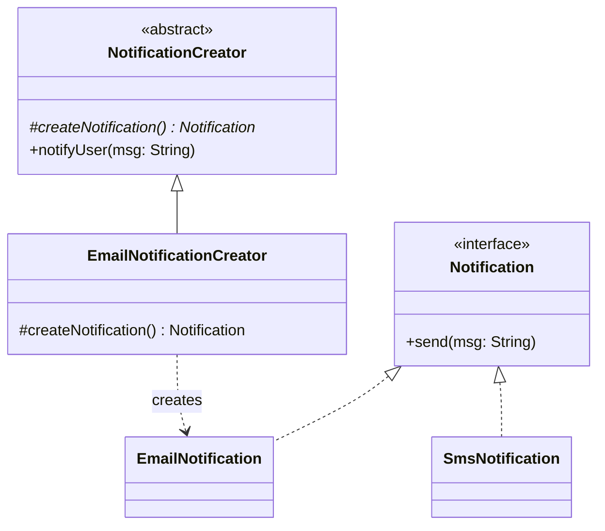

# Factory Method Pattern

> **One-line summary:** Define an interface/method for creating a single object, letting subclasses or concrete creators decide which concrete product class to instantiate—decoupling creation from business workflow (OCP & DIP).

| Attribute | Specification |
|---|---|
| **Level** | Core / Foundational |
| **Prerequisites** | [02-open-closed.md](../02-solid-principles/02-open-closed.md), [05-dependency-inversion.md](../02-solid-principles/05-dependency-inversion.md) |
| **Estimated Reading Time** | 30 minutes |
| **Status** | Complete |
| **Category** | Creational |
| **Origin** | GoF 1994 |
| **Also Known As** | Virtual Constructor |
| **Languages Tested** | Java 25 (LTS) / TypeScript 5.8 (Node 24 native) / Python 3.14 |

---

## Table of Contents
- [1 The Problem](#1-the-problem)
- [2 Why It Exists](#2-why-it-exists)
- [3 What It Is](#3-what-it-is)
- [4 The Problem Without It](#4-the-problem-without-it)
- [5 How It Solves It](#5-how-it-solves-it)
- [6 How It Works](#6-how-it-works)
- [7 Real-World Examples](#7-real-world-examples)
- [8 When to Use and When NOT to Use](#8-when-to-use-and-when-not-to-use)
- [9 Variations and Language Idioms](#9-variations-and-language-idioms)
- [10 Relationship to Other Principles and Patterns](#10-relationship-to-other-principles-and-patterns)
- [11 Common Mistakes and Anti-Patterns](#11-common-mistakes-and-anti-patterns)
- [12 Testing and Design Verification](#12-testing-and-design-verification)
- [13 Performance, Concurrency and Security Notes](#13-performance-concurrency-and-security-notes)
- [14 Interview Questions](#14-interview-questions)
- [15 Practice Exercises](#15-practice-exercises)
- [16 Summary / Cheat Sheet](#16-summary--cheat-sheet)
- [17 Further Reading](#17-further-reading)

---

## 1 The Problem

Imagine a notification platform whose core workflow formats a message, attaches an audit ID, dispatches it, and logs delivery metrics. Initially it only sends Emails: `Notification n = new EmailNotification();`.

When SMS, Push, and Slack channels are added, developers insert `if (channel.equals("SMS")) new SmsNotification()` directly inside the core dispatch workflow. Every new channel forces editing the core dispatch class, risking regressions in audit logging and retry logic.

---

## 2 Why It Exists

Formulated by the **Gang of Four (1994)** as a class-creational pattern: a framework or high-level workflow knows *when* an object must be created and *how* to use it via an interface, but cannot know *which* concrete subclass will be needed until a subclass or pluggable creator supplies it.

---

## 3 What It Is

The **Creator** defines an abstract `createNotification()` method (the Factory Method) returning the `Notification` product interface. Subclasses (`EmailNotificationCreator`, `SmsNotificationCreator`) override the factory method to return their specific product without touching the Creator's core `notifyUser()` workflow.



---

## 4 The Problem Without It

```java
// Naive Violation: Hardcoded switch inside core business workflow
class NotificationServiceViolation {
    public void notifyUser(String type, String msg) {
        if ("EMAIL".equals(type)) {
            System.out.println("Email: " + msg);
        } else if ("SMS".equals(type)) {
            System.out.println("SMS: " + msg);
        }
        // Adding Slack modifies this tested class!
    }
}
```

---

## 5 How It Solves It

### Java Implementation (Java 25 LTS)

```java
package com.design.patterns.creational.factorymethod;

interface Notification {
    void send(String msg);
}

class EmailNotification implements Notification {
    public void send(String msg) { System.out.println("Java Email: " + msg); }
}

class SmsNotification implements Notification {
    public void send(String msg) { System.out.println("Java SMS: " + msg); }
}

abstract class NotificationCreator {
    protected abstract Notification createNotification();

    // Closed for modification: calls factory method polymorphically!
    public void notifyUser(String msg) {
        Notification n = createNotification();
        n.send(msg);
    }
}

class EmailNotificationCreator extends NotificationCreator {
    protected Notification createNotification() { return new EmailNotification(); }
}

public class FactoryMethodApp {
    public static void main(String[] args) {
        NotificationCreator creator = new EmailNotificationCreator();
        creator.notifyUser("Welcome!");
    }
}
```

### TypeScript Implementation (Node 24 Native)

```typescript
interface Notification { send(msg: string): void; }

class EmailNotification implements Notification {
    send(msg: string): void { console.log("TS Email:", msg); }
}

abstract class NotificationCreator {
    protected abstract createNotification(): Notification;
    notifyUser(msg: string): void {
        this.createNotification().send(msg);
    }
}

class EmailNotificationCreator extends NotificationCreator {
    protected createNotification(): Notification { return new EmailNotification(); }
}

new EmailNotificationCreator().notifyUser("Welcome!");
```

### Python Implementation (Python 3.14)

```python
from abc import ABC, abstractmethod
from typing import Protocol

class Notification(Protocol):
    def send(self, msg: str) -> None: ...

class EmailNotification:
    def send(self, msg: str) -> None:
        print(f"Python Email: {msg}")

class NotificationCreator(ABC):
    @abstractmethod
    def create_notification(self) -> Notification: ...

    def notify_user(self, msg: str) -> None:
        self.create_notification().send(msg)

class EmailNotificationCreator(NotificationCreator):
    def create_notification(self) -> Notification:
        return EmailNotification()

EmailNotificationCreator().notify_user("Welcome!")
```

---

## 6 How It Works

Notice that `NotificationCreator.notifyUser()` is essentially a **Template Method** whose varying step is *object instantiation* (`createNotification()`). Adding `SlackNotification` requires creating `SlackNotification` + `SlackNotificationCreator` with **zero edits** to existing classes.

---

## 7 Real-World Examples

1. **Java `Collection.iterator()`**: `ArrayList` and `HashSet` override `iterator()` (Factory Method) to return `ArrayList$Itr` or `HashMap$KeyIterator` implementing `Iterator<E>`.
2. **SLF4J `LoggerFactory.getLogger(...)` / `URL.openConnection()`**: Abstracts concrete protocol/logger instantiation.
3. **Python `http.server` / Django Class-Based Views (`get_queryset()`)**: Subclasses override factory hooks to customize returned objects.

---

## 8 When to Use and When NOT to Use

| Context | Use Factory Method? | Rationale |
|---|---|---|
| **Framework / Template workflow creating 1 varying product** | **Yes** | Keeps workflow closed for modification (OCP). |
| **Functional Languages (TS / Python / Java 8+)** | **Consider Passing a Constructor/Supplier `() -> Notification`** | Passing `Supplier<Notification>` avoids creating an entire subclass per product! |
| **Simple static lookup with no subclass workflow** | **Use Simple Factory** | Don't invent an abstract `Creator` class just to wrap `new`. |

---

## 9 Variations and Language Idioms

- **Functional Factory (`Supplier<T>` / `() => T`):** In Java (`Supplier<Notification>`), TypeScript (`() => Notification`), and Python (classes themselves are first-class callables `cls: type[Notification]`), passing a factory function often replaces inheritance-based `Creator` subclasses cleanly.

---

## 10 Relationship to Other Principles and Patterns

- **Template Method:** Factory Method is a specialization of Template Method focused on creation.
- **Abstract Factory:** Often implemented as a collection of Factory Methods producing a *family* of products.

---

## 11 Common Mistakes and Anti-Patterns

| Anti-Pattern | Description | Production Consequence | Correct Remedy |
|---|---|---|---|
| **Inheritance Bloat for Simple Creation** | Creating 10 `Creator` subclasses when `Supplier<T>` or a Map suffices. | Class proliferation. | Pass a lambda/constructor reference. |
| **Confusing Simple Factory with Factory Method** | Calling a `switch(type)` static method "Factory Method." | Terminology confusion (Simple Factory still violates OCP!). | Know the distinction. |
| **Leaking Concrete Product Types** | Returning `EmailNotification` instead of `Notification` from the factory method. | Breaks DIP/polymorphism. | Always return the abstract interface. |
| **Heavy Side Effects in Factory** | Doing network/DB calls inside `createNotification()`. | Unexpected failures during object creation. | Keep creation lightweight; do I/O in `send()`. |
| **Ignoring `Null` / Invalid Types** | Returning `null` on unknown types. | Downstream `NullPointerException`. | Fail fast with `IllegalArgumentException`. |
| **Using Factory Method for Families** | Using 4 independent Factory Methods instead of one Abstract Factory when products must match (e.g. Dark Button + Dark Menu). | Mismatched UI themes! | Upgrade to Abstract Factory. |

---

## 12 Testing and Design Verification

In unit tests, create a `FakeNotificationCreator` returning an in-memory spy `Notification`, verifying `notifyUser()` audit/retry logic without hitting SMTP or SMS gateways.

---

## 13 Performance, Concurrency and Security Notes

Keep factory methods pure and stateless so multiple threads can invoke them concurrently without synchronization.

---

## 14 Interview Questions

<details>
<summary><strong>1. What is the Factory Method pattern and which SOLID principles does it satisfy?</strong></summary>

Factory Method defines an interface for creating a single object while letting subclasses decide which concrete class to instantiate. It satisfies **OCP** (new products require no edits to creator workflow) and **DIP** (creator depends only on product abstraction).
</details>

<details>
<summary><strong>2. How does Factory Method differ from Simple Factory?</strong></summary>

A **Simple Factory** is a single helper method with a `switch(type)` (which must be edited for new types). **Factory Method** uses polymorphism/subclassing (or injected supplier functions) so new product types extend cleanly without modifying existing code.
</details>

<details>
<summary><strong>3. How does Factory Method differ from Abstract Factory?</strong></summary>

**Factory Method** creates *one* product via inheritance/method overriding. **Abstract Factory** creates *families* of related, compatible products via object composition.
</details>

<details>
<summary><strong>4. How do lambdas / first-class functions simplify Factory Method in Python, TypeScript, and modern Java?</strong></summary>

Instead of defining a new `Creator` subclass for every product, you can inject `Supplier<Notification>` (Java), `() => Notification` (TS), or the class callable `EmailNotification` directly (Python).
</details>

<details>
<summary><strong>5. Give a real JDK example of Factory Method.</strong></summary>

`Collection.iterator()`: `ArrayList` and `HashSet` each override `iterator()` to instantiate their own concrete `Iterator` implementation behind the `Iterator<E>` interface.
</details>

<details>
<summary><strong>6. How is Factory Method related to Template Method?</strong></summary>

Factory Method is literally a Template Method specialized for object instantiation—the base workflow calls `createProduct()` as one of its overridable steps.
</details>

<details>
<summary><strong>7. Why should a Factory Method's return type always be the interface, not the concrete class?</strong></summary>

Returning the concrete class defeats polymorphism and couples the Creator's workflow to concrete implementation details.
</details>

<details>
<summary><strong>8. When is Factory Method overkill?</strong></summary>

When a class has only one implementation that never varies, or when simple constructor injection in the Composition Root already supplies the dependency.
</details>

---

## 15 Practice Exercises

### Exercise 1: Refactor `switch` to Factory Method (Easy)
Convert a `ReportExporter` containing `if (type == "PDF") new PdfDoc()` into Factory Method with `PdfExporter` and `CsvExporter`.

<details>
<summary><strong>Solution</strong></summary>

Create `interface Document { void render(); }`, `abstract class ReportExporter { protected abstract Document createDoc(); public void export() { createDoc().render(); } }`, and subclasses `PdfExporter` / `CsvExporter`.
</details>

---

### Exercise 2: Functional Factory in TypeScript (Medium)
Replace `NotificationCreator` inheritance with a function `notifyUser(createNotification: () => Notification, msg: string)`.

<details>
<summary><strong>Solution</strong></summary>

`function notifyUser(create: () => Notification, msg: string) { create().send(msg); }` — zero subclass boilerplate!
</details>

---

### Exercise 3: Plugin Creator in Python (Hard)
Implement a `SerializerCreator` in Python using `Protocol` and a `JsonSerializer` / `YamlSerializer` pluggable design.

<details>
<summary><strong>Solution</strong></summary>

Define `class Serializer(Protocol): def dump(self, data: dict) -> str: ...` and pass `serializer_factory: Callable[[], Serializer]` into `export_data(factory, data)`.
</details>

---

## 16 Summary / Cheat Sheet

```
+--------------------------------------------------------------------------+
|                         FACTORY METHOD PATTERN                           |
+--------------------------------------------------------------------------+
| INTENT     : Defer single-product instantiation to subclasses/callables. |
| KEY WIN    : Keeps core workflow closed for modification (OCP).          |
| MODERN IDIOM: Pass Supplier<T> / () => T instead of subclassing Creator! |
+--------------------------------------------------------------------------+
```

---

## 17 Further Reading

- Erich Gamma et al., *Design Patterns*, Addison-Wesley, 1994.

### In Your Language
| Language Track | Deep Dive Reference |
|---|---|
| Java | [Java OOP & Design Patterns](file:///e:/Learning/engineering-notes/01-languages/java/24-design-patterns/README.md) |
| TypeScript | [TypeScript Design Patterns](file:///e:/Learning/engineering-notes/01-languages/typescript/17-design-patterns/README.md) |
| Python | [Python Design Patterns](file:///e:/Learning/engineering-notes/01-languages/python/23-design-patterns/README.md) |

---

[← Previous: 01 - Singleton Pattern](file:///e:/Learning/engineering-notes/08-solid-design-patterns/05-creational-patterns/01-singleton.md) | [Module 05 Index](file:///e:/Learning/engineering-notes/08-solid-design-patterns/05-creational-patterns/README.md) | [Next: 03 - Abstract Factory →](file:///e:/Learning/engineering-notes/08-solid-design-patterns/05-creational-patterns/03-abstract-factory.md)
