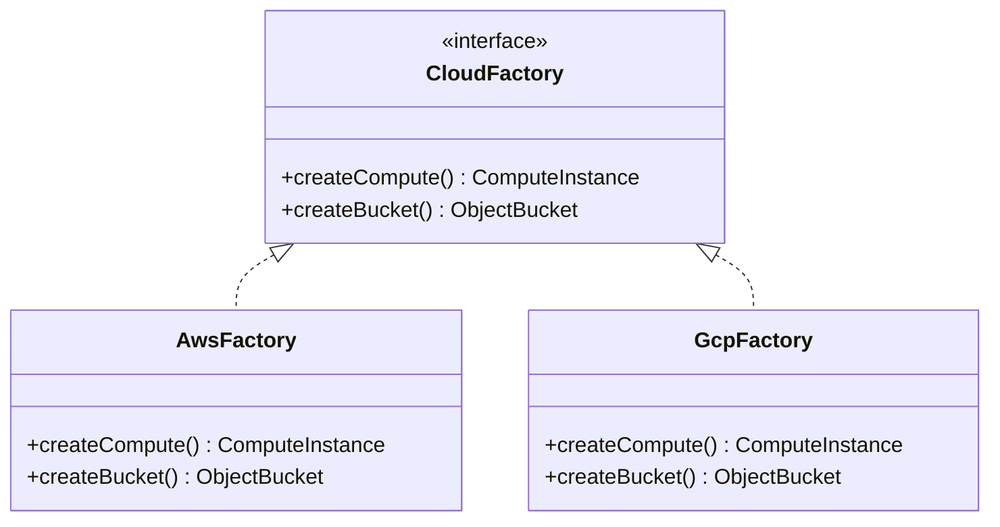

# Abstract Factory Pattern

> **One-line summary:** Provide an interface for creating families of related or dependent objects without specifying their concrete classes—guaranteeing product compatibility across platforms, cloud providers, or UI themes.

| Attribute | Specification |
|---|---|
| **Level** | Intermediate / Core GoF |
| **Prerequisites** | [02-factory-method.md](02-factory-method.md), [04-programming-to-interfaces.md](../01-foundations/04-programming-to-interfaces.md) |
| **Estimated Reading Time** | 30 minutes |
| **Status** | Complete |
| **Category** | Creational |
| **Origin** | GoF 1994 |
| **Also Known As** | Kit Pattern, Product Family Factory |
| **Languages Tested** | Java 25 (LTS) / TypeScript 5.8 (Node 24 native) / Python 3.14 |

---

## Table of Contents
- [1 The Problem](#1-the-problem)
- [2 Why It Exists](#2-why-it-exists)
- [3 What It Is](#3-what-it-is)
- [4 The Problem Without It](#4-the-problem-without-it)
- [5 How It Solves It](#5-how-it-solves-it)
- [6 How It Works](#6-how-it-works)
- [7 Real-World Examples](#7-real-world-examples)
- [8 When to Use and When NOT to Use](#8-when-to-use-and-when-not-to-use)
- [9 Variations and Language Idioms](#9-variations-and-language-idioms)
- [10 Relationship to Other Principles and Patterns](#10-relationship-to-other-principles-and-patterns)
- [11 Common Mistakes and Anti-Patterns](#11-common-mistakes-and-anti-patterns)
- [12 Testing and Design Verification](#12-testing-and-design-verification)
- [13 Performance, Concurrency and Security Notes](#13-performance-concurrency-and-security-notes)
- [14 Interview Questions](#14-interview-questions)
- [15 Practice Exercises](#15-practice-exercises)
- [16 Summary / Cheat Sheet](#16-summary--cheat-sheet)
- [17 Further Reading](#17-further-reading)

---

## 1 The Problem

Imagine building a multi-cloud infrastructure provisioner supporting **AWS** and **GCP**. Every deployment needs two coordinated resources: a `ComputeInstance` (`EC2` vs `ComputeEngine`) and an `ObjectBucket` (`S3` vs `GCS`).

If the deployment engine creates resources using scattered conditionals:
```java
if (cloud.equals("AWS")) vm = new Ec2Instance(); else vm = new GceInstance();
// 50 lines later, someone accidentally checks a wrong flag:
bucket = new GcsBucket(); // BUG: Booted AWS EC2 with a GCP GCS bucket!
```
Mixing incompatible products across families causes IAM authentication failures and cross-cloud egress outages.

---

## 2 Why It Exists

Formulated by the **Gang of Four (1994)** to solve **product-family consistency**: when a system must be configured with one of multiple families of related objects (Dark vs Light UI widgets, AWS vs GCP resources, PostgreSQL vs MySQL query drivers), an Abstract Factory locks all created products to the same compatible family.

---

## 3 What It Is

An `AbstractFactory` interface declares creation methods for each product in the family (`createCompute()`, `createBucket()`). Concrete factories (`AwsFactory`, `GcpFactory`) implement all methods consistently, and clients depend solely on the factory and product interfaces.



---

## 4 The Problem Without It

```java
// Violation: Scattered provider checks allow incompatible family mixing
class DeploymentViolation {
    public void deploy(String computeCloud, String storageCloud) {
        if ("AWS".equals(computeCloud)) System.out.println("Boot EC2");
        if ("GCP".equals(storageCloud)) System.out.println("Create GCS -> MISMATCH!");
    }
}
```

---

## 5 How It Solves It

### Java Implementation (Java 25 LTS)

```java
package com.design.patterns.creational.abstractfactory;

interface ComputeInstance { void boot(); }
interface ObjectBucket { void put(String key); }

interface CloudFactory {
    ComputeInstance createCompute();
    ObjectBucket createBucket();
}

class AwsFactory implements CloudFactory {
    public ComputeInstance createCompute() { return () -> System.out.println("Java AWS EC2 booted"); }
    public ObjectBucket createBucket() { return k -> System.out.println("Java AWS S3 put: " + k); }
}

class GcpFactory implements CloudFactory {
    public ComputeInstance createCompute() { return () -> System.out.println("Java GCP GCE booted"); }
    public ObjectBucket createBucket() { return k -> System.out.println("Java GCP GCS put: " + k); }
}

class Deployer {
    private final CloudFactory factory;
    public Deployer(CloudFactory factory) { this.factory = factory; }
    public void deployApp() {
        factory.createCompute().boot();
        factory.createBucket().put("artifact.jar");
    }
}
```

### TypeScript Implementation (Node 24 Native)

```typescript
interface ComputeInstance { boot(): void; }
interface ObjectBucket { put(key: string): void; }
interface CloudFactory {
    createCompute(): ComputeInstance;
    createBucket(): ObjectBucket;
}

class AwsFactory implements CloudFactory {
    createCompute(): ComputeInstance { return { boot: () => console.log("TS AWS EC2 booted") }; }
    createBucket(): ObjectBucket { return { put: k => console.log("TS AWS S3 put:", k) }; }
}

function deployApp(factory: CloudFactory) {
    factory.createCompute().boot();
    factory.createBucket().put("bundle.js");
}
deployApp(new AwsFactory());
```

### Python Implementation (Python 3.14)

```python
from typing import Protocol

class ComputeInstance(Protocol):
    def boot(self) -> None: ...

class ObjectBucket(Protocol):
    def put(self, key: str) -> None: ...

class CloudFactory(Protocol):
    def create_compute(self) -> ComputeInstance: ...
    def create_bucket(self) -> ObjectBucket: ...

class AwsCompute:
    def boot(self) -> None: print("Python AWS EC2 booted")

class AwsBucket:
    def put(self, key: str) -> None: print(f"Python AWS S3 put: {key}")

class AwsFactory:
    def create_compute(self) -> ComputeInstance: return AwsCompute()
    def create_bucket(self) -> ObjectBucket: return AwsBucket()
```

---

## 6 How It Works: The Extensibility Trade-off

- **Adding a new Product Family (e.g., `AzureFactory`):** Easy! Create one new factory class + products without modifying `Deployer` (OCP).
- **Adding a new Product Type to existing families (e.g., `createQueue()`):** Hard! Requires updating `CloudFactory` interface and *every* concrete factory (`AwsFactory`, `GcpFactory`).

---

## 7 Real-World Examples

1. **JDBC `Connection` / `Statement` / `ResultSet`**: `PostgresConnection` acts as an Abstract Factory producing compatible PostgreSQL `PreparedStatement` and `ResultSet` instances.
2. **Java Swing / AWT `Toolkit`**: Abstracts OS-specific windows, buttons, and menus.
3. **Cross-Platform UI Component Libraries (Material vs Cupertino in Flutter/React Native)**.

---

## 8 When to Use and When NOT to Use

| Context | Use Abstract Factory? | Rationale |
|---|---|---|
| **Multiple related products that must match by family** | **Yes** | Guarantees compatibility at compile time. |
| **Single independent product** | **No** | Use Factory Method or simple `Supplier<T>`. |

---

## 9 Variations and Language Idioms

- **TypeScript Object Literal Kit:** An object `{ createCompute: ..., createBucket: ... }` satisfies `CloudFactory` without extra class boilerplate.
- **Abstract Factory + Prototype:** Concrete factories store prototype templates and clone them.

---

## 10 Relationship to Other Principles and Patterns

- **DIP & ISP:** Clients depend only on abstract factory/product interfaces.
- **Factory Method:** Abstract Factory methods are typically implemented as Factory Methods.

---

## 11 Common Mistakes and Anti-Patterns

| Anti-Pattern | Description | Production Consequence | Correct Remedy |
|---|---|---|---|
| **Using for a Single Product** | Building an Abstract Factory with only 1 `createFoo()` method. | Unnecessary abstraction layer. | Use Factory Method or `Supplier<Foo>`. |
| **Adding New Product Types Frequently** | Constantly adding new methods to `CloudFactory`. | Breaks all existing factory implementations. | Only group stable product families. |
| **Leaking Concrete Types** | Returning `S3Bucket` instead of `ObjectBucket`. | Couples client to AWS. | Return abstract product interface. |
| **Hardcoding Factory Choice Inside Client** | Client doing `new AwsFactory()` internally. | Defeats configurability. | Inject `CloudFactory` via Composition Root (DI). |
| **Mixing Families via Static Helpers** | Calling `AwsFactory` for compute and `GcpFactory` for storage. | Runtime incompatibility. | Pass one `CloudFactory` instance per deployment. |
| **Stateful Factories** | Storing mutable deployment state inside `AwsFactory`. | Race conditions across threads. | Keep factories stateless. |

---

## 12 Testing and Design Verification

Inject a `FakeCloudFactory` returning in-memory fakes to verify `Deployer` sequences without touching AWS or GCP APIs.

---

## 13 Performance, Concurrency and Security Notes

Stateless factories can be shared as Singletons safely across concurrent threads.

---

## 14 Interview Questions

<details>
<summary><strong>1. What problem does Abstract Factory solve that Factory Method does not?</strong></summary>

Factory Method creates a single product. Abstract Factory creates **families of related, interdependent products** (e.g., `Compute` + `Storage` + `Network`), guaranteeing that products from incompatible families are never mixed.
</details>

<details>
<summary><strong>2. What is the biggest maintenance trade-off of Abstract Factory?</strong></summary>

Adding a new *family* (`AzureFactory`) is trivial (OCP), but adding a new *product type* (`createQueue()`) to the family forces modifying the `AbstractFactory` interface and every concrete factory implementation.
</details>

<details>
<summary><strong>3. Give a real-world example of Abstract Factory in Java's standard library.</strong></summary>

`java.sql.Connection` (creates vendor-compatible `Statement`, `PreparedStatement`, `CallableStatement`) and `javax.xml.parsers.DocumentBuilderFactory`.
</details>

<details>
<summary><strong>4. How does Abstract Factory support Dependency Inversion (DIP)?</strong></summary>

The high-level client depends exclusively on the `AbstractFactory` and abstract product interfaces; concrete vendor factories and products depend inward on those abstractions.
</details>

<details>
<summary><strong>5. Can Abstract Factory be implemented without classes in TypeScript or Python?</strong></summary>

Yes—using a record/dictionary of factory callables (`{ createCompute: ..., createBucket: ... }`) typed against a structural interface/Protocol.
</details>

<details>
<summary><strong>6. How can Abstract Factory collaborate with Singleton?</strong></summary>

Each concrete factory (`AwsFactory`, `DarkThemeFactory`) is typically stateless and can safely be instantiated once per application as a DI Singleton.
</details>

<details>
<summary><strong>7. How does Abstract Factory differ from Builder?</strong></summary>

**Abstract Factory** creates a *family* of distinct objects immediately in one call per product; **Builder** constructs *one* complex object step-by-step and finalizes it with `.build()`.
</details>

<details>
<summary><strong>8. What happens if a client mixes products from two different `AbstractFactory` instances?</strong></summary>

It defeats the pattern's guarantee. Enforce single-factory injection at the Composition Root so a client only ever receives one `CloudFactory`.
</details>

---

## 15 Practice Exercises

### Exercise 1: Identify Family vs Single Product (Easy)
Which needs Abstract Factory? (a) Creating `PdfReport` vs `CsvReport`; (b) Creating matching `WinButton` + `WinCheckbox` vs `MacButton` + `MacCheckbox`.

<details>
<summary><strong>Solution</strong></summary>

(b) requires **Abstract Factory** (family of compatible UI widgets); (a) needs only Factory Method.
</details>

---

### Exercise 2: Add `AzureFactory` Without Editing `Deployer` (Medium)
Extend the Java/TS/Python cloud example with `AzureFactory` (`AzureVm`, `AzureBlob`) and verify `Deployer` needs zero edits.

<details>
<summary><strong>Solution</strong></summary>

Implement `class AzureFactory implements CloudFactory` returning `AzureVm` and `AzureBlob`; pass `new AzureFactory()` to `new Deployer(...)`.
</details>

---

### Exercise 3: Database Driver Abstract Factory in Python (Hard)
Design a `DatabaseFactory` protocol producing `Connection` and `QueryBuilder` for `Postgres` and `Sqlite`, ensuring SQL dialect compatibility.

<details>
<summary><strong>Solution</strong></summary>

Define `DatabaseFactory(Protocol)` with `create_connection()` and `create_query_builder()`, implemented separately by `PostgresFactory` and `SqliteFactory`.
</details>

---

## 16 Summary / Cheat Sheet

```
+--------------------------------------------------------------------------+
|                         ABSTRACT FACTORY PATTERN                         |
+--------------------------------------------------------------------------+
| INTENT     : Create compatible families of related objects without       |
|              hardcoding concrete classes.                                |
| TRADE-OFF  : Easy to add new families; hard to add new product types.    |
| VS BUILDER : Abstract Factory = product families; Builder = 1 complex obj|
+--------------------------------------------------------------------------+
```

---

## 17 Further Reading

- Erich Gamma et al., *Design Patterns*, Addison-Wesley, 1994.

### In Your Language
| Language Track | Deep Dive Reference |
|---|---|
| Java | [Java OOP & Design Patterns](file:///e:/Learning/engineering-notes/01-languages/java/24-design-patterns/README.md) |
| TypeScript | [TypeScript Design Patterns](file:///e:/Learning/engineering-notes/01-languages/typescript/17-design-patterns/README.md) |
| Python | [Python Design Patterns](file:///e:/Learning/engineering-notes/01-languages/python/23-design-patterns/README.md) |

---

[← Previous: 02 - Factory Method](file:///e:/Learning/engineering-notes/08-solid-design-patterns/05-creational-patterns/02-factory-method.md) | [Module 05 Index](file:///e:/Learning/engineering-notes/08-solid-design-patterns/05-creational-patterns/README.md) | [Next: 04 - Builder Pattern →](file:///e:/Learning/engineering-notes/08-solid-design-patterns/05-creational-patterns/04-builder.md)
