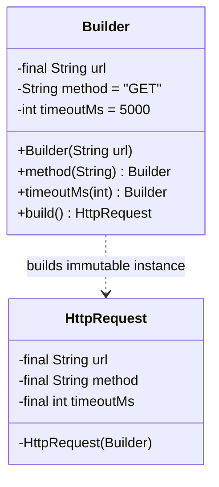

# Builder Pattern

> **One-line summary:** Separate the construction of a complex, immutable object from its representation—eliminating unreadable "telescoping constructors" and half-initialized setter states.

| Attribute | Specification |
|---|---|
| **Level** | Core / Foundational |
| **Prerequisites** | [07-immutability-and-value-objects.md](../01-foundations/07-immutability-and-value-objects.md), [08-fail-fast-principle.md](../03-design-principles/08-fail-fast-principle.md) |
| **Estimated Reading Time** | 30 minutes |
| **Status** | Complete |
| **Category** | Creational |
| **Origin** | GoF 1994 / Joshua Bloch Fluent Builder (*Effective Java* Item 2) |
| **Also Known As** | Fluent Builder, Step Builder, Staged Builder |
| **Languages Tested** | Java 25 (LTS) / TypeScript 5.8 (Node 24 native) / Python 3.14 |

---

## Table of Contents
- [1 The Problem](#1-the-problem)
- [2 Why It Exists](#2-why-it-exists)
- [3 What It Is](#3-what-it-is)
- [4 The Problem Without It](#4-the-problem-without-it)
- [5 How It Solves It](#5-how-it-solves-it)
- [6 How It Works](#6-how-it-works)
- [7 Real-World Examples](#7-real-world-examples)
- [8 When to Use and When NOT to Use](#8-when-to-use-and-when-not-to-use)
- [9 Variations and Language Idioms](#9-variations-and-language-idioms)
- [10 Relationship to Other Principles and Patterns](#10-relationship-to-other-principles-and-patterns)
- [11 Common Mistakes and Anti-Patterns](#11-common-mistakes-and-anti-patterns)
- [12 Testing and Design Verification](#12-testing-and-design-verification)
- [13 Performance, Concurrency and Security Notes](#13-performance-concurrency-and-security-notes)
- [14 Interview Questions](#14-interview-questions)
- [15 Practice Exercises](#15-practice-exercises)
- [16 Summary / Cheat Sheet](#16-summary--cheat-sheet)
- [17 Further Reading](#17-further-reading)

---

## 1 The Problem

Imagine constructing an `HttpRequest` with 2 required fields (`url`, `method`) and 6 optional fields (`timeoutMs`, `retries`, `headers`, `body`, `followRedirects`, `tlsVerify`).

Developers try two naive approaches, and both fail:
1. **Telescoping Constructors:** `new HttpRequest("https://api.com", "POST", 5000, 3, null, "{}", true, false)`. Swapping `true, false` silently disables TLS verification in production—and nobody reading the call site can tell what `5000, 3, true, false` mean!
2. **JavaBeans Setters:** `req = new HttpRequest(); req.setUrl(...); req.setTimeout(...);`. Now `HttpRequest` is **mutable** (unsafe across threads!) and can exist in an **invalid half-initialized state** if a caller forgets `setUrl()`.

---

## 2 Why It Exists

Originally cataloged by **GoF (1994)** with a `Director` + `Builder` hierarchy, the modern **Fluent Builder** was popularized by **Joshua Bloch** (*Effective Java*, Item 2: *"Consider a builder when faced with many constructor parameters"*). It delivers the safety of immutable constructors *plus* the readability of named parameters.

---

## 3 What It Is

A `Builder` collects required parameters in its constructor and optional parameters via fluent chaining methods (returning `this`), validating cross-field invariants atomically when `.build()` constructs the final immutable object.



---

## 4 The Problem Without It

```java
// Telescoping Constructor Anti-Pattern: Unreadable & error-prone!
class TelescopingHttpRequest {
    public TelescopingHttpRequest(String url, String method, int timeoutMs, int retries, boolean followRedirects, boolean verifyTls) {
        // Easy to swap booleans or ints accidentally!
    }
}
```

---

## 5 How It Solves It

### Java Implementation (Java 25 LTS — Joshua Bloch Fluent Builder)

```java
package com.design.patterns.creational.builder;

public final class HttpRequest {
    private final String url;
    private final String method;
    private final int timeoutMs;

    private HttpRequest(Builder b) {
        this.url = b.url;
        this.method = b.method;
        this.timeoutMs = b.timeoutMs;
    }

    public String summary() {
        return method + " " + url + " (" + timeoutMs + "ms)";
    }

    public static class Builder {
        private final String url;
        private String method = "GET";
        private int timeoutMs = 5000;

        public Builder(String url) {
            if (url == null || url.isBlank()) throw new IllegalArgumentException("URL required");
            this.url = url;
        }

        public Builder method(String m) { this.method = m; return this; }
        public Builder timeoutMs(int ms) {
            if (ms <= 0) throw new IllegalArgumentException("Timeout must be positive");
            this.timeoutMs = ms;
            return this;
        }

        public HttpRequest build() {
            return new HttpRequest(this);
        }
    }
}
```

### TypeScript Implementation (Node 24 Native — Fluent Builder & Idiomatic Options Alternative)

```typescript
// Note: In TypeScript, a typed Options object often replaces Builder natively!
export interface HttpRequestOptions {
    readonly url: string;
    readonly method?: "GET" | "POST" | "PUT" | "DELETE";
    readonly timeoutMs?: number;
}

export function createHttpRequest(opts: HttpRequestOptions) {
    if (!opts.url.trim()) throw new Error("URL required");
    return Object.freeze({
        url: opts.url,
        method: opts.method ?? "GET",
        timeoutMs: opts.timeoutMs ?? 5000,
    });
}
```

### Python Implementation (Python 3.14 — Idiomatic Keyword-Only Dataclass)

```python
from dataclasses import dataclass

# Python's named keyword arguments + frozen dataclass eliminate Builder boilerplate natively!
@dataclass(frozen=True, kw_only=True)
class HttpRequest:
    url: str
    method: str = "GET"
    timeout_ms: int = 5000

    def __post_init__(self) -> None:
        if not self.url.strip():
            raise ValueError("URL required")
        if self.timeout_ms <= 0:
            raise ValueError("timeout_ms must be positive")
```

---

## 6 How It Works: The Step Builder (Compile-Time Required Fields)

For critical objects where multiple required fields must be set in order, **Step Builders** return distinct interfaces at each step (`UrlStep` $\to$ `MethodStep` $\to$ `BuildStep`), making `.build()` unreachable at compile time until every required field is provided!

---

## 7 Real-World Examples

1. **Java `java.net.http.HttpRequest.newBuilder()`** and **`StringBuilder`**.
2. **Lombok `@Builder` / Protocol Buffers Java `Message.newBuilder()`**.
3. **SQL Query Builders (jOOQ, Knex.js, SQLAlchemy select chains)**.

---

## 8 When to Use and When NOT to Use

| Context | Use Builder? | Rationale |
|---|---|---|
| **Java with 4+ optional/same-typed parameters** | **Yes** | Eliminates telescoping constructors while preserving immutability. |
| **TypeScript / Python** | **Prefer Options Object / `@dataclass(kw_only=True)`** | Native named parameters solve the telescoping problem directly without Builder boilerplate. |
| **Simple 2–3 field class** | **NO** | Plain constructor or `record` is simpler (KISS). |

---

## 9 Variations and Language Idioms

- **GoF Director + Builder:** Useful when constructing multiple representations (e.g., HTML vs Markdown) from the exact same step sequence.
- **Lombok `@Builder` / Java Records:** Keep compact validation inside the record constructor even when adding a builder.

---

## 10 Relationship to Other Principles and Patterns

- **Immutability & Value Objects:** Builder's primary purpose is enabling immutable objects without ugly constructors.
- **Fail-Fast:** `.build()` validates cross-field invariants before returning the object.
- **Composite:** Builders frequently assemble recursive Composite trees cleanly.

---

## 11 Common Mistakes and Anti-Patterns

| Anti-Pattern | Description | Production Consequence | Correct Remedy |
|---|---|---|---|
| **Builder Without Immutability** | Target object still exposes public setters. | Loses thread-safety and invariant guarantees. | Make target fields `final`/`readonly` with private constructor. |
| **Missing Validation in `build()`** | Checking invariants only in setters or not at all. | Invalid object built if optional combo violates rule. | Validate cross-field invariants inside `build()`. |
| **Using Builder in Python/TS Blindly** | Writing 50-line Builder classes instead of `kw_only` dataclasses or options objects. | Unnecessary Java-style boilerplate. | Use native named arguments. |
| **Sharing Mutable Collections** | `this.headers = builder.headers;` without defensive copying. | Mutating builder *after* `build()` corrupts built object! | Copy collections (`List.copyOf(builder.headers)`). |
| **Builder for 2 Fields** | `new User.Builder("Alice").age(30).build()`. | Over-engineering (KISS). | Use `new User("Alice", 30)`. |
| **Mutable Builder Reuse Trap** | Reusing one builder instance across threads. | Data corruption. | Builders are short-lived single-thread helpers. |

---

## 12 Testing and Design Verification

**Test Data Builders** (e.g., `OrderTestBuilder.aDefaultOrder().withTotal(0).build()`) are one of the highest-ROI testing patterns—keeping test Arrange blocks concise and resilient to schema changes!

---

## 13 Performance, Concurrency and Security Notes

- **Concurrency:** Built objects are immutable and safe across threads; the `Builder` itself is intentionally non-thread-safe and short-lived.

---

## 14 Interview Questions

<details>
<summary><strong>1. What two problems does Joshua Bloch's Fluent Builder solve?</strong></summary>

1. **Telescoping Constructors** (unreadable positional arguments of identical types).
2. **JavaBeans Setters** (forcing objects to be mutable and allowing half-initialized invalid states).
</details>

<details>
<summary><strong>2. Why are Builders much less common in Python and TypeScript than in Java?</strong></summary>

Python supports named keyword arguments with defaults (`@dataclass(kw_only=True)`), and TypeScript supports typed options objects (`{ url, timeoutMs = 5000 }`)—natively providing named optional parameters without extra Builder classes.
</details>

<details>
<summary><strong>3. What is a "Step Builder" (Staged Builder)?</strong></summary>

A variation where each builder method returns a distinct interface representing the next required step, guaranteeing at **compile time** that `.build()` cannot be called until all mandatory fields are supplied.
</details>

<details>
<summary><strong>4. Why must `build()` defensively copy mutable collections from the Builder?</strong></summary>

If `build()` stores a direct reference to `builder.items` (`List`), the caller could still call `builder.addItem(...)` *after* `build()`, mutating the supposedly immutable object! Use `List.copyOf(...)`.
</details>

<details>
<summary><strong>5. How does Builder differ from Factory Method and Abstract Factory?</strong></summary>

Factory patterns instantiate objects in a single atomic call (focusing on *which* concrete subtype to pick). Builder constructs a single complex object **step-by-step** with configurable optional parts before finalizing in `.build()`.
</details>

<details>
<summary><strong>6. Where should cross-field validation happen in a Builder?</strong></summary>

Inside `.build()` (or the target object's private constructor called by `build()`), because cross-field rules (e.g., `startDate < endDate`) can only be evaluated once all fields are set.
</details>

<details>
<summary><strong>7. What is the "Test Data Builder" pattern?</strong></summary>

A test-only Builder pre-populated with valid sensible defaults (`OrderBuilder.anOrder().withDiscount(0.5).build()`), letting each unit test specify only the exact fields relevant to that test case.
</details>

<details>
<summary><strong>8. When is Builder an anti-pattern?</strong></summary>

When a class has 3 or fewer fields, no optional parameters, or in languages with native named keyword parameters unless complex step-by-step assembly (like SQL/AST building) is needed.
</details>

---

## 15 Practice Exercises

### Exercise 1: Spot the Defensive Copy Bug (Easy)
`build()` sets `this.tags = builder.tags;`. Show how a caller can corrupt the built immutable object and fix it.

<details>
<summary><strong>Solution</strong></summary>

Caller calls `obj = builder.build(); builder.addTag("hack");` which mutates `obj.tags`. Fix with `this.tags = List.copyOf(builder.tags);`.
</details>

---

### Exercise 2: Convert Telescoping Constructor to Builder in Java (Medium)
Refactor `Email(String to, String subject, String body, String cc, boolean html, int priority)` into a Fluent Builder requiring `to` and `subject`.

<details>
<summary><strong>Solution</strong></summary>

`Email.builder("a@b.com", "Hi").body("...").html(true).build()` with validation in `Builder(to, subject)` and `build()`.
</details>

---

### Exercise 3: Design a Compile-Time Step Builder (Hard)
Sketch Java interfaces `HostStep -> PortStep -> BuildStep` ensuring `DbConfig` cannot be built without setting both `host` and `port`.

<details>
<summary><strong>Solution</strong></summary>

```java
interface HostStep { PortStep host(String host); }
interface PortStep { BuildStep port(int port); }
interface BuildStep { BuildStep ssl(boolean enabled); DbConfig build(); }
```
</details>

---

## 16 Summary / Cheat Sheet

```
+--------------------------------------------------------------------------+
|                             BUILDER PATTERN                              |
+--------------------------------------------------------------------------+
| INTENT     : Step-by-step construction of complex immutable objects.     |
| FIXES      : Telescoping constructors & mutable half-built JavaBeans.    |
| MUST DO    : Defensive copy collections & validate cross-fields in build.|
| TS/PYTHON  : Prefer Options Objects / kw_only dataclasses natively!      |
+--------------------------------------------------------------------------+
```

---

## 17 Further Reading

- Joshua Bloch, *Effective Java (3rd Edition)* (Item 2: Consider a builder when faced with many constructor parameters), 2018.

### In Your Language
| Language Track | Deep Dive Reference |
|---|---|
| Java | [Java OOP & Design Patterns](file:///e:/Learning/engineering-notes/01-languages/java/24-design-patterns/README.md) |
| TypeScript | [TypeScript Design Patterns](file:///e:/Learning/engineering-notes/01-languages/typescript/17-design-patterns/README.md) |
| Python | [Python Design Patterns](file:///e:/Learning/engineering-notes/01-languages/python/23-design-patterns/README.md) |

---

[← Previous: 03 - Abstract Factory](file:///e:/Learning/engineering-notes/08-solid-design-patterns/05-creational-patterns/03-abstract-factory.md) | [Module 05 Index](file:///e:/Learning/engineering-notes/08-solid-design-patterns/05-creational-patterns/README.md) | [Next: 05 - Prototype Pattern →](file:///e:/Learning/engineering-notes/08-solid-design-patterns/05-creational-patterns/05-prototype.md)
