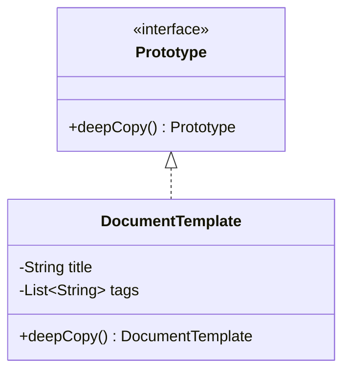

# Prototype Pattern

> **One-line summary:** Create new objects by cloning an existing pre-configured prototype instance—avoiding expensive initialization costs or coupling to concrete subclasses, while guarding against shallow-copy aliasing bugs.

| Attribute | Specification |
|---|---|
| **Level** | Core / GoF Creational |
| **Prerequisites** | [07-immutability-and-value-objects.md](../01-foundations/07-immutability-and-value-objects.md) |
| **Estimated Reading Time** | 25 minutes |
| **Status** | Complete |
| **Category** | Creational |
| **Origin** | GoF 1994 |
| **Also Known As** | Clone / Copy Constructor Pattern |
| **Languages Tested** | Java 25 (LTS) / TypeScript 5.8 (Node 24 native) / Python 3.14 |

---

## Table of Contents
- [1 The Problem](#1-the-problem)
- [2 Why It Exists](#2-why-it-exists)
- [3 What It Is](#3-what-it-is)
- [4 The Problem Without It](#4-the-problem-without-it)
- [5 How It Solves It](#5-how-it-solves-it)
- [6 How It Works](#6-how-it-works)
- [7 Real-World Examples](#7-real-world-examples)
- [8 When to Use and When NOT to Use](#8-when-to-use-and-when-not-to-use)
- [9 Variations and Language Idioms](#9-variations-and-language-idioms)
- [10 Relationship to Other Principles and Patterns](#10-relationship-to-other-principles-and-patterns)
- [11 Common Mistakes and Anti-Patterns](#11-common-mistakes-and-anti-patterns)
- [12 Testing and Design Verification](#12-testing-and-design-verification)
- [13 Performance, Concurrency and Security Notes](#13-performance-concurrency-and-security-notes)
- [14 Interview Questions](#14-interview-questions)
- [15 Practice Exercises](#15-practice-exercises)
- [16 Summary / Cheat Sheet](#16-summary--cheat-sheet)
- [17 Further Reading](#17-further-reading)

---

## 1 The Problem

Imagine a document workflow engine or game server that spawns thousands of configured objects (`DocumentTemplate` with 40 parsed XML sections and legal clause lists, or `EnemyUnit` with pre-loaded AI behavior trees).

Building each instance from scratch requires re-parsing disk templates or querying the database every time (taking 50ms per object). Furthermore, if you only hold an interface reference (`Shape shape`), you cannot call `new shape.getClass()()` cleanly if fields are private!

When developers try to solve this with naive assignment or Java `Object.clone()`, a **shallow-copy aliasing bug** hits: mutating `clonedDoc.tags.add("signed")` silently mutates `originalTemplate.tags` too!

---

## 2 Why It Exists

Formulated by the **Gang of Four (1994)** to let systems duplicate pre-configured objects dynamically without coupling to their concrete constructors and without repeating expensive initialization I/O.

---

## 3 What It Is

The Prototype pattern declares a `clone()` / `deepCopy()` contract (or copy constructor) on objects so a Prototype Registry can store pre-initialized templates and stamp out independent copies on demand.



---

## 4 The Problem Without It

```java
// Shallow Copy Trap: Both templates share the exact same mutable tags List!
class BrokenDocumentTemplate {
    String title;
    java.util.List<String> tags;
    public BrokenDocumentTemplate(String title, java.util.List<String> tags) {
        this.title = title;
        this.tags = tags; // Aliasing bug!
    }
}
```

---

## 5 How It Solves It

Implement explicit **deep-copy** methods (or copy constructors / `copy.deepcopy` / `structuredClone`) so nested mutable collections are cloned independently.

### Java Implementation (Java 25 LTS — Copy Constructor / `deepCopy()`)

```java
package com.design.patterns.creational.prototype;

import java.util.*;

// Prefer explicit Copy Constructor / deepCopy() over broken java.lang.Cloneable!
class DocumentTemplate {
    private final String title;
    private final List<String> tags;

    public DocumentTemplate(String title, List<String> tags) {
        this.title = title;
        this.tags = new ArrayList<>(tags);
    }

    public DocumentTemplate deepCopy() {
        return new DocumentTemplate(this.title, new ArrayList<>(this.tags));
    }

    public void addTag(String tag) { tags.add(tag); }
    public List<String> getTags() { return Collections.unmodifiableList(tags); }
}
```

### TypeScript Implementation (Node 24 Native — `structuredClone`)

```typescript
interface DocumentTemplate {
    title: string;
    tags: string[];
}

const template: DocumentTemplate = { title: "NDA", tags: ["legal"] };
const copy = structuredClone(template); // Built-in deep clone in Node 24 / Browsers!
copy.tags.push("signed");
console.log("TS Prototype original:", template.tags, "copy:", copy.tags);
```

### Python Implementation (Python 3.14 — `copy.deepcopy`)

```python
import copy
from dataclasses import dataclass, field

@dataclass
class DocumentTemplate:
    title: str
    tags: list[str] = field(default_factory=list)

    def clone(self) -> "DocumentTemplate":
        return copy.deepcopy(self)

if __name__ == "__main__":
    t1 = DocumentTemplate("NDA", ["legal"])
    t2 = t1.clone()
    t2.tags.append("signed")
    print(f"Python Prototype t1: {t1.tags}, t2: {t2.tags}")
```

### Real Execution Output
```text
Prototype t1 tags: [legal], t2 tags: [legal, signed]
Python Prototype t1: ['legal'], t2: ['legal', 'signed']
```

---

## 6 How It Works: Why Java `Cloneable` Is Broken

Joshua Bloch (*Effective Java* Item 13) famously warns against `java.lang.Cloneable`:
1. `Cloneable` is a marker interface with *no* `clone()` method (`Object.clone()` is `protected`!).
2. `super.clone()` performs a **shallow field-by-field copy**, silently sharing mutable lists/arrays and breaking `final` fields!
3. Always use **Copy Constructors** (`new Foo(existingFoo)`) or explicit `deepCopy()` methods instead.

---

## 7 Real-World Examples

1. **JavaScript Prototype Chain (`Object.create`) & `structuredClone()`**.
2. **Python `copy.copy` / `copy.deepcopy` & `dataclasses.replace(obj, field=new_val)`**.
3. **Kubernetes PodTemplates / VM Golden Images**: Cloning pre-configured template specs rather than building configs from scratch.

---

## 8 When to Use and When NOT to Use

| Context | Use Prototype? | Rationale |
|---|---|---|
| **Expensive object initialization (parsed AST/XML, DB-loaded templates)** | **Yes** | Clone in memory in microseconds instead of repeating I/O. |
| **Immutable Value Objects (`record` / `frozen=True`)** | **Use `with*` / `dataclasses.replace`** | Immutable objects don't need defensive deep copying of shared immutable parts! |

---

## 9 Variations and Language Idioms

- **Immutable Copy-on-Write (`with` / `replace`):** In Java records, TS `{ ...obj, tags: [...obj.tags] }`, and Python `dataclasses.replace()`, cloning is trivial when fields are immutable.

---

## 10 Relationship to Other Principles and Patterns

- **Memento:** Can use Prototype/deep copy to snapshot internal state.
- **Abstract Factory + Prototype:** Factories store prototype objects and clone them to produce products.

---

## 11 Common Mistakes and Anti-Patterns

| Anti-Pattern | Description | Production Consequence | Correct Remedy |
|---|---|---|---|
| **Shallow Copy Aliasing** | Copying object references while sharing nested `List`/`Map` fields. | Mutating clone silently corrupts prototype! | Deep copy all mutable nested objects. |
| **Using Java `Cloneable`** | Implementing `Cloneable` and calling `super.clone()`. | Bypasses constructors; breaks `final` fields. | Use Copy Constructor or `deepCopy()`. |
| **JSON.parse(JSON.stringify(x)) Hack** | Using JSON round-tripping to deep-clone in JS/TS. | Drops `Date`, `Map`, `Set`, `undefined`, and methods! | Use native `structuredClone()`. |
| **Circular Reference Infinite Loop** | Naive recursive deep copy on cyclic graphs (`A -> B -> A`). | `StackOverflowError` / `RecursionError`. | Track visited references (`IdentityHashMap` / `deepcopy` memo). |
| **Cloning Open Sockets/DB Handles** | Deep-copying objects holding live OS file descriptors. | Double-close crashes and resource corruption. | Exclude live I/O handles; only clone data templates. |
| **Cloning Immutable Objects** | Deep-copying immutable `String` or `record` instances needlessly. | Wasted CPU and memory. | Share immutable references safely. |

---

## 12 Testing and Design Verification

Always write an **Isolation Mutation Test**: clone the prototype, mutate nested lists/maps on the clone, and assert the original prototype remains 100% unchanged.

---

## 13 Performance, Concurrency and Security Notes

- **Concurrency:** If a shared `PrototypeRegistry` serves templates to multiple threads, clones *must* be deep-copied (or immutable) before threads mutate them.

---

## 14 Interview Questions

<details>
<summary><strong>1. Why does Joshua Bloch recommend avoiding `java.lang.Cloneable`?</strong></summary>

`Cloneable` lacks a `clone()` method in its interface, `super.clone()` bypasses constructors and fails with `final` mutable fields, and it defaults to shallow copying. Copy constructors or explicit `deepCopy()` factory methods are safer and cleaner.
</details>

<details>
<summary><strong>2. Explain Shallow Copy vs Deep Copy with a concrete failure example.</strong></summary>

A shallow copy duplicates top-level fields while copying references to nested mutable objects (like `List<String> tags`), causing mutations in the clone to corrupt the original. A deep copy recursively clones nested mutable objects so both remain independent.
</details>

<details>
<summary><strong>3. Why is `JSON.parse(JSON.stringify(obj))` a bad deep-clone in JavaScript/TypeScript?</strong></summary>

It silently converts `Date` objects to strings, strips `undefined`, `Map`, `Set`, functions, and `RegExp`, and crashes on circular references or `BigInt`. Modern Node/browsers provide `structuredClone()`.
</details>

<details>
<summary><strong>4. How does Python's `copy.deepcopy` handle cyclic object graphs?</strong></summary>

`copy.deepcopy` maintains an internal `memo` dictionary mapping original object IDs to already-cloned instances, preventing infinite recursion on cycles.
</details>

<details>
<summary><strong>5. When is Prototype preferable to Factory Method?</strong></summary>

When initializing an object from scratch is expensive (disk/network parsing) or requires complex runtime state configurations best captured in pre-built template instances.
</details>

<details>
<summary><strong>6. How does immutability eliminate the need for deep copying?</strong></summary>

If nested objects are deeply immutable (`record`, `readonly`, `frozen=True`), two objects can safely share the exact same references without any risk of aliasing mutation.
</details>

<details>
<summary><strong>7. How does `dataclasses.replace` in Python work with Prototype?</strong></summary>

`dataclasses.replace(obj, title="New")` creates a shallow copy of a dataclass while overriding specified fields cleanly—ideal for immutable value objects.
</details>

<details>
<summary><strong>8. What happens if you try to clone an object holding a live database socket?</strong></summary>

Cloning live OS handles (sockets, file descriptors) duplicates the handle reference, causing interleaved writes or double-close crashes. Only clone data/configuration templates, never live I/O connections.
</details>

---

## 15 Practice Exercises

### Exercise 1: Spot Shallow Copy Bug (Easy)
`let copy = { ...user }; copy.roles.push("ADMIN");` — why does `user.roles` now contain `"ADMIN"`?

<details>
<summary><strong>Solution</strong></summary>

Spread `{ ...user }` only shallow-copies top-level properties; `roles` array reference is shared. Use `structuredClone(user)` or `{ ...user, roles: [...user.roles, "ADMIN"] }`.
</details>

---

### Exercise 2: Implement Copy Constructor in Java (Medium)
Add a copy constructor `public OrderTemplate(OrderTemplate other)` deep-copying `List<LineItem> items`.

<details>
<summary><strong>Solution</strong></summary>

`this.items = new ArrayList<>(other.items);` (and deep-copy `LineItem` if mutable).
</details>

---

### Exercise 3: Prototype Registry in Python (Hard)
Build a `TemplateRegistry` storing named `DocumentTemplate` prototypes and returning independent deep-cloned instances via `create(name)`.

<details>
<summary><strong>Solution</strong></summary>

Store `dict[str, DocumentTemplate]` and return `copy.deepcopy(self._registry[name])` in `create(name)`.
</details>

---

## 16 Summary / Cheat Sheet

```
+--------------------------------------------------------------------------+
|                            PROTOTYPE PATTERN                             |
+--------------------------------------------------------------------------+
| INTENT     : Clone pre-configured instances instead of building anew.    |
| DANGER     : Shallow copy aliasing corrupts original nested collections! |
| BEST IMPL  : Java: Copy Constructor | TS: structuredClone | Py: deepcopy.|
+--------------------------------------------------------------------------+
```

---

## 17 Further Reading

- Joshua Bloch, *Effective Java (3rd Edition)* (Item 13: Override `clone` judiciously), 2018.

### In Your Language
| Language Track | Deep Dive Reference |
|---|---|
| Java | [Java OOP & Design Patterns](file:///e:/Learning/engineering-notes/01-languages/java/24-design-patterns/README.md) |
| TypeScript | [TypeScript Design Patterns](file:///e:/Learning/engineering-notes/01-languages/typescript/17-design-patterns/README.md) |
| Python | [Python Design Patterns](file:///e:/Learning/engineering-notes/01-languages/python/23-design-patterns/README.md) |

---

[← Previous: 04 - Builder Pattern](file:///e:/Learning/engineering-notes/08-solid-design-patterns/05-creational-patterns/04-builder.md) | [Module 05 Index](file:///e:/Learning/engineering-notes/08-solid-design-patterns/05-creational-patterns/README.md) | [Next: 06 - Simple Factory & Static Factory Methods →](file:///e:/Learning/engineering-notes/08-solid-design-patterns/05-creational-patterns/06-simple-factory-and-static-factory-methods.md)
