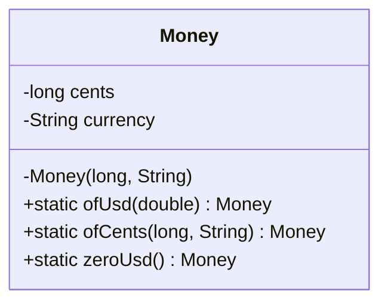

# Simple Factory & Static Factory Methods

> **One-line summary:** Replace ambiguous constructors with named static factory methods (`Money.ofUsd(...)`, `List.of(...)`) that clarify intent, cache immutable instances, and return interface subtypes—while keeping Simple Factory distinct from GoF Factory Method.

| Attribute | Specification |
|---|---|
| **Level** | Core / Foundational |
| **Prerequisites** | [02-factory-method.md](02-factory-method.md), [07-immutability-and-value-objects.md](../01-foundations/07-immutability-and-value-objects.md) |
| **Estimated Reading Time** | 25 minutes |
| **Status** | Complete |
| **Category** | Creational |
| **Origin** | Joshua Bloch (*Effective Java* Item 1) & GoF Companion Idiom |
| **Also Known As** | Named Constructors, Static Creation Methods |
| **Languages Tested** | Java 25 (LTS) / TypeScript 5.8 (Node 24 native) / Python 3.14 |

---

## Table of Contents
- [1 The Problem](#1-the-problem)
- [2 Why It Exists](#2-why-it-exists)
- [3 What It Is](#3-what-it-is)
- [4 The Problem Without It](#4-the-problem-without-it)
- [5 How It Solves It](#5-how-it-solves-it)
- [6 How It Works](#6-how-it-works)
- [7 Real-World Examples](#7-real-world-examples)
- [8 When to Use and When NOT to Use](#8-when-to-use-and-when-not-to-use)
- [9 Variations and Language Idioms](#9-variations-and-language-idioms)
- [10 Relationship to Other Principles and Patterns](#10-relationship-to-other-principles-and-patterns)
- [11 Common Mistakes and Anti-Patterns](#11-common-mistakes-and-anti-patterns)
- [12 Testing and Design Verification](#12-testing-and-design-verification)
- [13 Performance, Concurrency and Security Notes](#13-performance-concurrency-and-security-notes)
- [14 Interview Questions](#14-interview-questions)
- [15 Practice Exercises](#15-practice-exercises)
- [16 Summary / Cheat Sheet](#16-summary--cheat-sheet)
- [17 Further Reading](#17-further-reading)

---

## 1 The Problem

Imagine a `Money` class in a financial engine. Callers construct it as `new Money(100, "USD")`.
Three bugs appear in production:
1. **Unit Ambiguity:** Does `new Money(100, "USD")` mean \$100.00 or 100 cents (\$1.00)? Callers guess differently!
2. **Constructor Overload Collision:** You cannot have two constructors `Money(double dollars)` and `Money(double euros)` because their parameter types are identical (`double`).
3. **Wasteful Allocations:** Every call creates a new object even for `Money(0, "USD")`, and constructors can never return a subtype (`List.of()` returning an optimized `ImmutableCollections$List12`).

---

## 2 Why It Exists

Formalized by **Joshua Bloch** (*Effective Java*, Item 1: *"Consider static factory methods instead of constructors"*). Static factory methods solve five constructor limitations:
1. **They have descriptive names** (`Money.ofCents(100)` vs `Money.ofUsd(100.0)`).
2. **They are not required to create a new object** on every call (flyweight caching, `Boolean.valueOf`, `Integer.valueOf`).
3. **They can return any subtype** of their return type (hiding implementation classes like `Collections.unmodifiableList`).
4. **Returned class can vary** based on input parameters (`EnumSet.of(...)` returning `RegularEnumSet` vs `JumboEnumSet`).
5. **Simple Factory** centralizes a `switch(type)` creation block in one place instead of duplicating it across 10 callers.

---

## 3 What It Is



---

## 4 The Problem Without It

```java
// Ambiguous Constructor: Is 1999 dollars or cents? Cannot overload two (double) constructors!
class AmbiguousMoney {
    AmbiguousMoney(long amount, String currency) {}
}
```

---

## 5 How It Solves It

### Java Implementation (Java 25 LTS)

```java
package com.design.patterns.creational.staticfactory;

public final class Money {
    private final long cents;
    private final String currency;
    private static final Money ZERO_USD = new Money(0, "USD");

    private Money(long cents, String currency) {
        this.cents = cents;
        this.currency = currency;
    }

    public static Money ofUsd(double dollars) {
        return new Money(Math.round(dollars * 100), "USD");
    }

    public static Money ofCents(long cents, String currency) {
        return new Money(cents, currency);
    }

    public static Money zeroUsd() {
        return ZERO_USD; // Cached immutable flyweight!
    }

    public String display() {
        return currency + " " + (cents / 100.0);
    }
}
```

### TypeScript Implementation (Node 24 Native)

```typescript
export class Money {
    readonly cents: number;
    readonly currency: string;
    private static readonly ZERO_USD = new Money(0, "USD");

    private constructor(cents: number, currency: string) {
        this.cents = cents;
        this.currency = currency;
    }

    static ofUsd(dollars: number): Money {
        return new Money(Math.round(dollars * 100), "USD");
    }

    static zeroUsd(): Money {
        return Money.ZERO_USD;
    }
}
```

### Python Implementation (Python 3.14)

```python
from dataclasses import dataclass

@dataclass(frozen=True)
class Money:
    cents: int
    currency: str

    @classmethod
    def of_usd(cls, dollars: float) -> "Money":
        return cls(round(dollars * 100), "USD")

    @classmethod
    def of_cents(cls, cents: int, currency: str) -> "Money":
        return cls(cents, currency)
```

### Real Execution Output
```text
Static Factory: USD 19.99 | Zero cached: true
TS Static Factory: 1999 true
Python Static Factory: Money(cents=1999, currency='USD')
```

---

## 6 How It Works: Simple Factory vs. Factory Method

- **Simple Factory:** A single concrete factory class/static method containing `switch(type)`. It does **not** use polymorphism to extend—adding a new type modifies the `switch`. Good for isolating creation when types change rarely.
- **Static Factory Method:** A named `static` method on the product class itself (`Money.ofUsd()`, `Optional.of()`).
- **GoF Factory Method:** Polymorphic creation overridden by subclasses or injected suppliers (satisfies OCP).

---

## 7 Real-World Examples

1. **Java `List.of(...)`, `Optional.of(...)`, `LocalDate.of(...)`, `Integer.valueOf(...)`** (IntegerCache `-128` to `127`).
2. **Python `datetime.fromtimestamp(...)`, `dict.fromkeys(...)`** (`@classmethod` named constructors).
3. **TypeScript `Array.from(...)`, `Promise.resolve(...)`**.

---

## 8 When to Use and When NOT to Use

| Context | Use Static Factory Method? | Rationale |
|---|---|---|
| **Multiple ways to construct from same types (`fromBytes`, `fromJson`)** | **Yes** | Eliminates constructor ambiguity. |
| **Caching / Flyweight / Subtype selection** | **Yes** | Constructors always allocate `this` class; static methods can return cached or subclass instances. |
| **Simple DTOs with 1 obvious constructor** | **Optional** | `new Point(x, y)` is already clear. |

---

## 9 Variations and Language Idioms

- **Common Naming Conventions (Effective Java):** `from` (type conversion), `of` (aggregation), `valueOf`, `instance` / `getInstance`, `create` / `newInstance` (guarantees fresh object).
- **Python `@classmethod` vs `@staticmethod`:** Prefer `@classmethod` (`cls(...)`) so subclasses inherit the factory properly!

---

## 10 Relationship to Other Principles and Patterns

- **POLA (Least Astonishment):** Named constructors (`ofUsd` vs `ofCents`) prevent unit confusion.
- **Flyweight:** Static factory methods are the primary entry point for returning cached Flyweight instances.

---

## 11 Common Mistakes and Anti-Patterns

| Anti-Pattern | Description | Production Consequence | Correct Remedy |
|---|---|---|---|
| **Static Simple Factory Doing Heavy I/O** | `NotificationFactory.create()` opening DB connections internally. | Untestable static coupling. | Use DI or inject a non-static factory interface. |
| **Python `@staticmethod` Instead of `@classmethod`** | Hardcoding `Money(...)` inside `@staticmethod`. | Breaks subclassing (`CryptoMoney.of_usd()` returns `Money`!). | Use `@classmethod` and `cls(...)`. |
| **Unbounded Caching in Static Factory** | Caching every dynamic `Money.ofCents(n)` in a static `HashMap`. | Memory leak (OOM)! | Only cache fixed bounded constants (like `ZERO`, `-128..127`). |
| **Confusing Simple Factory with OCP** | Claiming a `switch(type)` Simple Factory is closed for modification. | False architectural assumptions. | Upgrade to Registry or Factory Method if variants grow fast. |
| **Leaving Ambiguous Public Constructor** | Keeping public `new Money(100)` alongside `Money.ofUsd(100)`. | Callers still misuse old constructor. | Make constructor `private` when enforcing named factories. |
| **Obscure Custom Method Names** | Naming factories `Money.makeIt()` instead of `of`, `from`, `parse`. | Poor discoverability. | Follow standard `of`/`from`/`parse` conventions. |

---

## 12 Testing and Design Verification

Verify cached identities (`assertSame(Money.zeroUsd(), Money.zeroUsd())`) and clear conversion invariants (`Money.ofUsd(19.99)` equals `Money.ofCents(1999, "USD")`).

---

## 13 Performance, Concurrency and Security Notes

Returning cached immutable constants (`ZERO`, `EMPTY`) reduces garbage collection allocation pressure on hot paths.

---

## 14 Interview Questions

<details>
<summary><strong>1. List 4 advantages of Static Factory Methods over constructors (Effective Java Item 1).</strong></summary>

1. They have descriptive names. 2. They don't have to create a new object on every call (caching/flyweights). 3. They can return any subtype of their return type. 4. The returned concrete class can vary depending on input parameters.
</details>

<details>
<summary><strong>2. What is the main limitation of Static Factory Methods?</strong></summary>

Classes with only `private` constructors cannot be subclassed, and static factory methods are slightly less immediately visible in generated Javadocs than constructors (mitigated by standard naming like `of`, `from`, `valueOf`).
</details>

<details>
<summary><strong>3. Why should Python static factories use `@classmethod` instead of `@staticmethod`?</strong></summary>

`@classmethod` receives `cls` as its first argument, so if a subclass inherits the factory method, calling `Subclass.from_str(...)` constructs an instance of `Subclass` rather than hardcoding the parent class.
</details>

<details>
<summary><strong>4. How does `Integer.valueOf(42)` in Java use a Static Factory Method for performance?</strong></summary>

`Integer.valueOf` caches `Integer` objects for values `-128` through `127` (`IntegerCache`), returning the shared cached object instead of allocating on the heap.
</details>

<details>
<summary><strong>5. Distinguish Simple Factory from GoF Factory Method.</strong></summary>

Simple Factory is a single concrete method with a `switch` (violates OCP when new types arrive). GoF Factory Method is a polymorphic method overridden by subclasses or injected suppliers.
</details>

<details>
<summary><strong>6. Give 3 standard naming conventions for static factories in Java.</strong></summary>

`from` (single-arg type conversion, e.g., `Date.from(instant)`), `of` (aggregation, e.g., `List.of(1, 2)`), `parse` (string parsing, e.g., `Instant.parse(...)`).
</details>

<details>
<summary><strong>7. When does caching inside a static factory cause a memory leak?</strong></summary>

When caching unbounded user-supplied inputs (e.g., caching every unique string or monetary amount) in a strong static `Map` without eviction or `WeakReference`s.
</details>

<details>
<summary><strong>8. Why is `SimpleFactory` still useful even though it violates OCP?</strong></summary>

When there are 2–3 stable types in one place, a Simple Factory centralizes the `switch` in a single module (DRY) without introducing premature inheritance hierarchies (KISS).
</details>

---

## 15 Practice Exercises

### Exercise 1: Fix Constructor Collision (Easy)
A `Temperature` class needs construction from both Celsius (`double`) and Fahrenheit (`double`). Implement static factories in Java/TS/Python.

<details>
<summary><strong>Solution</strong></summary>

`Temperature.fromCelsius(double c)` and `Temperature.fromFahrenheit(double f)` with a private constructor storing canonical Kelvin/Celsius.
</details>

---

### Exercise 2: Subtype Return Factory (Medium)
Write a Java `Notification.of(String channel)` static factory returning `EmailNotification` or `SmsNotification` behind the `Notification` interface without exposing concrete classes publicly.

<details>
<summary><strong>Solution</strong></summary>

Make `EmailNotification` and `SmsNotification` package-private classes; expose `public static Notification of(String channel)` on `interface Notification`.
</details>

---

### Exercise 3: Python `@classmethod` Subclass-Safe Factory (Hard)
Implement `BaseEvent.from_json(raw)` using `@classmethod` and verify that `OrderPaidEvent.from_json(...)` returns an `OrderPaidEvent` instance.

<details>
<summary><strong>Solution</strong></summary>

```python
import json
class BaseEvent:
    def __init__(self, event_id: str): self.event_id = event_id
    @classmethod
    def from_json(cls, raw: str): return cls(**json.loads(raw))
```
</details>

---

## 16 Summary / Cheat Sheet

```
+--------------------------------------------------------------------------+
|                SIMPLE FACTORY & STATIC FACTORY METHODS                   |
+--------------------------------------------------------------------------+
| WHY USE    : Named clarity (ofUsd vs ofCents), caching, subtype returns. |
| CONVENTIONS: from(), of(), valueOf(), parse(), newInstance().            |
| PYTHON     : Always prefer @classmethod (cls) over @staticmethod!        |
+--------------------------------------------------------------------------+
```

---

## 17 Further Reading

- Joshua Bloch, *Effective Java (3rd Edition)* (Item 1), Addison-Wesley, 2018.

### In Your Language
| Language Track | Deep Dive Reference |
|---|---|
| Java | [Java OOP & Design Patterns](file:///e:/Learning/engineering-notes/01-languages/java/24-design-patterns/README.md) |
| TypeScript | [TypeScript Design Patterns](file:///e:/Learning/engineering-notes/01-languages/typescript/17-design-patterns/README.md) |
| Python | [Python Design Patterns](file:///e:/Learning/engineering-notes/01-languages/python/23-design-patterns/README.md) |

---

[← Previous: 05 - Prototype Pattern](file:///e:/Learning/engineering-notes/08-solid-design-patterns/05-creational-patterns/05-prototype.md) | [Module 05 Index](file:///e:/Learning/engineering-notes/08-solid-design-patterns/05-creational-patterns/README.md) | [Next: 07 - Object Pool Pattern →](file:///e:/Learning/engineering-notes/08-solid-design-patterns/05-creational-patterns/07-object-pool.md)
