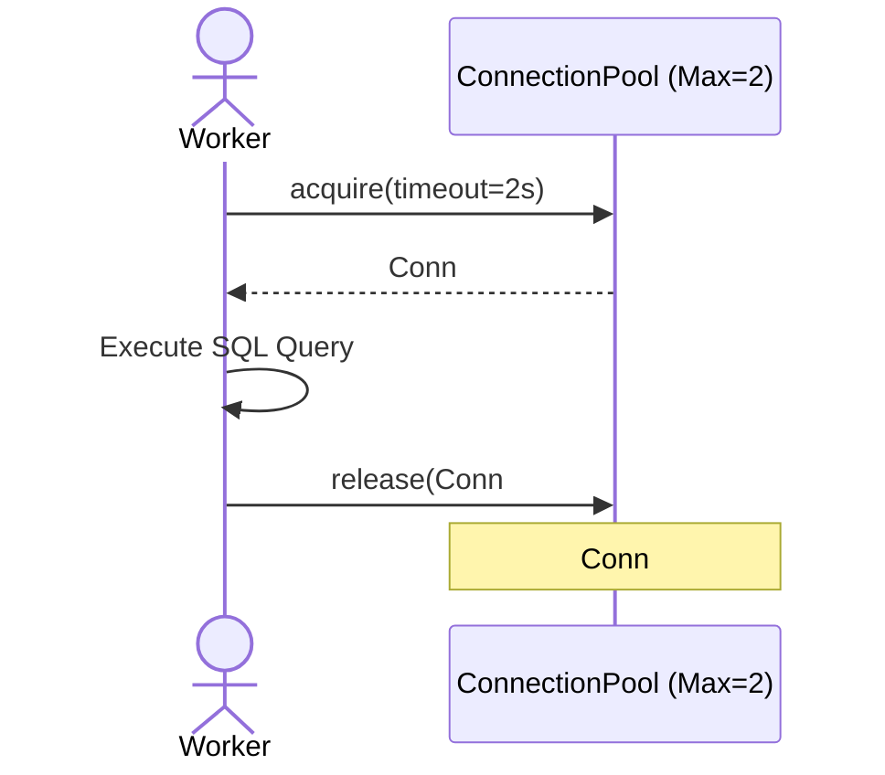

# Object Pool Pattern

> **One-line summary:** Maintain a bounded cache of initialized, expensive-to-create objects (such as database TCP connections, thread workers, or GPU buffers) so callers borrow and return them rather than repeatedly paying allocation/handshake costs.

| Attribute | Specification |
|---|---|
| **Level** | Intermediate / Systems & Concurrency |
| **Prerequisites** | [01-singleton.md](01-singleton.md), [08-fail-fast-principle.md](../03-design-principles/08-fail-fast-principle.md) |
| **Estimated Reading Time** | 30 minutes |
| **Status** | Complete |
| **Category** | Creational / Resource Management |
| **Origin** | Systems Engineering / GoF Companion Pattern |
| **Also Known As** | Resource Pool, Connection Pool (HikariCP / pg-pool) |
| **Languages Tested** | Java 25 (LTS) / TypeScript 5.8 (Node 24 native) / Python 3.14 |

---

## Table of Contents
- [1 The Problem](#1-the-problem)
- [2 Why It Exists](#2-why-it-exists)
- [3 What It Is](#3-what-it-is)
- [4 The Problem Without It](#4-the-problem-without-it)
- [5 How It Solves It](#5-how-it-solves-it)
- [6 How It Works](#6-how-it-works)
- [7 Real-World Examples](#7-real-world-examples)
- [8 When to Use and When NOT to Use](#8-when-to-use-and-when-not-to-use)
- [9 Variations and Language Idioms](#9-variations-and-language-idioms)
- [10 Relationship to Other Principles and Patterns](#10-relationship-to-other-principles-and-patterns)
- [11 Common Mistakes and Anti-Patterns](#11-common-mistakes-and-anti-patterns)
- [12 Testing and Design Verification](#12-testing-and-design-verification)
- [13 Performance, Concurrency and Security Notes](#13-performance-concurrency-and-security-notes)
- [14 Interview Questions](#14-interview-questions)
- [15 Practice Exercises](#15-practice-exercises)
- [16 Summary / Cheat Sheet](#16-summary--cheat-sheet)
- [17 Further Reading](#17-further-reading)

---

## 1 The Problem

Opening a TLS-encrypted PostgreSQL TCP connection takes ~30–80ms (TCP 3-way handshake, TLS negotiation, authentication, server process fork). If a web server handling 1,000 requests/sec opens and closes a fresh database connection on every HTTP request:
- Request latency balloons from 3ms to 80ms.
- PostgreSQL exhausts its `max_connections` limit (typically 100–300), rejecting new clients with `FATAL: too many connections`.

---

## 2 Why It Exists

Object Pool trades a small fixed memory footprint for **bounded concurrency and near-zero acquisition latency** by reusing pre-established connections/buffers across requests.

---

## 3 What It Is

A `Pool` holds a bounded collection (`BlockingQueue` / `Semaphore` + list) of reusable objects. Callers `acquire()` (with timeout!), execute work inside a guaranteed `try/finally` (or `with`/`AutoCloseable`), and `release()` the object back after resetting any dirty state.



---

## 4 The Problem Without It

```java
// Violation: Opening a new heavyweight connection per request exhausts DB max_connections!
void handleRequest() {
    // 50ms TCP + TLS handshake on every single request!
    var conn = openNewTcpTlsDbConnection();
    query(conn);
    conn.close();
}
```

---

## 5 How It Solves It

### Java Implementation (Java 25 LTS — Bounded `BlockingQueue` Pool)

```java
package com.design.patterns.creational.pool;

import java.util.concurrent.*;

class DbConnection {
    final int id;
    public DbConnection(int id) { this.id = id; }
    public void reset() { /* clear temp session variables/transactions */ }
}

class ConnectionPool {
    private final BlockingQueue<DbConnection> pool;

    public ConnectionPool(int size) {
        this.pool = new ArrayBlockingQueue<>(size);
        for (int i = 1; i <= size; i++) {
            pool.add(new DbConnection(i));
        }
    }

    public DbConnection acquire(long timeoutMs) throws InterruptedException {
        DbConnection conn = pool.poll(timeoutMs, TimeUnit.MILLISECONDS);
        if (conn == null) throw new IllegalStateException("Pool exhausted after " + timeoutMs + "ms");
        return conn;
    }

    public void release(DbConnection conn) {
        if (conn != null) {
            conn.reset();
            pool.offer(conn);
        }
    }
}
```

### TypeScript Implementation (Node 24 Native)

```typescript
class PooledBuffer {
    readonly id: number;
    constructor(id: number) { this.id = id; }
    reset(): void { /* wipe buffer */ }
}

class BufferPool {
    private available: PooledBuffer[] = [];
    constructor(size: number) {
        for (let i = 1; i <= size; i++) this.available.push(new PooledBuffer(i));
    }
    acquire(): PooledBuffer {
        const buf = this.available.pop();
        if (!buf) throw new Error("Pool exhausted");
        return buf;
    }
    release(buf: PooledBuffer): void {
        buf.reset();
        this.available.push(buf);
    }
}
```

### Python Implementation (Python 3.14 — Context-Managed Pool)

```python
from queue import Queue, Empty
from contextlib import contextmanager

class ConnectionPool:
    def __init__(self, size: int) -> None:
        self._q: Queue[int] = Queue(maxsize=size)
        for i in range(1, size + 1):
            self._q.put(i)

    @contextmanager
    def borrow(self, timeout_s: float = 1.0):
        try:
            conn_id = self._q.get(timeout=timeout_s)
        except Empty as e:
            raise TimeoutError("Connection pool exhausted") from e
        try:
            yield conn_id
        finally:
            self._q.put(conn_id)
```

---

## 6 How It Works: Mandatory Safety Rules

1. **Always bound pool size + acquisition timeout:** Unbounded `acquire()` deadlocks threads forever under traffic spikes.
2. **Always return inside `finally` / `AutoCloseable` / `with`:** Missing a release on an exception permanently leaks connections until the pool starves!
3. **Always reset dirty state on release:** Uncommitted transactions or session variables (`SET ROLE`) leaked to the next borrower cause catastrophic security/data bugs!

---

## 7 Real-World Examples

1. **HikariCP (Java) / `pg.Pool` (Node.js) / SQLAlchemy QueuePool (Python)**: Production DB connection pools.
2. **`ExecutorService` / `ThreadPoolExecutor`**: Thread pools reusing OS worker threads.
3. **Netty `ByteBuf` Recycler**: Pools off-heap direct byte buffers for high-throughput networking.

---

## 8 When to Use and When NOT to Use

| Context | Use Object Pool? | Rationale |
|---|---|---|
| **Network/DB Connections, OS Threads, Off-heap Buffers** | **Yes** | Creation cost is milliseconds (syscalls/handshakes). |
| **Plain In-Memory Objects (`Order`, `String`, DTOs)** | **NO (Anti-Pattern!)** | Modern generational GCs allocate & reclaim small objects in nanoseconds—faster than pool synchronization! |

---

## 9 Variations and Language Idioms

- **Java `AutoCloseable` Wrapper:** Return a `PooledConnection implements AutoCloseable` whose `.close()` calls `pool.release(this)` so callers use `try (var c = pool.acquire()) { ... }` cleanly!

---

## 10 Relationship to Other Principles and Patterns

- **Flyweight:** Flyweights are *immutable/shared simultaneously* by many callers; Pooled objects are *exclusively borrowed* by one caller at a time and returned.
- **Proxy:** `PooledConnection` is a Proxy whose `close()` intercepts disposal and returns it to the pool.

---

## 11 Common Mistakes and Anti-Patterns

| Anti-Pattern | Description | Production Consequence | Correct Remedy |
|---|---|---|---|
| **Pooling Light Objects** | Pooling ordinary POJOs/DTOs in Java/JS/Python. | Synchronization slower than GC; causes stale-data bugs. | Let the GC handle short-lived objects. |
| **Connection Leak (No `finally`)** | Calling `release()` after business code without `try/finally`. | Pool empties on first exception; total outage! | Use `try-with-resources` / `with`. |
| **Dirty State Carryover** | Releasing a DB connection with an open transaction or temp table. | Next user sees wrong transaction/permissions! | `reset()` / `ROLLBACK` on return. |
| **Infinite `acquire()` Wait** | Blocking forever with no timeout when pool is full. | Cascading thread exhaustion across entire server. | Always enforce bounded wait timeout (`poll(timeout)`). |
| **Returning Stale/Broken Connections** | Handing out a TCP socket closed by DB idle timeout. | Random query failures on first request after idle period. | Validate liveness (`isValid`) or evict idle connections. |
| **Double-Release Bug** | Caller calls `pool.release(c)` twice! | Two callers simultaneously borrow the exact same connection! | Track `isBorrowed` state and reject double-release. |

---

## 12 Testing and Design Verification

Test **exhaustion timeout** (borrowing `size + 1` throws timeout error), **exception safety** (exception inside `borrow` still returns connection to pool), and **state reset**.

---

## 13 Performance, Concurrency and Security Notes

- **Security:** Resetting session auth/role context (`DISCARD ALL` in PostgreSQL) before returning connections prevents cross-tenant privilege escalation.

---

## 14 Interview Questions

<details>
<summary><strong>1. When should you use an Object Pool, and when is it an anti-pattern?</strong></summary>

Use it for resources with high OS/network initialization cost (DB/TCP sockets, threads, direct off-heap buffers). It is an anti-pattern for ordinary in-memory objects because modern generational GCs allocate/reclaim them faster than thread-safe pool locking, without stale-state risks.
</details>

<details>
<summary><strong>2. Compare Object Pool vs Flyweight.</strong></summary>

**Flyweight** shares *immutable* intrinsic state concurrently across many callers at once. **Object Pool** lends *mutable* exclusive resources to one borrower at a time, requiring explicit return and state reset.
</details>

<details>
<summary><strong>3. What are the 3 non-negotiable invariants of a production Object Pool?</strong></summary>

1. Guaranteed release (`try/finally` / `AutoCloseable`). 2. Bounded acquisition timeout (fail fast instead of deadlocking). 3. Clean state reset on return (preventing dirty transactions or security leaks).
</details>

<details>
<summary><strong>4. What happens if a caller calls `release(conn)` twice on a naive pool?</strong></summary>

The exact same connection reference appears twice in the free queue, allowing two threads to borrow and interleave SQL on the same TCP socket simultaneously! Guard against double-release.
</details>

<details>
<summary><strong>5. How does HikariCP avoid connection leaks and stale sockets?</strong></summary>

Using `try-with-resources` proxy wrappers, leak-detection thresholds, max-lifetime eviction, and fast socket validation before handing out connections.
</details>

<details>
<summary><strong>6. Why should pool sizes be bounded (e.g., 10–50 connections) rather than 5,000?</strong></summary>

Databases degrade catastrophically under thousands of concurrent active connections due to context-switching and lock contention. A small bounded pool acts as a **Bulkhead** protecting the database.
</details>

<details>
<summary><strong>7. How does Python's `@contextmanager` make Object Pool usage safe?</strong></summary>

`with pool.borrow() as conn:` guarantees the `finally:` block returns `conn` to the queue even if an exception occurs inside the body.
</details>

<details>
<summary><strong>8. What is the Proxy role in database connection pools?</strong></summary>

The pool returns a `Connection` Proxy whose `.close()` method intercepts the close call and returns the underlying physical TCP connection back to the pool instead of closing the socket.
</details>

---

## 15 Practice Exercises

### Exercise 1: Spot the Leak Bug (Easy)
`var c = pool.acquire(); doWork(c); pool.release(c);` — why does this eventually hang the server?

<details>
<summary><strong>Solution</strong></summary>

If `doWork(c)` throws an exception, `pool.release(c)` is skipped permanently, draining the pool to zero. Wrap in `try { doWork(c); } finally { pool.release(c); }`.
</details>

---

### Exercise 2: Wrap Java Pool with `AutoCloseable` (Medium)
Add a `PooledResource implements AutoCloseable` wrapper to `ConnectionPool` so callers use `try (var conn = pool.acquire(1000)) { ... }`.

<details>
<summary><strong>Solution</strong></summary>

`close()` calls `pool.release(underlying)` once (using an `AtomicBoolean released` to guard against double-close).
</details>

---

### Exercise 3: Guard Against Double-Release in Python (Hard)
Update Python `ConnectionPool` to track active checked-out IDs in a `set` so releasing an unborrowed or already-returned ID raises `ValueError`.

<details>
<summary><strong>Solution</strong></summary>

Track `self._checked_out: set[int]` under a `threading.Lock`; add on borrow, `remove` on return (raising if absent).
</details>

---

## 16 Summary / Cheat Sheet

```
+--------------------------------------------------------------------------+
|                           OBJECT POOL PATTERN                            |
+--------------------------------------------------------------------------+
| USE FOR    : Expensive OS/network resources (DB sockets, Threads).       |
| NEVER FOR  : Plain POJOs/DTOs (let generational GC handle them!).        |
| 3 RULES    : try/finally release + bounded wait timeout + reset on return|
+--------------------------------------------------------------------------+
```

---

## 17 Further Reading

- HikariCP Wiki, *About Pool Sizing*, github.com/brettwooldridge/HikariCP/wiki/About-Pool-Sizing.

### In Your Language
| Language Track | Deep Dive Reference |
|---|---|
| Java | [Java OOP & Design Patterns](file:///e:/Learning/engineering-notes/01-languages/java/24-design-patterns/README.md) |
| TypeScript | [TypeScript Design Patterns](file:///e:/Learning/engineering-notes/01-languages/typescript/17-design-patterns/README.md) |
| Python | [Python Design Patterns](file:///e:/Learning/engineering-notes/01-languages/python/23-design-patterns/README.md) |

---

[← Previous: 06 - Simple Factory & Static Factory](file:///e:/Learning/engineering-notes/08-solid-design-patterns/05-creational-patterns/06-simple-factory-and-static-factory-methods.md) | [Module 05 Index](file:///e:/Learning/engineering-notes/08-solid-design-patterns/05-creational-patterns/README.md) | [Next: 08 - Lazy Initialisation & Holder →](file:///e:/Learning/engineering-notes/08-solid-design-patterns/05-creational-patterns/08-lazy-initialisation-and-holder.md)
