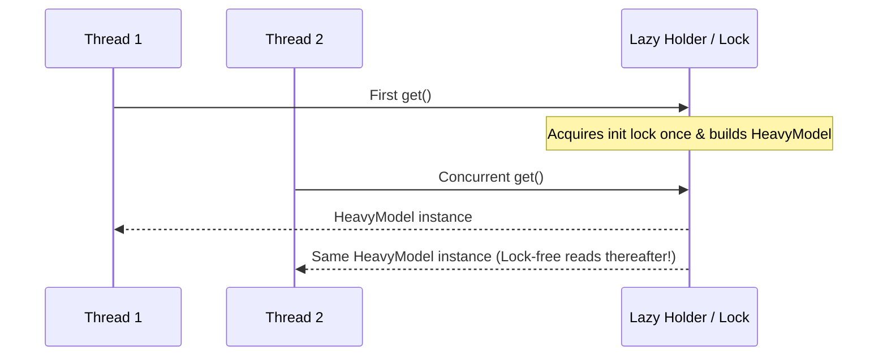

# Lazy Initialisation & The Holder Idiom

> **One-line summary:** Defer expensive object creation or resource loading until first actual use—while guaranteeing thread-safe, lock-free reads once initialized.

| Attribute | Specification |
|---|---|
| **Level** | Intermediate / Concurrency & Performance |
| **Prerequisites** | [01-singleton.md](01-singleton.md), [07-immutability-and-value-objects.md](../01-foundations/07-immutability-and-value-objects.md) |
| **Estimated Reading Time** | 25 minutes |
| **Status** | Complete |
| **Category** | Creational / Performance |
| **Origin** | PoEAA (Martin Fowler) / Bill Pugh Holder Idiom |
| **Also Known As** | On-Demand Initialization, `Lazy<T>`, `functools.cached_property` |
| **Languages Tested** | Java 25 (LTS) / TypeScript 5.8 (Node 24 native) / Python 3.14 |

---

## Table of Contents
- [1 The Problem](#1-the-problem)
- [2 Why It Exists](#2-why-it-exists)
- [3 What It Is](#3-what-it-is)
- [4 The Problem Without It](#4-the-problem-without-it)
- [5 How It Solves It](#5-how-it-solves-it)
- [6 How It Works](#6-how-it-works)
- [7 Real-World Examples](#7-real-world-examples)
- [8 When to Use and When NOT to Use](#8-when-to-use-and-when-not-to-use)
- [9 Variations and Language Idioms](#9-variations-and-language-idioms)
- [10 Relationship to Other Principles and Patterns](#10-relationship-to-other-principles-and-patterns)
- [11 Common Mistakes and Anti-Patterns](#11-common-mistakes-and-anti-patterns)
- [12 Testing and Design Verification](#12-testing-and-design-verification)
- [13 Performance, Concurrency and Security Notes](#13-performance-concurrency-and-security-notes)
- [14 Interview Questions](#14-interview-questions)
- [15 Practice Exercises](#15-practice-exercises)
- [16 Summary / Cheat Sheet](#16-summary--cheat-sheet)
- [17 Further Reading](#17-further-reading)

---

## 1 The Problem

A microservice loads a 400MB ML inference model (or parses 50,000 GeoIP rules) eagerly inside its constructor on startup. Two issues hit immediately:
1. Serverless/Kubernetes readiness probes time out because cold startup takes 18 seconds—even for health-check or admin requests that never touch ML inference!
2. Unit tests instantiating the service take 18 seconds each even when testing unrelated methods.

Yet naive `if (model == null) model = load();` fails under concurrent requests: two threads both load the 400MB model simultaneously, crashing the container with `OutOfMemoryError`!

---

## 2 Why It Exists

Lazy Initialization balances **fast startup** against **thread-safe once-only construction**, using language-level memory-model guarantees (`Holder` classloading, `volatile` Double-Checked Locking, `cached_property`) to avoid paying `synchronized` lock costs on every subsequent read.

---

## 3 What It Is



---

## 4 The Problem Without It

```java
// Eager Load: Slows cold start & every unit test!
// Or Naive Lazy: Race condition loads 400MB twice!
class NaiveLazyService {
    private Object model;
    public Object getModel() {
        if (model == null) model = loadHeavyModel(); // Race condition!
        return model;
    }
    private Object loadHeavyModel() { return new Object(); }
}
```

---

## 5 How It Solves It

### Java Implementation (Java 25 LTS — Instance Double-Checked Locking & Static Holder)

```java
package com.design.patterns.creational.lazy;

import java.util.function.Supplier;

// Reusable Thread-Safe Lazy<T> Wrapper (Instance-level DCL with volatile!)
public final class Lazy<T> {
    private volatile T value;
    private final Supplier<T> supplier;

    public Lazy(Supplier<T> supplier) {
        this.supplier = supplier;
    }

    public T get() {
        T local = value; // Single volatile read on hot path!
        if (local == null) {
            synchronized (this) {
                local = value;
                if (local == null) {
                    local = supplier.get();
                    value = local;
                }
            }
        }
        return local;
    }
}
```

### TypeScript Implementation (Node 24 Native)

```typescript
export class Lazy<T> {
    private initialized = false;
    private value?: T;
    private readonly factory: () => T;

    constructor(factory: () => T) {
        this.factory = factory;
    }

    get(): T {
        if (!this.initialized) {
            this.value = this.factory();
            this.initialized = true;
        }
        return this.value as T;
    }
}
```

### Python Implementation (Python 3.14 — `functools.cached_property`)

```python
from functools import cached_property

class GeoIpService:
    @cached_property
    def rules(self) -> dict[str, str]:
        print("Python: Loading heavy GeoIP rules once lazily...")
        return {"1.1.1.1": "AU"}
```

---

## 6 How It Works

1. **Static Class-Level Lazy:** Use the **Bill Pugh Holder** (`private static class Holder { static final T INSTANCE = ...; }`).
2. **Instance-Level Lazy:** Use `Lazy<T>` with **`volatile` + `local` variable** (reading `volatile` once into a local register makes the fast path ~25% faster in HotSpot).
3. **Note on `null` results:** Track a boolean `initialized` flag if `supplier.get()` can legitimately return `null`/`undefined`.

---

## 7 Real-World Examples

1. **Java `StableValue` (JDK preview) & Kotlin `by lazy { ... }`**.
2. **Python `functools.cached_property` & Django lazy querysets**.
3. **Virtual Proxy (ORM Lazy Loading)**: Hibernate creates lightweight proxies for `order.getLineItems()`, querying SQL only if accessed.

---

## 8 When to Use and When NOT to Use

| Context | Lazy vs Eager? | Rationale |
|---|---|---|
| **Heavy optional resources (ML models, large lookup tables)** | **Lazy** | Speeds up startup and tests. |
| **Critical startup dependencies (DB Pool, Required Config)** | **EAGER (Fail-Fast!)** | Don't defer DB config errors until the first customer checkout at 02:00 AM! |

---

## 9 Variations and Language Idioms

- **Kotlin `by lazy`** / **C# `Lazy<T>`** / **Python `@cached_property`** / **Java `Lazy<T>`**.

---

## 10 Relationship to Other Principles and Patterns

- **Virtual Proxy:** Structural pattern wrapping lazy initialization transparently behind the target interface.
- **Fail-Fast:** Opposite force—never lazily defer critical configuration validation.

---

## 11 Common Mistakes and Anti-Patterns

| Anti-Pattern | Description | Production Consequence | Correct Remedy |
|---|---|---|---|
| **DCL Without `volatile`** | Omitting `volatile` on `value` field in Java. | Half-constructed object visible to other threads. | Always mark `volatile`. |
| **Lazy Validation of Critical Config** | Deferring `DATABASE_URL` parsing until first query. | App passes Kubernetes readiness probe, then crashes on live traffic! | Validate config eagerly on boot (Fail-Fast). |
| **Lazy Loading N+1 ORM Trap** | Iterating 1,000 `Order`s and lazily triggering `order.getItems()` SQL per row. | 1,001 DB roundtrips! | Eagerly fetch/join when looping. |
| **Swallowing Init Exceptions** | Caching `null` or partial state if `factory()` throws once. | Permanent broken state until restart. | Let exception propagate without setting `initialized = true`. |
| **Lazy-Initializing Cheap Objects** | Wrapping a 2-field `Point` in `Lazy<Point>`. | Wrapper overhead > object cost! | Construct cheap objects directly. |
| **Single-Threaded Python `@cached_property` Assumptions** | Note that prior to Python 3.12, `cached_property` held a per-instance lock; in 3.12+, locking was removed! | Concurrent threads in Python 3.12+ may run `cached_property` twice unless guarded by a `Lock`! | Add `threading.Lock` if init must execute strictly once across threads. |

---

## 12 Testing and Design Verification

Use an `AtomicInteger callCount` inside the supplier and invoke `lazy.get()` concurrently from multiple threads, asserting `callCount.get() == 1`.

---

## 13 Performance, Concurrency and Security Notes

In Java `Lazy<T>`, reading `volatile T value` into a local variable avoids hitting memory barriers twice on the already-initialized fast path.

---

## 14 Interview Questions

<details>
<summary><strong>1. When should you prefer Eager initialization over Lazy initialization?</strong></summary>

For critical startup dependencies (missing DB URLs, invalid TLS certificates, connection pools) where you want Kubernetes/health-checks to **Fail-Fast** on boot rather than failing on the first live user request.
</details>

<details>
<summary><strong>2. Why does Java's Bill Pugh Holder idiom not need `synchronized` or `volatile`?</strong></summary>

Because the JVM specification guarantees that static class initialization (`Holder`) runs lazily on first reference and is synchronized internally by the classloader.
</details>

<details>
<summary><strong>3. Why does instance-level Double-Checked Locking store `volatile value` into a `local` variable?</strong></summary>

In the common fast path where `value` is already initialized, copying `value` into a local register requires only **one** volatile memory barrier read instead of two (`if (value == null) ... return value`).
</details>

<details>
<summary><strong>4. What happens if `supplier.get()` throws an exception during lazy initialization?</strong></summary>

Because `value` / `initialized` has not been set yet, subsequent calls will cleanly retry initialization rather than permanently caching a broken `null`.
</details>

<details>
<summary><strong>5. How does ORM Lazy Loading cause the N+1 Query problem?</strong></summary>

Loading 100 `Orders` executes 1 SQL query; accessing a lazily-initialized `order.getItems()` inside a loop fires 100 additional individual SQL queries instead of a single `JOIN` or `WHERE order_id IN (...)` batch.
</details>

<details>
<summary><strong>6. What changed in Python 3.12 regarding `functools.cached_property` thread safety?</strong></summary>

Python 3.12 removed the internal `RLock` from `cached_property` for performance—meaning in multi-threaded Python 3.12+, two concurrent threads can invoke the computation simultaneously unless you add an explicit `threading.Lock`.
</details>

<details>
<summary><strong>7. Compare Lazy Initialization with Virtual Proxy.</strong></summary>

Lazy Initialization is the general technique (e.g., `Lazy<T>` wrapper requiring `.get()`). **Virtual Proxy** hides that lazy creation behind the target object's own interface so callers don't even know creation was deferred.
</details>

<details>
<summary><strong>8. What happens if `supplier.get()` legitimately returns `null` in `Lazy<T>`?</strong></summary>

A naive `if (value == null)` check will re-run `supplier.get()` on every single call forever! Track a separate `volatile boolean initialized` flag (or sentinel object) if `null` is a valid result.
</details>

---

## 15 Practice Exercises

### Exercise 1: Spot the Eager vs Lazy Trap (Easy)
Should `JwtSigningKeyLoader` (reading `JWT_PUBLIC_KEY` env var) be Lazy or Eager on microservice startup?

<details>
<summary><strong>Solution</strong></summary>

**Eager (Fail-Fast)!** If the key is missing or malformed, the service must refuse to boot instead of failing every login request later.
</details>

---

### Exercise 2: Support Legitimate `null` in TypeScript `Lazy<T>` (Medium)
Verify why `if (!this.value)` fails if `T` is `number | null` and `0` or `null` is returned, and fix it using a `private initialized = false` flag.

<details>
<summary><strong>Solution</strong></summary>

`!0` and `!null` are truthy in JS, causing re-evaluation! Using `private initialized = false;` fixes both `0` and `null` cleanly.
</details>

---

### Exercise 3: Thread-Safe `Lazy` in Python 3.14 (Hard)
Implement a thread-safe generic `Lazy[T]` class in Python using `threading.Lock` and double-checked locking.

<details>
<summary><strong>Solution</strong></summary>

Check `if not self._initialized: with self._lock: if not self._initialized: ...`.
</details>

---

## 16 Summary / Cheat Sheet

```
+--------------------------------------------------------------------------+
|                    LAZY INITIALISATION & HOLDER IDIOM                    |
+--------------------------------------------------------------------------+
| USE FOR    : Heavy optional resources (ML models, large parse trees).    |
| AVOID FOR  : Required startup config/secrets (use Fail-Fast Eager!).     |
| JAVA       : Static -> Bill Pugh Holder | Instance -> volatile DCL.      |
+--------------------------------------------------------------------------+
```

---

## 17 Further Reading

- Joshua Bloch, *Effective Java (3rd Edition)* (Item 83: Use lazy initialization judiciously), 2018.

### In Your Language
| Language Track | Deep Dive Reference |
|---|---|
| Java | [Java OOP & Design Patterns](file:///e:/Learning/engineering-notes/01-languages/java/24-design-patterns/README.md) |
| TypeScript | [TypeScript Design Patterns](file:///e:/Learning/engineering-notes/01-languages/typescript/17-design-patterns/README.md) |
| Python | [Python Design Patterns](file:///e:/Learning/engineering-notes/01-languages/python/23-design-patterns/README.md) |

---

[← Previous: 07 - Object Pool Pattern](file:///e:/Learning/engineering-notes/08-solid-design-patterns/05-creational-patterns/07-object-pool.md) | [Module 05 Index](file:///e:/Learning/engineering-notes/08-solid-design-patterns/05-creational-patterns/README.md) | [Next: 09 - Multiton & Registry →](file:///e:/Learning/engineering-notes/08-solid-design-patterns/05-creational-patterns/09-multiton-and-registry.md)
