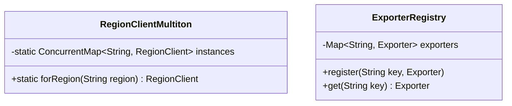

# Multiton & Registry Pattern

> **One-line summary:** Manage a controlled, keyed map of named instances (one per tenant, region, or strategy key) so systems scale beyond a single Singleton while avoiding unbounded duplicate allocations or rigid `switch` statements.

| Attribute | Specification |
|---|---|
| **Level** | Intermediate / Creational |
| **Prerequisites** | [01-singleton.md](01-singleton.md), [02-open-closed.md](../02-solid-principles/02-open-closed.md) |
| **Estimated Reading Time** | 25 minutes |
| **Status** | Complete |
| **Category** | Creational |
| **Origin** | GoF / PoEAA (Martin Fowler: *Registry*) |
| **Also Known As** | Keyed Singleton, Plugin Registry, Named Instance Map |
| **Languages Tested** | Java 25 (LTS) / TypeScript 5.8 (Node 24 native) / Python 3.14 |

---

## Table of Contents
- [1 The Problem](#1-the-problem)
- [2 Why It Exists](#2-why-it-exists)
- [3 What It Is](#3-what-it-is)
- [4 The Problem Without It](#4-the-problem-without-it)
- [5 How It Solves It](#5-how-it-solves-it)
- [6 How It Works](#6-how-it-works)
- [7 Real-World Examples](#7-real-world-examples)
- [8 When to Use and When NOT to Use](#8-when-to-use-and-when-not-to-use)
- [9 Variations and Language Idioms](#9-variations-and-language-idioms)
- [10 Relationship to Other Principles and Patterns](#10-relationship-to-other-principles-and-patterns)
- [11 Common Mistakes and Anti-Patterns](#11-common-mistakes-and-anti-patterns)
- [12 Testing and Design Verification](#12-testing-and-design-verification)
- [13 Performance, Concurrency and Security Notes](#13-performance-concurrency-and-security-notes)
- [14 Interview Questions](#14-interview-questions)
- [15 Practice Exercises](#15-practice-exercises)
- [16 Summary / Cheat Sheet](#16-summary--cheat-sheet)
- [17 Further Reading](#17-further-reading)

---

## 1 The Problem

Imagine a multi-region cloud service managing one `RegionClient` (with its own HTTP connection pool and auth token) per AWS region (`us-east-1`, `eu-west-1`, `ap-south-1`).
- A **Singleton** fails because you need *multiple* instances (one per region).
- Creating a fresh `new RegionClient(region)` on every request wastes TLS handshakes and leaks sockets.
- Similarly, a plugin system needs to map string keys (`"csv"`, `"pdf"`, `"parquet"`) to exporters dynamically without modifying a central `switch` statement (OCP).

---

## 2 Why It Exists

**Multiton** generalizes Singleton from *one instance globally* to *one instance per unique key*. **Registry** (Martin Fowler, PoEAA) provides a structured, extensible lookup table of named services or strategy factories—frequently injected via DI rather than exposed as a static global.

---

## 3 What It Is



---

## 4 The Problem Without It

```java
// Violation: Re-creating heavy region clients repeatedly OR brittle switch statements!
class NaiveClientLookup {
    public Object getExporter(String type) {
        return switch (type) {
            case "CSV" -> new Object();
            case "PDF" -> new Object();
            default -> throw new IllegalArgumentException("Unknown");
        };
    }
}
```

---

## 5 How It Solves It

### Java Implementation (Java 25 LTS — Thread-Safe `ConcurrentHashMap` Multiton & DI Registry)

```java
package com.design.patterns.creational.multiton;

import java.util.Map;
import java.util.concurrent.ConcurrentHashMap;

// 1. Thread-Safe Multiton (one instance per region key)
class RegionClient {
    private static final ConcurrentHashMap<String, RegionClient> INSTANCES = new ConcurrentHashMap<>();
    private final String region;

    private RegionClient(String region) { this.region = region; }

    public static RegionClient forRegion(String region) {
        return INSTANCES.computeIfAbsent(region, RegionClient::new);
    }

    public String getRegion() { return region; }
}

// 2. Instance-Scoped Registry (Testable via DI, no global static state!)
interface Exporter { void export(String data); }

class ExporterRegistry {
    private final Map<String, Exporter> map = new ConcurrentHashMap<>();

    public void register(String format, Exporter exporter) {
        map.put(format.toUpperCase(), exporter);
    }

    public Exporter resolve(String format) {
        Exporter exp = map.get(format.toUpperCase());
        if (exp == null) throw new IllegalArgumentException("Unsupported format: " + format);
        return exp;
    }
}
```

### TypeScript Implementation (Node 24 Native)

```typescript
export class ExporterRegistry<T> {
    private readonly items = new Map<string, T>();

    register(key: string, instance: T): void {
        this.items.set(key.toUpperCase(), instance);
    }

    resolve(key: string): T {
        const item = this.items.get(key.toUpperCase());
        if (!item) throw new Error(`Unregistered key: ${key}`);
        return item;
    }
}
```

### Python Implementation (Python 3.14 — Decorator-Driven Registry)

```python
from typing import Callable, Any

class PluginRegistry:
    def __init__(self) -> None:
        self._plugins: dict[str, Callable[..., Any]] = {}

    def register(self, name: str):
        def decorator(fn: Callable[..., Any]):
            self._plugins[name.lower()] = fn
            return fn
        return decorator

    def get(self, name: str) -> Callable[..., Any]:
        if name.lower() not in self._plugins:
            raise KeyError(f"Unknown plugin: {name}")
        return self._plugins[name.lower()]
```

---

## 6 How It Works

In Java, `ConcurrentHashMap.computeIfAbsent(key, ...)` guarantees atomic per-key initialization without global lock contention across distinct keys. Note: in Java `ConcurrentHashMap`, the mapping function must be pure and never recursively modify the same map!

---

## 7 Real-World Examples

1. **Java `java.util.logging.Logger.getLogger(String name)` & SLF4J `LoggerFactory.getLogger(Class<?>)`**: Classic Multitons returning one logger per class/namespace.
2. **Java `Enum` with values**: Essentially a compile-time fixed Multiton (`DayOfWeek.MONDAY`).
3. **FastAPI / Flask Route Registries (`@app.get(...)`) & Spring `Map<String, Strategy>` auto-wiring**.

---

## 8 When to Use and When NOT to Use

| Context | Use Multiton / Registry? | Rationale |
|---|---|---|
| **Bounded keys (regions, tenants, plugin formats)** | **Yes (Prefer DI Registry!)** | Eliminates `switch` statements (OCP) and shares per-key clients safely. |
| **Unbounded dynamic user/session keys** | **NO (Use Bounded LRU Cache!)** | An unbounded Multiton `Map` leaks memory until OOM! |

---

## 9 Variations and Language Idioms

- **Spring `Map<String, PaymentStrategy>` Injection:** Spring automatically populates a `Map<beanName, Strategy>` into a constructor, giving you a zero-boilerplate OCP Registry!
- **Python Decorator Registry:** `@registry.register("csv")` registers plugins cleanly at module import time.

---

## 10 Relationship to Other Principles and Patterns

- **OCP:** Registry replaces `switch(type)` dispatch with extensible key lookup.
- **Singleton & Service Locator:** Global static Registries suffer the same hidden-state flaws as Singleton/Service Locator—prefer injecting an instance-scoped Registry via DI!

---

## 11 Common Mistakes and Anti-Patterns

| Anti-Pattern | Description | Production Consequence | Correct Remedy |
|---|---|---|---|
| **Unbounded Key Growth (Memory Leak)** | Creating Multiton entries per `requestId` or `userId` in a static `Map`. | `OutOfMemoryError` crash after days in prod! | Use an LRU/TTL cache (`Caffeine`) for unbounded keys. |
| **Global Mutable Static Registry** | Exposing `public static Map` globally. | Test pollution across test suites. | Instantiate Registry in Composition Root and inject via DI. |
| **Non-Atomic `if (!map.containsKey)`** | Check-then-put on a plain `HashMap` across threads. | Duplicate creation and `ConcurrentModificationException`. | Use `ConcurrentHashMap.computeIfAbsent`. |
| **Silent `null` Return on Missing Key** | Returning `null` from `resolve("unknown")`. | Cryptic `NullPointerException` downstream. | Fail-Fast with `IllegalArgumentException`. |
| **Recursive `computeIfAbsent` Deadlock** | `computeIfAbsent` callback updating another key in the same `ConcurrentHashMap`. | JVM livelock/hang! | Keep creation callbacks self-contained. |
| **Using Multiton When `Enum` Suffices** | Building a dynamic string map for 3 fixed statuses. | Unnecessary runtime lookup. | Use a Java `enum` or TS union. |

---

## 12 Testing and Design Verification

Create a fresh `new ExporterRegistry()` per unit test—verifying registration, case-insensitive lookup, and `IllegalArgumentException` on unknown keys cleanly.

---

## 13 Performance, Concurrency and Security Notes

- **Security:** Never allow untrusted user input to create arbitrary new Multiton keys (Hash-DoS / memory exhaustion attack). Only allow lookup against pre-registered keys or a strict allowlist!

---

## 14 Interview Questions

<details>
<summary><strong>1. How does Multiton differ from Singleton?</strong></summary>

Singleton guarantees **one instance globally**; Multiton guarantees **one instance per unique key** (e.g. one DB pool per tenant or one logger per class name).
</details>

<details>
<summary><strong>2. What is the biggest production risk of a Multiton if keys come from user input?</strong></summary>

Unbounded memory leak (`OutOfMemoryError`) and potential Denial-of-Service if an attacker sends millions of distinct keys. Always bound keys to a strict allowlist or use an eviction cache (LRU/TTL).
</details>

<details>
<summary><strong>3. How does a Registry pattern help satisfy the Open/Closed Principle (OCP)?</strong></summary>

Instead of editing a central `switch (format)` method every time a new exporter is added, new exporters register themselves under a key in a `Registry` map, leaving lookup/dispatch code untouched.
</details>

<details><strong>4. Why is `ConcurrentHashMap.computeIfAbsent` safer than `if (!map.containsKey(k)) map.put(k, ...)`?</strong></summary>

`if (!containsKey) put` is a non-atomic check-then-act race condition under concurrency. `computeIfAbsent` atomically ensures the factory executes at most once per key.
</details>

<details>
<summary><strong>5. Why should you prefer a DI-injected Registry over a global static Registry?</strong></summary>

A DI-injected Registry avoids global mutable state, making parallel unit tests isolated and deterministic.
</details>

<details>
<summary><strong>6. Give a real JDK example of Multiton.</strong></summary>

`Logger.getLogger(String name)` in `java.util.logging` and `Currency.getInstance(String currencyCode)`.
</details>

<details>
<summary><strong>7. How does Spring Framework implement a zero-boilerplate Strategy Registry?</strong></summary>

By injecting `Map<String, PaymentStrategy>` into a service constructor—Spring automatically maps every bean name implementing `PaymentStrategy` to its instance.
</details>

<details>
<summary><strong>8. What happens if a `ConcurrentHashMap.computeIfAbsent` callback modifies the same map?</strong></summary>

In Java's `ConcurrentHashMap`, modifying the same map inside `computeIfAbsent` is illegal and can cause an `IllegalStateException` or thread livelock on bucket locks.
</details>

---

## 15 Practice Exercises

### Exercise 1: Spot the Memory Leak (Easy)
`static Map<String, RateLimiter> limiters = new ConcurrentHashMap<>();` keyed by incoming client IP address. What breaks in production?

<details>
<summary><strong>Solution</strong></summary>

Millions of distinct IP addresses will fill `limiters` forever until OOM. Replace with a bounded TTL/LRU cache (e.g. Caffeine `expireAfterAccess`).
</details>

---

### Exercise 2: Replace `switch` with Registry in TypeScript (Medium)
Refactor a 3-branch `switch (codec)` parser into an `ExporterRegistry` supporting runtime `.register()`.

<details>
<summary><strong>Solution</strong></summary>

Use `Map<string, Codec>` with `register(name, codec)` and `resolve(name)` throwing if missing.
</details>

---

### Exercise 3: Python Decorator Plugin Registry (Hard)
Implement a Python `CommandRegistry` with `@registry.command("deploy")` decorator and test dispatching `"deploy"` and raising `KeyError` on `"unknown"`.

<details>
<summary><strong>Solution</strong></summary>

Store `self._commands[name] = fn` inside the decorator and dispatch via `self._commands[name](*args)`.
</details>

---

## 16 Summary / Cheat Sheet

```
+--------------------------------------------------------------------------+
|                       MULTITON & REGISTRY PATTERN                        |
+--------------------------------------------------------------------------+
| MULTITON   : One shared instance per unique key (Bounded keys only!).    |
| REGISTRY   : Map<Key, Strategy/Service> eliminating switch ladders (OCP).|
| SAFETY     : Use ConcurrentHashMap.computeIfAbsent + DI-injected Map.    |
+--------------------------------------------------------------------------+
```

---

## 17 Further Reading

- Martin Fowler, *Patterns of Enterprise Application Architecture* (Registry), Addison-Wesley, 2002.

### In Your Language
| Language Track | Deep Dive Reference |
|---|---|
| Java | [Java OOP & Design Patterns](file:///e:/Learning/engineering-notes/01-languages/java/24-design-patterns/README.md) |
| TypeScript | [TypeScript Design Patterns](file:///e:/Learning/engineering-notes/01-languages/typescript/17-design-patterns/README.md) |
| Python | [Python Design Patterns](file:///e:/Learning/engineering-notes/01-languages/python/23-design-patterns/README.md) |

---

[← Previous: 08 - Lazy Initialisation & Holder](file:///e:/Learning/engineering-notes/08-solid-design-patterns/05-creational-patterns/08-lazy-initialisation-and-holder.md) | [Module 05 Index](file:///e:/Learning/engineering-notes/08-solid-design-patterns/05-creational-patterns/README.md) | [Next: 10 - Dependency Injection vs Factories →](file:///e:/Learning/engineering-notes/08-solid-design-patterns/05-creational-patterns/10-dependency-injection-vs-factories.md)
