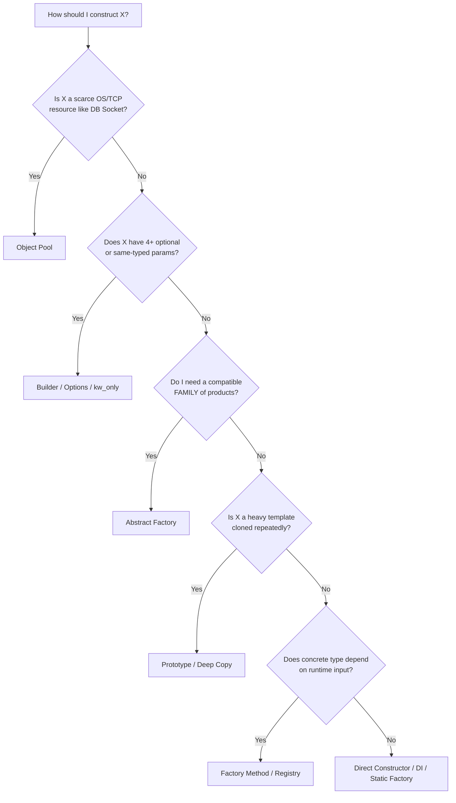

# Creational Patterns Comparison & Decision Matrix

> **One-line summary:** A rapid side-by-side comparison of all Creational Patterns—helping you select the exact instantiation mechanism without over-engineering.

| Attribute | Specification |
|---|---|
| **Level** | Quick Reference / Synthesis |
| **Prerequisites** | [Module 05 Overview](00-overview.md) |
| **Estimated Reading Time** | 15 minutes |
| **Status** | Complete |
| **Category** | Creational Patterns |

---

## 1. Master Comparison Matrix

| Pattern | Intent | Key Trade-off | Modern Language Idiom Shortcut |
|---|---|---|---|
| **Singleton** | Exactly 1 instance globally | Global state harms testability | Prefer **DI Singleton**; in Java `enum` / `Holder` |
| **Factory Method** | Subclass/callable picks 1 concrete product | Extra subclass per product | Pass `Supplier<T>` / `() => T` |
| **Abstract Factory** | Create compatible *families* of products | Hard to add new product types to family | Object literal kit in TS; Protocol in Python |
| **Builder** | Assemble complex immutable object step-by-step | Verbose boilerplate in Java | TS Options `{ ... }`; Python `@dataclass(kw_only=True)` |
| **Prototype** | Clone pre-configured template instance | Shallow copy aliasing bug | TS `structuredClone`; Python `copy.deepcopy`; Java Copy Constructor |
| **Simple / Static Factory** | Named creation method (`ofUsd`) + caching | `switch` violates OCP for open types | Java `List.of()`; Python `@classmethod` |
| **Object Pool** | Reuse scarce OS/TCP/Thread resources | Must guarantee `finally` release & reset | Never pool plain POJOs/DTOs! |
| **Lazy Init & Holder** | Defer heavy optional creation until first read | Don't defer required startup config | Java `Holder` / `volatile` DCL; Python `@cached_property` |
| **Multiton & Registry** | 1 instance per key / OCP plugin lookup | Unbounded keys cause OOM leaks | `ConcurrentHashMap.computeIfAbsent` + LRU for dynamic keys |

---

## 2. Rapid Selection Decision Tree

---

[← Previous: 10 - DI vs Factories](file:///e:/Learning/engineering-notes/08-solid-design-patterns/05-creational-patterns/10-dependency-injection-vs-factories.md) | [Module 05 Index](file:///e:/Learning/engineering-notes/08-solid-design-patterns/05-creational-patterns/README.md) | [Next: Module 06 - Structural Patterns →](file:///e:/Learning/engineering-notes/08-solid-design-patterns/06-structural-patterns/README.md)
