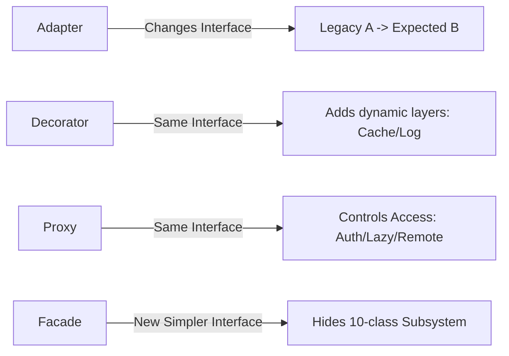

# Structural Design Patterns Overview

> **One-line summary:** Structural patterns compose classes and objects into larger, resilient architectures—bridging incompatible APIs, stacking runtime behaviors, flattening trees, and sharing immutable memory.

| Attribute | Specification |
|---|---|
| **Level** | Core / Foundational |
| **Prerequisites** | [02-composition-vs-inheritance.md](../01-foundations/02-composition-vs-inheritance.md), [04-interface-segregation.md](../02-solid-principles/04-interface-segregation.md) |
| **Estimated Reading Time** | 15 minutes |
| **Status** | Complete |
| **Category** | Structural Patterns |

---

## 1. The Four Wrapper Patterns: Same Shape, Different Intent

Every wrapper pattern delegates work to another object—choosing the right one depends strictly on *why* you are wrapping it.

---

[← Module 06 Index](file:///e:/Learning/engineering-notes/08-solid-design-patterns/06-structural-patterns/README.md) | [Next: 01 - Adapter Pattern →](file:///e:/Learning/engineering-notes/08-solid-design-patterns/06-structural-patterns/01-adapter.md)
