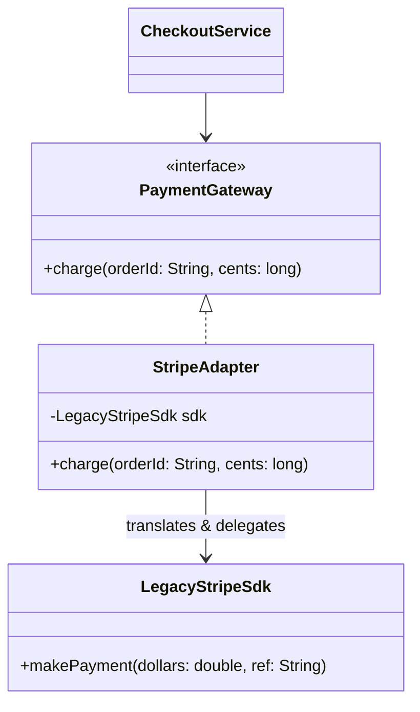

# Adapter Pattern

> **One-line summary:** Convert the incompatible interface of an existing, legacy, or third-party class into the clean interface your domain expects—allowing incompatible collaborators to work together without modifying source code.

| Attribute | Specification |
|---|---|
| **Level** | Core / GoF Structural |
| **Prerequisites** | [04-programming-to-interfaces.md](../01-foundations/04-programming-to-interfaces.md), [05-dependency-inversion.md](../02-solid-principles/05-dependency-inversion.md) |
| **Estimated Reading Time** | 30 minutes |
| **Status** | Complete |
| **Category** | Structural |
| **Origin** | GoF 1994 |
| **Also Known As** | Wrapper Pattern, Anti-Corruption Layer (DDD Adapter) |
| **Languages Tested** | Java 25 (LTS) / TypeScript 5.8 (Node 24 native) / Python 3.14 |

---

## Table of Contents
- [1 The Problem](#1-the-problem)
- [2 Why It Exists](#2-why-it-exists)
- [3 What It Is](#3-what-it-is)
- [4 The Problem Without It](#4-the-problem-without-it)
- [5 How It Solves It](#5-how-it-solves-it)
- [6 How It Works](#6-how-it-works)
- [7 Real-World Examples](#7-real-world-examples)
- [8 When to Use and When NOT to Use](#8-when-to-use-and-when-not-to-use)
- [9 Variations and Language Idioms](#9-variations-and-language-idioms)
- [10 Relationship to Other Principles and Patterns](#10-relationship-to-other-principles-and-patterns)
- [11 Common Mistakes and Anti-Patterns](#11-common-mistakes-and-anti-patterns)
- [12 Testing and Design Verification](#12-testing-and-design-verification)
- [13 Performance, Concurrency and Security Notes](#13-performance-concurrency-and-security-notes)
- [14 Interview Questions](#14-interview-questions)
- [15 Practice Exercises](#15-practice-exercises)
- [16 Summary / Cheat Sheet](#16-summary--cheat-sheet)
- [17 Further Reading](#17-further-reading)

---

## 1 The Problem

Imagine your checkout domain uses a clean, currency-safe `PaymentGateway` interface (`charge(String orderId, long cents)`). Now your company acquires a vendor whose legacy payment SDK (`LegacyStripeSdk`) exposes `makePayment(double dollars, String ref)`—incompatible parameter order, `double` dollars instead of `long` cents, and completely different method names.

You **cannot** edit `LegacyStripeSdk` (it is a compiled third-party JAR/npm package). And if you rewrite your 30 domain checkout classes to call `makePayment(double, String)` directly, every floating-point rounding bug and vendor SDK upgrade leaks directly into your core domain!

---

## 2 Why It Exists

Formulated by the **Gang of Four (1994)** (analogous to a physical EU-to-US power plug adapter): an **Adapter** translates calls from your clean target interface into the incompatible interface of an existing Adaptee, protecting domain code from third-party API churn.

---

## 3 What It Is



---

## 4 The Problem Without It

```java
// Violation: Domain checkout service imports & calls incompatible vendor SDK directly!
class CheckoutViolation {
    private final LegacyStripeSdk sdk = new LegacyStripeSdk();
    public void checkout(String orderId, long cents) {
        // Domain polluted with vendor method names & unit conversions everywhere!
        sdk.makePayment(cents / 100.0, orderId);
    }
}
```

---

## 5 How It Solves It

### Java Implementation (Java 25 LTS — Object Adapter)

```java
package com.design.patterns.structural.adapter;

interface PaymentGateway {
    void charge(String orderId, long cents);
}

// Incompatible Third-Party / Legacy Adaptee (Cannot modify!)
class LegacyStripeSdk {
    public void makePayment(double dollars, String ref) {
        System.out.println("Java Adapter -> LegacyStripe charged $" + dollars + " ref=" + ref);
    }
}

// Adapter translates PaymentGateway -> LegacyStripeSdk
class StripeAdapter implements PaymentGateway {
    private final LegacyStripeSdk sdk;

    public StripeAdapter(LegacyStripeSdk sdk) {
        this.sdk = sdk;
    }

    @Override
    public void charge(String orderId, long cents) {
        double dollars = cents / 100.0;
        sdk.makePayment(dollars, orderId);
    }
}
```

### TypeScript Implementation (Node 24 Native)

```typescript
interface PaymentGateway {
    charge(orderId: string, cents: number): void;
}

class LegacyStripeSdk {
    makePayment(dollars: number, ref: string): void {
        console.log(`TS Adapter -> LegacyStripe charged $${dollars} ref=${ref}`);
    }
}

class StripeAdapter implements PaymentGateway {
    private readonly sdk: LegacyStripeSdk;
    constructor(sdk: LegacyStripeSdk) { this.sdk = sdk; }
    charge(orderId: string, cents: number): void {
        this.sdk.makePayment(cents / 100, orderId);
    }
}
```

### Python Implementation (Python 3.14)

```python
from typing import Protocol

class PaymentGateway(Protocol):
    def charge(self, order_id: str, cents: int) -> None: ...

class LegacyStripeSdk:
    def make_payment(self, dollars: float, ref: str) -> None:
        print(f"Python Adapter -> LegacyStripe charged ${dollars} ref={ref}")

class StripeAdapter:
    def __init__(self, sdk: LegacyStripeSdk) -> None:
        self._sdk = sdk

    def charge(self, order_id: str, cents: int) -> None:
        self._sdk.make_payment(cents / 100.0, order_id)
```

### Real Execution Output
```text
Java Adapter -> LegacyStripe charged $25.99 ref=ORD-1
```

---

## 6 How It Works: Object Adapter vs. Class Adapter

1. **Object Adapter (Preferred — Composition):** `StripeAdapter` holds a reference to `LegacyStripeSdk` via composition—works across all languages (Java, TS, Python) and lets you adapt subclasses too.
2. **Class Adapter (Multiple Inheritance):** Inherits from both `Target` and `Adaptee` (possible in Python/C++, impossible with two classes in Java/TS). Avoid unless specifically overriding protected methods.

---

## 7 Real-World Examples

1. **Java `java.io.InputStreamReader(InputStream)` & `OutputStreamWriter(OutputStream)`**: Adapts byte streams (`InputStream`) to character streams (`Reader`).
2. **Java `Arrays.asList(array)`**: Adapts a fixed array into a `List` view.
3. **Hexagonal Architecture (Ports & Adapters)**: Every repository/gateway adapter (`PostgresOrderAdapter`, `S3StorageAdapter`) implements a domain Port interface!

---

## 8 When to Use and When NOT to Use

| Context | Use Adapter? | Rationale |
|---|---|---|
| **Integrating third-party SDKs or legacy systems** | **Yes** | Protects domain from vendor churn (Anti-Corruption Layer). |
| **Code you own inside the same module** | **NO (Refactor Directly!)** | Don't leave messy interfaces around and wrap them in adapters if you can just fix the signature directly. |

---

## 9 Variations and Language Idioms

- **Two-Way Adapter:** Implements both `TargetA` and `TargetB` interfaces to bridge two systems simultaneously.
- **Functional Adapter:** In TypeScript/Python, a 1-line closure `const gateway: PaymentGateway = { charge: (id, c) => sdk.makePayment(c / 100, id) }` eliminates boilerplate!

---

## 10 Relationship to Other Principles and Patterns

- **DIP & OCP:** Adapter is the mechanical bridge enabling DIP (translating domain Port to third-party Adaptee).
- **Anti-Corruption Layer (DDD):** A macro-level Adapter translating external legacy domain models into clean bounded-context models.

---

## 11 Common Mistakes and Anti-Patterns

| Anti-Pattern | Description | Production Consequence | Correct Remedy |
|---|---|---|---|
| **Adapter for Code You Own** | Wrapping your own internal class in an Adapter instead of fixing its method signature. | Unnecessary layer bloat. | Refactor your own class directly. |
| **Leaking Vendor Exceptions** | `StripeAdapter.charge()` letting `StripeNetworkException` propagate raw to domain. | Couples domain catch blocks to Stripe SDK! | Translate vendor exceptions into domain `PaymentException`. |
| **Using Class Adapter (Inheritance)** | Subclassing `LegacySdk` just to adapt its interface. | Exposes legacy public methods to callers! | Prefer Object Adapter (Composition). |
| **Putting Business Logic in Adapter** | Adding discount/tax rules inside `StripeAdapter`. | Violates SRP; invisible to domain tests. | Keep adapters strictly thin translators. |
| **Stateful Adapter Caching** | Storing mutable transaction state in Adapter fields. | Concurrency bugs when Adapter is a singleton. | Keep adapters stateless. |
| **Missing Unit Precision Guards** | Converting `cents` to `double` without rounding/BigDecimal where required. | Floating-point precision loss. | Use `BigDecimal` for real monetary conversions. |

---

## 12 Testing and Design Verification

Test the Adapter with a mock/fake `LegacyStripeSdk` verifying parameter translation (`2599` cents $\to$ `25.99` dollars) and exception translation.

---

## 13 Performance, Concurrency and Security Notes

- **Security:** Sanitize and validate untrusted third-party responses inside the Adapter (Anti-Corruption boundary) before returning domain objects.

---

## 14 Interview Questions

<details>
<summary><strong>1. What is the difference between Object Adapter and Class Adapter?</strong></summary>

**Object Adapter** uses **composition** (holding an instance of the Adaptee and delegating to it); **Class Adapter** uses **multiple inheritance** (inheriting from both Target and Adaptee). Object Adapter is strongly preferred because it follows composition over inheritance and works in single-inheritance languages like Java/TS.
</details>

<details>
<summary><strong>2. How does Adapter differ from Decorator and Proxy?</strong></summary>

**Adapter** *changes* an incompatible interface into the expected interface. **Decorator** and **Proxy** keep the *exact same* interface while adding behavior or controlling access.
</details>

<details>
<summary><strong>3. Give a real JDK example of the Adapter pattern.</strong></summary>

`java.io.InputStreamReader` adapts an `InputStream` (bytes) into a `Reader` (characters); `Arrays.asList(T[])` adapts an array into a `List<T>`.
</details>

<details>
<summary><strong>4. Why should an Adapter also translate third-party exceptions?</strong></summary>

If `StripeAdapter` lets raw `com.stripe.exception.CardException` leak out, domain callers must import Stripe SDK packages to catch it—breaking DIP! Translate vendor exceptions into domain exceptions (`PaymentDeclinedException`).
</details>

<details>
<summary><strong>5. When is writing an Adapter an anti-pattern?</strong></summary>

When both the caller and callee are internal modules you fully own and can refactor directly—don't pile Adapters on top of your own messy code instead of cleaning it up.
</details>

<details>
<summary><strong>6. What is an "Anti-Corruption Layer" (ACL) in Domain-Driven Design?</strong></summary>

An architectural boundary built with Adapters and Translators that prevents an external legacy system's messy data models and semantics from polluting a clean new domain model.
</details>

<details>
<summary><strong>7. How can you implement an Adapter without creating a class in TypeScript or Python?</strong></summary>

Using a lightweight adapter function or object literal closure: `const adapter = (id: string, cents: number) => sdk.makePayment(cents / 100, id);`.
</details>

<details>
<summary><strong>8. What is the difference between Adapter and Facade?</strong></summary>

Adapter converts *one* existing incompatible interface to match a target interface; Facade creates a *brand-new simplified* interface over a complex multi-class subsystem.
</details>

---

## 15 Practice Exercises

### Exercise 1: Identify Adapter vs Facade (Easy)
Wrapping `XmlParser`, `HttpTransport`, and `OAuthSigner` behind `sendInvoice(Invoice)`—is this Adapter or Facade?

<details>
<summary><strong>Solution</strong></summary>

**Facade** (simplifying a multi-class subsystem behind a unified API).
</details>

---

### Exercise 2: Add Exception Translation to `StripeAdapter` (Medium)
Wrap `sdk.makePayment(...)` in `try/catch (RuntimeException e)` inside `StripeAdapter` and throw a domain `PaymentGatewayException`.

<details>
<summary><strong>Solution</strong></summary>

`try { sdk.makePayment(cents / 100.0, orderId); } catch (RuntimeException e) { throw new PaymentGatewayException("Stripe failed for " + orderId, e); }`
</details>

---

### Exercise 3: Two-Way Logger Adapter in Python (Hard)
Adapt a third-party `LegacyLogWriter.write_raw(severity_int, text)` into a `Logger.info(msg)` / `Logger.error(msg)` protocol.

<details>
<summary><strong>Solution</strong></summary>

`class LegacyLoggerAdapter: def info(self, msg: str): self._legacy.write_raw(1, msg); def error(self, msg: str): self._legacy.write_raw(3, msg)`.
</details>

---

## 16 Summary / Cheat Sheet

```
+--------------------------------------------------------------------------+
|                             ADAPTER PATTERN                              |
+--------------------------------------------------------------------------+
| INTENT     : Translate incompatible interface A into expected interface B|
| PREFER     : Object Adapter (Composition) over Class Adapter.            |
| DON'T FORGET: Translate vendor exceptions too (Anti-Corruption Layer)!   |
+--------------------------------------------------------------------------+
```

---

## 17 Further Reading

- Erich Gamma et al., *Design Patterns*, Addison-Wesley, 1994.
- Eric Evans, *Domain-Driven Design* (Anti-Corruption Layer), Addison-Wesley, 2003.

### In Your Language
| Language Track | Deep Dive Reference |
|---|---|
| Java | [Java OOP & Design Patterns](file:///e:/Learning/engineering-notes/01-languages/java/24-design-patterns/README.md) |
| TypeScript | [TypeScript Design Patterns](file:///e:/Learning/engineering-notes/01-languages/typescript/17-design-patterns/README.md) |
| Python | [Python Design Patterns](file:///e:/Learning/engineering-notes/01-languages/python/23-design-patterns/README.md) |

---

[← Previous: 00 - Structural Overview](file:///e:/Learning/engineering-notes/08-solid-design-patterns/06-structural-patterns/00-overview.md) | [Module 06 Index](file:///e:/Learning/engineering-notes/08-solid-design-patterns/06-structural-patterns/README.md) | [Next: 02 - Bridge Pattern →](file:///e:/Learning/engineering-notes/08-solid-design-patterns/06-structural-patterns/02-bridge.md)
